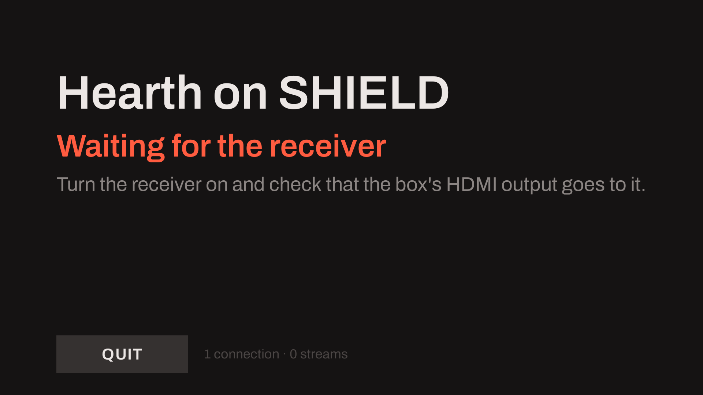
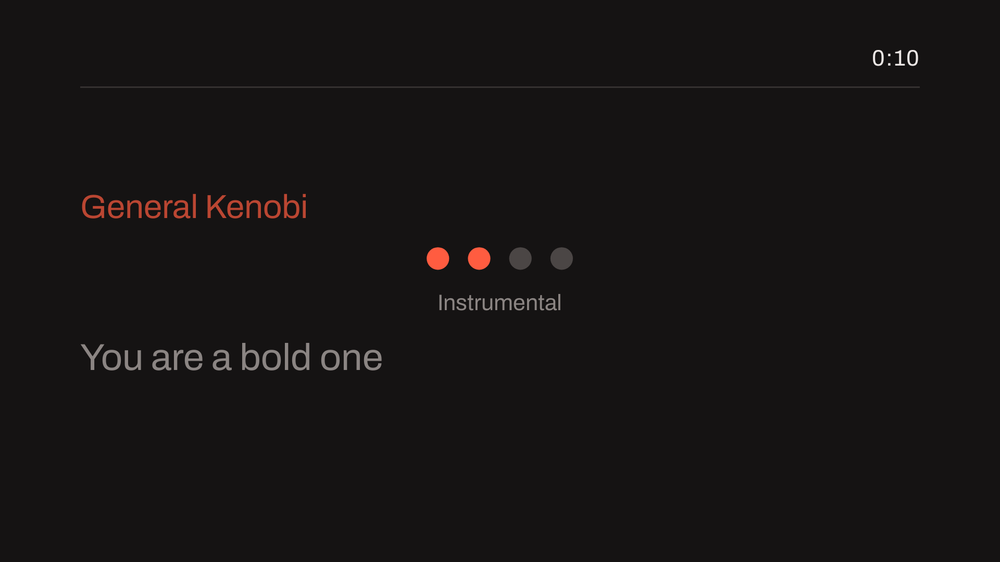
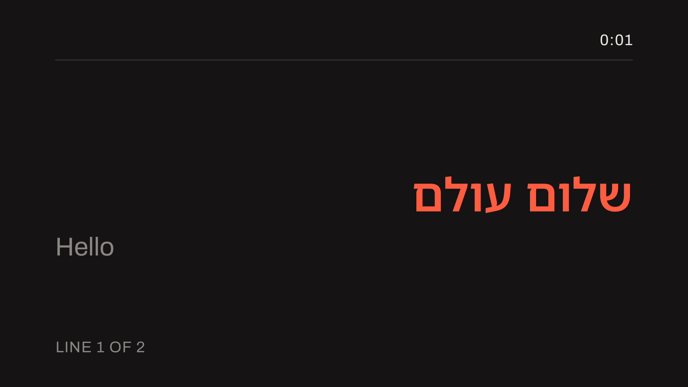
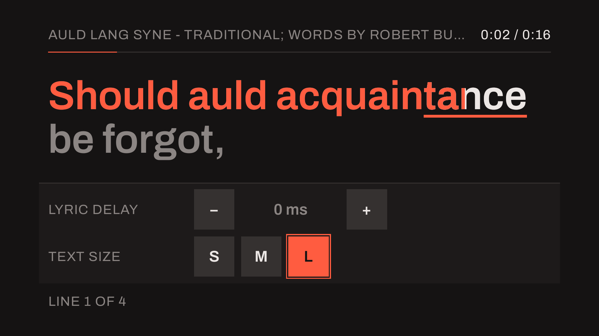
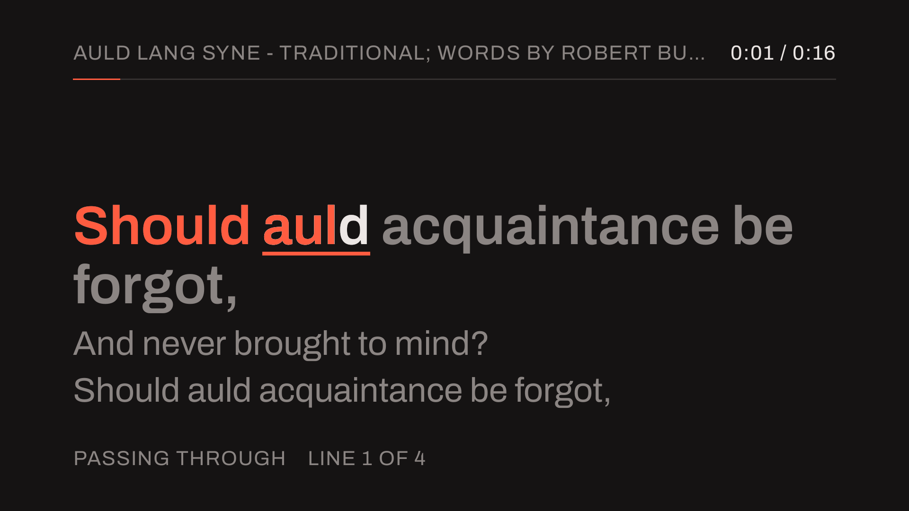
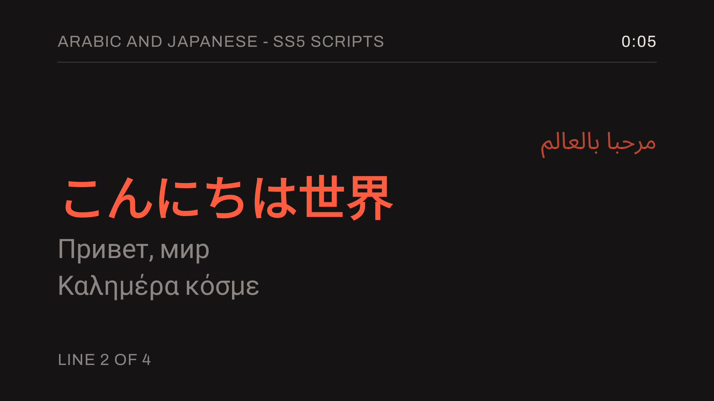
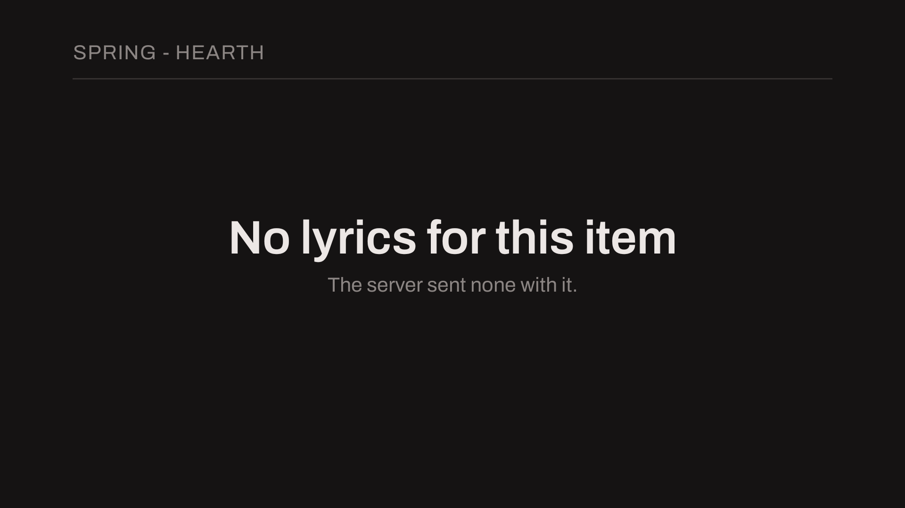
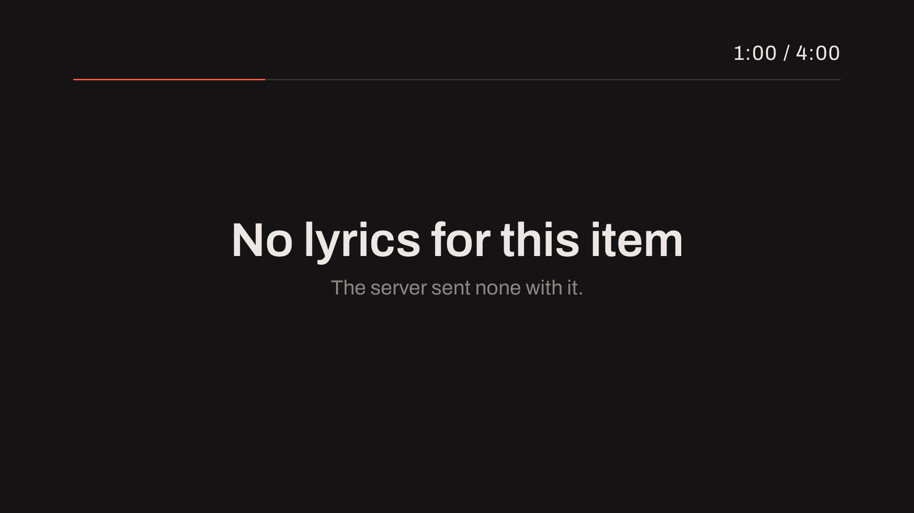

# Hearth for Android

A Sendspin **sink** for Android TV: it is advertised on the network, paired with from Hearth, and
plays what Hearth sends it. The plan is [`planning/hearth-android.md`](../../../planning/hearth-android.md)
and the one screen design it, the desktop Hearth and the ESP32-P4X panel share is
[`planning/hearth-sink-screen.md`](../../../planning/hearth-sink-screen.md).

**State: phases 0 to 3, and the protocol additions D6, D7 and D8.** The service, the advertisement,
the listener, the pairing records and the pass-through output are here: an AC-3 or E-AC-3 stream a
Hearth sends is rebuilt into the IEC 61937 bursts it came from and written to the receiver, between
null bursts, in the slot each is due in, and [one run on a Shield and a receiver](#a-run-on-a-shield-and-a-receiver-phase-1e)
is recorded below. The sink core follows a karaoke item's lyrics on its own clock and
[the lyric screen](#the-lyric-screen-phase-2) draws them, held to the spec's fixtures at fixed
positions. [The starting, idle and attention screens](#the-status-screens-phase-3c), the controls
sheet and its D-pad focus walk, and the family's tokens (one file, `Tokens.kt` generated from it)
are the common design, and a pairing code the server asks for in its QR form is drawn as a QR. The route a stream takes is reported to the server and drawn as a chip
(D6); what is playing comes from the server's `metadata@v1` (D7); and the remote's vocals row asks
the server for the singer's karaoke choice (D8).

What it does not do yet: decode locally for karaoke (phase 4), and play `player@v1`'s PCM, FLAC and
Opus (5): a stream of those is accepted and dropped. A first-run screen is not built. AC-4 is not listed: nothing has shown a receiver decoding it over
this route. Phases 4 and 5 are planned in
[`planning/hearth-android-phases-4-5.md`](../../../planning/hearth-android-phases-4-5.md).

| Part | Where |
|---|---|
| The sink: listener, pairing, admission, the roles | `libs/sink` (`iclforge::sink`), on `libs/sendspin` |
| The pass-through output and its tests: the rebuild, the slots, the null bursts | `libs/sink` (`iclforge::sink_passthrough`) |
| The app's own native library: JNI over one sink, and its link to the `AudioTrack` | `app/src/main/cpp` |
| The service, the advertisement (`NsdManager`), audio focus and the screen | `app/src/main/java/com/iclforge/hearth` |
| The `AudioTrack` that carries the bursts | `PassthroughBridge.kt` (the backend in `libs/audio` calls it by name) |

## Build

The native side links `libs/sendspin`, whose packages come from vcpkg's `hearth` feature, so the
build needs a vcpkg checkout and the NDK, which Gradle's own toolchain does not have:

```sh
export VCPKG_ROOT=/path/to/vcpkg          # a checkout of the commit tools/ci pins
cd apps/hearth/android
./gradlew :app:assembleDebug              # app/build/outputs/apk/debug/app-debug.apk
```

`app/src/main/cpp/CMakeLists.txt` puts vcpkg in front of the NDK's toolchain and says why; the first
build compiles the ports (about 25 minutes cold) and vcpkg's binary cache keeps them after. The NDK
(26.1) and CMake (3.31.6) are pinned in `app/build.gradle.kts`, and the SDK's path is in
`local.properties`, which is not committed.

Install on a TV box with `adb install -r app/build/outputs/apk/debug/app-debug.apk`. The sink is
`Hearth on <the box's name>`; a server's `_sendspin._tcp` browse finds it, and the pairing code it
asks for is shown on the screen and written to logcat under the tag `HearthSink`.

## Tests

The pass-through path, end to end (planning/hearth-android.md, AR1): a Sendspin server session packs a
Dolby-encoded fixture into IEC 61937 bursts the way Hearth's server does, sends each over a loopback
WebSocket to the sink with the pass-through output over a model of the Shield's device, and the bursts
the device was handed are compared, byte for byte and in order, with the ones the packer wrote.

| Where | How |
|---|---|
| The host | `ctest -L end-to-end` (`libs/sink/tests/test_end_to_end.cpp`): five fixtures, about seven seconds each |
| A device or an emulator | `./gradlew :app:connectedDebugAndroidTest` (`PassthroughPathInstrumentedTest`): three fixtures, the harness's JNI entry compiled into the debug build only |
| A device, without Gradle | the preset's `iclforge-sink-tests` pushed with `adb`, and `ICLFORGE_FIXTURE_ROOT` naming a directory that holds `external-baseline/` and `object-fixture/` |

Nothing in them needs an HDMI route or a receiver. The debug build carries `x86_64` beside `arm64-v8a`,
for the emulator CI runs them on; a run on one device builds one ABI with
`-Pandroid.injected.build.abi=arm64-v8a`.

## The status screens (phase 3c)

When there are no words to show the app's screen is one of three
([`planning/hearth-sink-screen.md`](../../../planning/hearth-sink-screen.md), S0, S1 and S10), chosen
by `StatusScreens.choose()` from what the app knows:

| Screen | When | Says |
|---|---|---|
| **S10 attention** | the sink did not start; the receiver would not take a stream (`isDirectPlaybackSupported` false at an open); the link dropped under a stream (`ERROR_DEAD_OBJECT`) and has not opened again within 20 s | one sentence of what happened and what to do; over a lyric it is a banner at the foot and the line being sung stays above it, dimmed |
| **S0 starting** | the sink is not up, or the box has no address (waiting for the network); or the HDMI route takes neither burst form (waiting for the receiver) | the name, what it waits for, and what to check |
| **S1 idle** | otherwise | the name large, the address, the port and the kind of network; "Paired with *server*", or "Waiting for a server" and how to choose this sink; and **the code a server asked to pair by, large, in the accent**; the formats the route takes ("Passes through Dolby Digital · Dolby Digital Plus") |

What they read: the core's `Sink::status()` (who is connected and for what, the pairing code, the number
of paired servers; `NativeSink.statusJson()`), the active network's address and kind
(`ConnectivityManager`), the route (`AudioTrack.isDirectPlaybackSupported`, quietly, twice a second) and
`LinkHealth`, which the pass-through bridge writes when a link is refused or lost. The pairing code
comes from the core and no longer from reading the log. **Quit** is the screen's one control, with the
family's focus ring, and the D-pad's centre presses it; the foot also carries a small muted note
(the advertiser's trouble, when it has one). Not here: the layout line (a pass-through sink has none);
the QR for a server that asks for it is described below.





`StatusScreenTest` holds the choice (a table of what outranks what), the news's twenty seconds and the
open that undoes it, the native status as the JNI writes it (read by the parser), and each screen drawn at
1080p and probed (the code is the accent, the sentence is a banner over a dimmed lyric, Quit has the ring
and the centre presses it).

**The pairing code as a QR (S1).** A server that asks to pair by a dynamic code may ask for its QR
form, the `SP:1` token; the idle screen then draws a QR at the right, large, on a light card (a scanner
wants dark on light, and the card's margin is the standard's four-module quiet zone), with the token
under it for a person who would type it. The encoder is `QrCode.kt`: byte mode, error correction
level M, versions 1 to 6 (up to 106 bytes; the token is 43, version 4), no dependency, and a token too
long for it is shown as text and not as a wrong code. It is held by structure tests on the Shield (the
finder and timing patterns, the dark module, a format word that is a valid BCH codeword for level M, the
size of each version and the limit) and by an independent decoder: `tools/hearth/check_qr_matrices.py`
decodes the matrices `QrCodeTest` writes with OpenCV (16 of 16 payloads, versions 1 to 6, UTF-8
included), the token's matrix is pinned after that, and the whole 1080p idle-screen picture decodes to
the token at full size and at half and 0.35 scale (a phone camera's view of a TV). **Not tested:** a
phone's own scanner app and a real server's pairing flow with the QR form of the code.


## The lyric screen (phase 2)

When a document is held or a stream is playing, the app's one screen is the lyric view
([`planning/hearth-sink-screen.md`](../../../planning/hearth-sink-screen.md), S2 to S8): the past line,
the line being sung with the fill running through it, the next lines, a duet's two vocals, the count-in
of an instrumental gap, a line timed as a whole, plain text, "no lyrics" after a one-second grace, and
each line in its own direction. It draws one `LyricFrame` the sink's core answers
(`NativeSink.lyricFrame(delayMs)`, 30 times a second while a word is sung, 5 while a line is shown, 1
otherwise): the document the server sent, followed on the sink's own clock by the server's anchors, less
the singer's delay. Sizes are in `u`, a 600th of the height, and the colours are the family's, always
dark; the faces are the shared theme's (Archivo, with Noto Sans Hebrew and Arabic, and the system's for
Greek, Cyrillic and CJK).





**Controls** ([S9](../../../planning/hearth-sink-screen.md#the-screens)): the D-pad's centre (or a tap)
opens a sheet over the foot of the stage: the lyric delay's "-" and "+", and the text size, S, M and L. The
four directions move a focus ring (the accent, 2 u wide and 2 u out) through them, the centre presses the
one it is on, Back closes it, and it hides itself after eight seconds without a key; a file with no times
has no delay row. The delay (kept, -1,000 to +1,000 ms in 50 ms steps, drawn in the footer when it is not
0) and the text size (kept) are what a sink owns of its screen; the vocals and the reproduction are the
server's, which the sheet can only **ask** for (the vocals row below). With the sheet down, left and right
still nudge the delay by 50 ms and up and down scroll a file with no times.

**The vocals row (D8).** While a stream is open the sheet has a row between the delay and the size: Both,
V1, V2 and None. The centre on one asks the server for it (`NativeSink.requestVocals`, a `client/command`
request, [the spec's Requests](../../../planning/hearth-sendspin-extension.md#requests)), as the capable
reproduction with those vocals for V1, V2 and None, since the choice of vocals is read by that
reproduction alone, and as the aware reproduction for Both, which plays both voices as the song's mix
does (`sink::vocals_request`, the owner's call of 2026-10-13). It is advice with no answer: the row fills what was asked and not what is playing, and **this sink hands the
receiver the coded bits, so it plays every vocal whatever the server decides** (the spec's SS7). What a
press changes is what the server's own screens show and what the group's decoding members play, and it
changes nothing this TV hears until the app decodes for itself (phase 4); the row says so beside the
buttons while the route is passing through. The server applies it only when the sink is in the group it
is playing to. It was held by the focus walk on the Shield; a press reaching a real server's Karaoke page
has not been run.




**The route chip (D6).** While a stream is open the footer's first chip says how it leaves this sink:
"Passing through" when the output hands the coded bits to the receiver (what this app's output always
does), "Decoded here" for an output that decodes. It is the extension role's `output` state, which the
sink core sends to the server in `client/state` and puts in its own status (`Sink::Status::Peer::output`,
`NativeSink.statusJson()`'s `"output"`), and it is absent, and so is the chip, with no stream open, with
one the output did not take (the receiver's route was gone at the start), and for a sink that does not
say. The sink core's half is held by a loopback case in `iclforge-sink-tests` (a server reads the key
in `client/state`, the status says the same, and a stream the output did not take says nothing); the chip
is held by `LyricViewRenderTest`. The app's own JNI JSON is read by `StatusScreenTest` from a canned
object: a real server's run to a Shield has not been made.

**The format, beside the route.** The output reads the stream's first syncframe and the role reports what
it found (`decoder`: the codec, the coding mode, the LFE, the objects). The status carries it per
connection (`Sink::Status::Peer::decoder`, written by `sink::status_json` in `libs/sink`, which a host
case holds, not only the app) and the footer joins it to the route in one chip: "Dolby Digital 5.1 ·
Passing through", "Dolby Digital Plus 5.1 + objects · Passing through". The name is `StreamFormat.name`:
the codec, the front channels and the LFE from the coding mode ("1+1" for two programmes), and "+ objects"
for a stream that carries them. It is the format alone when the sink does not say the route, nothing for a
codec the screen has no word for, and gone with the stream.




**How it is checked.** `LyricViewRenderTest` (`src/androidTest`) takes the karaoke examples' documents
(`examples/karaoke`, staged by Gradle) through the library's own frame (`Harness.lyricFrameJson`: the
pure half of `Sink::lyric_frame()`), the parse and the view, draws it to a 1920 by 1080 bitmap with no
display and no server, writes the picture to the app's external files directory (`lyric-renders/`), and
probes the pixels where the spec puts things: the fill grows with the fraction and the word is
underlined, a line stays inside the margins, a duet's second vocal is indented, the dots go out, a
line-timed file draws no word, "no lyrics" waits its grace, a Hebrew line is at the right edge and a
line in no face's script is said and not drawn. It runs on an emulator and on a TV box that is asleep:

```sh
./gradlew :app:assembleDebug :app:assembleDebugAndroidTest '-Pandroid.injected.build.abi=arm64-v8a'
adb install -r -t app/build/intermediates/apk/debug/app-debug.apk
adb install -r -t app/build/intermediates/apk/androidTest/debug/app-debug-androidTest.apk
adb shell am instrument -w -e class com.iclforge.hearth.LyricViewRenderTest \
    com.iclforge.hearth.test/androidx.test.runner.AndroidJUnitRunner
adb pull /sdcard/Android/data/com.iclforge.hearth/files/lyric-renders
```

**Conformance (2c).** The spec's fixtures are held at fixed positions by one checked-in file:
`libs/sink/tests/lyric-frames/cases.txt` lists each document (the karaoke examples, a file timed as lines,
a plain one, lines of 18, 36, 44, 54 and 55 characters, a gap of 3.9 s and one of 4.0 s, Hebrew and
Yiddish in UTF-8 and UTF-16, Arabic, Japanese, Cyrillic and Greek) with its positions and delay, and
`golden.txt` holds the 48 frames the library gives for them. `iclforge-sink-tests` and
`LyricConformanceTest` (on the device, with this build of the library) compare their frames with it, so a
renderer's test and the library agree; `ICLFORGE_UPDATE_LYRIC_FRAMES=1` rewrites it, and a frame that
moved is a decision to read in the diff. On the Shield's own faces the same test draws the scripts of
tiers T1 to T4: Greek and Cyrillic by the system's face, Hebrew and Yiddish (the digraph letters and
points) right to left in Noto Sans Hebrew, Arabic shaped (joined letters are narrower than the same
letters kept apart by a zero-width non-joiner) in Noto Sans Arabic, and Japanese by the system's face; a
line no face has is the sentence. The length rule's five steps are asserted on the size the view chose
(72, 64, 56, 48 and 40 u), and the text-size step moves each one.



**The idle guard.** A sink holds the display on, and an OLED TV is the reason the spec asks for what
holds still to be moved: once nothing on the screen (the pairing screen or the lyric view, a paused song
included) has changed for two minutes, it dims to 40% and moves 6 u a minute round a small ring; a key or
a touch brings it back (`IdleGuard`, held by `LyricConformanceTest`). **Reduced motion** has nothing to
switch off: the only thing that moves is the fill, which the spec keeps, and the count-in's dots go out in
steps and do not fade.

**The item's name when it has no lyrics (D7).** The sink lists `metadata@v1`, keeps what each server says is
playing, and `Sink::lyric_frame()` fills the frame's title, artist and album from it: what the server says
comes first and the document's own `[ti:]`, `[ar:]` and `[al:]` are the fallback. The header then names an
item that has no lyrics, over the "No lyrics for this item" sentence (S7). What Hearth's engine sends is its
own: the lyrics file's tags where it has them, otherwise the name its queue shows, and no artist or album
for an item with no lyrics file, since nothing reads a tag from a stream or a container. The sink core's half
is held by a loopback case (no document and no title, the server's title, the server's title over a
document's, and the document's once the server clears it) and the header by `LyricViewRenderTest`; a
real server's `metadata@v1` to a Shield has not been run.



**Its time, too.** The same `metadata@v1` says where the item is: the sink computes the position at the
sink's own time on the server's clock (`metadata::position_ms`, a pause keeps it), and for an item with no
document, or one that is plain text, the header draws that time and the item's length at the right and the
hairline under it fills by it, as it does for a timed document. A timed document keeps its own playhead;
the server's length fills the one a file does not name with `[length:]`. The frame carries `progress` when
the position is the server's, which the screen reads, and the view polls twice a second while it is, so a
second is neither shown twice nor skipped. Nothing is drawn before the sink's clock has converged on the
server's, which is a few seconds after the stream starts.



To see it live, `hearth-testserver --lyrics examples/karaoke/auld-lang-syne/auld-lang-syne.lrc
--play examples/karaoke/auld-lang-syne/auld-lang-syne.ac3 --player ws://<the Shield>:8928/sendspin ...`
sends the sink the document and the anchors with the audio. With `--sink <directory>` instead of a
player the same run is made to a reference sink in the test server's own process, which reports what its
core had the sound in (`reference sink: 55 lyric frame(s) on a line, the last at 14279 ms: "And auld
lang syne!"` for that file): the chain from a server's document and anchors, through the time filter, to
the sink's clock, run on the host. It has not been run to a Shield here. **Not shown here:** the pictures on a
television (they are the view's own render at 1080p, not a photograph of a set), and a duet's "you" and
"guide" words (they need the reproduction the singer chose).

## A run on a Shield and a receiver (phase 1e)

Recorded on 2026-10-12 with an NVIDIA Shield TV (2019, Android 11) on an HDMI input of an Onkyo TX-RZ740, the
receiver feeding a TV, and a Windows host on the same LAN running `hearth-testserver` built from this tree.
The debug APK was installed with `adb install -r -t`. Nothing on the receiver was set: it was only queried
over eISCP (`!1IFAQSTN`, port 60128), and what it said is below.

| Programme | The receiver said | Played | Underruns | Late (dropped) |
|---|---|---|---|---|
| AC-3 5.1, 448 kb/s, 121 s | `HDMI 6, Dolby Audio - DD, 48 kHz, 5.1 ch`, from about 2 s after the first burst to the end | 3790 of 3792 | 0 | 2 |
| E-AC-3 5.1, 256 kb/s, 121 s | `HDMI 6, Dolby Audio - DD+, 48 kHz, 5.1 ch`, from about 2 s after the first burst to the end | 3792 of 3792 | 0 | 0 |

What else the runs showed:

- **Ten AC-3 runs of 20 to 121 s and the E-AC-3 one: no underrun in any.** In three of the ten AC-3 runs the
  output dropped two or three consecutive bursts as late, each at a stream age of 9.1 to 9.2 s (the
  receiver stayed locked); the other seven AC-3 runs and the E-AC-3 run dropped none. The cause is not
  known. The output notes a step of more than 8 ms in the sync filter's offset (`time offset moved`, in
  logcat under `HearthPassthrough`), which is the first thing the next occurrence will say; it did not fire
  in the four runs made with it, none of which dropped.
- **A link that goes away costs bursts, and they are counted.** With the TV off, the receiver's HDMI output
  had no display and it pulsed the Shield's input low for about 3 s every 20.5 s. Each pulse made the
  route disappear and the `AudioTrack` die (`ERROR_DEAD_OBJECT`); the output opened it again within about
  3 s and the receiver locked again, with no crash. A 45 s AC-3 run then played 1089 of 1422 bursts. The
  bursts waiting while the link was down were cleared without being counted, so the first of those runs
  reported none late and none dropped; they are counted as dropped now (1089 played and 333 dropped).
- **Not shown here:** Atmos lock (it needs a signed stream, and none was played), AC-4 (not listed over this
  route), another receiver, and relock after a change of input.
- **Open:** a second run of the test server against a sink it had already paired with, with the same
  `--state` directory, timed out in pairing (the sink showed a code and the server never asked for it); each
  run above used a new state directory.

To repeat one run: a file that receives the app's logcat (`HearthSink` lines), and

```sh
hearth-testserver --player ws://<the Shield>:8928/sendspin --label shield --code-log <that file> \
    --play testdata/external-baseline/ac3-51-448/dee.ac3 --seconds 120 --state <a new directory> \
    --report report.json
```

The server measures the log file's size when it asks for the code and then reads the first `PAIRING CODE`
line after it; on a LAN the sink's line is faster than that, so hold each line back half a second. The
`hearth-testserver` line `N bursts played of M, K underruns, L late, D dropped` is the count.

## What else is checked

`tools/checks/check_android_jni.py` holds the package, the `external fun`s and the native symbol
names to each other without a device. CI's `build-android-hearth` job builds the APK
(`.github/workflows/_build.yml`).
