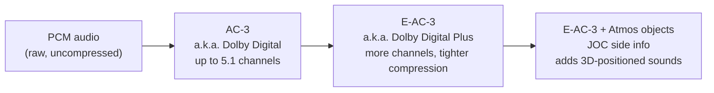

# Concepts

This section explains the audio formats used by ICL Forge. It assumes no codec or digital-signal
processing knowledge.

The rest of the documentation ([Library](../library/index.md), [CLI](../forge/cli/index.md),
[GUI](../forge/gui/index.md)) shows you how ICL Forge implements these ideas in software. This
section only explains what the ideas *are*.

## Why compress multichannel audio at all?

A CD track is stereo: two channels of **PCM** (pulse-code modulation — audio stored as a
plain sequence of sample values, with nothing squeezed out) audio. A film or TV soundtrack
usually carries more: six channels for "5.1" surround, eight for "7.1", sometimes more.

Six to eight uncompressed channels is a lot of data — too much to fit comfortably on a DVD,
inside a broadcast signal, or down a streaming pipe alongside the video. Compressed
multichannel audio formats exist to squeeze all of those channels down to a fraction of their
raw size, in a way a decoder can unpack fast enough to play back in real time, so a disc,
broadcast stream, or download can carry full surround sound without needing six to fourteen
uncompressed tracks.

## One family, three names

The first three formats ICL Forge implements form a single lineage, each one building on the last:

- **AC-3** — better known by its trademarked name **Dolby Digital**. The original: a 1990s
  standard for cinema, DVD, and broadcast, supporting up to 5.1 channels (left, centre,
  right, left-surround, right-surround, plus a bass-only LFE channel).
- **E-AC-3** ("Enhanced AC-3") — better known as **Dolby Digital Plus**. Adds more channel
  layouts (7.1 and beyond) and squeezes harder for the same audio quality, so it fits more
  channels into less bitrate.
- **Dolby Atmos in E-AC-3** — an object layer carried with E-AC-3. It describes sounds as
  *objects* with positions in three-dimensional space. **JOC** (Joint Object Coding) carries
  that object information inside the E-AC-3 stream.

Each arrow is additive: E-AC-3 is AC-3 plus more tools, and Atmos is E-AC-3 plus an object
layer riding on top. A plain Dolby Digital decoder that has never heard of Atmos can still
play an Atmos stream — it just plays the ordinary 5.1 mix underneath and ignores the part it
doesn't understand. The [AC-3 & E-AC-3](ac3-eac3.md) page covers the first two links in that
chain; [Atmos & JOC](atmos-joc.md) covers the third.

## A separate codec: AC-4

**AC-4** is not another link in that chain. It has its own bitstream syntax, defined by ETSI
TS 103 190, so an AC-3 or E-AC-3 decoder cannot read it. A stream can carry several
**presentations**, such as a choice of language or audio description. Its loudness model has the
listening system set the output level, and it codes objects in two ways. The [AC-4](ac4.md) page
covers what it is and how much of it ICL Forge implements.

## A lossless codec: TrueHD and MLP

**TrueHD** (Dolby's lossless format for Blu-ray) and **MLP** (the older form on DVD-Audio) are a
third, unrelated family. They compress without loss: a decoder returns exactly the samples that went
in, at a much higher bit rate than E-AC-3 or AC-4. They have no openly published standard. ICL Forge
reads and writes TrueHD and reads MLP from a specification its owner supplied. The
[TrueHD and MLP](truehd.md) page covers what they are and how much of them ICL Forge implements.

!!! note "Trademarks and standards"
    "Dolby", "Dolby Digital", "Dolby TrueHD" and "Dolby Atmos" are trademarks of Dolby Laboratories.
    ICL Forge implements the openly published standards behind AC-3, E-AC-3, Atmos and AC-4 — ATSC
    A/52:2018 (of which E-AC-3 is normative Annex E), ETSI TS 102 366, ETSI TS 103 420, and ETSI TS
    103 190 (AC-4) — and TrueHD from a specification supplied by the project's owner, using the
    technical names AC-3, E-AC-3, AC-4 and TrueHD throughout its code and docs. It is not
    affiliated with, endorsed by, or certified by Dolby Laboratories.

## Why this project exists

ICL Forge's AC-3, E-AC-3 and AC-4 codecs are a clean-room implementation: built entirely from the
published standards above, not by studying or reusing any existing codec's code. TrueHD has no
published standard, so that codec is written from the owner's specification instead, and the
specification's disagreements with real streams are recorded rather than hidden
([TrueHD and MLP](truehd.md#no-published-standard)). It links no other codec library —
not even to decode. During development, FFmpeg is used only as an independent, external pair
of eyes: AC-3 and E-AC-3 encoder output gets checked against FFmpeg's own decoder as a sanity
check, but the project never depends on FFmpeg to build or run. FFmpeg has no AC-4 decoder, so
AC-4 is checked by other means ([Validation: AC-4](../verification.md#ac-4)); FFmpeg's TrueHD
encoder and decoder are the independent check for TrueHD
([Validation: TrueHD](../verification.md#truehd-and-mlp)). The point is to
understand these formats from first principles, by implementing the standards directly, rather
than to wrap or extend existing tooling.

## Where to go next

- [AC-3 & E-AC-3](ac3-eac3.md) — frames, channel layouts, bitrate, and what E-AC-3 adds over
  plain AC-3.
- [Atmos & JOC](atmos-joc.md) — how object-based audio rides inside an ordinary E-AC-3
  stream, and two limitations of object coding.
- [Object signing](object-signing.md) — the keyed EMDF protection tag a licensed decoder checks
  before reconstructing objects, why the algorithm is in-tree but the key isn't, and how to turn
  it on.
- [AC-4](ac4.md) — a separate codec: frames and presentations, its coding tools, and what the
  library decodes and encodes.
- [TrueHD and MLP](truehd.md) — a lossless codec: access units, restarts and substreams, how a
  stream is carried, and what the library decodes and encodes.

Once the formats make sense, [Capabilities](../library/capabilities.md) lists the implemented
parts. [Forge](../forge/index.md), [Crucible](../crucible/index.md), and
[Hearth](../hearth/index.md) use the library for their codec work.
