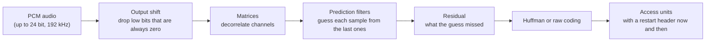

# TrueHD and MLP

This page covers **TrueHD** and **MLP** as ICL Forge implements them. It assumes the
[AC-3 & E-AC-3](ac3-eac3.md) page for the ideas every multichannel format shares: channels, the LFE,
bit rate and frames.

## A lossless codec

AC-3, E-AC-3 and AC-4 are lossy: they throw away what a listener is least likely to miss, and a
decoder returns something close to the original. TrueHD and MLP are **lossless**. A decoder returns
exactly the samples the encoder was given, bit for bit. The price is size: the rate is far higher than
E-AC-3's and varies with the material (the encoder's default ceiling is 18 Mbps, Blu-ray's).

The two names are one family. **MLP** (Meridian Lossless Packing) is the older form, used on
DVD-Audio. **TrueHD** is Dolby's variant, used on Blu-ray and HD DVD. They share the
same structure and differ in a marker at the start of the stream (`0xF8726FBA` for TrueHD,
`0xF8726FBB` for MLP). The library reads both and writes TrueHD.

Every step can be undone exactly, so a decoder runs the chain backwards. The residual is small when
the filters predict well, and that is where the saving comes from.

## Access units, restarts and substreams

A TrueHD stream is a run of **access units**. Each holds a fixed number of samples per channel (40 at
44.1 and 48 kHz, 80 at 96 kHz, 160 at 192 kHz) and begins with a short header that gives its length and a check value.
Some access units begin with a **major sync**, which names the sample rate, the channels and the
substreams. A decoder that joins a stream partway puts out nothing until the next major sync and the
next **restart header**, which resets the filters. The encoder places a restart every 128 access
units by default, and a shorter interval seeks sooner and costs more space.

The channels are split across up to four **substreams**, and a substream's channels build on the ones
before it. The first carries a 2 channel presentation, the second brings it to 6 channels and the third to 8,
so a player that wants stereo reads only the first. A fourth substream carries 16 channels. The
decoder reads the first three by default.

Every unit carries parity and CRC checks, and each restart interval carries a **lossless check**: a
value the decoder compares with the samples it reconstructed. A stream that fails any of them is
damaged, and the decoder says so rather than guessing.

## No published standard

AC-3, E-AC-3 and AC-4 are published by ATSC and ETSI. TrueHD and MLP are not. ICL Forge's TrueHD
library, `iclforge::truehd`, is written from a specification the project's owner supplied, which
is not in the repository. The specification contradicts itself and the real streams in places and is
silent in others, so the library records each such place in
[`libs/truehd/ERRATA.md`](https://github.com/iainchesworthlabs/iclforge/blob/main/libs/truehd/ERRATA.md)
and takes the reading that FFmpeg's decoder takes where a stream forces one. This codec is therefore
not covered by the clean-room statement the other codecs make
([Why this project exists](index.md#why-this-project-exists)).

Because the codec is lossless, checking it is simple: a decode either equals the source sample for
sample or is wrong. FFmpeg's `truehd` and `mlp` encoders and its decoder are the independent check
([Validation: TrueHD](../verification.md#truehd-and-mlp)).

## Where a TrueHD stream travels

| Carriage | What ICL Forge does |
|---|---|
| A bare `.thd` or `.mlp` file | Reads and writes TrueHD, reads MLP |
| MP4 | An `mlpa` sample entry with a `dmlp` box, in both directions |
| Matroska | An `A_TRUEHD` track, in both directions |
| MPEG-2 transport stream | Blu-ray's `stream_type` `0x83`, in both directions |
| HDMI and S/PDIF | **MAT** (Metadata-enhanced Audio Transport): 24 access units packed into one burst of IEC 61937 data type 22. The library packs and unpacks the bursts; nothing has been played into a receiver |

The specification gives no byte layout for any of these. Each is what FFmpeg's muxer writes, so each
has one outside reference. [TrueHD in the containers](../library/muxing-and-sinks.md#truehd-in-the-containers)
has the detail.

## Atmos in TrueHD

Dolby Atmos reaches TrueHD differently from E-AC-3. E-AC-3 carries Atmos as [JOC side
information](atmos-joc.md) inside the ordinary stream. TrueHD carries it as a 16 channel substream
and an **evolution frame** holding the object audio metadata, with an optional content signature.
ICL Forge decodes the 16 channel substream as 16 channels and reads the evolution frame into plain
structures, provisionally, because the owner's specification gives two accounts of the frame's layout and
neither has been checked against a stream; nothing renders the objects, and no Atmos stream is written. See
[Capabilities](../library/capabilities.md#truehd-and-mlp) for what is and is not built.

## Where to go next

- [TrueHD and MLP in the library](../library/truehd.md): the decoder and encoder API and the checks.
- [Capabilities](../library/capabilities.md#truehd-and-mlp): what the library does and does not do.
- [Development status](../library/development-status.md#truehd-mlp): the status of each feature.
