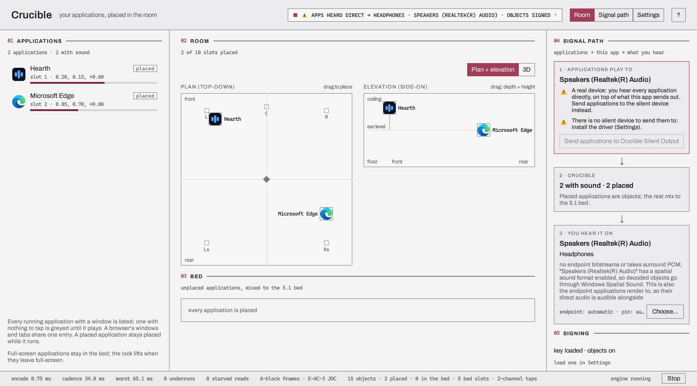

# Crucible

Crucible captures applications separately and places each one in a Dolby Atmos scene. You can
position an application in the room, send it to the fixed 5.1 bed, or split its stereo channels
into two objects. Output follows the selected audio device.

!!! note "Status: Windows and Linux have run on hardware; macOS builds and has never made a sound"
    Windows and Linux have run on real hardware. macOS compiles and runs its test suites in CI;
    the application has not been launched on a Mac, captured macOS audio, or produced macOS
    audio, and its process tap is off unless `ICLFORGE_MACOS_PROCESS_TAP` is set. CI builds a
    macOS archive of it, and no release publishes that archive. See
    [Where each platform stands](#where-each-platform-stands) and the
    [promotion record](design/promotion.md).

## What it does

1. **Install Crucible.** On Windows, build and install the test-signed silent-device driver
   separately; Linux creates its silent node while Crucible runs, and macOS needs no device.
2. **Send applications to that device** using Crucible or the system sound settings. The device
   suppresses their direct output.
3. **Crucible taps each one separately** and shows it in a room, as an icon with a level ring.
   Applications appear when they start playing and stay while they run.
4. **Drag one anywhere** — in plan, and in elevation. That application is now a dynamic object at
   that position. Its **Send to bed** button, a double-click on its marker, or `Delete` puts it
   back in the bed.
5. **What you hear follows your hardware.** An Atmos receiver over HDMI gets E-AC-3 JOC with the
   objects intact. A Dolby Digital receiver gets AC-3 5.1 with the positions panned onto the ring.
   A TV gets decoded multichannel PCM. Headphones get the decoded objects through the OS
   renderer, where there is one and a signing key is loaded. Plugging or unplugging switches
   modes without a restart.

*Hearth and Microsoft Edge playing, each placed in a slot. This computer has no silent device installed, so the signal path says so.*

Anything you have not placed, and whichever application is full-screen in front, is mixed into
the 5.1 bed.

The room can also show the lyrics of the selected application: a lyrics file (`.lrc`, SubRip,
Advanced SubStation Alpha or MIDI karaoke) or a CD+G disc's picture, imported against it and
followed as it plays ([The room, Lyrics](room.md#06-lyrics)).

## The four things it needs from a system

1. **Enumerate** which applications are playing.
2. **Tap** each one separately, without the others.
3. **Silence** their direct output, so the only thing you hear is what Crucible sends.
4. **Bitstream** the encoded result to a receiver.

Capturing an application does not suppress its original output. The silent device prevents the
same audio from being heard twice. [Install and first run](install.md) explains the platform
differences.

## Where each platform stands

| | Windows | Linux | macOS |
|---|---|---|---|
| Enumerate and tap | yes | yes, confirmed on hardware | compiles; the tap is refused unless `ICLFORGE_MACOS_PROCESS_TAP` is set, and nothing has been captured |
| Silence | a source-built kernel driver, test-signed only, [see below](#the-silent-device) | a PipeWire node, nothing to install | the tap mutes where it taps; no device needed — compiles; no tap has been created |
| Bitstream to a receiver | the underlying `PassthroughSink` is, via `forge` — [see Windows](../platforms/windows.md#audio-backend-wasapi); Crucible itself hasn't been run against a receiver yet | yes, read off the receiver: 5.1 DD+, and Atmos/DD+ with objects | nothing has been played |
| The window | yes | yes, run on the Pi | builds in CI and its suites run there; never launched on a Mac |

**Windows** has the longest record: the room, the tray, and the driver have run. Its silent
device is a kernel driver that is **test-signed only** today. The release archive carries the
install and remove scripts only. Until EV-certificate attestation is in place, the driver must
be built from source and loads only with Windows test signing enabled.

**Linux** has the engine, console runner, window, and platform services over PipeWire. It has
produced 5.1 E-AC-3 from a fixture and E-AC-3 with Atmos objects from the live path on a real
receiver. Crucible requires PipeWire because ALSA has no per-application capture. See the
[promotion record](design/promotion.md#alsa-or-pipewire). Application icons come from the
icon theme and `.desktop` entries. The full-screen rule is on under X11 and unanswerable under
Wayland (no client can ask which window is full-screen); the tray icon publishes wherever the
desktop has a StatusNotifier host, and says so where there is none
([Troubleshooting](troubleshooting.md#there-is-no-tray-icon)).

**macOS** uses Core Audio process taps, which mute applications when captured. The code compiles
and runs its test suites on both macOS CI legs. On a hosted Apple Silicon runner the first tap
never returned from `AudioDeviceCreateIOProcID`, so the backend refuses the tap unless
`ICLFORGE_MACOS_PROCESS_TAP` is set in the environment: on macOS Crucible lists the applications
using sound, draws them in the room, and taps none of them. It has not been launched on a Mac or
tested with audio hardware. That requires a Mac with a desktop session and an audio device, and
a Developer ID certificate for the operating system to show the capture consent prompt.

## The silent device

The silent device suppresses the application's original output while Crucible plays its mix.

**On Windows** it is a virtual audio device called "Crucible Silent Output" that discards whatever
it is given. The release archive has the install and remove scripts only. A source-built driver stays
installed until you remove it.

**On Linux** there is nothing to install. Crucible creates a PipeWire node named
"Crucible (silent)" while it runs, and the node disappears when it exits. No driver, no signing,
no password, and nothing left on your machine afterwards.

**On macOS** there is no silent device at all. The tap is created with `CATapMutedWhenTapped`, so
each application is muted at the point it is captured, there is no default output to move and
nothing to restore. That is what the code says; no tap has yet been created on any machine.

## Objects, and what the bed is

The encoder carries a 5.1 bed plus up to 15 dynamic objects, and the bed is made *from* five of
those object slots pinned to the L, R, C, Ls and Rs speaker positions. That leaves **ten slots
for placed applications**, which is more than a desk needs.

Each application is folded to one signal before it goes into its slot, so one application is one
object. You can ask for a **split** instead, where a stereo application becomes two objects
placed either side of its position — that costs a second slot, and Crucible refuses when the
budget would be exceeded rather than silently dropping one.

Two things always go to the bed: every application you have not placed, and the full-screen
application in front, because a full-screen game rendering 7.1 *is* the bed. On Linux the rule
is on under X11, where Crucible reads the active window's `_NET_WM_STATE` and `_NET_WM_PID`,
and off under Wayland, because no Wayland client can ask which window is full-screen; the Room
page says which applies.

## Codecs

Crucible sends a receiver E-AC-3 or AC-3 and decodes that stream for everything else: PCM
surround, stereo and headphones play a decode of it. Atmos is E-AC-3 with a JOC object layer;
with no signing key, or on a receiver that takes AC-3 only, the stream is a 5.1 E-AC-3 or AC-3
bed. Crucible has no AC-4 path. It captures what applications play as PCM and places it as
Atmos objects for a receiver, and no receiver found accepts AC-4
([planning/ac4.md](https://github.com/iainchesworthlabs/iclforge/blob/main/planning/ac4.md),
decision 20). Crucible can also encode its 5.1 bed as TrueHD, a mode you pin, lossless from the
24-bit values the mix is rounded to and with no objects. The audio library opens the TrueHD link on ALSA, PipeWire
(a sink whose codec list names it) and WASAPI (an endpoint that accepts the format in exclusive
mode), so on macOS no endpoint is offered it; the mode has been tested over scripted devices and no
path has been played into a receiver, so it has never reached one. A receiver's own list of what it
accepts naming TrueHD (the troubleshooting page quotes one) is what makes PipeWire offer it. TrueHD Atmos is not built. Whether the
mode becomes part of the automatic choice waits for a receiver to read it
([the roadmap](https://github.com/iainchesworthlabs/iclforge/blob/main/ROADMAP.md#truehd-and-e-ac-3-as-equals-proposed)).

## Objects need a signing key

A decoder that validates the object container's tag can refuse an unsigned container outright
instead of falling back to the bed. So with no key, Crucible sets no object metadata and streams
plain 5.1 — your placements still pan within the bed, but height does nothing. The one Atmos
receiver tried with an unsigned container did play the 5.1 bed
([Raspberry Pi passthrough](../platforms/raspberry-pi.md#live-hdmi-passthrough-to-a-real-receiver)).

The key is resolved at runtime, from a path in Settings or the same environment variables
`forge` reads. It is never built in, never shipped in a package, and never written to a log;
the [diagnostics file](troubleshooting.md#saving-a-diagnostics-file) withholds both the key and
the path to it. See [Object signing](../concepts/object-signing.md).

## Where to go next

- [Install and first run](install.md) — per platform, including what to do about the silent device
- [The room](room.md) — the rail, the views, the ten slots, and the keyboard route through a placement
- [The signal path](signal-path.md) — the two devices Crucible depends on, and why they are two
- [Settings](settings.md) — the settings screen block by block, and what each platform does differently
- [Keyboard and screen readers](accessibility.md) — the key map, the focus order, and what is announced
- [Languages](localisation.md) — the seven the window ships in, and what changes when one reads right to left
- [Troubleshooting](troubleshooting.md) — when you hear nothing, or hear everything twice
- [The promotion plan](design/promotion.md) — the design record, phase by phase, and what is unverified
- [Crucible QML feature coverage](https://github.com/iainchesworthlabs/iclforge/blob/main/apps/crucible/ui/tests/FEATURE_COVERAGE.md) — what the headless QML suites exercise
