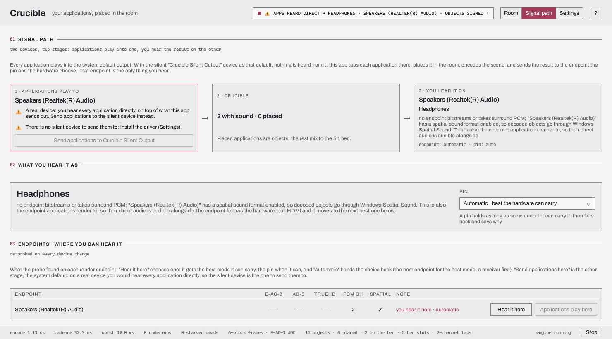

# The signal path

Crucible depends on **two** audio devices, and confusing them is the single most common way to
end up with silence or with everything playing twice. This page is that distinction, and nothing
else.

## Three stations

```
    applications play to  →  Crucible  →  you hear it on
      the silent device                    a receiver, a TV,
      (nobody hears it)                    headphones, speakers
```

**Station 1, where applications play.** This has to be a device you cannot hear. Crucible taps
each application there, individually. If it is a real device, you will hear every application
directly *as well as* through Crucible — the doubling that station 1 exists to prevent.

**Station 2, Crucible itself.** It takes each tap, places it where you dragged it, and encodes
the room as one stream.

**Station 3, what you hear.** One endpoint: your receiver over HDMI, a TV, headphones, or plain
speakers. This is the only station that makes sound.

The window shows all three, with a warning against whichever one is not yet what the path needs,
and one action that fixes it.

## Why it is two devices and not one

Because tapping an application does not silence it. On Windows and Linux, an application's audio
goes to the system's default output whether or not anyone is also capturing it. So Crucible has
to give the applications somewhere silent to play, and take a *different* device for itself.

That is also why Crucible moves your default output, and why it puts it back when it exits.

## How the stations differ per platform

The three stations are not the same shape everywhere, and the window says so rather than
pretending otherwise.

### Windows

Station 1 is the **"Crucible Silent Output" driver** (`IclForgeNullSink`), a virtual device that
discards its input. Crucible offers to make it the system default, and restores your previous
default on exit. The device has a name of its own so that station 1 and station 2 do not read
alike on the Output page: a device called "Speakers (Crucible)" would stand beside a station
called Crucible.

The driver is test-signed today, so it loads only on a machine with test signing on. Until an EV
certificate and attestation land, a normal machine has no silent device and Crucible tells you
so on the Settings page.

### Linux

Station 1 is a PipeWire node named **"Crucible (silent)"**, created by Crucible itself while it
runs and gone when it exits. Nothing is installed, nothing needs a password, and nothing is left
behind.

Crucible sets it as the default sink through PipeWire's `default.audio.sink` metadata — the same
thing `wpctl set-default` writes — and restores the previous default on exit.

### macOS

**There is no silent device.** macOS process taps can mute an application at the point they
capture it, so each application is silenced individually and no default output is moved at all.
Its `DefaultDevice` seam answers that the default never moves, and the first-run dialog, the
Settings silent-device block and the Send buttons follow that answer. The window still draws
station 1: it carries a warning with the platform's own words, "nothing to install: macOS
silences each application at the point Crucible taps it, so no silent device is needed", and its
button is disabled. That is read off the source and the Qt Quick suites, which build the window
offscreen on both macOS CI legs; nobody has seen it on a Mac.

## What the mode line means

Station 3's line names the mode Crucible chose and why:

| Mode | Chosen when | What your placements become |
|---|---|---|
| **Atmos** (E-AC-3 JOC) | an endpoint takes E-AC-3 exclusively **and** a signing key is loaded | objects, intact |
| **DD+ 5.1** | as above, but no signing key | panned onto the bed |
| **DD 5.1** (AC-3) | an endpoint takes AC-3 but not E-AC-3 | panned onto the bed |
| **TrueHD 5.1** | only when you pin it, and an endpoint takes TrueHD as a bitstream | panned onto the bed, lossless from 24-bit values, no objects |
| **PCM surround** | an endpoint offers 6 or 8 channels and no bitstream format | encoded, then decoded and rendered |
| **Headphones** | the endpoint has a spatial format enabled and a signing key is loaded | objects handed to the OS renderer |
| **Stereo** | nothing above applies | encoded, then decoded, folded down |

Three of these need saying plainly.

**Without a signing key you get DD+ 5.1, not Atmos.** Placements still pan, but height does
nothing. That is deliberate: a decoder that validates the tag can refuse an unsigned object
container outright, so Crucible sends no object metadata.

**Headphones is Windows-only.** It needs an OS object renderer, and neither Linux nor macOS
exposes one a third party can hand Atmos objects to. On those platforms the headphone route
decodes and folds instead. It also needs a signing key, because the decoder rebuilds objects only
from a signed stream; without one the stream is a 5.1 bed and stereo is the fold.

**TrueHD 5.1 is chosen by pinning it, and not every endpoint offers it.** The automatic choice
never picks it, because no receiver has read a TrueHD stream from Crucible. It sends the same 5.1 bed as
DD+ 5.1, encoded losslessly and carried as MAT bursts, and it carries no objects whatever key is
loaded. Lossless starts at 24-bit integers: Crucible's mix is floating point, it is rounded to the
nearest 24-bit value (a tie goes to the even one), and the stream decodes to exactly those values
and no further back. The mode also needs an audio backend that can carry MAT, which is eight
channels at 192 kHz: ALSA's can, PipeWire's can, on a sink whose codec list names TrueHD, and
WASAPI's can, on an endpoint that accepts Microsoft's MAT 1.0 format in exclusive mode; Core
Audio's cannot. So on macOS no endpoint reads as taking TrueHD, and a pin on a mode no endpoint
carries falls back to the automatic choice with the reason line saying so. The engine side is
tested over scripted devices, bit for bit, and the library's backends have been built and tested
without a receiver: nothing has been played into one, so whether an endpoint accepts the stream or
a receiver locks on it is not known.
Its LFE channel is empty, because Crucible's mix has no LFE source: a tap's LFE is dropped.

The modes are tried in the order of the table, and Crucible takes the first that some endpoint
can carry; TrueHD 5.1 is left out of that order and is only ever pinned. Crucible writes E-AC-3
and AC-3, and TrueHD when pinned. It has no AC-4 mode.

You can **pin** a mode to stop Crucible changing its mind, and **choose the endpoint** you hear
it on rather than letting the policy pick. An impossible pin leaves the automatic choice standing
and the reason line says so.

## The Signal path page



*The page on a computer with one output and no silent device.*

The page has five blocks.

| Block | What it holds |
|---|---|
| **01 SIGNAL PATH** | the two-device idea in one paragraph |
| **02 WHAT YOU HEAR IT AS** | the mode and why it was chosen, and the **Pin** list: Automatic, Atmos, Dolby Digital Plus 5.1, Dolby Digital 5.1, TrueHD 5.1, PCM surround, Headphones (where an OS renderer exists) and Stereo |
| **03 ENDPOINTS** | what the last probe found on each render endpoint: whether it takes E-AC-3, AC-3 and TrueHD as a bitstream, how many PCM channels, whether spatial sound is on. **Hear it here** chooses that endpoint and **Automatic** hands the choice back. **Send applications here** makes it the default output |
| **04 WHERE APPLICATIONS PLAY** | the current default output, the button that moves it to the silent device or restores it, **Open Sound settings**, and **Re-probe** |
| **05 CODEC PATH** | **Bypass the codec on headphones and PCM**. Off, headphones, PCM and stereo play a decode of the E-AC-3 stream, so what you hear went through the codec. On, headphones render the engine's own objects, and PCM and stereo take its 5.1 bed |

The endpoint list is probed again on every device change. If an output device goes away and comes
back, the next probe finds the dead output and Crucible restarts it; **Re-probe** asks for that at
once.

## The one rule that is not obvious

Probing an endpoint is safe. **Opening one is not.**

Crucible can ask any endpoint whether it accepts a format at any time, whatever else is playing.
But on Windows *taking* an endpoint exclusively while other applications are rendering to it is
refused, and invalidates their streams in the process — they stop playing, and the taps deliver
silence from then on.

So Crucible, on every platform, chooses a bitstream mode only on an endpoint that is not the
default output: it takes the output exclusively only after the default has moved to the silent
device and nothing is left on the endpoint it wants. If you see it decline to take your receiver,
this is usually why: something is still playing to it.

## Nothing is tapped until there is somewhere to play

Crucible opens no tap while station 3 has no endpoint, and releases every tap it holds the moment
one goes away. Probing takes a moment — on PipeWire each answer is a real connect — so on the
first frame of a session there is nothing chosen yet, and that is the state this rule is mostly
about.

On Windows and Linux the rule only keeps things tidy: a tap there is a pure capture, and an
application sounds the same whether or not anyone is reading it. On macOS it decides what you
hear. The tap is what silences the application (that is why there is no station 1 on that platform), so a tap held open
with nothing at station 3 would mute what you are listening to and send it nowhere. If Crucible
finds no usable output on a Mac, your applications keep playing to your speakers and Crucible
stays out of the way until there is somewhere for their audio to go.
