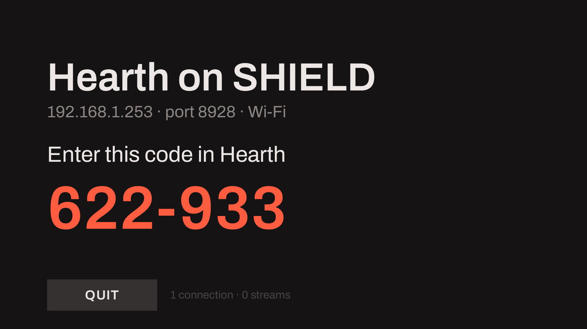
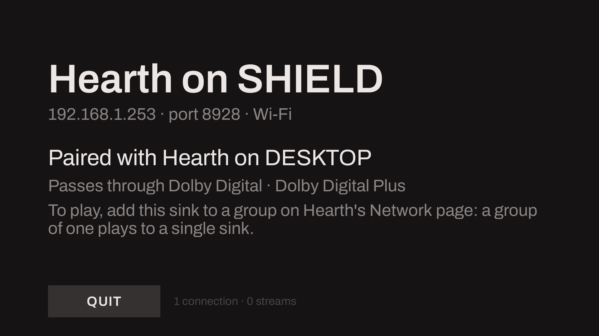
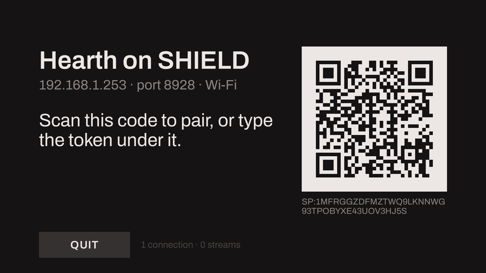
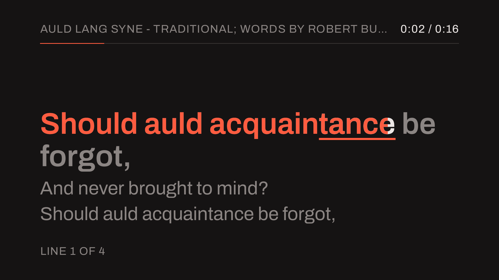
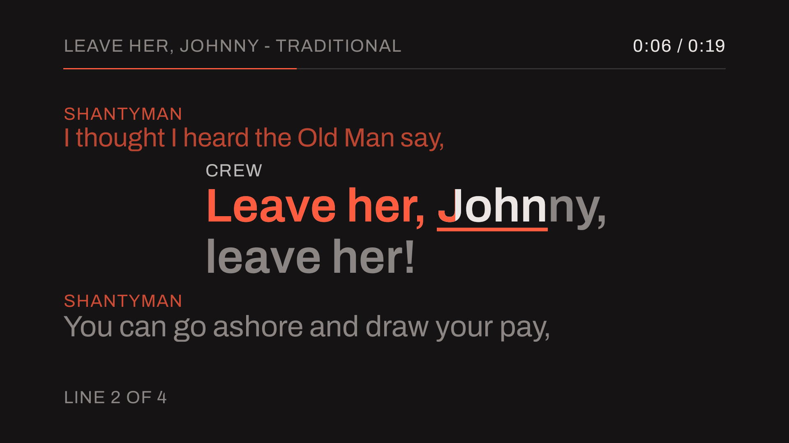
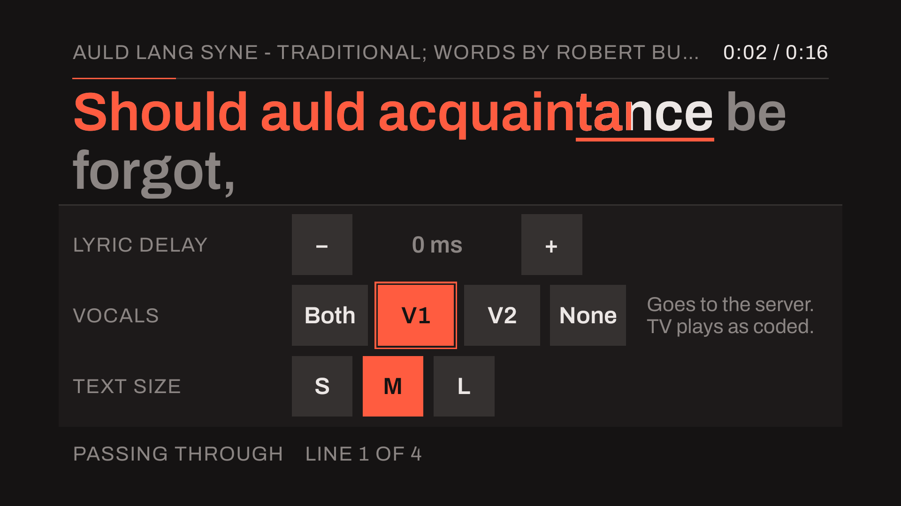
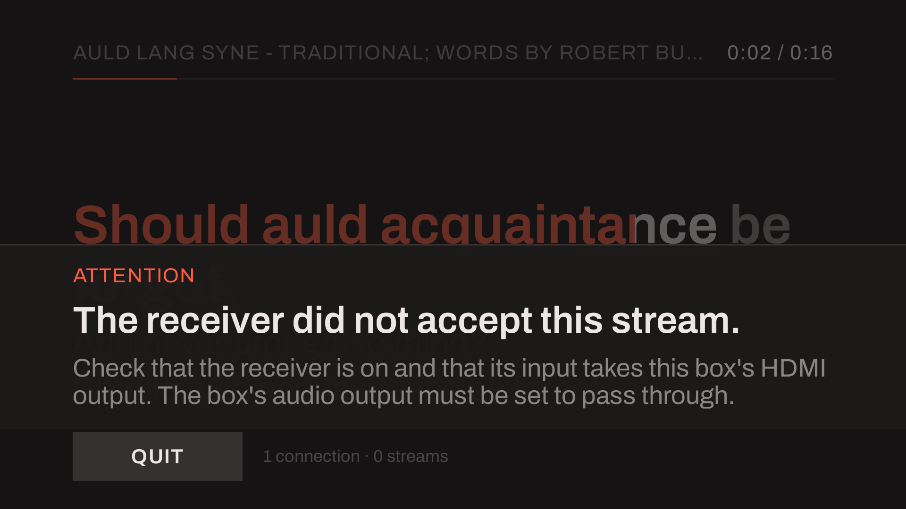

# Hearth for Android

Hearth for Android is a Sendspin sink for Android TV. It is advertised on the network, pairs with
the [desktop player](desktop-player.md), and hands the AC-3 or E-AC-3 stream Hearth sends it to the
AV receiver on the box's HDMI output, as the bitstream it is. When the item is a karaoke stream
with a lyrics file, it shows the words in time on the TV.

!!! note "Status as of 2026-10-13: built from source; no release carries it"
    The app pairs, passes AC-3 and E-AC-3 to a receiver and draws the lyric screen. It does not
    decode anything itself yet, so a stream that reaches it as PCM, FLAC or Opus is accepted and
    not heard, and it does not list AC-4 or TrueHD. CI builds a debug APK and runs its tests on an emulator;
    no release publishes one, and it is not in an app store. The plan and what is left are in
    [`planning/hearth-android.md`](https://github.com/iainchesworthlabs/iclforge/blob/main/planning/hearth-android.md).

The pictures on this page are the app's own drawing at 1080p, written by its tests. They are not
photographs of a television.

## What you need

- **An Android TV box wired by HDMI to an AV receiver** that decodes Dolby Digital and Dolby Digital
  Plus. The app plays nothing through a TV's own speakers. It has been run on an NVIDIA Shield TV
  (2019, Android 11) into an Onkyo TX-RZ740.
- **A computer running Hearth** on the same network, to pair with it and send it a stream.
- **To build it:** a [vcpkg](https://github.com/microsoft/vcpkg) checkout, the Android SDK with
  NDK 26.1 and CMake 3.31.6, and `adb`.

## Build and install

```sh
export VCPKG_ROOT=/path/to/vcpkg
cd apps/hearth/android
./gradlew :app:assembleDebug
adb install -r app/build/outputs/apk/debug/app-debug.apk
```

The first build compiles the native libraries' dependencies, which takes about 25 minutes; vcpkg's
cache keeps them for the next. The
[app's README](https://github.com/iainchesworthlabs/iclforge/blob/main/apps/hearth/android/README.md)
has the build's details and its tests.

## Pair and play



*The idle screen with the code a server asked for.*

1. **Start the app on the box.** The screen shows the sink's name, `Hearth on <the box's name>`,
   with its address and port, and says it is not paired yet.
2. **Pair it from Hearth.** On the desktop player's [Network page](desktop-player.md#network),
   select the sink and press **Pair with this computer**. The TV shows a six-digit code; type it
   into Hearth. A server that asks for the code as a QR is shown one beside the name.
3. **Put it in a group.** A paired sink is not played to until it is in a group, and the idle
   screen says so until its first stream: on the Network page, create a group with this sink in it.
   A group of one plays to a single sink.
4. **Play.** Choose the group in Hearth's [output picker](desktop-player.md#where-it-plays) and
   play a file.



*A paired sink before its first stream.*



*The pairing code as a QR.*

## What it plays

| Hearth sends | What happens |
|---|---|
| AC-3 or E-AC-3 | Passed to the receiver as IEC 61937 bursts, each in the time slot it is due in. The receiver decodes it, and its display names the format |
| PCM, FLAC or Opus | Accepted and dropped: nothing is heard. Hearth sends these to a sink that cannot take a stream as it is |
| AC-4 | Not listed by the sink, so Hearth decodes it and sends PCM, which the sink drops |

While a stream plays, the foot of the screen names its format and how it leaves the sink, for
example "Dolby Digital 5.1 · Passing through".

Because the receiver gets the coded stream, what it plays is the receiver's decode. For a karaoke
stream that means every vocal the stream carries, whatever is chosen on Hearth's Karaoke page.

## The lyric screen



*A line being sung.*

When Hearth plays a karaoke item that has a lyrics file, it sends the sink the words and where the
sound is in them, and the sink follows them on its own clock. The screen shows the line before, the
line being sung with the colour running through it word by word, and the lines to come. A duet's
lines carry each singer's name, an instrumental break counts in with four dots, and a line in
Hebrew, Yiddish or Arabic runs right to left. A file timed by line and not by word is shown a line
at a time, and a file with no times is shown as text to scroll.

An item with no lyrics is named in the header by what Hearth says is playing, with its position
and length.



*A duet.*

### The controls



*The controls sheet, opened with the remote's centre button.*

The remote's centre button opens a sheet over the foot of the screen. The four directions move the
focus, the centre presses, **Back** closes it, and it closes itself after eight seconds.

- **Lyric delay**: shows the words later or sooner, in steps of 50 ms up to a second either way.
  With the sheet closed, left and right nudge it.
- **Vocals**: Both, V1, V2 or None. This asks Hearth for that choice. It changes what Hearth's own
  page shows and what the decoding members of the group play; this TV plays the stream as coded,
  and the sheet says so.
- **Text size**: S, M or L.

The delay and the text size are kept.

## When something needs attention

| Screen | When | What it says |
|---|---|---|
| **Starting** | The sink is not up, the box has no network address, or the HDMI route takes neither format | The name, what it is waiting for, and what to check |
| **Idle** | Nothing is playing | The name, the address, who it is paired with, a pairing code when a server has asked for one, and the formats the route passes through |
| **Attention** | The sink did not start, the receiver would not take a stream, or the HDMI link dropped and did not come back within 20 seconds | One sentence of what happened and what to do; over a lyric it is a banner at the foot |



*An attention banner over a lyric.*

After two minutes with nothing changing on the screen, it dims and moves slowly, to spare an OLED
panel. Any key brings it back.

## What has been run

On 2026-10-12 an NVIDIA Shield TV (2019) on an Onkyo TX-RZ740 played two programmes sent by
`hearth-testserver`, the development server, with the receiver queried for what it was decoding:

| Programme | The receiver said | Bursts played | Underruns |
|---|---|---|---|
| AC-3 5.1, 448 kbit/s, 121 s | Dolby Audio - DD, 48 kHz, 5.1 ch | 3,790 of 3,792 | 0 |
| E-AC-3 5.1, 256 kbit/s, 121 s | Dolby Audio - DD+, 48 kHz, 5.1 ch | 3,792 of 3,792 | 0 |

Not run: the desktop window playing to the box (the runs used the test server), an Atmos stream,
another receiver, and a phone scanning the QR. The
[app's README](https://github.com/iainchesworthlabs/iclforge/blob/main/apps/hearth/android/README.md#a-run-on-a-shield-and-a-receiver-phase-1e)
has the runs in full, with what a dropped HDMI link costs.

## What it does not do

- **Decode on the device.** It passes the stream through, so it needs a receiver, and the karaoke
  choice does not change what the TV plays.
- **Play PCM, FLAC or Opus.** A stream of those is accepted and dropped.
- **AC-4.** No receiver here has decoded AC-4 over this route, so the sink does not list it.
- **Take a microphone.** The microphone and the pitch score are in the
  [desktop player](../karaoke/index.md#sing-into-a-microphone).
- **Come as a package.** It is built from source and installed with `adb`.

Decoding on the device and playing as an ordinary Sendspin player are
[phases 4 and 5 of the plan](https://github.com/iainchesworthlabs/iclforge/blob/main/planning/hearth-android-phases-4-5.md).
