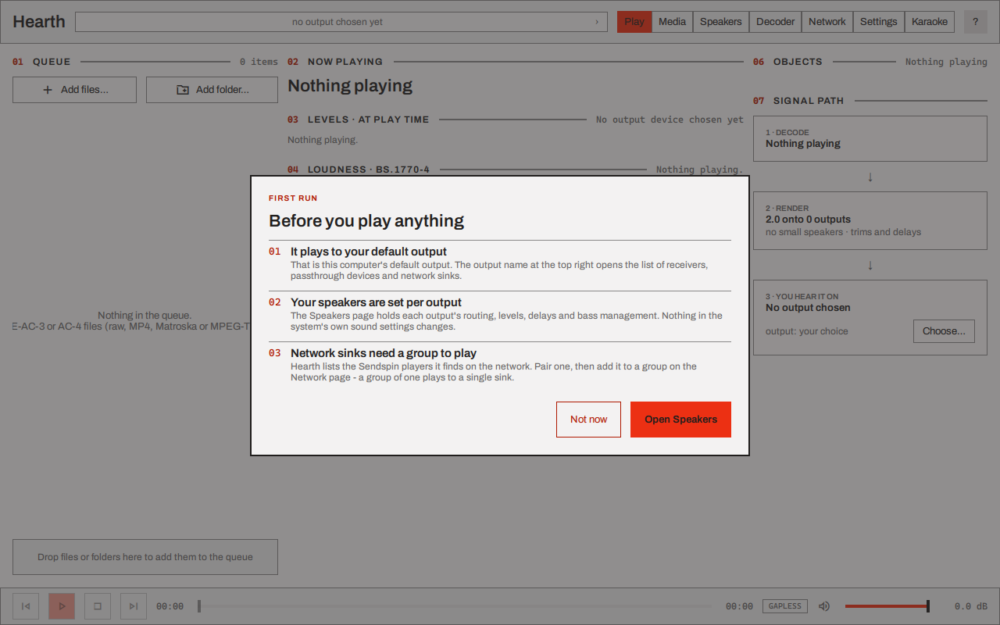
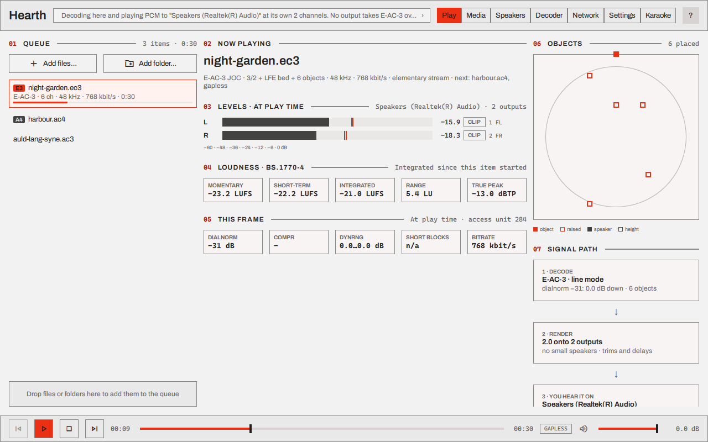
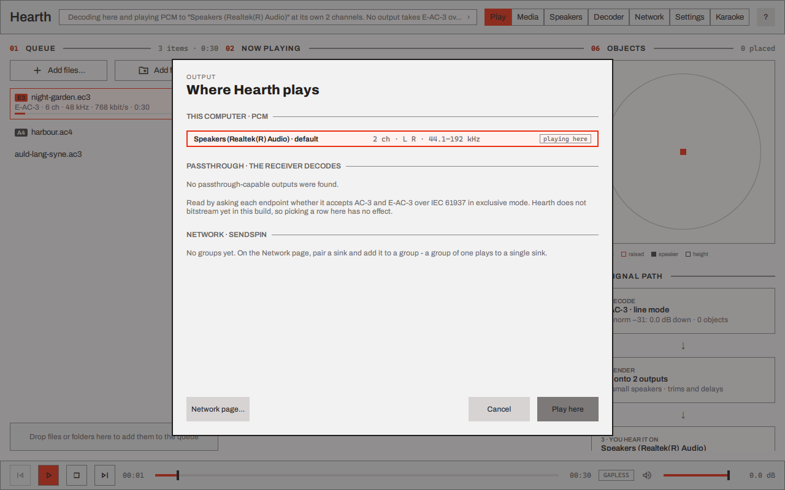
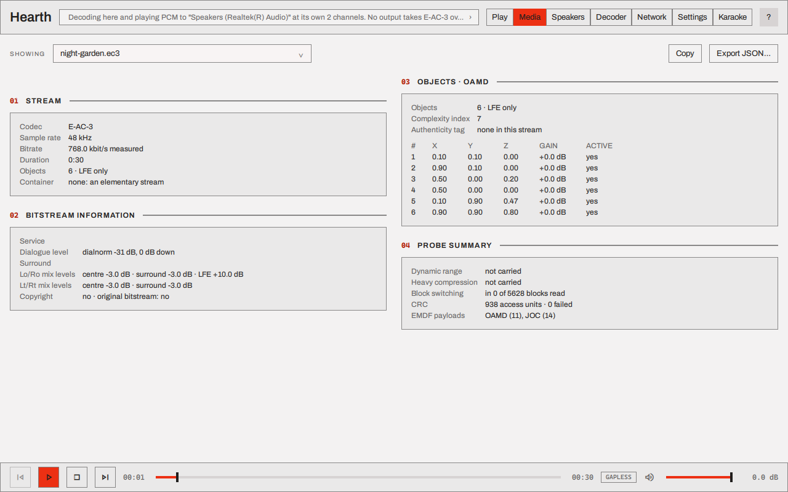
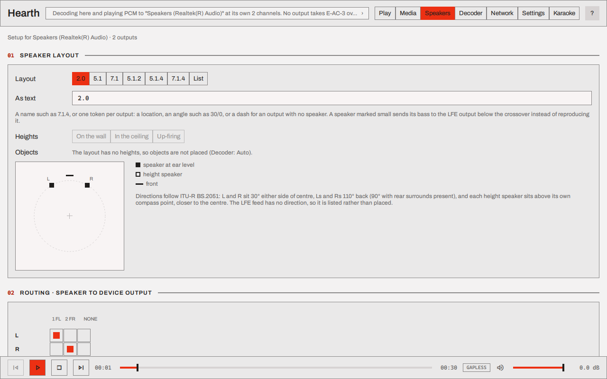
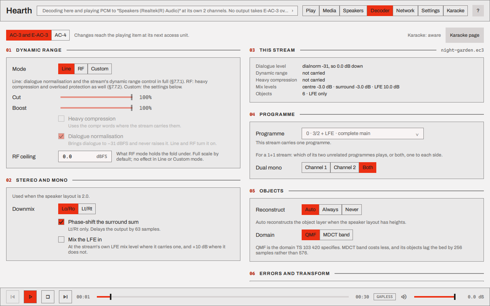
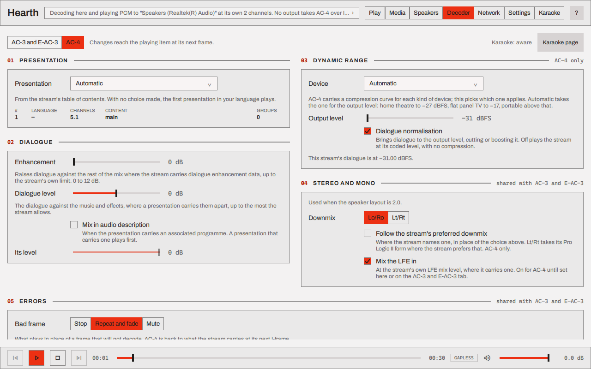
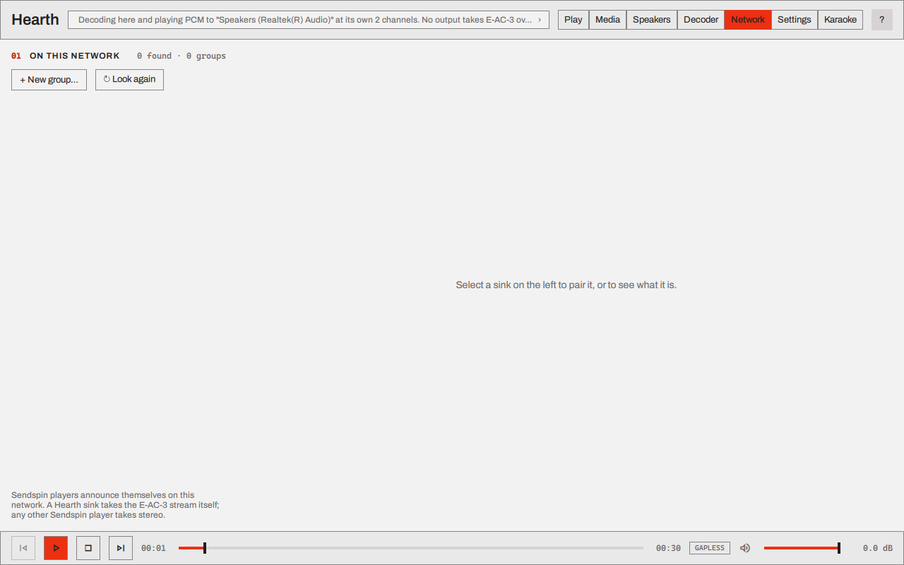
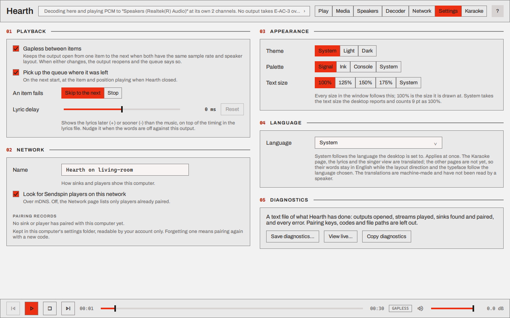
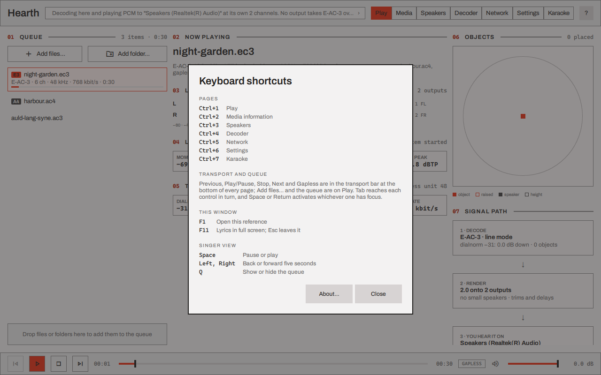

# Using the desktop player

`hearth` is the desktop player: a window that plays AC-3, E-AC-3, E-AC-3 with Atmos objects and
AC-4 files through this computer's speakers or to a group of network sinks. It does not play TrueHD or MLP
([Hearth](index.md) says why). This page walks through
the window page by page. [Hearth](index.md) is the reference for what each feature does and does
not do, and [Karaoke](../karaoke/index.md) covers the Karaoke page.

The pictures are of a build of `main` on Windows, playing three files made for the purpose: an
E-AC-3 stream with six Atmos objects, a 5.1 AC-4 stream and the karaoke example.

## First run

*The first-run dialog over an empty Play page.*

The first time it starts, Hearth says three things before it plays anything:

1. **It plays to this computer's default output.** The strip at the top of the window names the
   output, and clicking it opens the list of the others.
2. **Speakers are set per output.** The Speakers page holds each output's routing, levels, delays
   and bass management. Nothing in the operating system's own sound settings changes.
3. **Network sinks need a group to play.** Hearth lists the Sendspin players it finds on the
   network. Pair one, then add it to a group on the Network page; a group of one plays to a single
   sink.

**Open Speakers** goes to the Speakers page, and **Not now** closes the dialog. It does not come
back.

## The window

Every page has the same frame. The header holds the output strip, the seven page buttons
(`Ctrl+1` to `Ctrl+7`) and **?**, which opens the keyboard reference. The transport bar along the
bottom has previous, play or pause, stop and next, the position with a scrubber, the item's length,
the **Gapless** toggle and the volume.

Hearth opens where you left it. The window's size, its position and whether it was maximised are
kept with the other settings (`window/geometry` and `window/maximised`) and restored on the next
start. The window is never smaller than 960×620, and a remembered position that is on no connected
screen any more, such as a monitor that has been unplugged, is ignored: the window opens at its
remembered size where the system puts it. The first start opens at 1280×800. The lyrics in full
screen are not remembered as the window's state; leaving them returns the window as it was.

## Play

*The Play page 9 seconds into an E-AC-3 stream with objects, on a stereo output.*

**Queue.** **Add files…** and **Add folder…** add to the queue, and so does dropping files or a
folder on the page. A folder lists its `.ac3`, `.ec3`, `.ac4`, `.mp4`, `.mkv` and `.ts` files. Each
row has the codec (A3, E3 or A4), the channel count, the sample rate, the bit rate and the length,
and the row that is playing shows how far through it is. A file Hearth cannot read is marked not
playable, with the reason, when the queue reaches it. The window has no control that removes an
item.

A file can also be opened from outside the window: `hearth song.ac3` on a command line, or a
double-click on an `.ac3` or `.ec3` file on Windows once the installer has run. If Hearth is
already running, the file joins its queue and starts
([Command line](index.md#command-line)).

**Now playing** names the item and what it is: the codec, the coded layout, the objects, the rate,
the container, and what follows it in the queue and whether the join is gapless.

**Levels · at play time** has a meter for each output of the device, in dBFS, with the output's
number and name and a **CLIP** light. The meters, the loudness and the frame's metadata are of the
sound leaving the speakers now, not of what the decoder has read ahead.

**Loudness · BS.1770-4** gives the momentary, short-term and integrated loudness, the loudness
range and the true peak. The integrated figure starts again with each item.

**This frame** shows the metadata of the access unit being heard: `dialnorm`, the heavy
compression and dynamic range words, whether it has short blocks, and its bit rate.

**Objects** draws the room from above, with the speakers of the layout and each object of an
E-AC-3 stream where its metadata puts it; a raised object is drawn hollow. An AC-4 item's objects
are not listed here.

**Signal path** is the path from the file to the speakers in three steps: what decodes the stream
and in which dynamic range mode, what the renderer folds or places it onto, and the output it is
heard on. **Choose…** opens the output picker.

A karaoke item adds a **Lyrics** card with the words in time and a **Full screen** button
([Karaoke](../karaoke/index.md#play-it-in-hearth)).

## Where it plays

*The output picker on a computer with one stereo output, no receiver and no sinks paired.*

The strip in the header says where the sound goes and why, in a sentence. Clicking it opens the
output picker, which has three sections:

- **This computer · PCM.** Each output of the computer, with its channels and the sample rates it
  takes. Hearth decodes the stream and sends it PCM. The one in use says *playing here*.
- **Passthrough · the receiver decodes.** The outputs that say they accept AC-3 and E-AC-3 as a
  bitstream, each with a mark for the formats it takes. Choose one to play to it as a receiver: an
  AC-3 or E-AC-3 item it takes is sent to it untouched, as IEC 61937 bursts, and the receiver
  decodes it. Anything else is decoded here and played to the same output as PCM: an AC-4 item, a
  karaoke stream with a reproduction chosen, a programme other than a stream's first. The row in
  use says *playing here* while a bitstream goes out.
- **Network · Sendspin.** The groups made on the Network page.

Choose a row and press **Play here**, and playback moves there. The choice is kept: the window
plays there again the next time it is opened, before anything plays. Until you choose one the
window decodes to the computer's default output.

An output or group that is not there when the window opens does not change what is kept, and it
is not played to:

- A **passthrough** row whose output the computer does not list now, such as a receiver that is
  switched off or unplugged, starts as a decode to the default output. Nothing is sent as a
  bitstream to some other output that takes one. The receiver is played to again at the next start
  it is listed for, unless another row is chosen first.
- A **This computer · PCM** row whose output is not there starts as a decode to the default output.
- A **network group** is played to once it is ready. The network is found after the window opens,
  so for the first moments the group is not ready, and the header says so instead of playing the
  item on this computer; a group that has been removed is refused the same way until another row
  is chosen.

While a bitstream goes out, the receiver decodes it with its own settings and plays it on its own
speakers. The signal path says *sent as it is* and *Not rendered here*, the Decoder page says its
controls reach only the meters, the Speakers page says its setup is not applied, and the volume
in the transport bar is closed: the receiver's volume is the one that acts. The levels and the
loudness on the Play page are of a decode made here beside the stream. Sending a bitstream holds
the output, so other programs on the computer are silent through it meanwhile.
[Passthrough to a receiver](index.md#passthrough-to-a-receiver) has the rest.

## Media

*The Media page for the stream with objects.*

The Media page shows what the decoder reads from a file, without playing it. **Showing** chooses
any item in the queue. **Copy** puts the text on the clipboard, and **Export JSON…** saves it as
JSON.

- **Stream**: the codec, the sample rate, the measured bit rate, the length, the objects and the
  container.
- **Container**, for an MP4, Matroska or MPEG-TS file: its format, the track played and, for MP4,
  the edit list.
- **Bitstream information**, for AC-3 and E-AC-3: the service, the dialogue level, the surround
  mode, the downmix levels and the copyright bits.
- **Objects · OAMD**, for a stream with objects: how many there are, and each object's position,
  gain and whether it is active.
- **Probe summary**: whether the stream carries dynamic range control and heavy compression, how
  many blocks switch to short transforms, the CRC count and the EMDF payloads.

An AC-4 item has cards for its table of contents and presentations instead
([AC-4](index.md#ac-4)).

## Speakers

*The top of the Speakers page for a stereo output.*

The Speakers page describes the speakers on the output in use. The settings are kept for that
output and come back on the next start.

- **Speaker layout.** Pick a layout from 2.0 to 7.1.4, or **List** to write one as text: a name
  such as `7.1.4`, or one token for each output of the device (a location, an angle such as
  `30/0`, or a dash for an output with no speaker). **Heights** says whether the height speakers
  are on the wall, in the ceiling or up-firing. The plan draws the layout.
- **Routing · speaker to device output.** A grid with a row for each speaker and a column for each
  output of the device; a click sends a speaker to an output, and the arrow keys move around the
  grid. **Use the device's order** puts it back, and **Clear** empties it.
- **Levels and delays.** For each speaker: large or small, a trim in dB, a delay, and a button
  that plays the identify noise on it.
- **Bass management.** One crossover frequency, from 40 to 250 Hz. A speaker marked small sends
  what is below it to the LFE output.
- **Identify.** Pink noise on one output at a time, at -30, -20 or -12 dB, to hear which speaker is
  wired to it.

A change applies to what is playing. Hearth renders to the layout given here and does no room
measurement or equalisation.

## Decoder

*The AC-3 and E-AC-3 tab.*

The Decoder page has a tab for AC-3 and E-AC-3 and a tab for AC-4, and opens on the one for the
item that is playing. A change reaches that item at its next access unit or frame.

On the **AC-3 and E-AC-3** tab:

- **Dynamic range**: Line mode, RF mode, or Custom with the cut and the boost scaled apart, heavy
  compression, dialogue normalisation, and the level RF mode holds the output under.
- **Stereo and mono**, used when the layout is 2.0: a Lo/Ro or an Lt/Rt downmix, the phase shift
  of the surround sum, and whether the LFE is mixed in.
- **This stream**: what the playing stream carries of each of those.
- **Programme**: which independent programme of an E-AC-3 stream plays, and for a 1+1 stream,
  channel 1, channel 2 or both.
- **Objects**: whether the object layer is reconstructed (Auto does so when the layout has
  heights), and in which domain.
- **Errors and transform**: what plays in place of a frame that will not decode (stop, repeat and
  fade, or mute), and the fast inverse transform.

*The AC-4 tab, with a 5.1 AC-4 item playing.*

On the **AC-4** tab:

- **Presentation**: which presentation of the stream plays. Automatic takes the first one in your
  language.
- **Dialogue**: dialogue enhancement, the level of the dialogue against the music and effects
  where a presentation carries them apart, and audio description with its level.
- **Dynamic range**: which device's compression curve applies, the output level, and dialogue
  normalisation.
- **Stereo and mono**: the downmix, whether the stream's preferred downmix is followed, and
  whether the LFE is mixed in.
- **Errors**: what plays in place of a frame that will not decode.
- **Immersive and objects**: the layout an immersive stream is folded to, and core decoding, a
  lighter reconstruction of the immersive element and its objects.

The **Karaoke page** button at the top right goes to the karaoke choice, which belongs to the
decoder and has a page of its own.

## Network

*The Network page with nothing found. The pictures here were taken with network discovery off.*

The Network page lists the Sendspin players Hearth finds on the network. A Hearth sink takes the
coded stream itself; any other Sendspin player takes PCM that Hearth has decoded.

1. **Find.** Sinks appear by themselves; **Look again** asks the network once more. A sink can be
   an ESP32 board running `hearth_sink`, an Android TV box running
   [Hearth for Android](android.md), or any other Sendspin player.
2. **Pair.** Select a sink and press **Pair with this computer**. The sink shows a six-digit code,
   new for each attempt, on its own web page and on its serial console; type it in. Pairing makes a
   key that both keep, and after it the sink takes streams from Hearth without a code.
3. **Group.** **New group…**, or **Create a group** straight after pairing. A group of one plays
   to a single sink. The group editor shows what each member will be sent (the coded stream, PCM
   at its own layout, or Opus) and why, and holds the group's volume and mute.
4. **Play.** Choose the group in the [output picker](#where-it-plays).

A paired Hearth sink has a settings view with three tabs: **Speakers**, for the sink's own layout
and trims; **Decoder**, for its decoder settings and for whether audio decoded here reaches it as
PCM or as Opus; and **Firmware**, which shows the image it is running and updates it over the
network. The sink guides have the detail: [ESP32-S3](sink-esp32-s3.md),
[ESP32-C6](sink-esp32-c6.md), [ESP32-P4](sink-esp32-p4.md) and [sink firmware](sink-firmware.md).

A sink another server holds, such as one Music Assistant holds, shows as in use by another server,
with a **Take it back** button.

## Settings

*The Settings page.*

- **Playback**: gapless joins between items, whether the queue and the position come back on the
  next start, whether a file that fails is skipped or stops the queue, and the lyric delay.
- **Network**: the name sinks and players show for this computer, whether Hearth looks for
  Sendspin players, and the pairing records, each with **Forget**.
- **Appearance**: the theme, the palette, the text size and motion. Motion is System, Reduced or
  Full: System follows the desktop's own request to cut back animation, and Reduced draws the
  waiting mark as three still squares instead of a turning spinner
  ([Motion](../crucible/accessibility.md#motion) says how each platform's setting is read).
- **Language**: English, German, Spanish, French, Arabic, Hebrew or Yiddish. Every page is
  translated; the translations are machine-made and no speaker has read them
  ([Languages](index.md#languages)).
- **Diagnostics**: a text file of what Hearth has done (the outputs opened, the streams played,
  the sinks found and paired, and every error), saved, copied or viewed live. Pairing keys, codes
  and file paths are left out of it.
- **About**: **About Hearth…** opens the version and the build it came from, the licence, the
  repository, and **Licences…**, which lists what this build carries from others with each
  licence. The keyboard reference's **About…** (below) opens the same window; Forge and Crucible
  reach theirs from their Settings too.

## Keyboard

*The keyboard reference, opened with `F1` or the **?** button.*

| Key | What it does |
|---|---|
| `Ctrl+1` to `Ctrl+7` | Play, Media, Speakers, Decoder, Network, Settings, Karaoke |
| `F1` | Opens the keyboard reference |
| `F11` | The lyrics in full screen; `Esc` leaves it |
| `Space` | In the singer view: pause or play |
| `Left`, `Right` | In the singer view: back or forward five seconds |
| `Q` | In the singer view: show or hide the queue |

`Tab` reaches each control in turn, and `Space` or `Return` activates the one with focus. The
reference's **About…** button opens the version and the licences, as the **About** card on
[Settings](#settings) does.

## How the pictures were taken

`hearth --smoke-shot <png> --page <name>` saves a page to a file with network discovery off and a
scratch settings store ([Command line](index.md#command-line)). These were taken on Windows with
`QT_QPA_PLATFORM=windows:darkmode=0`, which draws the light theme whatever the desktop is set to,
and `QSG_DISTANCEFIELD_ANTIALIASING=gray`, which keeps coloured subpixel edges out of the text,
with the three files named by `--open` and a position by `--seek`.
