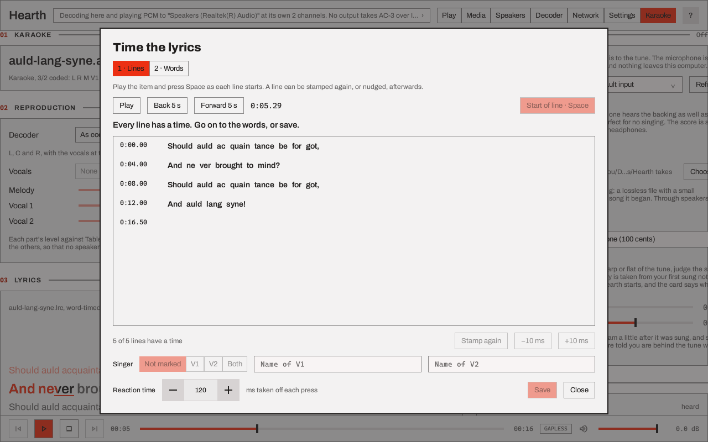
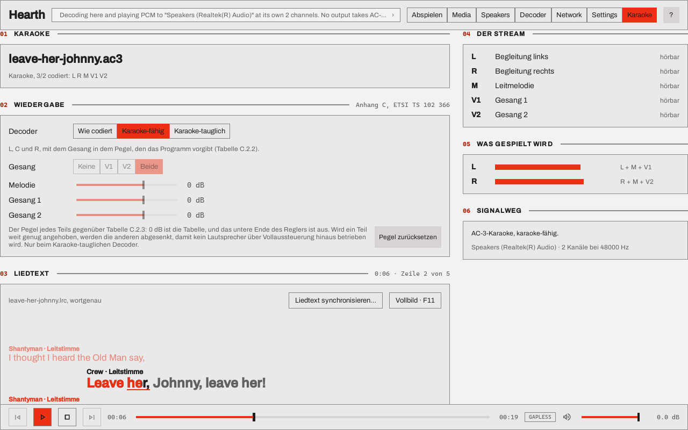
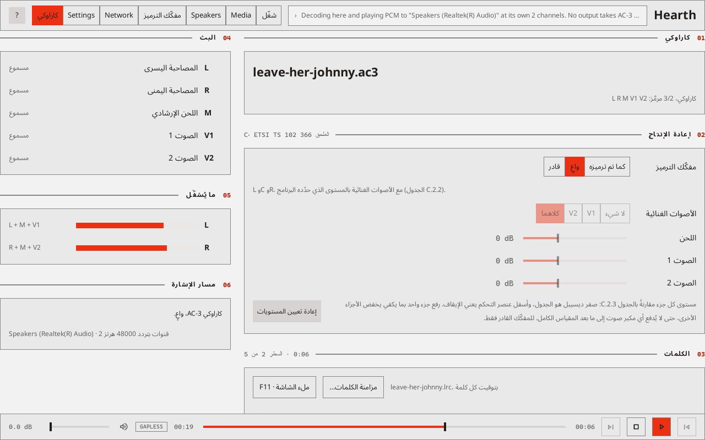

# Hearth

Hearth plays AC-3, E-AC-3, E-AC-3 with Atmos objects, and AC-4 through this computer's outputs, an
HDMI or S/PDIF receiver, or synchronised network sinks. The desktop player, `hearth`, decodes a
stream for its local outputs, passes AC-3 and E-AC-3 to a receiver chosen in its output picker,
and plays a stream to a group of network sinks over Sendspin, a protocol for synchronised network
audio. `hearth_sink` is the firmware for the ESP32 boards that join such a group, and
[Hearth for Android](android.md) is a sink for Android TV that hands the stream to an AV receiver.

[Using the desktop player](desktop-player.md) walks through the window with a picture of each
page. This page is the reference.

!!! note "TrueHD and MLP are decoded here, and not passed through"
    The desktop player decodes TrueHD and MLP (`.thd`, `.mlp`, and the TrueHD track of an MP4, Matroska or MPEG-TS file) and plays
    the result as PCM, to this computer's outputs and to a network group. It does not send TrueHD to a receiver as it is (the
    output decision says "Passthrough of TrueHD is not available"), no network sink is sent the coded stream, and Hearth for
    Android and the ESP32 sinks do not take it. The decode is lossless and 24 bits wide, and what reaches the output is float32
    through the operating system's mixer, so it is not a bit-exact path. How the work is staged is in the
    [parity audit](https://github.com/iainchesworthlabs/iclforge/blob/main/planning/truehd-parity-hearth-player.md);
    what the library has is in [TrueHD and MLP](../library/truehd.md); the roadmap row is
    [TrueHD and E-AC-3 as equals](https://github.com/iainchesworthlabs/iclforge/blob/main/ROADMAP.md#truehd-and-e-ac-3-as-equals-proposed).

## The desktop player

`hearth` runs on Windows, Linux, and macOS with a Qt 6.8 or later kit, and builds as the
`iclforge-hearth` package on each. It reads raw `.ac3`, `.ec3`, `.ac4`, `.thd` and `.mlp` elementary streams, and
the first AC-3, E-AC-3, AC-4 or TrueHD track of an MP4, Matroska or MPEG-TS file (`.mp4`, `.mkv`, `.ts`).
A container is told by its first bytes, not its name, and an MP4's edit list trims the priming and
padding the encoder added. **Add folder…** lists those eight kinds of file, and any file can be
added or dropped. The queue marks a file it cannot read as not playable, with the reason, when it
reaches it, and skips it or stops there as Settings > Playback > **An item fails** says.

A file with a TrueHD track first and an AC-3 or E-AC-3 track after it, as a Blu-ray remux has, plays the
TrueHD track: it is the first track Hearth can play. The AC-3 or E-AC-3 track is listed in the Media page as
another track of the file, and Hearth has no control yet to play it instead.

TrueHD and MLP are decoded to the stream's own channels and rate (44.1 to 192 kHz, up to 8 channels of the
2, 6 and 8 channel presentations) and placed on the output layout like any other bed: a layout that has a
channel's speaker plays it exactly, and a channel the layout has no speaker for is panned between the speakers it has.
A bare `.thd` or `.mlp` file is not read into memory; it is indexed once when it is opened, which reads the
whole file, and then read as it plays. A TrueHD track in a container is demuxed from a copy of the whole file
in memory, so a film's remux of tens of gigabytes is not something to open yet. A damaged unit plays as
silence until the stream's next restart header, and the Media page and the diagnostics say so.

The window has seven pages, chosen in the header or with `Ctrl+1` to `Ctrl+7`.

| Page | What it holds |
|---|---|
| **Play** | The queue (add files or a folder, or drop them on the page), the transport bar (play and pause, stop, previous and next, a position scrubber, the Gapless toggle, volume), per-channel levels, BS.1770-4 loudness, the metadata of the frame being decoded, the Objects card for E-AC-3 with Atmos objects, and the signal path from decoder to output |
| **Media** | What the decoder reads from a queued item: its stream, bitstream or presentation information and metadata, with **Copy** and **Export JSON…** |
| **Speakers** | The speaker layout, the routing of each speaker to an output of the device, size, trim and delay per speaker, the bass-management crossover, and an identify tone |
| **Decoder** | The decoder's controls on an AC-3 and E-AC-3 tab and an AC-4 tab. The page turns to the tab of the item that is playing, and a change reaches that item at its next access unit or frame |
| **Network** | The Sendspin players found on the network, pairing, groups and their volumes, and each paired Hearth sink's own settings and firmware |
| **Settings** | Playback, the network name and discovery, pairing records, appearance, language and diagnostics |
| **Karaoke** | What a karaoke AC-3 or E-AC-3 stream is (its coding mode and which of the melody and the vocals it carries), the reproduction chosen for it, which part each speaker carries, and the lyrics. See [Karaoke](#karaoke) |

The header says where playback goes. Clicking it, or **Choose…** in the signal path, opens the
output picker: this computer's outputs for decoded audio, the outputs that take AC-3 and E-AC-3 as
a bitstream, and the network groups. Its **Play here** button moves playback to the row chosen.
Until a row is chosen the window decodes to the computer's default output, and the choice is kept
for the next start. A row in the passthrough section plays to that output as a receiver
([Passthrough to a receiver](#passthrough-to-a-receiver)); a receiver that is not listed at a start
is not played to, and the window decodes to the default output until it is.
A network sink that another server holds, such as one Music Assistant holds, shows as in use by
another server, with a **Take it back** button. From a paired ESP32 sink's settings page the app
updates that sink's firmware. The engine and the Sendspin protocol are tested in CI, including
against `hearth-testsink` and the aiosendspin 9.1.1 server library that Music Assistant uses;
Music Assistant itself has not been tested.

### Passthrough to a receiver

With a passthrough row chosen, an AC-3 or E-AC-3 item that the output takes is sent to it as
IEC 61937 bursts: the access units of the file, unchanged, for the receiver to decode. An E-AC-3
stream with Atmos objects goes with its object layer. The output is held in exclusive mode while a
bitstream goes out, so nothing else on the computer plays through it. The header says what each
item is doing and why.

Everything else is decoded and played to the same output as PCM:

- an AC-4 item, which no receiver found takes;
- a programme other than the first of an E-AC-3 stream that carries several, since a receiver
  plays the first;
- a karaoke stream with **Aware** or **Capable** chosen on the Karaoke page, since the reproduction
  is the decoder's to make ([Karaoke](#karaoke));
- any item while the output says it takes neither format. On Linux that includes a receiver that
  is off or on another input, which reports no descriptor.

A receiver that takes AC-3 and not E-AC-3 is sent an E-AC-3 item transcoded to AC-3: its 5.1, with
the stream's metadata carried across for the receiver to apply. An object layer does not survive
that, and the receiver gets the bed the objects were mixed into.

Items sent in the same format at the same sample rate follow one another on the open link with no
gap, as decoded items do, when Gapless is on. Between an item that is sent and one that is decoded
the output closes and opens again, and the receiver takes a moment to lock.

While a bitstream goes out the receiver decodes and renders it, so the Decoder page's controls,
the Speakers page's setup and the volume in the transport bar are not applied; the Decoder page
says so and the volume control is closed. The levels, the loudness and the frame metadata on the
Play page are of a decode made here beside the stream. For a transcode they are of what is sent.

This is the path `forge play` uses. On Windows that path locks AC-3, E-AC-3 and signed Atmos on an
Onkyo TX-RZ740 ([Windows](../platforms/windows.md#audio-backend-wasapi)), and from a Raspberry Pi
it has played the same stream shapes to a receiver ([Where it runs](#where-it-runs)). From the
window it is tested in CI against a stand-in link that reads the bursts back as a receiver would;
the window itself has not yet been run into a receiver.

### Karaoke

The [Karaoke guide](../karaoke/index.md) covers the page, the lyrics and the singer view; this
section is the short form.

A karaoke AC-3 stream (`bsmod` 7 with a layout wider than mono; ETSI TS 102 366 Annex C), or an
E-AC-3 one flagged the same way, codes L and R, a guide melody M where a centre would be, and one
or two vocals V1 and V2 where the surrounds would be. Played as coded, the vocals come from the
surround speakers. The Karaoke page chooses how the decoder reproduces it:

- **As coded** plays the channels as the stream codes them.
- **Aware** (the default) reproduces L, C and R, with the vocals at the level the programme set
  (Table C.2.2). On two speakers it is the Lo/Ro fold, which Annex C says is the same thing.
- **Capable** lets you choose the vocals: none, V1, V2 or both (Table C.2.3). A single vocal joins
  the melody in the centre; a pair goes to the left and the right. It also takes a **level** for
  the melody and for each vocal, from 24 dB below the table (off) to 12 dB above it.

The page says in words when the choice cannot apply: a stream that is not karaoke (an ordinary
programme, an AC-4 stream, which has no karaoke mode, or an E-AC-3 stream flagged karaoke whose
programme has a dependent substream or an object layer, which plays as coded), a stream played
**As coded** to a receiver chosen for passthrough, which goes out as a bitstream for the receiver
to decode and reproduce as it will, and a stereo fold of Lt/Rt, for which Annex C defines no
reproduction. With **Aware** or **Capable** chosen, a karaoke stream is decoded here and the
receiver is sent PCM, so the choice is heard. The choice and the levels are kept across
starts, the only decoder settings that are. The Decoder page shows the choice in one line with a
button to the page. What is checked is Annex C's own tables and, for AC-3 and E-AC-3, Dolby's
reference decoder, which reproduces both ([how it is checked](../karaoke/index.md#how-it-is-checked)).

**To a network group**, the reproduction is the same on every member. A sink that lists the
`karaoke` setting (and `karaoke_vocals`, for Capable) is sent the stream as it is, and is told the
choice before the stream starts and again when you change it while the item plays; it decodes for
its own speakers, laying them out from the reproduction (L, C, R and the LFE) and not from the
coded layout. A sink that does not list them, such as a board on firmware from before them, is
sent PCM that Hearth has decoded with the reproduction applied, so the members never play two
things. Where such a sink takes no PCM either, the stream plays as coded on it and the Network
page says so. The Karaoke page's choice reaches a sink as settings, which replace that sink's
settings whole: what the sink's own page set is not kept.

A sink also says which codecs it reproduces karaoke for (`karaoke_codecs` in its support
object), and one that says nothing reproduces AC-3's alone. An E-AC-3 karaoke stream is
therefore decoded here and sent as PCM, with the reproduction applied, to a sink that does not
list `eac3`, and goes as it is to one that does, unless the sink decodes fewer channels of the
codec than the stream has: a stream of five channels and an LFE is decoded here for an
ESP32-C6, which decodes two, and for any sink with a limit below six. The boards are in [An ESP32-S3 sink](sink-esp32-s3.md#karaoke),
[An ESP32-C6 sink](sink-esp32-c6.md#karaoke-streams) and [An ESP32-P4 sink](sink-esp32-p4.md#karaoke-on-the-v1x-board).

The levels of the melody and the vocals (Capable only) travel the same way, as `karaoke_melody_db`,
`karaoke_vocal1_db` and `karaoke_vocal2_db`, and only the ones that change what is heard: a level
of 0 dB is left out, and so is the level of a vocal the Vocals choice leaves out. A sink that has
the reproduction but does not list a level's key (a board on firmware from before them) is sent PCM
as soon as that level is moved, so no member plays the table while another plays the level. A level
changed while an item plays reaches the sinks that are decoding for themselves; a sink that was
started on the item without its key keeps the table until the item is played again.

#### Lyrics

Beside a stream, `name.lrc` (the extension in any case) is its lyrics, and where there is none
`name.srt`, a SubRip file, whose cues are lines with no words in them, and then `name.ass`, an
Advanced SubStation Alpha script, whose karaoke tags give each syllable its time, and then
`name.kar`, a MIDI karaoke file, whose syllables are timed through its tempo map. The Karaoke page shows the
line being sung, the lines before it and after it, and a word at a time where the file times its
words:

- a word that has been **sung** is in the accent colour, a word **not yet sung** is muted, and the
  word **being sung** is underlined and fills in the accent from left to right as it is sung;
- a file that times lines and not words has each whole line emphasised as it is sung, and no word
  times are invented;
- a file with no times is shown whole and is not followed;
- with no file, the page says which name it looks for; a file that is not UTF-8 or UTF-16 is not shown,
  and playback is not affected.

With no lyrics file, a `name.cdg` beside the stream, the picture of a karaoke disc ripped on its
own, is shown instead: its words are part of the picture, so nothing in it is read as text, and
it moves with the same position and the same lyric delay (see [A CD+G
disc](../karaoke/index.md#a-cdg-disc)). With both beside the stream the words are shown, and a
**Show** choice (Words or Picture) on the Lyrics card and on the singer view's bar shows the disc
instead, until Hearth is closed.

The format is LRC: `[mm:ss.xx]` for a line, the enhanced `<mm:ss.xx>` tag before a word, and
`[offset:]`, `[ti:]`, `[ar:]`, `[al:]`, `[by:]` and `[length:]`. The text is UTF-8, with or
without a byte-order mark, or UTF-16 with one, in either byte order (what an editor saves as
"Unicode"), so Hebrew and Yiddish files read as they are. A file in an 8-bit code page such as
Windows-1255 is not read: save it as UTF-8 or UTF-16.

**Duets.** A line that starts `V1:`, `V2:` or `V1+V2:` (after its time) is sung by the first
vocal of the stream, the second, or both together; the marker is not shown as text. The two singers'
names are `[v1:Shantyman]` and `[v2:Crew]` in the file. Where the file marks its lines the Karaoke
page shows two name fields (typed for this run of Hearth, never kept for a song; a typed name comes
before the file's, which comes before "V1" and "V2"), and each line says who sings it: by name, by
side (the second singer's lines are indented) and by colour, which is never the only cue. On a
karaoke stream it also says **guide** where the vocal that is playing sings the line, and **you**
where it does not, with a sentence under the names for what the Vocals choice leaves you to sing.

**Lyric delay** in Settings (Playback), from -1,000 to +1,000 ms in steps of 10, is added to the
file's own timing; a positive value shows the words later. A bluetooth speaker or a receiver with
a long path is where it is needed, because what Hearth follows is the output's own delay-corrected
position, and a file's times are rarely right to the frame.

**Full screen** (`F11`, or the button on the page; `Esc` leaves) is the singer view: dark, with
larger type and more lines, and a position bar, Previous, Play/Pause, Next, **Queue** and the
vocals chooser kept at the bottom. `Space` pauses. Choosing a vocal there chooses the capable
reproduction with it. Press the position bar, or drag along it, to move the item: while the bar is
held the words and the clock show the place held, and the item moves when it is let go. `Left`
and `Right` move it five seconds either way, and stop at the ends of the item. **Queue** (or `Q`)
opens the queue beside the words, with the item that is playing marked and a press playing that
item; the strip at the top names the item that comes next.

**On the Play page**, an item that has lyrics, or a CD+G picture, gets a **Lyrics** card with the
same view and a **Full screen** button. It has a column of its own beside the queue when the
window is 1,580 pixels wide or more, and is the first card of the monitor column in a narrower
one, so that starting a song with lyrics does not move the rest of the page. An item with none
gets no card.

#### Timing the lyrics

**Time the lyrics...** on the Lyrics card is for an item whose words have no times, or whose times
are for lines and not words. It opens a window over the page, and the item plays as usual:



*The karaoke example's own file, which has its times already: `hearth --smoke-shot timing.png --page timing --setting "microphone/takesFolder=C:/Users/you/Documents/Hearth takes" --open examples/karaoke/auld-lang-syne/auld-lang-syne.ac3 --seek 5200`.*

1. **Lines.** Press `Space`, or the button, as each line starts. A press is taken to be the
   **reaction time** late (120 ms to start with, set in the window, kept across starts), and that is
   taken off, so that what is stored is where the sound was and not where the finger came down.
   Choose a line to play from it, to stamp it again, or to nudge it 10 ms at a time.
2. **Words.** Each stamped line has its words spread over it by their letters, drawn slanted and
   muted: a guess. Play, and press `Space` as each word starts; a word that was pressed turns solid
   and keeps its time. A line's words are guessed again only where no press has set them.

   **To put one word right**, choose it with a click, in either pass. It is outlined, the item is
   cued 1.5 s before it, and the window says which word it is and when it starts. The next `Space`
   in the words pass presses that word in place of the next guess, once, with the reaction time
   taken off as for any press; **Stamp again** presses it at the position now, and **-10 ms** and
   **+10 ms** move it by that, the word and not its line. Choosing the word again cues it again and
   lets `Space` press it again; choosing its line lets the word go, and the buttons are the line's
   again. This is how a file that came with the times of its words, from a forced aligner for one,
   is corrected: the words of such a file are taken as given, so the words pass has none to press
   until one is chosen. A word stays between its neighbours (stamped long after the next word, it
   stops at the next word's time), so move the neighbour first when a word has to go past it.

3. **A duet.** Choose a line and set its **Singer** (not marked, V1, V2 or both); the row shows the
   marker as it is written. The two **Name** fields are what the file calls the singers (`[v1:]`
   and `[v2:]`), kept with the file, unlike the names typed on the Karaoke page for a run. A name
   has no brackets or line breaks, since a tag ends at the first `]`.

**Save** writes the item's `.lrc`, or makes one beside the item, and keeps the first file that was
there once, as `.lrc.bak`. Nothing is shown as sung from the window's guesses until it is saved, and
`Esc` does not close the window while there are edits that were not saved (**Discard and close**
does). Times are kept to a hundredth of a second, which is what the format has.

An item with no words says so, and takes a text file with a line of the words to a line, saved as
UTF-8 or UTF-16 (an `.lrc` with no times will do), and times that.

A file that already has word times opens with them as given, solid and not drawn as guesses, so the
window is where they are checked against the sound and corrected. That is how the output of a forced
aligner is used: [Timing a song with a forced aligner](../karaoke/forced-alignment.md) makes such a
file with outside software and brings it here.

### AC-4

The desktop player plays channel-based, immersive and object AC-4 (A-JOC and direct-coded)
through the library's AC-4 decoder, which decodes it for every local output. No local output takes
AC-4 as a bitstream. A stream none of whose presentations the decoder decodes stays in the queue,
marked as not playable with the decoder's reason, and is skipped.

The AC-4 tab of the Decoder page has six cards:

- **Presentation.** **Automatic**, or one presentation from the stream's table of contents. The
  picker records a choice by the presentation's `presentation_id` where the stream sends one, and
  by its place in the table otherwise. With no choice made, the decoder selects the presentation
  that best meets its preferences: the first in the language of the computer's locale, one that
  carries audio description when **Mix in audio description** is on, and one made for headphones
  when the Dynamic range device is Portable headphones. The table beside the picker shows each
  presentation's language, channel count, content and substream groups, with the one playing in
  bold.
- **Dialogue.** **Enhancement**, 0 to 12 dB, raises dialogue against the rest of the mix where the
  stream carries dialogue enhancement data, up to the stream's own limit. **Dialogue level**, -12
  to +12 dB, sets the dialogue against the music and effects where a presentation carries them
  apart, up to the most the stream allows. **Mix in audio description** plays first a presentation
  that carries an associated programme and mixes it in, at **Its level**, -12 to 0 dB.
- **Dynamic range** (marked AC-4 only). **Device** chooses which of the compression curves the
  stream carries applies: Automatic (the one for the output level: home theatre up to -27 dBFS,
  flat panel TV up to -17, portable above that), Home theatre, Flat panel TV, Portable speakers,
  Portable headphones or No compression. **Output level**, -31 to 0 dBFS, is the level that
  **Dialogue normalisation** brings the stream's dialogue to. With normalisation off, both are
  disabled and the stream plays at its coded level with no compression.
- **Stereo and mono** (shared with AC-3 and E-AC-3). **Downmix** is Lo/Ro or Lt/Rt and applies
  when the speaker layout is 2.0; a 1.0 layout folds to mono, and a wider layout is rendered
  instead of folded. **Follow the stream's preferred downmix** uses the method the stream names in
  place of that choice for a stereo layout, and takes Lt/Rt's Pro Logic II form where the stream
  prefers it; the page has no Pro Logic II control of its own. **Mix the LFE in** is on for AC-4
  until it is set here or on the AC-3 and E-AC-3 tab.
- **Errors** (shared with AC-3 and E-AC-3). **Bad frame** is Stop, Repeat and fade, or Mute; AC-4
  is back to what the stream carries at its next I-frame.
- **Immersive and objects** (marked AC-4 only). **Layout** folds an immersive element to 5.1.2,
  5.1.4, 7.1, 7.1.2 or 7.1.4 when the speaker layout does not itself fold to stereo or mono; As
  coded keeps the layout the stream was coded in. **Core decoding** reconstructs the immersive
  element and its objects in a lighter form for low-complexity playback, and renders the core
  layout alone; off decodes in full. Objects are rendered into the speaker layout beside the
  channels.

The Media page describes an AC-4 item with a Stream card (bitstream version, frame rate, sync
frames and CRC failures, bit rate, I-frames, splices, substreams), the presentations, the
substream groups, an Immersive card when the stream carries A-JOC, and the metadata of the
presentation a decoder with no preferences selects: dialogue level, loudness, dynamic range,
dialogue enhancement and downmix.

A seek in an AC-4 item starts the decoder at the last I-frame at least 6,144 samples before the
point asked for and drops what comes before that point. Gapless playback keeps the output open
from one item to the next when both have the same sample rate and speaker layout, and an AC-4
item can follow an E-AC-3 one on the same output. A network group starts again, with a gap, when
the next item goes to its members in another form: another burst type, or PCM alone. The
decoder's own delay, 1,313 samples at frame rate index 13 (27 ms at 48 kHz), is not trimmed from
the start of an item, so two AC-4 items in a queue play about that far apart.

In a network group, a member on the Hearth extension role takes the stream itself as IEC 61937
bursts, and a member that is a standard Sendspin player takes PCM decoded here. An AC-4 item goes
to an extension-role member as IEC 61937-14 bursts only if the member lists `ac4` among its data
types (an ESP32-P4 whose image has the AC-4 decoder does, up to 5.1, and an ESP32-S3 whose image
has it and the 64 KB data cache does, at 2.0 and up to 25 frames a second; both state no objects,
and the published images have no decoder); otherwise that member gets PCM decoded here where it
takes PCM, and else nothing for the item. It also gets nothing when the presentation chosen on
the AC-4 tab is one a sink would not choose with no preferences: Hearth decodes that
presentation here, and only the PCM members hear it.

An extension-role member that cannot take a stream as it is (more channels than it decodes, say)
is sent it decoded here as PCM, at the layout it takes, and the group editor shows what each
member is sent and why. An ESP32-C6's buffer holds under a fifth of a second of PCM, so its
reason carries a note that the stream can drop out on a busy WiFi network, and it is sent PCM in
units of 10 ms. For a board on such a network, the Decoder tab of its page has an "Audio decoded
here" choice, PCM or Opus: Opus is lossy and a twelfth of PCM's bytes, so it rides out gaps in the
link, and it applies the next time the group plays. The choice is kept for that board, so a
restart of Hearth does not undo it, and it goes with the board's pairing if that is forgotten. A
board lists Opus only where its firmware decodes it, which the C6's does.

A member that states how many objects it places (`max_objects`, per data type) is sent an item
that has more as PCM decoded here, with the objects placed at the layout it takes. Hearth reads an
AC-4 presentation's count from its first I-frame, the LFE not counted. An AC-4 presentation of
objects alone has no channels for the member to fall back to, so its limit holds whatever the
member's layout or objects setting say; one with channels besides is played by a member that places
fewer as its bed, as an E-AC-3 stream is.

### Languages

The window ships in English and in German, Spanish, French, Arabic, Hebrew and Yiddish, chosen in
Settings. A language switches the layout direction (Arabic, Hebrew and Yiddish read right to
left), the typeface and the words of every page. The catalogues are
`apps/hearth/ui/assets/translations/hearth_<code>.ts`; each holds all 1106 strings of the window,
every one with a rendering. A string a catalogue lacks would show in English, which is what Qt does
with a message it has no entry for. English has a file too, `hearth_en.ts`, holding only the
messages that carry a count (below).



*The Karaoke page in German, with the duet example 6.3 s in: `ICLFORGE_GUI_LOCALE=de hearth --smoke-shot de.png --page karaoke --open examples/karaoke/leave-her-johnny/leave-her-johnny.ac3 --seek 6300`. The words of the lyrics are the file's own, and so is the stream's file name. The picture was taken before the rest of the window had its translations, so the header's page names are still English in it.*



*The same page in Arabic (`ICLFORGE_GUI_LOCALE=ar`): the layout mirrors, and the bundled Noto Sans Arabic face is used. Both pictures are of 2026-10-12, before the page had its Microphone card.*

**The translations are machine-made and no speaker of any of the six has read them.** Settings
says so under the language chooser, as the Forge GUI and Crucible do under theirs. They reuse the
renderings those apps already have for the words they share (Aware, Capable, Vocals, Melody
guide, Lyrics and the rest of the Forge GUI's Karaoke flow, and the glossary on
[Crucible's languages page](../crucible/localisation.md): receiver, passthrough, slot, bed,
object, underrun and the rest), so one term reads one way in all three, and they take their
address forms: *Sie* in German, *tú* in Spanish, *vous* in French, the masculine singular
imperative in Arabic, the plural in Hebrew and *איר* in Yiddish. Names that are not translated:
Hearth, Sendspin, ICL Forge, Dolby, Atmos, AC-3, E-AC-3, AC-4, JOC, PCM, Opus, IEC 61937, MP4,
Matroska, MPEG-TS, mDNS and WiFi. The terms a review by a speaker has to settle:

| Term | de | es | fr | ar | he | yi |
|---|---|---|---|---|---|---|
| lyrics | Liedtext | letra | paroles | الكلمات | מילות השיר | ווערטער |
| vocals | Gesang | voces | voix | الأصوات الغنائية | שירה | געזאַנג |
| melody guide | Leitmelodie | melodía guía | mélodie guide | اللحن الإرشادي | מנגינת הנחיה | גיד־מעלאָדיע |
| aware, capable | Karaoke-fähig, Karaoke-tauglich | consciente, capaz | aware, capable | واعٍ، قادر | מודע, בעל יכולת | באַוווּסט, פֿעיִק |
| time the lyrics | synchronisieren | sincronizar | synchroniser | مزامنة | סנכרון | סינכראָניזירן |
| stamp (a line's time) | setzen | marcar | horodater | حدّد الزمن | קבעו | שטעלט |
| singer | Stimme | cantante | chanteur | المغنّي | זמר | זינגער |
| queue | Warteschlange | cola | file d'attente | قائمة الانتظار | תור | ריי |
| speakers (surround) | Surround-Lautsprecher | altavoces envolventes | haut-parleurs surround | مكبرات الصوت المحيطية | רמקולים היקפיים | סראַונד־הילכערס |
| sink (a Hearth sink, any Sendspin player) | Wiedergabegerät | reproductor | lecteur | مشغّل | נגן | שפּילער |
| pair, pairing | koppeln, Kopplung | emparejar, emparejamiento | appairer, appairage | إقران | צימוד | פּאָרן, פּאָרונג |
| passthrough | Passthrough | paso directo | transmission directe | تمرير مباشر | מעבר ישיר | דורכלאָז |
| bitstream | Bitstream | flujo de bits | bitstream | تدفّق بتّات | זרם סיביות | ביטסטרים |
| burst (an IEC 61937 burst) | Burst | burst | burst | دفعة | פרץ | בורסט |
| take (a recording of your singing) | Aufnahme | toma | prise | تسجيل | הקלטה | אויפֿנאַמע |
| pitch (how near the tune) | Tonhöhe | afinación | justesse | طبقة الصوت | גובה צליל | טאָן־הייך |

The open points: the German *fähig* and *tauglich* are the Forge GUI's choice for aware and
capable and may read the wrong way round to a German speaker; *aware* stays English in French there,
as it does here; Yiddish has two words for a loudspeaker in the family's catalogues, and the one
here (*הילכערס*) is Crucible's; "stamp" is a verb for giving a line its time, which no language
has one word for. The Karaoke page's own entries call a sink a *player* (the word a Sendspin
player is also called), and the pages added since follow that, so a Hearth sink and a Sendspin
player read alike and differ only by the name before them. Where Crucible's and the Forge GUI's
catalogues differ, these pages take the rendering the finished Karaoke entries already use:
*Close* in Hebrew is *סגירה* here and in the Forge GUI, *סגור* in Crucible; *Speakers* in Yiddish
is *הילכער*, as the Karaoke entries have it, where the Forge GUI's wizard has *רעדער*, which is
also the plural of *ראָד* (a wheel).

**A string with a count is a plural message.** English makes a plural by a suffix and other
languages do not: Arabic has six forms (none, one, two, three to ten, eleven to ninety-nine, a
hundred and over), French counts 0 and 1 as singular, and the other three here have one form for
1 and one for everything else (Qt's table gives Hebrew and Yiddish no more, so the Hebrew
renderings cannot say two or *many* apart). So a count goes through the plural machinery rather
than through a suffix pasted on:

```qml
text: qsTr("%n items", "", queue.length)
```

(`QObject::tr("%n bursts", "", n)` in C++). The source carries the form most counts take;
`hearth_lupdate` writes one `<numerusform>` per form each language needs, and a translator fills
them all. A message with two counts holds one of them as the `%n` and the other as an ordinary
`%1`. **English needs its forms too**, because the source holds only one of the two: they are in
`hearth_en.ts`, which `hearth_lupdate` keeps (Qt's `PLURALS_TS_FILE`: the plural messages and
nothing else) and which `main.cpp` installs beneath the language the person chose. Fill its two
forms by hand like any other; they are English written by the people who wrote the source and not
a machine draft.

**Adding a string.** `hearth_lupdate` (the CI step "Check the Hearth translations are up to date"
runs the same target) adds it to the six catalogues as an empty `type="unfinished"` entry, and
copies the rendering of an identical source string in another page into it, also as `unfinished`:
a suggestion, which the window shows until a person confirms or replaces it. Fill it in Qt
Linguist or by hand, and remove the `type` attribute once the entry has a rendering you are
willing to ship. Run `hearth_lupdate` once more after filling by hand: it adds the suggestions
the new renderings make, and the committed files are what a further run leaves unchanged.

**What fails.** The `[hearth][translations]` cases of
`apps/crucible/ui/tests/test_translations.cpp` read the six files and fail on an entry left
unfinished, on a dead one (`vanished`, `obsolete`), on an empty rendering, on a placeholder
(`%1` to `%9`, `%n`) a rendering drops or invents, on a plural form left empty, on a name from
the list above that a rendering loses, and on one language holding a string the others do not;
a further case fails on a plural message that `hearth_en.ts` lacks or holds unfinished.
So a change that adds or rewords a `qsTr()` string in the window fills the six entries, and the
English forms of a plural one, in the same pull request. The rules are the ones
[Crucible's languages page](../crucible/localisation.md#what-the-gate-checks) lists.

### Diagnostics

Settings > Diagnostics has three buttons that produce the same text report of what Hearth has
done: outputs opened, items played, sinks found and paired, and every error. **Save
diagnostics…** writes it to a file, **View live…** shows it in a window that refreshes twice a
second, and **Copy diagnostics** puts it on the clipboard. Pairing keys, codes and file paths are
left out of it, and nothing is sent anywhere.

Setting `ICLFORGE_HEARTH_DIAGNOSTICS_PORT` to a port number, before Hearth starts, also serves
the report at `http://127.0.0.1:<port>/diagnostics`. The endpoint listens on the loopback address
only, and stays off when the variable is unset, does not name a port, or names one that cannot be
bound. On Windows every note Hearth records for the report is also sent to the debugger output
(`OutputDebugString`), where DebugView or an attached debugger shows it.

### Command line

`hearth` takes the files to open, and a few options. None is needed to use it: they open a file
at start, and take screenshots of the window with nobody at the machine.

| Option | What it does |
|---|---|
| `<file>` | Opens the file, as `hearth song.ac3`, as Windows runs `hearth.exe "%1"` for a double-clicked `.ac3` or `.ec3`, and as the Linux launcher runs `hearth %F`: it is added behind the queue the window brings back, and it starts. Several files are queued in the order given and the first starts. It waits, cued and not started, on a first run (the dialog that says where the sound goes comes first), and with `--seek`, `--shot` or `--smoke-shot` |
| `--` | Ends the options: everything after it is a file, so `hearth -- --page` opens a file called `--page` |
| `--open <file>` | A file named as an option, once for each `--open`, in the order given with any others: it cannot be read as anything else, so it is the form to write in a script. It queues and plays as a file on its own does; a capture or `--seek` cues the first file instead (loaded, not playing), so the Play, Media and Karaoke pages show it |
| `--seek <ms>` | Starts the first file at that position in milliseconds and holds it paused there, so a lyric view shows a word part way through (a stopped item has no position to show). It plays a moment of sound at the output it goes to, and needs a file |
| `--page <name>` | Opens on a page (`play`, `media`, `speakers`, `decoder`, `network`, `settings` or `karaoke`), on a dialog over the Play page (`firstrun`, `shortcuts`, `about` or `licences`), or on the Karaoke page with the singer view open (`singer`) or the window that times the lyrics (`timing`, which opens once a file is loaded). A capture draws the singer view in the window at its own size, not on the whole screen, so that the picture does not depend on the monitor |
| `--sing <file.wav>` | A capture of a performance: the file is the singer, and the microphone is the file. The first file plays from its start to the `--seek` position with the Microphone card on, in real time, and the picture is taken as it gets there, with the pitch ribbon, the marks under the lines sung and the score as they are while somebody sings. The file is sung along to the song as the song is heard, so a recording that is in time with it reads as in time whatever the output adds. **No microphone is opened and nothing is played**: the song goes to an output that plays to nothing (the window calls it "Speakers"), so a capture is silent and runs on a computer with no sound device, and the rule that only a person's press opens a microphone is not bent, because no microphone is there to open. The headphones answer is taken as yes, since a file has no room for the backing to leak into. It needs `--smoke-shot` or `--shot`, a file, `--seek` and `--page karaoke` or `--page singer`, and without them it is not used, and the log says which |
| `--finish-singing` | With `--sing`: holds the song at the `--seek` position and ends the performance before the picture, as a person's press on **Turn off** does, so that the Microphone card shows its **Last performance** |
| `--decoder-format <eac3\|ac4>` | Which tab the Decoder page opens on |
| `--open-output-picker` | Opens the output picker over the page |
| `--size <width>x<height>` | Opens the window at that size in pixels, as `--size 1280x1400`, for a picture of a page whose cards run on below the size the window opens at. A window is not made taller than the screen it is on |
| `--setting <key>=<value>` | Puts a value in a capture's settings before the window reads them, once for each `--setting`: `microphone/takesFolder=<folder>` for where the Microphone card looks for takes, `appearance/textScale=150` for the text size, `window/geometry=100,100,1100,700` for a window that was left there (a capture opens at its own size otherwise, because its store is empty). It needs `--smoke-shot` or `--shot`; without one it is not used, and the log says so, so it never changes a person's own settings |
| `--smoke-shot <png>` | Saves the window to a PNG once it has settled, and quits, **with network discovery off**: nothing browses the network, so there is no firewall prompt and no sink from the network in the picture. This is the one to put in a script |
| `--shot <png>` | The same capture with network discovery on, as the window runs. On Windows that asks for a Windows Firewall rule (a UAC prompt), so run it where somebody can answer it |

On Windows the installer registers `.ac3` and `.ec3` to open in Hearth, so a double-click is a
launch with that file.

**One Hearth plays.** A launch that would play files first offers them, and its `--page`, to a
Hearth that is already running under the same account. That one queues them behind its queue,
starts the first, comes to the front and switches to the page asked for, and the second process
ends without a window. The hand-over is a local socket (a named pipe on Windows) that only the
same account can open. It is only for a launch that plays: one with no file, with `--seek`, or
with `--shot` or `--smoke-shot` runs on its own (a capture does not even listen, so a running
Hearth is never handed to one). If a Hearth is running but does not answer, the launch runs on its
own as it always did. Where another program's window is in front, Windows may only flash Hearth's
taskbar button rather than bring its window forward.

A capture runs against a scratch settings store, so it neither reads nor changes a person's own
queue, devices or pairings, and it does not show the first-run dialog unless `--page firstrun`
asks for it. The Karaoke page's microphone card names its takes folder under a home that is
nobody's (`C:/Users/you/Documents/Hearth takes` on Windows), so that a picture of the page does
not carry the name of the account it was taken under. Its exit code is 0 for a picture saved, 2
when the picture could not be saved, and 3 when an `--open` file did not load, or did not reach
its `--seek` position, within fifteen seconds (with `--sing` the song takes as long again as its
position is from the start), or when `--sing`'s file is not a WAV file or the song has no melody
to score against (the picture is saved all the same, for what the window said about the file). A
script that regenerates screenshots can stop on that.

```sh
QT_QPA_PLATFORM=offscreen QT_QPA_FONTDIR=C:\Windows\Fonts \
  hearth --smoke-shot karaoke.png --page karaoke \
         --open examples/karaoke/auld-lang-syne/auld-lang-syne.ac3 --seek 5000
```

`QT_QPA_PLATFORM=offscreen` keeps a window from appearing, and `QT_QPA_FONTDIR` gives the
offscreen platform a font directory, without which the text is drawn as boxes. The lyrics file
beside the item is found as it is when the item is played. `ICLFORGE_GUI_LOCALE=de` (or `fr`,
`es`, `ar`, `he`, `yi`) takes the picture in that language, for a run that leaves the person's own
choice alone.

## ESP32 sinks

`hearth_sink` uses Improv Wi-Fi for initial network setup and Sendspin to pair with a server and
play in a group. It decodes AC-3, E-AC-3, and Atmos objects for its configured speaker layout; the
ESP32-C6 build plays stereo only. ESP32-S3 boards and an ESP32-C6 with an ESP32-S3 have played
AC-3 and E-AC-3 in Sendspin groups on hardware, for ten minutes each without an underrun (the
[S3 sink guide](sink-esp32-s3.md) and the [C6 sink guide](sink-esp32-c6.md) have the runs); no DAC
was wired to the boards. Every release from the next one on publishes sink firmware for the
ESP32-S3, the ESP32-C6, and the ESP32-P4 (one image for each of its two silicon generations, the
newer with a screen); [Sink firmware](sink-firmware.md) covers installing it and updating a board
over its network.

**AC-4 on the sinks.** A `hearth_sink` built with the AC-4 decoder (`sdkconfig.ac4`; CI builds
it) lists `ac4` beside `ac3` and `eac3` and decodes an AC-4 stream a group sends it. An ESP32-P4
at 360 MHz takes 2.0 and 5.1 in real time and states 6 channels
([AC-4 from a server, on the P4](../platforms/bare-metal/esp32-p4.md#ac-4-from-a-server)); an
ESP32-S3 with the 64 KB data cache takes 2.0 and states 2 channels and 25 frames a second
([on the S3](../platforms/bare-metal/esp32-s3.md#ac-4-from-a-server)). Neither decodes a
presentation's objects, and the desktop player decodes what is past a sink's limits and sends it
PCM. The published firmware images have the decoder off and list `ac3` and `eac3` alone, and an
ESP32-C6 has no room for the decoder beside Wi-Fi, so it takes AC-4 programmes as PCM.

## Where it runs

| Target | What runs there | Strongest evidence |
|---|---|---|
| [ESP32-S3](../platforms/bare-metal/esp32-s3.md) | `hearth_sink`, a Sendspin sink ([setup guide](sink-esp32-s3.md)); `i2s_player`, which loops a fixed test stream | Two boards in a Wi-Fi group for ten minutes without an underrun; all decode fixtures run in real time on a board; the sink pairs and plays under QEMU in CI |
| [ESP32-P4](../platforms/bare-metal/esp32-p4.md) | The AC-3 and E-AC-3 decoder, and `hearth_sink` built for boards of silicon revision v1.x, which reach Wi-Fi through the board's onboard ESP32-C6 ([firmware image](sink-firmware.md#which-image)); AC-4 decode in a build with `CONFIG_ICLFORGE_AC4` (off in the published images; [AC-4 on the P4](../platforms/bare-metal/esp32-p4.md#ac-4)) | All AC-3 and E-AC-3 decode fixtures run in real time on a board at 360 MHz; CI builds the sink firmware |
| [ESP32-C3](../platforms/bare-metal/esp32-c3.md) | The same decoder, in the fixed-point tier | Correct under `qemu-riscv32` emulation. No board has run it |
| [ESP32-C6](../platforms/bare-metal/esp32-c6.md) | Fixed-point decoder; `hearth_sink`'s Sendspin player, stereo only | All decode fixtures run on a board; a stereo Sendspin group with an ESP32-S3 played ten minutes with no underruns on either board ([setup guide](https://github.com/iainchesworthlabs/iclforge/blob/main/firmware/hearth-sink/README.md#on-the-esp32-c6)). CI builds the Sendspin player for this part, for the 4 MB and the 16 MB flash layouts, and does not run it: ESP-IDF's RISC-V QEMU emulates the ESP32-C3 and no other part |
| [ESPHome](../platforms/bare-metal/esphome.md) | An external component wrapping the ESP32-S3 decoder | Config-checked in CI against the manifest; not yet a `media_player` or `speaker` source |
| Windows, Linux and macOS | `hearth` (the desktop window, Qt 6.8+) with its engine and Network page; `hearth-testsink`, `hearth-testserver` and `hearth-render` development tools | Engine and Sendspin interoperability tests run in CI, and the window builds there on all three platforms; each committed AC-4 test stream that the decoder accepts plays through the engine sample for sample as the library decodes it |
| Android TV | [Hearth for Android](android.md), a Sendspin sink that passes AC-3 and E-AC-3 to the receiver on its HDMI output | One recorded run on an NVIDIA Shield TV (2019) into an Onkyo TX-RZ740: AC-3 5.1 and E-AC-3 5.1 for two minutes each with no underrun, sent by the test server. CI builds a debug APK and runs its tests on an emulator |

The desktop player's passthrough uses the same path as `forge play`. That command has played the
AC-3, E-AC-3 and signed Atmos stream shapes listed there to a receiver through a Raspberry Pi 4B
without an underrun
([Raspberry Pi passthrough](../platforms/raspberry-pi.md#live-hdmi-passthrough-to-a-real-receiver)).
The window's own use of it is tested against a stand-in link
([Passthrough to a receiver](#passthrough-to-a-receiver)).

## Hearth for Android

Hearth for Android is a Sendspin sink for Android TV. It pairs with the desktop player, passes the
AC-3 or E-AC-3 stream it is sent to the AV receiver on the box's HDMI output, and shows a karaoke
item's lyrics in time. It is built from source; no release carries it, and it does not decode on
the device, so a stream that reaches it as PCM is not heard. [Hearth for Android](android.md) has
the build, the pairing, the screens and what has been run.

## What it does not do

- **Send AC-4 as it is to a sink running a published firmware image.** Those images have no AC-4
  decoder, so such a sink gets PCM decoded here; a board built with the decoder takes the stream
  itself. [ESP32 sinks](#esp32-sinks) has the detail.
- **Play every track of a container.** An MP4, Matroska or MPEG-TS file plays its first AC-3,
  E-AC-3 or AC-4 track; the others are not offered, and a Matroska file's codec delay is not
  trimmed.
- **Fetch lyrics, or time them from the recording.** Hearth reads `.lrc` files beside a stream, and
  times the words of one by hand ([Timing the lyrics](#timing-the-lyrics)); it does not find or
  download them, or work the times out from the sound.
- **List AC-4 objects on the Play page.** The Objects card shows the positions of E-AC-3 objects.
  An AC-4 item's objects are rendered into the speaker layout, and the Media page says an A-JOC
  stream carries object metadata without listing it.
- **Remove an item from the queue.** The window has no control for it.
- **Trim the AC-4 decoder's delay** at the start of an item (see above).
- **Play to a group before the network is found.** The output chosen in the picker is kept across
  starts, and a group is one of the choices; but the network starts after the window opens, so the
  group is not ready for the first moments, and playback is refused with that reason until it is
  rather than played on this computer.
- **Send a receiver anything but AC-3 and E-AC-3 as a bitstream.** An AC-4 item is decoded for it
  ([Passthrough to a receiver](#passthrough-to-a-receiver)).
- **Notice by itself that a receiver was switched on.** What each output takes is read when
  playback first starts and again each time the output picker opens, so a receiver switched on
  while the window is open is taken up when the picker is next opened. The output Hearth is
  playing to is not read while it is in use: a receiver switched on in the middle of a decode to
  its own output is sent a bitstream once playback has been stopped and started.

## Where to go next

- [Using the desktop player](desktop-player.md) — the window, page by page, with pictures.
- [Hearth for Android](android.md) — the sink for Android TV.
- [Karaoke](../karaoke/index.md) — playing, timing, singing and making karaoke streams.
- [An ESP32-S3 sink](sink-esp32-s3.md) — build, flash, configure, and pair a board.
- [An ESP32-C6 sink](sink-esp32-c6.md) — the stereo player on a part with no PSRAM.
- [An ESP32-P4 sink](sink-esp32-p4.md) — the best tier, its two silicon generations and two images,
  and the lyric screen for a board with a panel.
- [Speaker levels, distances and the test tone](sink-speakers.md) — what a sink does to each speaker
  between the decoder and the DAC, and how to hear which speaker an output reaches.
- [Sink firmware](sink-firmware.md) — install a published image, update over the network, and go
  back; or [install from the browser](sink-installer.md).
- [Choosing the speaker layout of a sink](sink-layouts.md) — which layouts a board can take, and why
  it cannot take the others.
- [ESP32-S3](../platforms/bare-metal/esp32-s3.md) — decoder timing and memory measurements.
- [AC-4](../concepts/ac4.md) and [AC-4 decoding and encoding](../library/ac4.md) — the format and
  the library's decoder.
- [The design record](design/player-appliance.md) — decisions and current implementation status.
- [Hearth QML feature coverage](https://github.com/iainchesworthlabs/iclforge/blob/main/apps/hearth/ui/tests/FEATURE_COVERAGE.md) — what the headless QML suites exercise.
- [Roadmap](../roadmap.md) — planned work.
