# An ESP32-P4 sink

`hearth_sink` runs on the ESP32-P4 as the **best** of the sink family: the part with the room to
decode E-AC-3 7.1.4 with its tools on, and AC-4 to 5.1, in real time. It has one I2S controller
whose TDM frame holds 512 bits, which reaches sixteen 32-bit channels into both DACs of the
planned pair from one line, and, on a board with a panel, it draws the words of a karaoke song as
they are sung.

!!! note "Status as of 2026-10-20: the v1.x board plays; the v3.x kit shows the screen, takes a tap, plays through 16 TDM slots, plays a karaoke song with its words and decodes AC-4 5.1; the clocks on the pins are not measured, and the glass costs the heaviest stream a tenth"
    The sink runs on a DFRobot FireBeetle 2 (chip revision v1.3), stereo, over Wi-Fi hosted on its
    onboard ESP32-C6. The v3.x kit arrived on 2026-10-20 and the v3.x image ran on it the same day:
    it boots on a v3.2 chip at 400 MHz, joins Wi-Fi, is found by Music Assistant, draws the idle and
    the lyric screens on the panel, answers a tap on every button of the controls sheet, and plays a
    5.1 stream through the full sixteen 32-bit TDM slots in real time with no underrun. A karaoke
    song with word-timed lyrics then played for 99 s with no underrun or late chunk, the words
    following it on the glass, and the owner, who watched and used the Adjust sheet, said it appeared
    and looked fine. **The glass takes decode time:** its scan-out costs the decoder 1.3% (AC-3), 6%
    (E-AC-3) and about 10% (AC-4 5.1), and with the song filling the screen the light streams' decode
    time moves by 5 to 12% (under 1% of a frame). **The glitches the first measurement put on the glass
    are not its:** about one play in five reaches the kit with its first chunk 300 to 600 ms late, with
    the glass, without it and at 40 Hz, over Wi-Fi and (more often) over wired, and those plays
    lose the start of their first second: lwIP's six-entry TCP receive mailbox refused the first
    segments; PR #1610 makes it 32, and none of 40 plays had a late first chunk
    ([the trace](https://github.com/iainchesworthlabs/iclforge/blob/main/planning/karaoke-p4x-panel.md#what-the-glitches-were-the-first-chunk-comes-late)).
    **Not checked on the kit: the TDM clocks on the pins (it needs a scope) and tearing beyond the
    owner's look.** The board suite is played on it, with a baseline. Its RJ45 port works beside the
    Wi-Fi ([wired](#wired-and-wi-fi)): the sink answers on it, plays Sendspin through it,
    takes an update over it, falls back to Wi-Fi when the Ethernet cable is pulled and returns to wired
    when it is put back, so the kit can run on a PoE splitter; **the splitter itself is not yet tried.**
    [planning/karaoke-p4x-panel.md](https://github.com/iainchesworthlabs/iclforge/blob/main/planning/karaoke-p4x-panel.md)
    has the plan, the first run and the list of what it runs next.

Pairing, groups and firmware updates work the same as on the S3; see
[An ESP32-S3 sink](sink-esp32-s3.md) and [Sink firmware](sink-firmware.md). This page covers what
differs on the P4.

## Two chips, two images

The P4 has had two silicon generations, and **their firmware images are not interchangeable**
(Espressif's v3.x user guide, section 1.1): an image for one refuses to start on the other. A
release carries one for each.

| | Chip revision v1.x | Chip revision v3.x ("P4X", v3.1 and newer) |
|---|---|---|
| Image | `hearth-sink-esp32p4-rev1` | `hearth-sink-esp32p4-rev3` |
| Example board | DFRobot FireBeetle 2 (v1.3) | ESP32-P4X-Function-EV-Board, 7-inch panel |
| CPU | 360 MHz (400 MHz asserts in its boot) | 400 MHz |
| I2S clock source | APLL, 125 MHz at most: **no TDM above two channels** | the 160 MHz PLL: TDM at the full 16 × 32 bits |
| Screen | none | the 7-inch 1024 by 600 panel, with touch |
| Verified | on a board | on a board (a v3.2 kit, 2026-10-20): screen, touch, 16-slot TDM in real time, a karaoke play with lyrics, AC-4 5.1 (scratch build); **the clocks on the TDM pins not yet measured** |

`GET /hardware` tells which a board is, and `ota.py` chooses the image from it, so a board updated
over its network gets the right one ([Sink firmware](sink-firmware.md#which-image)).

## Build and flash

From `firmware/hearth-sink`, in an ESP-IDF v6.1 terminal. A P4 is not built with `set-target`
and plain defaults: say the target and the overlays.

**Chip revision v1.x** (the FireBeetle 2, stereo, no screen):

```bash
idf.py -DIDF_TARGET=esp32p4 "-DSDKCONFIG_DEFAULTS=sdkconfig.defaults;sdkconfig.hw;sdkconfig.p4;sdkconfig.sendspin;sdkconfig.ac4" build
idf.py -p PORT flash monitor
```

**Chip revision v3.x with the 7-inch panel** (the image CI publishes as `hearth-sink-esp32p4-rev3`):

```bash
idf.py -DIDF_TARGET=esp32p4 "-DSDKCONFIG_DEFAULTS=sdkconfig.defaults;sdkconfig.hw;sdkconfig.p4;sdkconfig.p4-rev3;sdkconfig.sendspin;sdkconfig.panel;sdkconfig.panel-dsi" build
```

**A board with no panel, to see the screen** (any P4; the picture is read back over HTTP,
[below](#developing-the-screen-without-a-panel)):

```bash
idf.py -DIDF_TARGET=esp32p4 "-DSDKCONFIG_DEFAULTS=sdkconfig.defaults;sdkconfig.hw;sdkconfig.p4;sdkconfig.sendspin;sdkconfig.panel;sdkconfig.panel-null" build
```

| File | What it sets |
|---|---|
| `sdkconfig.p4` | The P4 itself: the wide I2S sink, PSRAM, the code run from PSRAM, the Wi-Fi buffers and the DMA queue, with the reasons for each. Written for v1.x silicon |
| `sdkconfig.p4-rev3` | After `sdkconfig.p4`: chip revisions v3.1 to v3.99, 400 MHz, and the bootloader at the Warn log level (a v3.x bootloader is 25,152 bytes at Info against the 24,576-byte window; 22,448 at Warn) |
| `sdkconfig.panel` | LVGL's heap in PSRAM, TrueType fonts, right-to-left text |
| `sdkconfig.panel-null` / `sdkconfig.panel-dsi` | The frame buffer with no panel, or the 7-inch MIPI DSI panel |

AC-4 is `sdkconfig.ac4`: in the v1.x release profile since the fold of `p4-rev1-ac4` into `p4-rev1`, and not in the v3.x one, whose
internal RAM beside the screen cannot hold the decoder's second lane
([planning/ac4-in-release-images.md](https://github.com/iainchesworthlabs/iclforge/blob/main/planning/ac4-in-release-images.md);
[ESP32-P4 platform page](../platforms/bare-metal/esp32-p4.md#ac-4)).

## On the v1.x board

It plays AC-3 and E-AC-3 onto 2.0 in a paired Sendspin session, and decodes AC-4 to 5.1 in real
time ([ESP32-P4](../platforms/bare-metal/esp32-p4.md)). **TDM does not open above two channels on
this silicon**: the controller has no PLL clock source before v3, and the audio PLL it falls back to
tops out at 125 MHz, short of the ~147 MHz a 512-bit frame needs at 48 kHz. That is a limit of the
chip, and `GET /hardware` says so on such a board.

### Karaoke on the v1.x board

The board reproduces AC-3 and E-AC-3 karaoke itself at its 2.0 layout, which is the only one it
can open. Hearth's live karaoke cases at `ICLFORGE_HEARTH_LIVE_KARAOKE_LAYOUT=2.0`, on a v1.3 board
booted from its first slot on 2026-10-13, found the board's output levels within 0.2 dB of the
host's decode for AC-3 and within 0.7 dB for E-AC-3, for as coded, aware, and capable with a
vocal, with none, and with the melody and a vocal moved, with the layout, routing, trim, delay
and crossover settings pushed as well. At 2.0 the aware reproduction is the Lo/Ro fold as coded
already is, so the two read alike. The 3.0 layout the case uses by default needs three slots
and cannot open here; it is not measured on a v3.x chip.

One earlier run on the same image, started from the board's second slot straight after an update
restart, played nothing and logged `burst player: a stream control message did not fit the ring`
(the player's ring was not draining). It did not repeat in eight runs after a clean start from
the first slot, and its cause is not known.

## On the v3.x kit

!!! warning "Run on a v3.2 chip and a panel; the pins' clocks are not measured"
    What follows was built from ESP-IDF's headers, the v3.x user guide and the vendor drivers' own
    values, and the first run on the kit (2026-10-20) corrected it in four places: a crash in the DSI
    code, the touch controller's address (0x14), its axes (turned half a turn from the display's)
    and how often it must be read, all fixed. A line below that says what the kit did was seen on it;
    one that says what the chip should do was not.

### What changes for the audio

- **400 MHz**, and PSRAM at 200 MHz by ESP-IDF's default for this chip. The decoders do not scale
  with the clock: on the kit, with no panel, the decoder alone takes 10% less time than on the v1.3
  board for AC-3 and 17% less for AC-4 (11% more clock), and a Sendspin burst at the same layout (2.0)
  takes 3 to 6% less. A burst used to cost about 176 µs for each output of the layout (the renderer,
  the patch, the trims, the meters and the playout's copy) whether or not the stream filled it, and
  the kit's player starts at 9.1.6, sixteen outputs, where the v1.3 board's sink has two: the kit's
  first Sendspin figures were 13% to 100% above the v1.3 board's for that reason. The player now
  does that work for the outputs that carry audio only, and hands the DAC zeros for the rest: an
  AC-3 2.0 stream takes 2.4 ms a burst at 2.0, 5.1 and 9.1.6 alike (2.6, 3.3 and 5.2 ms before),
  and an AC-4 5.1 stream 29.9 ms at 9.1.6 (33.4 before). The kit's figures are in [Memory and
  time](#memory-and-time).
- **TDM opens**: the `i2s_wide` sink takes the 160 MHz PLL (`I2S_CLK_SRC_PLL_160M`) as the clock
  source on this silicon, which the 16 × 32-bit frame needs (a 147 MHz source at least). The source
  is chosen when the image is built, because the two revisions are two images. On the kit, a 5.1
  stream rendered onto the layout `9.1.6` opened sixteen 32-bit slots and played for 30 s in real
  time with no underrun, 30,336 ms of audio in 30,185 ms of wall clock, the six coded channels in
  their slots and the other ten at zero. **Whether the clocks leave the pins at 24.576 MHz (BCLK) and
  48 kHz (WS) is not measured:** it needs a scope or a logic analyser.
- **The DACs** are not wired and no firmware programs an ES9080 over I2C: the board plays to a
  frame whose unused slots are zero, which is what the ES9080 contract is
  ([sink tiers](https://github.com/iainchesworthlabs/iclforge/blob/main/planning/esp32-sink-tiers.md#shared-es9080-contract-all-tiers)).

### The screen


The board shows the lyrics of the item playing, against the sound **the board** is playing: the
server sends the document and where in it the sound is, and the board follows on its own clock, which
knows its own output delay. The same lyric file and the same karaoke stream Hearth plays on a desktop
([Karaoke](../karaoke/index.md)).

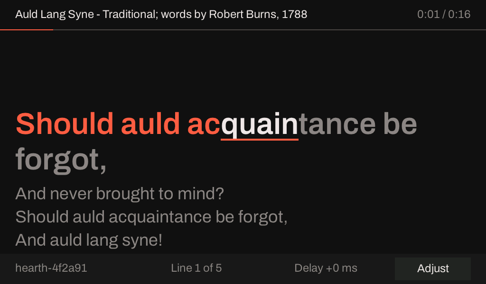

One colour for a word sung, one fill for the word being sung, and one for a word not yet sung, as on
the desktop, with one cue that is not colour (the underline), so that no one has to tell the colours
apart. The picture above and the others on this page are drawn by the firmware's own screen code
(`firmware/hearth-sink/main/panel/lvgl/lyric_screen.cpp`) and rendered by a tool on a computer
([below](#developing-the-screen-without-a-panel)).

| Screen | When |
|---|---|
| 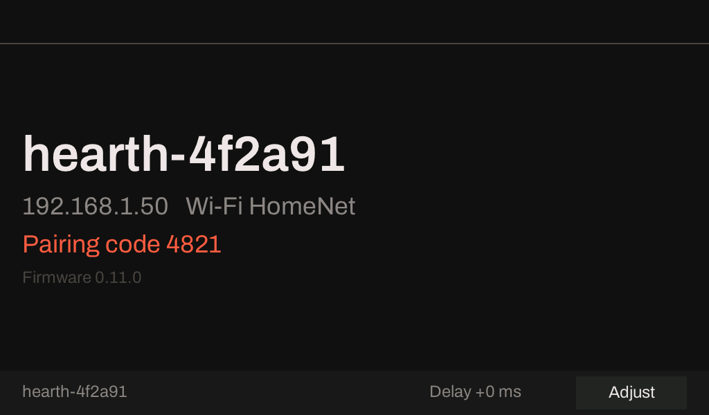 | **Nothing is playing.** The board's name, its address and network, and what it waits for; the pairing code while an attempt shows one |
| 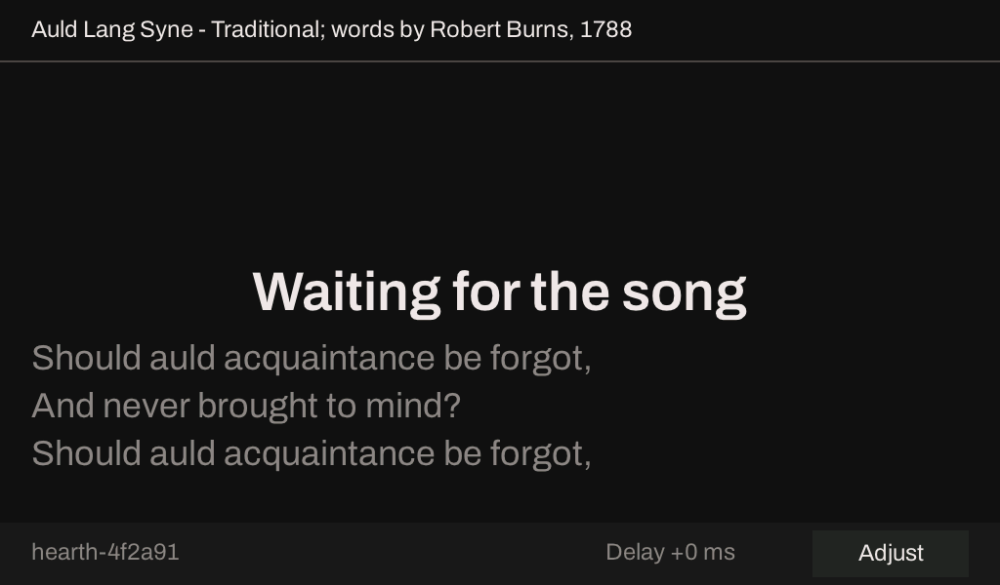 | **The song is held and has not started.** The first lines, so a singer sees what is coming |
| 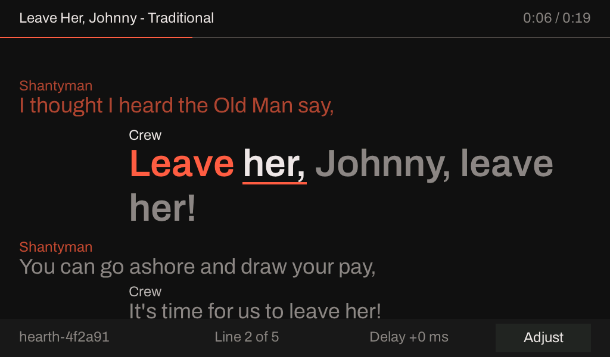 | **A duet.** The first singer's lines at the left, the second's indented, each tagged with its name from the file |
| 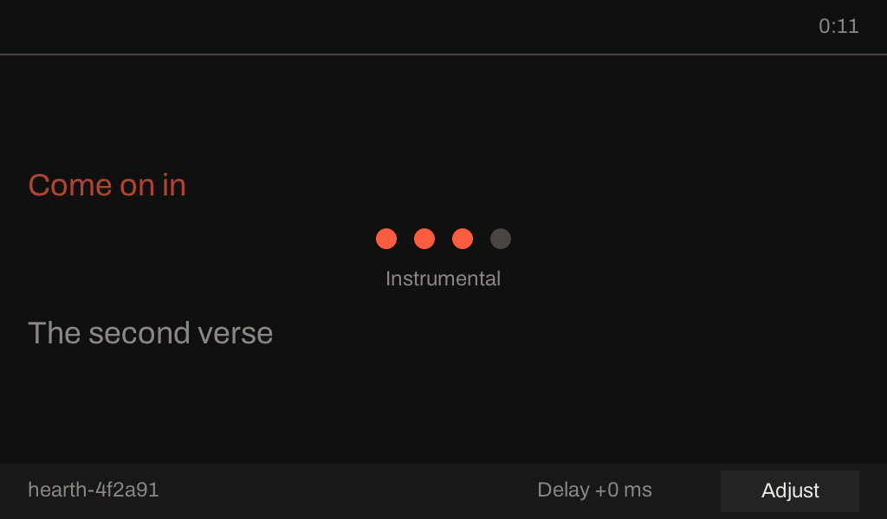 | **An instrumental break** of four seconds or more: four dots that go out one a second, so the line's start is seen coming |
| 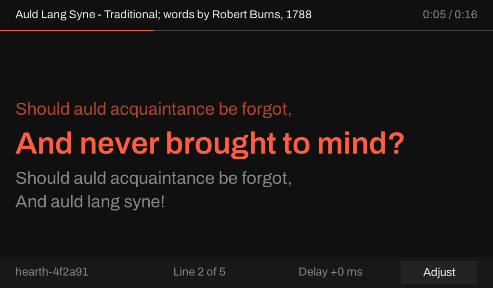 | **A file with line times only.** The whole line, emphasised; no word is invented |
| 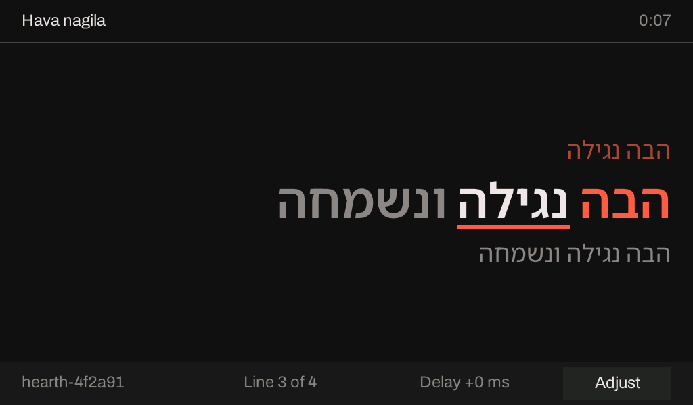 | **Hebrew or Yiddish.** Right-aligned, the words flow right to left and the fill runs from a word's right edge |
| 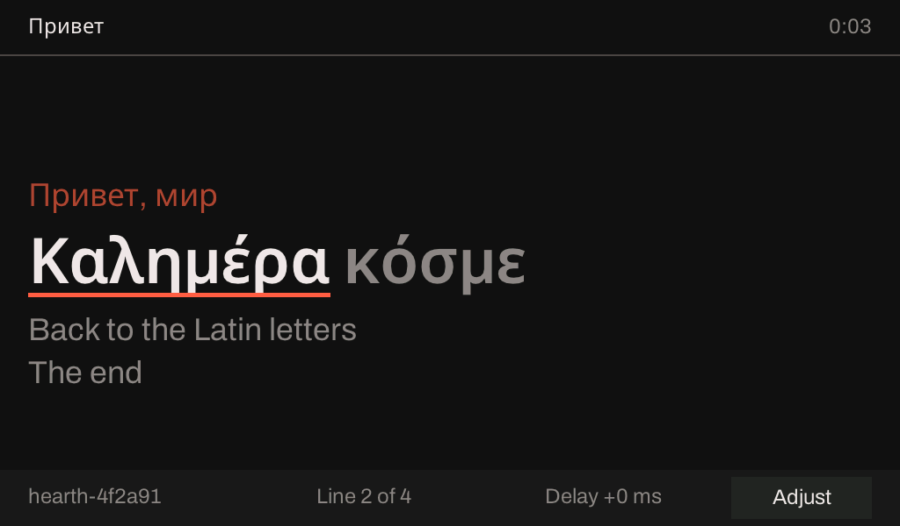 | **Cyrillic or Greek.** Drawn as Latin is, in Noto Sans behind Archivo, with the same fill |
| 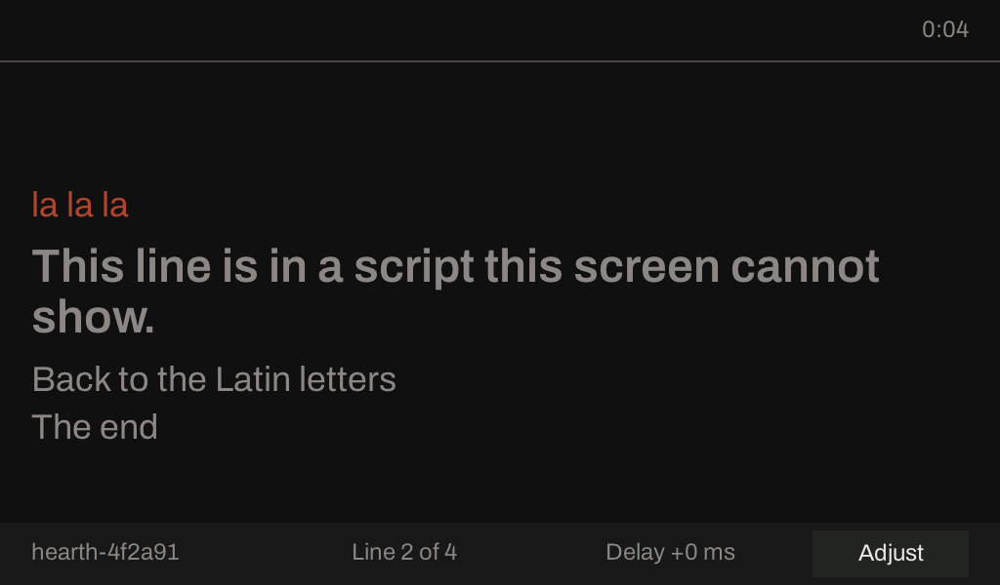 | **A script the fonts cannot draw** (Arabic here). One sentence in the line's place; the title in it is left out; a music note is dropped |
| 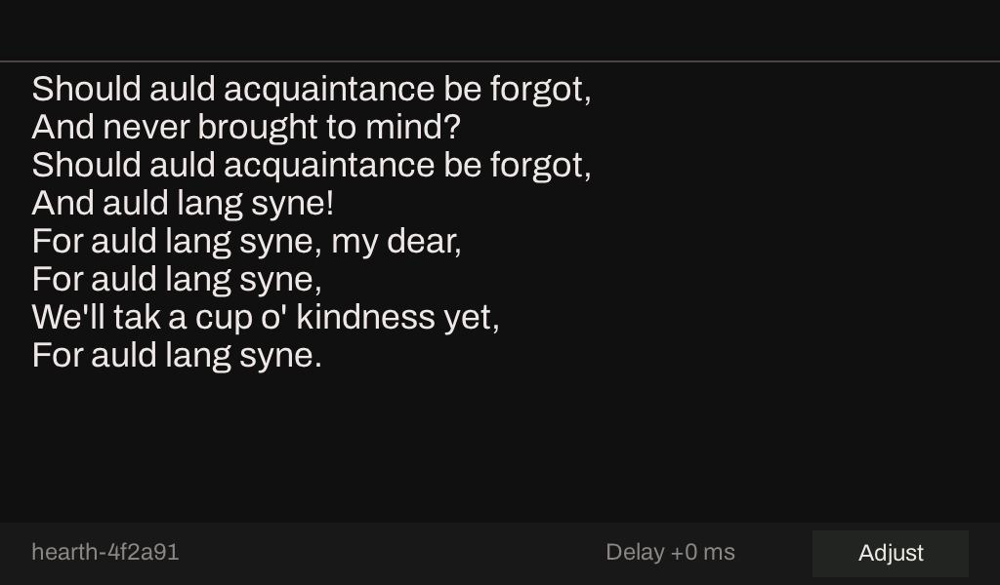 | **A file with no times.** The text, scrolled by touch, not followed |
|  | **Playing, and no lyrics are held** ([below](#a-song-with-no-lyrics)). The speakers of the layout in force, each glowing with its own level |
|  | **Playing, no lyrics, and the server has said what is playing** (the title card, [below](#a-song-with-no-lyrics)). The title, the artist, the album and year, and the song's time with a progress line |
| 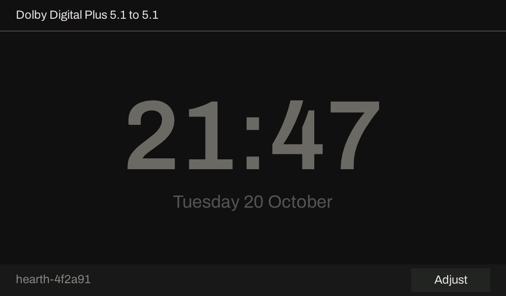 | **Playing, no lyrics, and the clock chosen** ([below](#the-clock)). The time, the date and the line over them; nothing until a time server has answered |
| 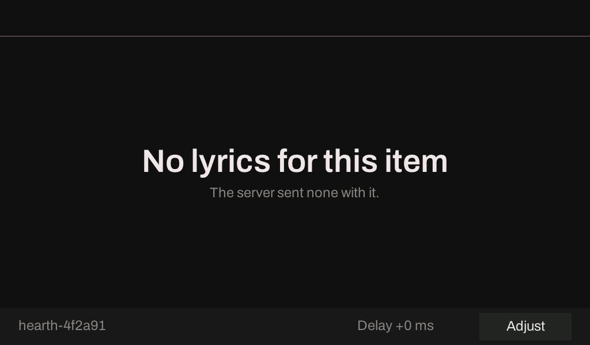 | **The same with that screen turned off.** The sentence this screen had before |
| 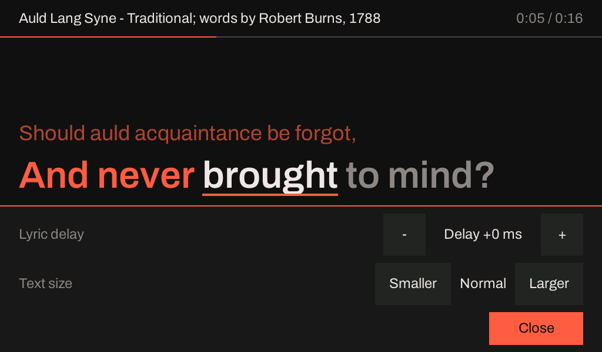 | **Adjust.** The lyric delay in 50 ms steps and the text size, and nothing else; put away after eight seconds untouched |
|  | **Preferences.** What is chosen once and left, grouped and scrollable ([below](#adjust-and-preferences)): the screen for a song with no lyrics and when it dims; a choice the board cannot make is greyed, with the reason |

**Controls.** Touch changes only what the board owns: its lyric delay (±1,000 ms) and its text size
(Smaller, Normal or Larger, which the sheet says beside its buttons) in **Adjust**, and what it shows
while a song has no lyrics, when that dims and the rest of what is chosen once in **Preferences**
([below](#adjust-and-preferences)). Which vocals sound and the reproduction are the server's settings and are
shown, not changed, until the role has a way to carry a request back.

#### Adjust and Preferences

The footer has two buttons, **Preferences** and **Adjust** (Adjust is where it always was, at the right). One is for
what a person does while a song is on, the other for what they choose once and leave.

**Adjust** keeps the two tweaks of the lyric screen: the lyric delay (50 ms steps, up to 1,000 ms either way) and the
text size (Smaller, Normal or Larger). It is 250 px tall on the kit's panel (it was 352 when it also held the screen for
a song with no lyrics and its dim time) and puts itself away after eight seconds untouched.


**Preferences** is a full-screen, scrollable list of everything that is chosen once and left, grouped Display, Sound,
Network, Time, Updates and System (a group with nothing in it is not drawn), with *Close* at the top right. It keeps the
screen lit while it is open, puts itself away after a minute untouched, and is built when it opens and deleted when it
closes, so the lyric screen is as it was with it shut. It holds what the screen shows while a song has no lyrics and
when it dims (the two settings that were in Adjust), the screen's **brightness**, how the clock view writes the time,
the **night schedule** and the **time zone**, then the Sound group (the test tone through each speaker, and the level and distance of each speaker on [the Speakers sheet](sink-speakers.md#setting-them)),
then the Network and System groups: wired or
Wi-Fi, the player's name, About, the paired servers, Restart, Reset preferences and Factory reset
([On the screen](#on-the-screen)). The technical settings (slot width, the second I2S line, the time
server) stay in the [developer view](#the-developer-view) and the routes.

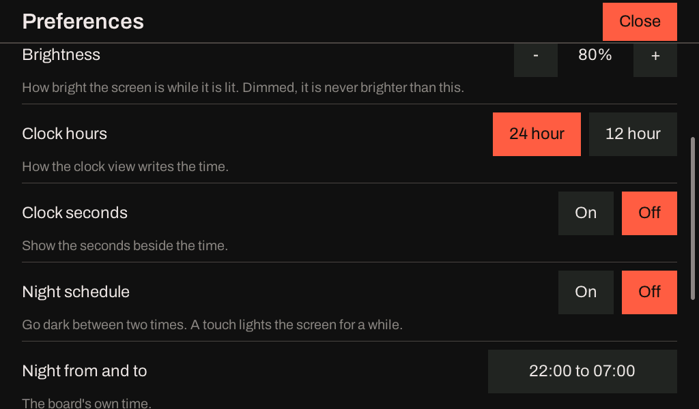

The brightness is a stepper (every tenth from 10% to 100%), the clock's hours and seconds are a choice and a switch, and
the night schedule is a switch, a button that opens an editor for its two times, and a switch for whether it darkens the
idle screen too. **A value that is chosen in a list or a pair of times is a button that opens an editor over the sheet**,
with a *Done* of its own:

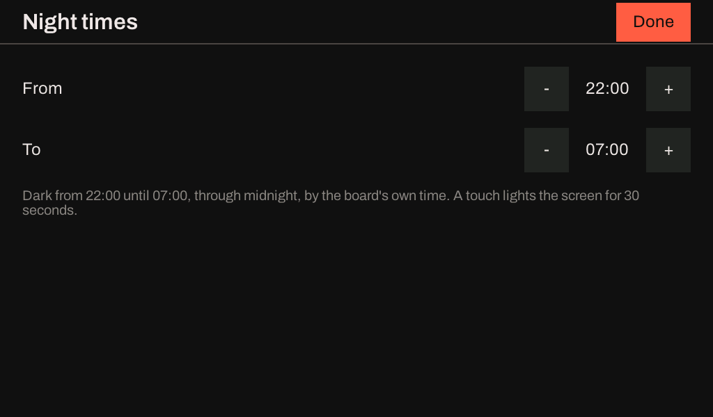

Each time steps a quarter of an hour round the clock (22:00 up is 22:15, and 00:00 down is 23:45); a button held keeps
stepping, ten times a second, and after eight steps moves an hour at a time. The pair is written half a second after
the last step, so that a held button is one write and not forty. The editor says what the two mean (*Dark from 22:00
until 07:00, through midnight, by the board's own time. A touch lights the screen for 30 seconds.*), that the schedule is
switched off when it is, and, for the same time twice, that the screen is never dark.

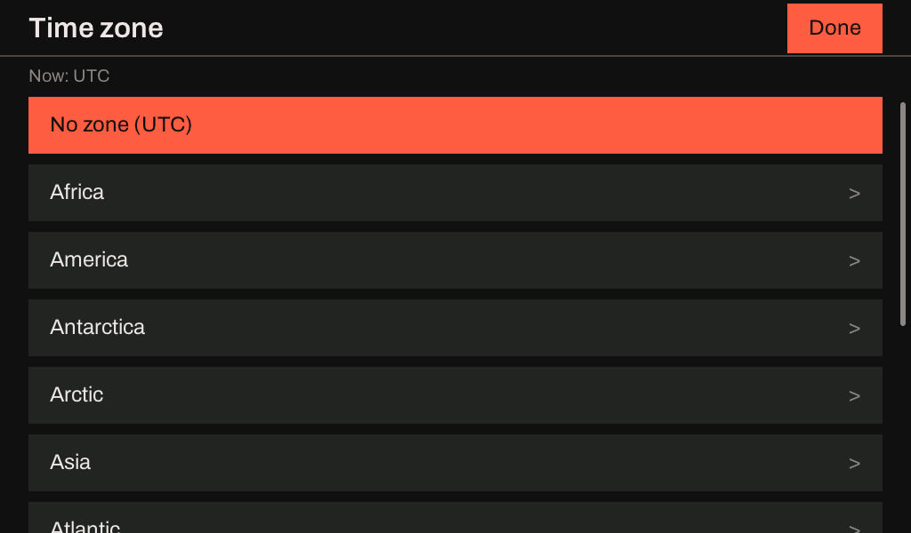

The time zone is the same picker as the web page's: the regions of the zone table (Africa to Pacific, and *No zone
(UTC)* above them), then the places in one, **opening at the region of the zone already chosen with that place in
view**, so a person who wants the city next to the board's own does not scroll for it. A tap on a place chooses it
at once; the editor says *Now: Melbourne (Australia)*, and *Regions* (a chevron on a narrow bar) goes back up.

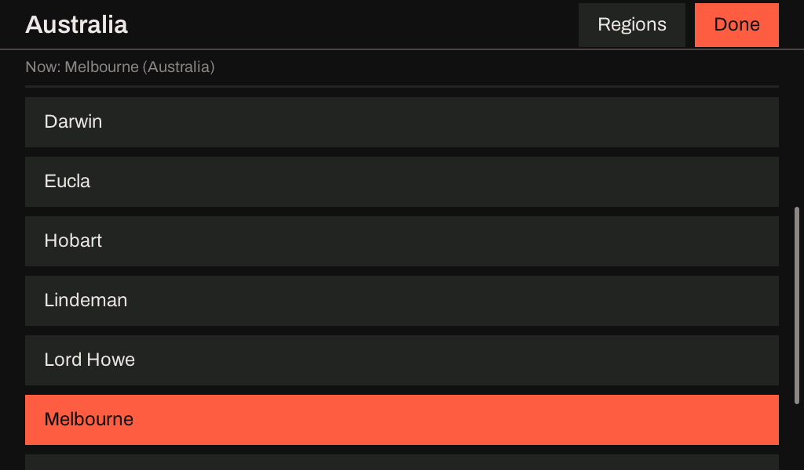


**One product base, many boards.** What a board can do is data, not an `#ifdef` and not "is this the P4X".
`iclforge::BoardCaps` (`libs/device/include/iclforge/board_caps.hpp`) describes it: the display (how it is attached, its
size, whether it has touch and a backlight), the sink (the bits in a TDM frame, whether a second line is possible,
whether the chip can open a TDM frame at all, and the slot width and second line in force), the networks, whether the
board keeps the time, the object cap, and the chip's own facts (`HardwareFacts`, which `GET /hardware` reports). The
firmware fills it from the build and the hardware (`main/board_caps.cpp`), and `board_variants.hpp` has every board the
product knows and a few it does not (an ESP32-S3 with a 320 by 240 SPI panel, an ESP32-C3 with a panel that has no
touch) for the host tests to walk.

The **preference registry** (`libs/device/include/iclforge/preferences.hpp`) is the list the screen, `GET /preferences`
and the web page all draw from. An entry has an id, a group, a label, a kind (choice, stepper, toggle, text, action, info,
list or sheet: a row that says what is set and opens an editor of its own), whether a change applies live, at the next play or after a restart, the route that sets the same value, its
choices, what **Reset preferences** does with it (`on_reset`: put back to its default word, or keep; an entry that says
neither fails a host test), and **`availability(caps)`**, once for the entry and once for each choice: whether this board
can do it and, if not, why. The values are read and set through a typed `Backend` that the firmware implements once over the `settings_*`
functions (`main/preferences.cpp`), so the screen, the routes and the host tests go through the same code.

**A preference the board cannot support is shown, greyed, with the reason, and never hidden.** On a board whose screen
has no touch, the Dark view (which a touch lights) and the dim time (which a touch wakes) are greyed, and the sheet says
why:

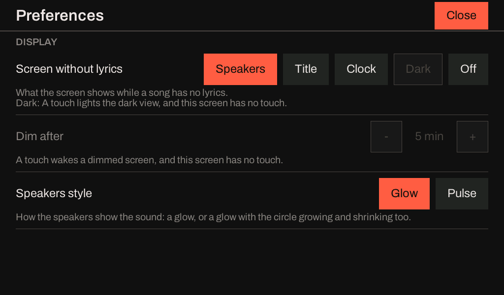

A tap on a greyed control does nothing, and `prefs::set_value()` refuses it before the board is asked. The host tests
(`libs/device/tests/test_preferences.cpp`) check every entry against every known board: a reason wherever something is
greyed, and a default that is never a choice the board cannot make.

| Preference | Id | Route | Available when |
|---|---|---|---|
| Screen without lyrics: speakers, title, clock, meters, dark, off | `now-view` | `/now-playing` | the board has a screen; *clock* needs a clock, *meters* a screen of at least 240 x 240 and the Sendspin player, *dark* needs touch |
| Dim after: 1, 5, 15, 30 minutes, 1, 2, 4 hours, never | `dim-after` | `/dim-after` | the board has a screen with touch |
| Speakers style: glow, pulse | `speakers-style` | `/speakers-style` | the board has a screen (it is greyed, with the reason, while the screen is set to the clock or off, which draw no speakers) |
| Brightness: 10% to 100% in tens | `brightness` | `/brightness` | the board has a screen whose backlight it controls |
| Clock hours: 24 or 12 | `clock-hours` | `/clock-format` | the board has a screen and keeps the time |
| Clock seconds: on or off | `clock-seconds` | `/clock-format` | the board has a screen and keeps the time |
| Night schedule: on or off | `night-schedule` | `/night-schedule` | a screen with touch, and a clock |
| Night from and to: a pair of times (editor) | `night-times` | `/night-schedule` | the same |
| Night covers idle screen: on or off | `night-idle` | `/night-idle` | the same |
| Time zone: a place by region (editor) | `time-zone` | `/timezone` | the board keeps the time |
| Wired or Wi-Fi: automatic, wired, Wi-Fi | `network-preference` | `/network-preference` | the board has both a wired network and Wi-Fi |
| Name of this player | `name` | `/name` | always |
| About | `about` | `/hardware` | always |
| Paired servers | `paired-servers` | `/pairing` | the board runs the Sendspin player |
| Restart | `restart` | `/restart` | not while an update is under way, nor while the new image is on trial |
| Reset preferences | `reset-preferences` | `/reset-preferences` | not while an update is under way |
| Factory reset | `factory-reset` | `/factory-reset` | as Restart |
| Identify speakers: a button, *Identify*, that opens the Speakers sheet and plays the tone through every speaker in turn | `identify-speakers` | `/identify` | the build has a Sendspin player; a song playing says so under the row |
| Speaker levels and distances: a sheet (kind `sheet`), the same Speakers sheet, with the room, a level and a distance for each speaker | `speaker-trim` | `/trim` | the build has a Sendspin player; the distance needs delay lines (PSRAM) |
| Late night: standard or late night; from the next stream, and put back by Reset preferences ([Late night](sink-esp32-s3.md#late-night)) | `late-night` | `/dynamic-range` | the build has a Sendspin player: it decodes the Dolby streams |

**`GET /preferences`** lists every entry as this board sees it, on every board (one with no screen lists the Display
entries greyed with *This board has no screen.*): its id, group, label, kind, how a change applies, the route, the
value, whether it is available and why not, and each choice the same way. It is read-only; a change goes through the
entry's own route.

```json
{"profile":"p4-rev3","display":"dsi","preferences":[{"id":"now-view","group":"Display","label":"Screen without lyrics","kind":"choice","apply":"live","route":"/now-playing","value":"speakers","available":true,"reason":"","choices":[{"id":"speakers","label":"Speakers","available":true,"reason":""}]}]}
```

**Any size of screen.** The sizes are the display's, not 1024 by 600's. `libs/device/include/iclforge/screen_metrics.hpp`
derives the margins, the gaps, the type and the height of a button from the display's shorter side (host tested for every
size), and the footer and both sheets are laid out from them, so the kit's own sizes are as they were:

| Display | Margin | Type | Button (Adjust / list) | Adjust sheet |
|---|---|---|---|---|
| 1024 by 600 | 32 | 24 | 72 / 64 | 250 px |
| 800 by 480 | 24 | 22 | 64 / 56 | 222 px |
| 480 by 320 | 16 | 18 | 56 / 52 | 194 px |
| 320 by 240 | 10 | 16 | 48 / 48 | 170 px |

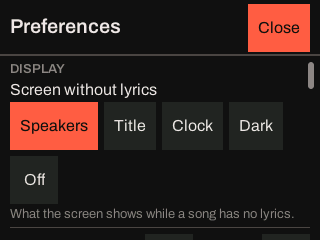

**The fingertip.** A control that is touched is at least **48 px** on both sides, with at least 6 px to the next one:
48 px is 7.2 mm on the kit's 7-inch 1024 by 600 panel (about 6.7 px a millimetre) and 7.4 mm on a 2.4-inch 320 by 240
module, over the 7 mm that Apple and Google give as the least a finger hits reliably (44 pt, 48 dp). The preview tool
([below](#developing-the-screen-without-a-panel)) draws Adjust and Preferences at the four sizes above and **fails the
run** if text is cut off, a control sticks out of what holds it or off the screen, a touch target is under 48 px or
closer than 6 px to another, a tap does not do what it says, a greyed choice answers a tap, or a list longer than the
glass does not scroll. A display backend for a chip other than the P4 is not written (no such panel is on the bench):
`panel/lvgl/display.hpp` is the seam one would fill, and everything above it takes its size from the display.

**Adding a preference** is a registry entry (id, group, label, choices and their availability rules), a getter and a
setter in `Backend` (a pure virtual, so a firmware that forgot the setter does not build), the same pair in the host
tests' fake, and the firmware's implementation; only a control that is not one of the five kinds needs an editor, and
it names one (`Pref::editor`: a pair of times, a place in a list) which `panel/lvgl/prefs_editors.cpp` draws. There are
no bespoke buttons in `lyric_screen.cpp`.

**A tap's setter runs on the panel's own task**, which holds the panel's lock (a `std::mutex`, not recursive) for the frame
that reads the tap, so **no `panel_set_*` may take that lock** or touch the glass: a tap on Brightness - or + once hung the
screen for good (the first run on the kit, 2026-10-26) because the brightness setter did both. What the screen follows is
`iclforge::panelfollow::PanelFollow` (`libs/device/include/iclforge/panel_follow.hpp`): atomics only, the brightness only
marks the backlight stale, and the panel's loop gives the glass the level in its next cycle (within a tenth of a second).
`test_panel_follow.cpp` holds a lock across every setter, and reads `panel.cpp` to fail if a `panel_set_*` mentions a lock,
a wait or the glass.

#### A song with no lyrics

Most of what is played has none. While a stream plays and the board holds no lyrics, the panel shows
the **speakers**: the room the layout in force describes, seen from above with the front at the top.
Ear-level speakers are circles, height speakers rounded squares, the LFE a wide box along the bottom,
and each speaker glows with its own level, from the board's own measure of the last 100 ms. A
speaker with nothing on it is a hollow outline, so a dead output can be seen. The line above says
what arrives and what it is played on (*Dolby Digital Plus 5.1 to 7.1.4*, *PCM to 2.0*).


It is meant to be left on for hours in a dim room: the glow moves in a few steps, and is never brighter
than the accent at 55%. **After five
minutes with nothing touched** (the time is a Preference, or `PUT /dim-after`: `never`, or whole minutes
from 1 to 240) the backlight goes to 4% and a black screen with one line is over everything; any tap
brings the speakers back, and the tap does not also press what is under it. Only this screen dims:
the lyric screens and the idle screen do not.


**How the speakers follow the sound** (the plan is [planning/p4x-speakers-options.md](https://github.com/iainchesworthlabs/iclforge/blob/main/planning/p4x-speakers-options.md)).
The screen reads the level of every 100 ms window the player measures (a lock and two short arrays,
`BurstPlayer::levels()`; the heading and the title are still read five times a second), where it once read
every other one. A level is judged against **the loudest the room has lately been** (it rises at once and
falls 2 dB a second, and is never lower than -48 dB of full scale), so that the same music shows the same at
any volume: the player's volume is applied before the meter, and against full scale the glow would shrink with
the knob. The core of a speaker is six steps over 30 dB (6 dB a step) and the halo, from the peak, two. The
level rises at once and falls at 60 dB a second, so a hit is a step down in the window after the next, and a
step changes only when the level is 0.4 of a step past its edge (0.7 for the halo), so that a level on a
boundary does not flicker. A speaker with nothing on it is still a hollow outline. These are the constants of
`libs/render/include/iclforge/render/room_plan.hpp`, chosen over a synthetic groove in 2.0, 5.1 and 7.1.4
(`firmware/hearth-sink/preview/speakers_options/tune.cpp`): 72% of the onsets of 5 dB or more showed as a step
up in the same window (the 5 Hz glow before it: 3 to 26%), 3 to 5% of steady windows moved a step, and the
view flushed 18 000 pixels a second at 2.0, 56 000 at 5.1, 82 000 at 7.1.4 and 101 000 at 9.1.6 (the lyric
screen's song filling: 192 000). The pixels are what the view costs; what they cost a stream on the kit (the
first design, at about 45 000 a second at 5.1, cost a burst 0.4%, below) is still to be measured for these
constants.

**The speakers' style.** `glow` (the default) is the above. `pulse` makes the filled circle of each speaker
grow and shrink with its level, a little: eight sizes between 88% and 112% of the plan's, moved by at most
three in a window, held until the level is a quarter size past an edge, and a speaker 18 dB or more under the
room's loudest (or silent) stays at its smallest and does not move. The halo is not resized, so a size change
redraws the circle's rectangle and nothing else. It needs no meter and no seam the glow does not have. It is
set in Preferences (Display) or with `PUT /speakers-style`; the value is kept on the
board as `np_style` (0 glow, 1 pulse; never renumbered).

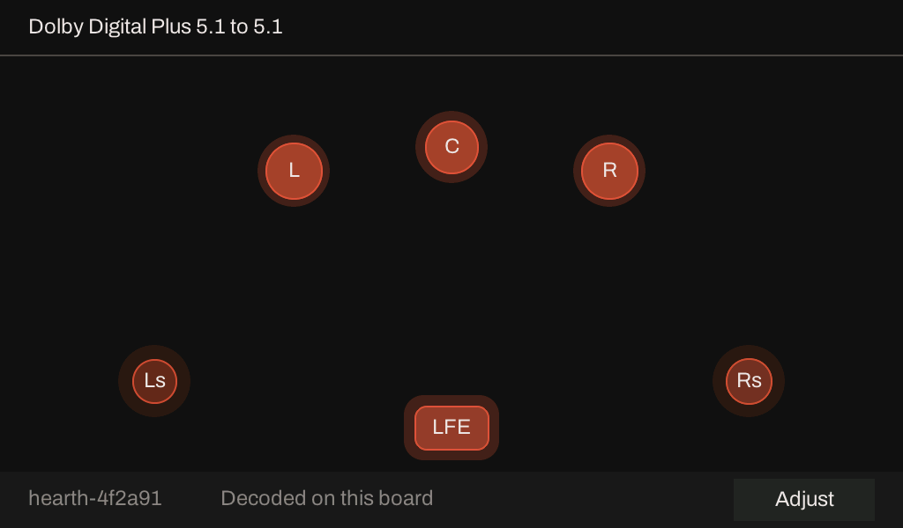
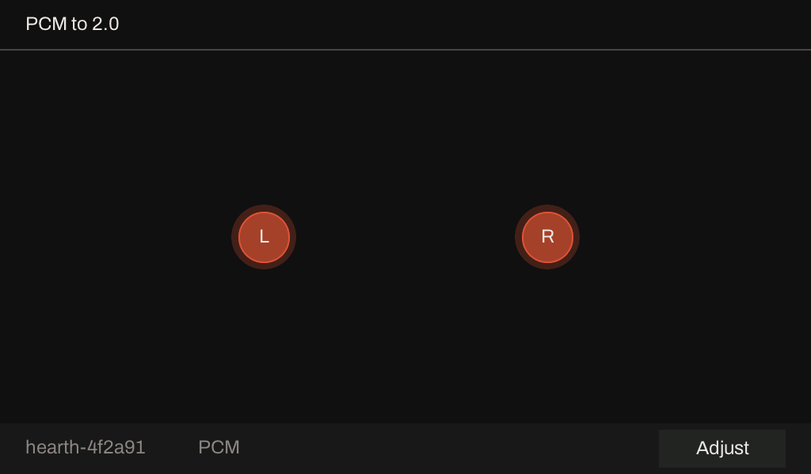

Both styles stay: the owner, 2026-10-25, saw the glow, as it was and as it became, beside the pulse at plus and
minus 12% (the bound is `kPulseReach`), and kept both as a choice, with the glow the default.

Which screen shows is the owner's: `speakers` (the default), `title`, `clock` ([below](#the-clock)),
`dark`, or `off`, which is the old sentence. The plan, with how each was chosen and built, is
([planning/p4x-now-playing.md](https://github.com/iainchesworthlabs/iclforge/blob/main/planning/p4x-now-playing.md)).

**The title card.** The board lists `metadata@v1` in its hello, which a board with a screen does and
one without does not, so a server that has the role tells it what is playing: the title, the artist,
the album and its year, and where in the song it is. The card is those, and nothing the server did
not say: the title in 72 down to 34 px by its length (the lyric line's rule, and the same Smaller and
Larger steps), in two rows at most with three dots after them; the artist under it in 36 px, the album
and year in 24 px muted; the song's time at the top right and a progress line under the header, as the
lyric screens have them, where the server gave a progress and the board's clock has converged.


**The Meters view.** A choice of the screen without lyrics (`meters`, stored as `np_view` 5, never renumbered; Preferences,
Display, *Screen without lyrics*, or `PUT /now-playing`): an instrument rather than a picture of the room. The top of the screen is a
third-octave spectrum of the main mix (31 bands from 20 Hz to 20 kHz, 0 dB a full-scale sine, 60 dB of range) with a dB scale, a
peak tick that holds one second and then falls, and the colours of a level meter: green, then amber from -30 dB and red from -15 dB.
Under it are the room's channels, drawn the way the size of the screen and the number of outputs ask for
(`iclforge/meters_view.hpp`, `representation_for`):

| Screen width | A 2.0 room | More than two outputs |
| --- | --- | --- |
| under 400 px | the pair, L and R, with a peak tick each | the pair (the stereo downmix of the room) |
| 400 to 799 px | the pair | one meter for each of L, C, R, LFE, Ls, Rs (the surround sum) |
| 800 px and wider | the pair | every output, in groups: Front, Surround, Rear, Height, LFE |

The bars are green, amber from -18 dB and red from -6 dB, with a peak tick that holds 1.5 s. The spectrum has one bar a band on the
wide screen, two bands a bar on the middle one and three (an octave) on the small one. **The Meters view needs a screen of at
least 240 by 240 and the Sendspin player**, because the player is where the sound is: on a board without either, the choice is shown
greyed with the reason and `PUT /now-playing` answers 409. While Meters shows, *Speakers style* does nothing (the glow and pulse
are the speakers' view) and is greyed too.

What it draws comes from the player, not the glass: after the output stage has set its gain, `BurstPlayer` hands each block of the
frames about to be played to a `BlockTap` (`iclforge/block_tap.hpp`), one pointer read when nothing is listening. `MeterTap`
(`iclforge/meters_tap.hpp`) keeps a mono mix of the outputs in a ring of 340 ms and, for each output, the largest sample in each
50 ms; the screen takes the mix, analyses it (`iclforge/dsp/spectrum.hpp`: a 2048-point transform of the signal at 12 kHz for the
17 bands up to 800 Hz and a 1024-point one at 48 kHz above it, so that a low band is not smeared over a fifth of a second and a high
one is not slow), averages the power over 80 ms, and lets the bars fall at 30 dB a second (meters 24). It does this twenty times a
second whatever the frame rate. The spectrum, the channel bars and the pair of meters are each one canvas, redrawn only where a bar or a tick moved, in a few rectangles (one for each run of
neighbouring bars that move alike), so an update is a handful of invalid areas and not a hundred (a rectangle for each part of each bar, which the kit measured at 80 to 290 ms a refresh). When the screen is dimmed or another view is
chosen the tap is removed, so a board that is not showing meters pays nothing for them. Everything the view draws, and the analysis's
tables (about 63 KB with the transform's work buffers, in PSRAM), exist only in an image with a panel; the C6 and S3 images have the tap's interface and nothing else.
How fast it runs on the kit, and the protocol that measures it, are in
([planning/p4x-meters-view.md](https://github.com/iainchesworthlabs/iclforge/blob/main/planning/p4x-meters-view.md)).

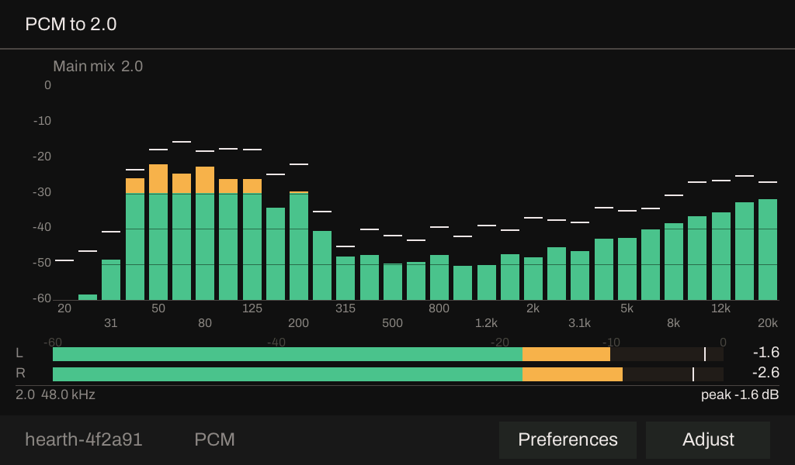
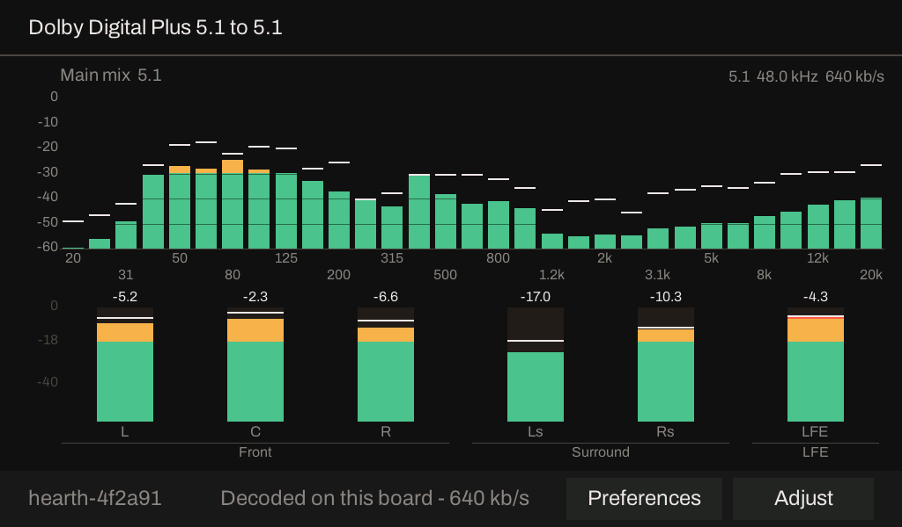
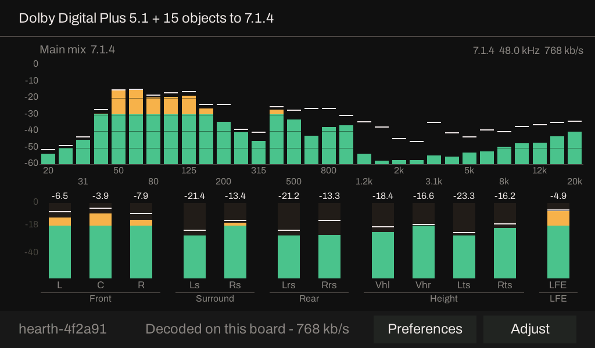
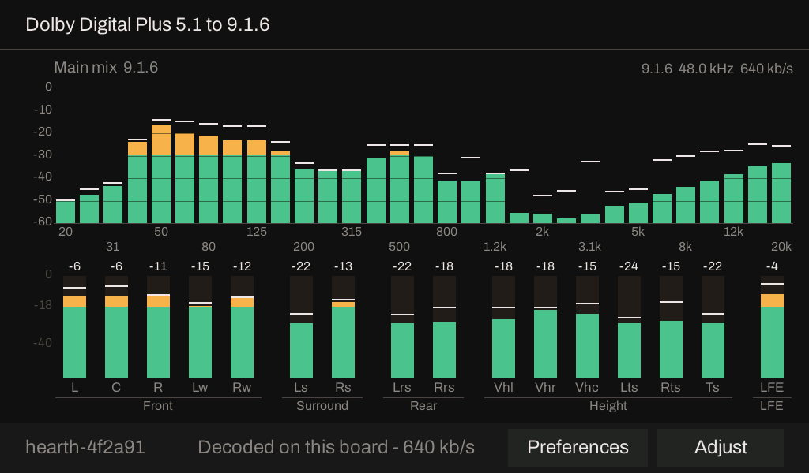
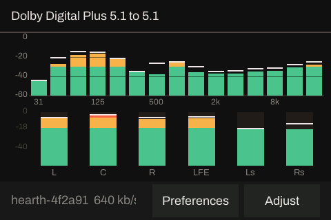
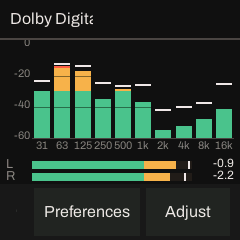

**What the Meters view costs, and the rate it holds.** `GET /panel-stats` (port 80, on a board with a screen) says what the panel
costs: LVGL's refreshes (the start of one to its end, the flush to the glass included), the panel task's stack never-free minimum, the
PSRAM and internal heap now and at their lowest, and, once the view has been opened, the Meters view's own figures since it opened: the rate it
holds, how long an update's analysis, widgets and render take (last, mean, largest), the updates that were late or missed, and what the player's
tap costs the audio path for a burst of 1,536 frames. The developer view shows the same in its PERFORMANCE section. The view runs at **twenty updates
a second when the panel's task can keep up and ten when it cannot** (`iclforge/meters_governor.hpp`): over the last 20 updates, an average cost
above 70 % of the 50 ms step, or 4 updates started more than 15 ms later than the loop could have started them, drops it to ten; it returns to
twenty only after 10 s at ten with the cost under 60 % and nothing late, so that it does not flip; the first two seconds of a view are not judged (its first draw and the
cold code are not what it costs). The target is **20 Hz if possible, else a steady 10 Hz** (no more than
1 % of the steps without an update, an update under half of its step), and the kit protocol says which room holds which. **The audio comes first:** while the decoder is
busy (a mean burst of 14 ms or more of its 32: a 7.1.4 object stream, AC-4; not a 5.1 E-AC-3 room) the view is held at ten, since the drawing and the analysis beside the decoder
cost it 1.5 to 2 ms a burst in those rooms (`ICLFORGE_EXAMPLE_PANEL_YIELD`, default 1; 2 also keeps the panel's task on the decode core, and 0 turns it off). How each room holds up on the kit, and the
protocol that measures it, are in
([planning/p4x-meters-view.md](https://github.com/iainchesworthlabs/iclforge/blob/main/planning/p4x-meters-view.md)).

**The stream, in the footer.** While the speakers or the card show, the footer says what the stream is
and who sends it, in the most that fits: *Decoded on this board - 768 kb/s - from Music Assistant*, then
*Decoded here - 768 kb/s - from Music Assistant*, then the same without the server, then the figure alone. With
**Preferences** and **Adjust** both in the footer there are 386 px for it on the kit's panel (it was 558 with Adjust
alone), which holds *Decoded on this board - 768 kb/s* and not the server's name: the developer view has that.
A coded stream (E-AC-3, AC-3, AC-4) is sent undecoded and decoded on the board, which the wording says; a
PCM one was decoded by the server, and the footer says *PCM from Music Assistant*. The bitrate is what was
played: the coded bytes of the chunks played over the time they took, over windows of a second and
smoothed, not a figure from a header (it is absent until the first second has played). The server is the
name in `/status` `server` without the id in brackets (`Music Assistant (d5369777-music-assistant)` is
*Music Assistant*); the developer view keeps the whole string.

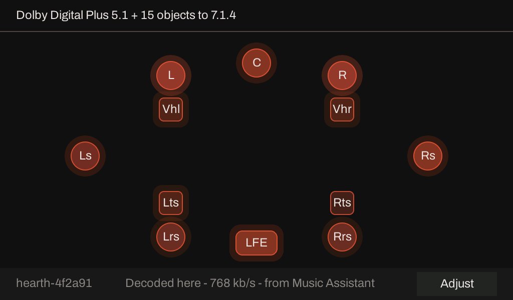
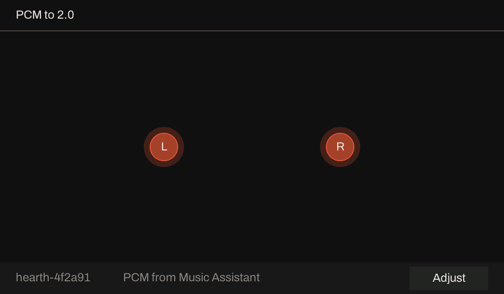

**A layout for a server that sends none.** A board's layout is the image's (`CONFIG_ICLFORGE_EXAMPLE_LAYOUT`,
`2.0` on the kit) until a server's settings replace it for the stream: Hearth sends one, Music Assistant
does not, so a 5.1 or 7.1.4 stream to a 2.0 board shows two speakers. `PUT /layout` now keeps what it is
given in NVS, so it survives a restart, and the board starts with it (a stored layout this sink cannot
carry is said on the console and the image's stands):

```
curl -X PUT -d 7.1.4 http://<board address>/layout
```

The role's own settings message still wins for the stream and is not stored.

**Until a title has come, there is no card.** With `title` chosen and nothing said (a server that
does not send the role, or has not yet), or with a title in a script the fonts cannot draw, the
speakers show in its place, and nothing but a title makes a card. Once a title is known the speakers'
own header says it too: *Title - Artist* at the left, the time at the right and the progress line under
it, in place of what arrives and what it is played on (which the dark screen still says).


The card dims as the speakers do, and its dark screen names the song (*Playing - Blue in Green - Miles
Davis*). What the store keeps is small and fixed (a title of 256 bytes, an artist or an album of 160,
cut at a character and not in the middle of one), in strings that keep their capacity, so a server's
update and the panel's five reads a second allocate nothing from the internal heap an AC-4 decoder
leaves little of. Two servers say it differently, and the board reads each as it means it
([planning/hearth-sendspin-extension.md](https://github.com/iainchesworthlabs/iclforge/blob/main/planning/hearth-sendspin-extension.md),
C36): the specification's object is the whole state, so what it leaves out is gone (and aiosendspin 10,
which Music Assistant runs now, sends it so); aiosendspin 9.1.1's carried only what changed, a field it
cleared given as `null`, so that a pause (a progress and nothing else) leaves the title alone and a track
with no artist does not keep the last one's. A state stamped in the future (a scheduled change, which
aiosendspin can send up to 20 s ahead and Music Assistant does not) takes effect when it arrives.

**Dark** is for a listener who wants no light at all while music plays. With it chosen, the backlight
is **off** from the moment a song with no lyrics begins, however long ago anything last touched the
panel, and the screen says nothing. **A tap lights the speakers for 30 seconds from the last touch**
(another tap moves that on), and then it is dark again. The tap that lights it does not also press what
is under it; the developer view and Preferences keep the screen lit while they are open (the Adjust sheet
puts itself away after eight seconds, inside the 30). Preferences' dim row, which has no meaning here, is
greyed and says "Not used by the Dark view: a touch lights it for 30 seconds, then it is dark again." Only this
screen goes dark: a lyric screen and the idle screen are lit as they always were.


| Route | Takes | Default |
|---|---|---|
| `GET` and `PUT /now-playing` | `speakers`, `title`, `clock`, `meters`, `off` or `dark` | `speakers` |
| `GET` and `PUT /dim-after` | `never`, or minutes from 1 to 240 | `5` |
| `GET` and `PUT /speakers-style` | `glow` or `pulse` | `glow` |
| `GET` and `PUT /brightness` | a whole number, 10 to 100: the percent the backlight is at while the screen is lit | `80` |
| `GET` and `PUT /clock-format` | `24`, `12`, `24 seconds` or `12 seconds` | `24` |
| `GET` and `PUT /night-schedule` | two times and a state: `22:00-07:00 on`; `PUT` also takes just the times (and switches it on), or `on`, or `off` | `22:00-07:00 off` |
| `GET` and `PUT /night-idle` | `on` or `off` | `off` |

All six are stored on the board and take effect at once, with no restart; a board with no panel answers
404. **The brightness is the lit level, and the dim floor stays under it**: the dimmed screen is at 4%, or at
the brightness if that is lower, and the dark view is off whatever it is. A screen whose backlight cannot be
dimmed (the frame buffer a board with no panel runs) refuses it with a 409. `GET :8081/panel` says which `view`
is chosen, whether the screen is `dimmed` (a black cover is up, dimmed or dark) and the `backlight` in percent:
80 lit (or the brightness set), 4 dimmed, 0 dark; whether Preferences is open (`prefs_view`), how many times
it was built and the longest a build took (`prefs_builds`, `prefs_build_us_max`); and the
[time of day](#the-time-of-day)'s state.

#### The clock

The time of day, for a room where the sound is the thing and the panel is a glance: **the time at 200 px, the
date under it, and nothing else**, in the muted tone (the time at about 80% of it and the date at about 60%, so
that neither is the brightest thing in a dim room). By default it is in 24 hours and shows no seconds, so what the
screen redraws is the time's rectangle once a minute (the preview counts 224,000 pixels, against none for a second
that passes), and the line over it still says what the stream is (*Dolby Digital Plus 5.1 to 5.1*).

**A person can have 12 hours** (*9:47*, with a small *PM* beside it; midnight is 12:05 AM) **and the seconds**
(small beside the digits, *:12*), in any combination: `PUT /clock-format` takes `24`, `12`, `24 seconds` or `12 seconds`.
The small text is a label of its own, so a second that passes redraws about 9,600 pixels and not the digits' 300,000,
and with the seconds off a second redraws nothing.

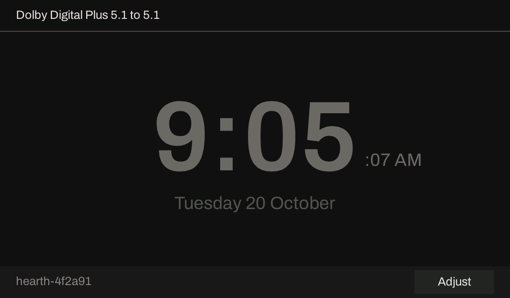


The time is [the board's own](#the-time-of-day), kept with a time server, which every board does.
**Until the first answer the view draws the heading and nothing else, never a time it made up** (and an
answer from before 2026 is a server with a wrong clock, and is not taken for the time either).

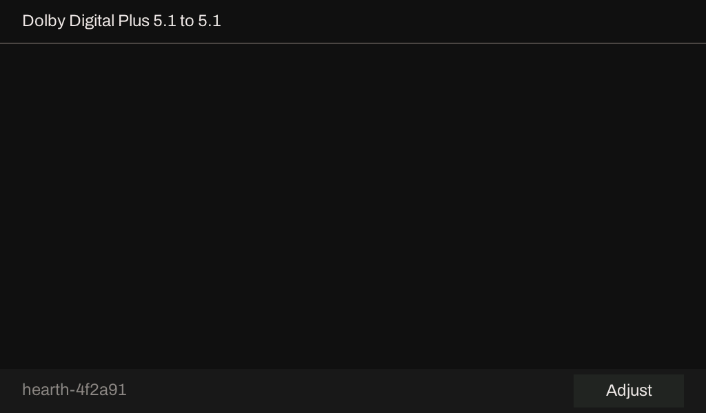

**With no time zone set the clock says UTC, and says so:**

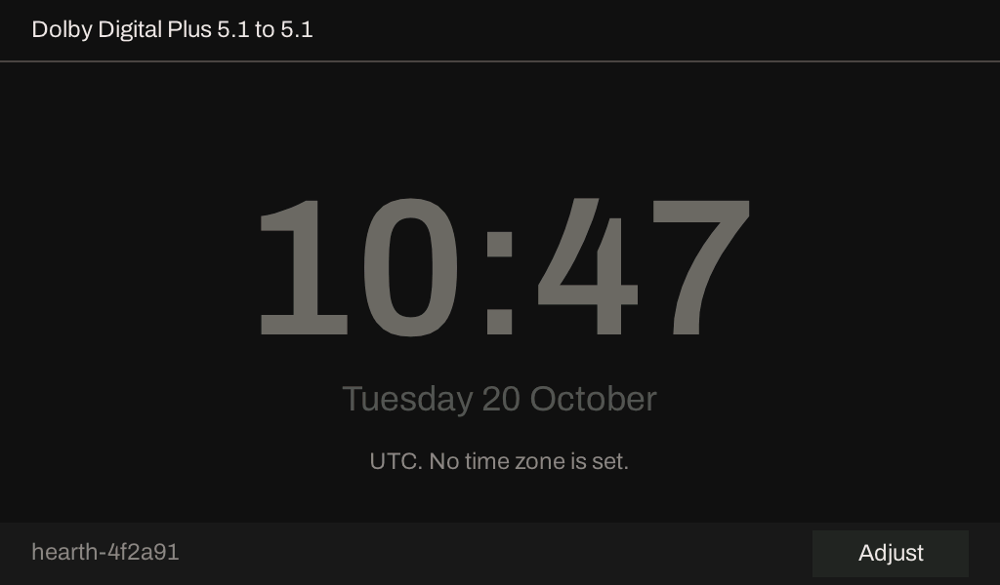

**A dim leaves the clock on the glass.** Dimming lowers the backlight to its floor, as for the speakers,
but the clock is what a dark room has the screen for, so no black cover goes over it: a clear one
catches the tap that wakes the screen, and the time goes on changing under it.

#### The night schedule

**Go dark between two times**, by the board's own time (the [time of day](#the-time-of-day), in its zone). It is off
until a person switches it on, and then it is **22:00 to 07:00** until they change the times. While it is in force
the no-lyrics screen behaves as the [dark view](#a-song-with-no-lyrics) does: **dark from the moment it begins to show**
(a song that starts at 23:00 is dark at once; one already playing at 22:00 goes dark once nothing has touched the glass
for 30 seconds), **a tap lights it for 30 seconds from the last touch**, and the tap that lights it does not also press
what is under it. A window that ends before it starts crosses midnight; the same time twice is an empty window (never
dark: a whole day is the Dark view's job); **a board that has not heard the time yet is lit**, never dark by accident;
and a zone with daylight saving moves the window with the clock (the night the clocks go forward is eight real hours of
dark, the night they go back ten). With the Dark view chosen, or the screen without lyrics Off, the rows say the schedule
is not used (*The Dark view is dark already: a touch lights it for 30 seconds, as at night.*).

**The idle screen is a switch of its own** (`night-idle`, *Night covers idle screen*), off. Whether the night should
darken the screen between two songs as well is the owner's to say; with it on, the idle screen counts as showing while
the night is in force and is dark from the moment the night begins, with the same touch. It is not used while the
schedule is off, and the row says so.

**Kept as one number.** NVS `night` holds the two times and both switches (from in bits 0 to 10, to in bits 11 to 21,
bit 22 on, bit 23 the idle screen), so a power cut cannot leave half a schedule; a number no build wrote is dropped with a
line on the console and the Kconfig default (`ICLFORGE_EXAMPLE_NIGHT_SCHEDULE`, `22:00-07:00 off`, and
`ICLFORGE_EXAMPLE_NIGHT_IDLE`) stands. Reset preferences returns it; the time zone it is read in stays. The panel is
handed the schedule and the board's local minute of the day (read only while the schedule is on, and nothing until the
clock has converged) and `lyric_screen.cpp` passes both to `dim_state()`: that is the whole of what the screen does for it.
The rule, its words and its changeover cases are host-tested (`test_now_view.cpp`), and the preview tool drives it on the
screen: lit at noon, dark at 23:00, a touch lights it for 30 s, lit at 07:00 and with no time known, and the idle screen
dark only when told.

**On the kit, the title card** (2026-10-21): `hearth-testserver` said a song over Sendspin (`--title`, `--artist`, `--album`, `--year`, `--track-seconds`, and `--then-after` for a second song with no artist) and the panel's read-back was the card above, then the second song alone with nothing kept from the first, and the speakers again when the play ended; a play that said nothing, with the card chosen, showed the speakers; a 119-character title ended in three dots after two rows, and `0:08 / 24:45` fitted. A 5.1 E-AC-3 programme at layout 5.1 took 5,325 µs a burst with the view off, 5,341 with the speakers (their header the song) and 5,333 with the card (three plays each, none late, no underrun or resynchronisation); at 2.0 with a stereo programme 2,614, 2,628 and 2,633; at 7.1.4 6,475, 6,478 and 6,491. The role itself cost nothing that showed: the image without it took 5,364 µs for the same play. The panel redraws about 5.7 times a second for the song's time and line. The owner's Music Assistant had not reconnected to the kit by then, so what it sends this role is from aiosendspin's source (the whole state each time, as the specification has it) and not yet seen on the board.

**On the kit, the speakers** (2026-10-21): over Sendspin, a 5.1 E-AC-3 test programme with no lyrics drew exactly this picture; with the speakers showing, a burst took 4,573 µs against 4,555 µs with the view off (three 60 s plays each, no late burst, underrun or resynchronisation, and the same least free heap), and at 2.0 with a stereo music programme 2,099 against 2,114 µs. With `dim-after` at one minute the screen went dark 60.4 s after the speakers began to show, and a tap woke it. The glass's brightness at 4% and a finger's tap in place of an injected one were not looked at; the scan-out is the same whatever is drawn, and dimming leaves it alone. The **dark view**, run the same way (the same programme for 190 s, injected taps, the read-back sampled twice a second): dark as soon as the song showed, on a panel nobody had touched; a tap on *Adjust* lit it within 0.8 s and did not open the sheet; dark again 30.1 s after that tap; two taps 20 s apart kept it lit and it was dark 30.2 s after the second. A real finger, and the glass with its backlight off, were not looked at.

**The time and the clock** (2026-10-21, with the time on every board): the clock view drew `09:06 Wednesday 21
October` against the PC's local `09:06`, and a 5.1 Sendspin play with it chosen took a burst 4,566 µs against
4,564 µs with the view off (three 60 s plays each, no late burst or underrun). The board asked a time server
from boot, answered within seconds, stopped asking at once on `PUT /time-sync off` (no request in the next 30 s),
kept its zone, server and sync through `POST /restart`, and read all 42 zones of the page's list and 15 others as
written.

**Fonts.** Archivo, the apps' own, for Latin (Basic, Latin-1 and Extended-A, most of Extended-B and
the Vietnamese block, and the punctuation and currency signs a lyric uses); Noto Sans behind it for
Greek (modern, with its tonos) and Cyrillic (with its supplement), and Noto Sans Hebrew behind that;
all three under the SIL Open Font License, in the image (473 KB of flash, two weights of each). **Not
in this build:** polytonic Greek and the Cyrillic Extended blocks, CJK (a usable face is 5 to 16 MB,
which the 4 MB application slots have no room for), Arabic (its shaping is not done by LVGL), and the
Indic and Thai scripts. **A line in a script the screen cannot draw is replaced by one sentence**,
"This line is in a script this screen cannot show.", not by the font's missing-glyph boxes; a title
in one is left out, and a music note (which none of the fonts has) is dropped from a line.

### The developer view

**Three taps on the board's name** (`hearth-e753f9`, at the left of the footer) put a screen of
developer information over the lyrics; **a tap anywhere else puts it away**. It is on the panel
image only (it needs the touch screen), the lyric and idle screens are as they were with it shut,
and it puts itself away after five minutes untouched, so that a panel left on a stand is a lyric
screen again.

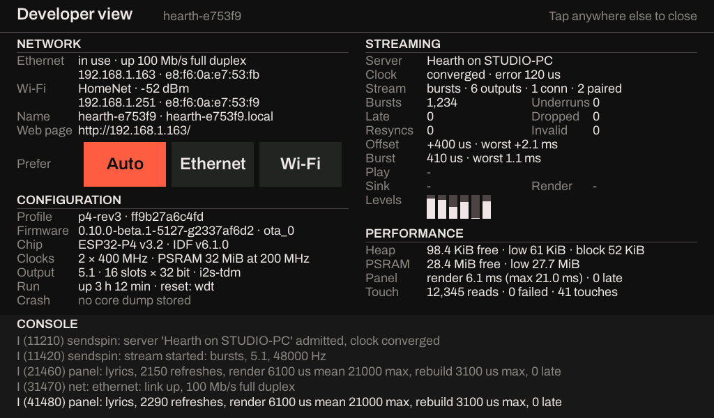

Two columns of 18 px type and the console's last five lines under them, brought up to date once a
second (every two while a stream plays, so that its drawing and its questions of the radio
leave the audio alone). This is a page for someone at arm's length, not the two-metre type of the lyrics.

| Section | What it says |
|---|---|
| **Network** | The interface **in use**; for the wired network and for the radio its link (the wired network's speed and duplex, the radio's network and signal in dBm), its address and its MAC; the board's name and its mDNS name; the address of the web page |
| **Configuration** | The profile and its hash (`/hardware`), the firmware version and the slot it runs from, the chip and its revision, the ESP-IDF, the cores and the CPU and PSRAM clocks, the output layout, the slots and their width and the sink, how long the board has been up and why it last reset, and whether a core dump is stored |
| **Streaming** | The server and the connections; whether the clock has converged and its error; the stream; bursts played, underruns, late, dropped, resyncs and invalid chunks; the playout's offset and the burst time, each with its worst; a meter for each output; and the figures of a play from `POST /play` (`us_per_frame`, `worst_frame_us`, `sink_us_per_frame`, `render_us_per_frame`), which are dashes until one has run |
| **Performance** | The internal heap and the PSRAM, free and at their lowest; the panel's own render time and late cycles; the touch controller's reads, failures and touches |
| **Console** | The last five lines of the 16 KB ring `GET /log` serves, without their colour codes |

**The accent colour means look here**: a counter that is not zero, a radio signal below -75 dBm, a
clock that has not converged while something plays, a reset by a panic, a watchdog or a brownout
(`wdt` is not one: it is how this board restarts), a stored core dump, an internal heap that has
fallen below 16 KB.

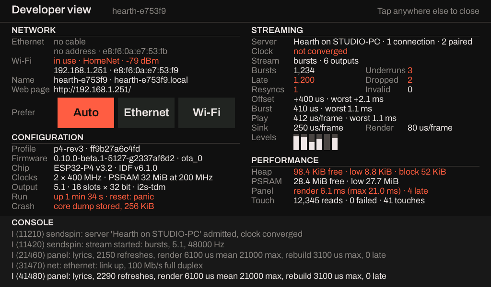

**The network preference.** The row of three buttons, Automatic, Wired and Wi-Fi, is the board's
[network preference](#wired-and-wi-fi), the chosen one in the accent colour. A tap on another one
**asks first**, so that a stray tap cannot cut the board off the network it is being used over:

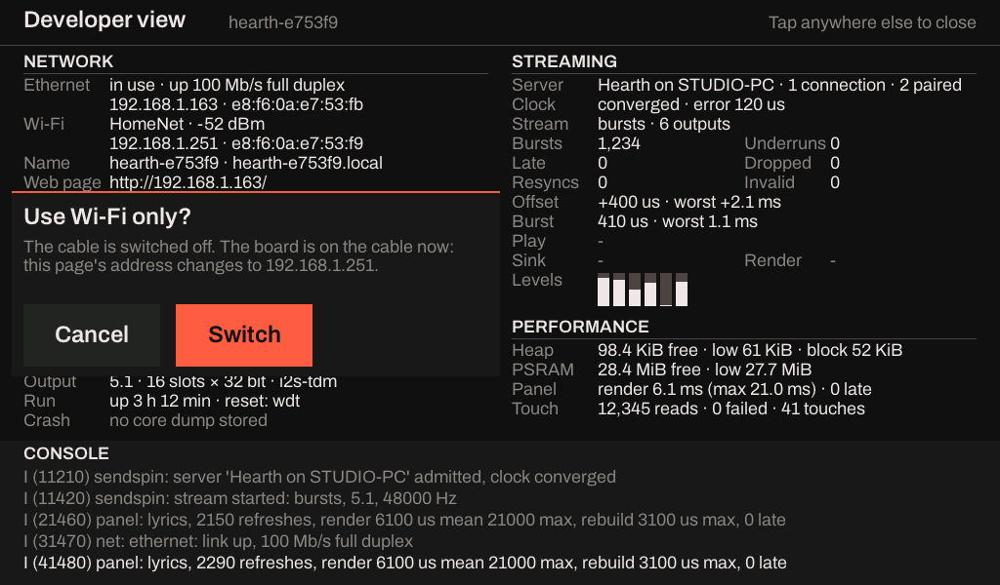

Cancel, a tap anywhere else or eight seconds of nothing changes nothing. A change the board is sure
to refuse (the interface it names holds no address, or no Wi-Fi network is stored) is said so in the
accent colour and Switch is dimmed. **Switch** asks for the change as `PUT /network-preference` does
(the same call; it returns at once and the work is done on a task of its own, verified as the wired
section says), and the view says "Switching..." until the board keeps the preference, then "Done.",
or "The board refused the change." if it has not after 45 seconds.

**What it never shows** is the Wi-Fi passphrase or the Sendspin pairing token: the view reads one
struct of facts that has no field for either, and a console line that names a passphrase, a
password or a pairing token is replaced by a sentence. **What it does not show** is a ring fill: the
burst player keeps no such figure (the HTTP source's `ring_low` is in `GET /status` after a
`POST /play`).

The view's rows are `libs/device/include/iclforge/dev_view.hpp`, which the host tests hold to the
letter (the triple tap, the numbers, the colours, the confirming step's words, the log's lines),
and its pictures are drawn by the same code as the board's, by the
[preview](#developing-the-screen-without-a-panel).

### The time of day

**Every ESP board that has a network keeps its time with a time server**, by default, from the
moment it holds an address: all the hardware (the Wi-Fi boards and the P4X with its wired network), where QEMU's
network has nothing to ask and a build with no network has nothing to ask over, so those keep no
time (the routes below answer 404). It is lwIP's SNTP client (`firmware/hearth-sink/main/clock/sntp/`).
The panel's [clock view](#the-clock) draws what it keeps; a board with no screen has it for its page,
`GET /status` and the console. Nothing listens: SNTP is a request the board sends and the answer comes
back to it.

**Which server is asked**, in this order:

1. **The one a person named** (`PUT /ntp-server`: a host name or an IPv4 address). Naming a server says
   where the time comes from, so with one named the board asks it and then the router's, and not the pool.
2. **The one the router gave over DHCP** (option 42), which is the default: lwIP keeps it when a lease is
   bound (`net/stack.cpp` turns that on at boot), so it is there from the first lease, and a lease
   renewed with another replaces it.
3. **`pool.ntp.org`**, when nobody named a server.

A lease rewrites lwIP's table of servers when it is bound (the router's takes the first slot and the rest
are emptied), so the board looks at the table once a second and puts it back as it should be; the
router's server is remembered from the first slot. The first request goes out after a random delay of up to
five seconds (RFC 4330 asks it of a device that has just started), and then once an hour. A new address
starts the question again at once if no server has answered yet.

| Route | Takes | Default |
|---|---|---|
| `GET` and `PUT /time-sync` | `on` or `off` | `on` |
| `GET` and `PUT /ntp-server` | a host name or an IPv4 address, or `none` | `none`: the router's, then the pool |
| `GET` and `PUT /timezone` | a name from `GET /time-zones` (`Australia/Melbourne`), a POSIX time zone, or `none` | `none`: UTC |
| `GET /time-zones` | the names `PUT /timezone` takes, one a line | 420 of them |

All three are stored on the board (NVS `time_sync`, `ntp_server`, `time_zone`, and `tz_name` for the name a person
chose) and take effect at once, with no restart. **They are on the board's own web page too**, in a Time section
of Settings: the time the board keeps and how it got it, a checkbox for whether to ask a time server, a region and a
city (the page asks the board for its list of zones) with a field for any other zone, and a field for the server (which says, under it, the servers lwIP is set to ask). `GET /status` has a `time`
object (`sync`, `asking`, `synced`, `local`, `zone`, `zone_name`, `zone_place`, `zone_label`, `server`, `servers`, `answers`), and the console
says when the board started asking (*wall clock: asking for the time: 192.168.1.5 (from DHCP),
pool.ntp.org*), each answer, and when it stopped. **`off` is for a board that must contact no time server:**
it stops asking and forgets the time (a clock left running with nothing correcting it is a time the board
made up), and a clock view then shows only its heading.

**The time zone is a POSIX string**, because the firmware has no zone database: `PUT /timezone
AEST-10AEDT,M10.1.0,M4.1.0/3` is Sydney, Melbourne and Hobart. Its offset is the hours *west* of UTC, so an
Australian zone has a minus sign; `none` takes the zone away. **A person need not type one.** The board carries a table of
the zones people choose by region and city, **420 of them in 11,578 bytes of flash**, generated from IANA's tzdata (2026e;
`tools/hearth/gen_time_zones.py`), Australia complete: `PUT /timezone Australia/Melbourne` stores the string that
name stands for **and the name** (the Preferences screen has the same picker, [above](#adjust-and-preferences)), so the screen can say *Melbourne* (the string alone could not: Melbourne, Sydney, Hobart and
Canberra are one string). A name from the table says the zone, so a release that carries a government's new rules
moves the boards that chose that city and no others. A name that is not in the table is a 400, as is a string that is
not a zone. A string that is not a zone, or one with daylight saving and no rules (which the
board's C library would give its own for, differently from the next one's), is refused with a 400
that says so; one the grammar accepts is then read by the board's own C library, on a day in January
and a day in July, and refused with a 409 if the library did not read it as written (a library that
cannot parse a string falls back to UTC without saying so). With none set the time is UTC.

**A screen or a page never shows the string.** It is the board's way of keeping a zone and the routes' way of reporting
it (`GET /timezone`, `GET /status`'s `zone` and the Preferences entry's `value`, for tools); a person reads the place
(`iclforge::wallclock::zone_readable`, host tested). The name they chose is the place. A zone set with a string and no
name (through the page before it had a picker, or by hand) is read as **the place the table holds for the string**: an
exact match, and where several places share it (Melbourne, Sydney, Hobart and Canberra are one) the most populous, which
`tools/hearth/gen_time_zones.py` writes down as `PREFERRED` (51 strings are shared; the table says which place
each means, in 102 bytes of flash), so a board set to `AEST-10AEDT,M10.1.0,M4.1.0/3` reads *Melbourne (Australia)* on the
Preferences row, in the picker (which opens at Australia with Melbourne marked) and on the page, though no name was stored.
A zone in no table reads as its offset and as the person's own: *UTC+09:45 (custom)*, *UTC+09:30 (custom, with daylight
saving)*. The guess is display only and is not stored: it would turn a guess at which of four cities was meant into a
choice. `GET /status`'s `time` has the place (`zone_place`: a name in the table, or `none`) and the words
(`zone_label`: *Melbourne (Australia)*, *UTC*, *UTC+09:45 (custom)*), which the page shows in *Now* and under the time zone.
The page's field for a zone not in the list is never filled in with the board's string; Save with nothing typed asks
for a choice and sends nothing (UTC is Other, then UTC).

The grammar and the words (`libs/device/include/iclforge/wall_clock.hpp`) are held to the letter by
the host tests (`test_wall_clock.cpp`: the zones and the servers taken and the ones refused, the offsets,
the dates and the words; `test_time_zones.cpp`: every string in the table taken by the board's reader, Australia
complete, and Melbourne's changeovers, with 15 other zones', at tzdata's own instants), and the device page's
stand-in is held to the same lists (`apps/demos/wasm/tests/device-ui/contract.spec.js`). The generator holds every
string to tzdata itself (`gen_time_zones.py --verify`: 4,500 changes from 2026 to 2036, no disagreement).

### Wiring

All of these are Kconfig (`ICLFORGE_EXAMPLE_PANEL_*`), and the defaults are the
[ESP32-P4X-Function-EV-Board's](https://docs.espressif.com/projects/esp-dev-kits/en/latest/esp32p4/esp32-p4x-function-ev-board/user_guide.html),
from its user guide and the older board's support header; **check them against the schematic of
the board the image is for.**

| Signal | Default | |
|---|---|---|
| Panel | EK79007, 1024 by 600, two DSI lanes at 900 Mbit/s | from Espressif's driver |
| DSI PHY supply | LDO channel 3 at 2.5 V | from Espressif's driver |
| Backlight (PWM), panel reset | GPIO26, GPIO27 | the user guide: J1 pins 31 and 38, to the LCD adapter |
| Touch (GT911) | I2C SDA GPIO7, SCL GPIO8; address 0x5D, then 0x14; polled | board header |
| TDM BCLK, WS, DOUT | GPIO20, 21, 22, the FireBeetle defaults | on J1 (pins 13, 11, 12), free in the user guide's table; **not yet checked on the bench** |
| Ethernet (`ICLFORGE_EXAMPLE_ETH_*`) | IP101GR on RMII: SMI MDC 31 and MDIO 52, PHY reset 51, PHY address 1, the 50 MHz reference clock in on 50, TX_EN 49, TXD0 34, TXD1 35, CRS_DV 28, RXD0 29, RXD1 30 | ESP-IDF v6.1's `examples/ethernet/basic` for the P4, and Zephyr's devicetree for this board; **read on the kit: the PHY answers at address 1 with ID 0243 0c54** |

Two things the user guide does not settle, and the first power-on checks: **which driver IC the
screen has** (it links both an EK73217BCGA and an EK79007AD datasheet; this image has the EK79007's
driver) and which touch controller (the older board's has a GT911). **Secure Download is not
supported on a v3.1 chip, and the image never enables it.**

### Wired, and Wi-Fi

The kit's RJ45 port (the chip's own Ethernet MAC and an IP101GR PHY on RMII, 10/100 Mbit/s) is a
network of the sink as the Wi-Fi is, so the kit can sit on a PoE splitter with no USB cable: the
splitter's Ethernet leg into the RJ45, its USB-C leg into the kit's **power** input (not the
connector marked JTAG, which is the console and the flashing port). The image is updated over the
same network, the way [Sink firmware](sink-firmware.md) describes, and everything that answers on
Wi-Fi answers on wired: the control surface and the page on port 80, `GET /log`, `PUT /firmware`,
mDNS (`_sendspin._tcp` on 8928 and `hearth-<mac tail>.local`), the Sendspin player and its pairing,
and the idle screen, which shows the address and then `Wired` or `Wi-Fi <network>`.

**Which one it uses.** The board takes an address on whichever has a link, by DHCP, under the name
it is called (`hearth-<mac tail>`). With **auto**, the default, it uses wired while wired
holds an address and the Wi-Fi when only that does, and goes back to wired when it returns, with
no restart. Both are up when the Ethernet cable is in and a Wi-Fi network is stored, the wired interface
with the higher route priority (200 against the Wi-Fi's 100; ESP-IDF's own number for Ethernet, 50,
would have put a board with both on Wi-Fi). A board with the Ethernet cable in and **no Wi-Fi network
stored** comes up on wired alone and needs nothing else. The setting, `network preference`,
chooses what the board does:

| Preference | Wired | The Wi-Fi station |
|---|---|---|
| `auto` | used while it holds an address | joined as the way out if wired goes; used when only it holds an address |
| `ethernet` | the only network | switched off: no radio, nothing joined |
| `wifi` | switched off | the only network |

It is stored in the board's NVS like its name and its Wi-Fi network, so it survives a restart and an
update, and it is changed over REST, in the style of `PUT /name`:

```bash
curl http://192.168.1.251/network-preference                     # auto
curl -X PUT -d ethernet http://192.168.1.251/network-preference  # ok; takes effect in a moment, ...
```

A pinned preference leaves the board with one network and nothing to fall back to, so a change made
while the board runs is checked before it is kept. `ethernet` brings wired up first (it waits
for a link and an address) and only then stores the preference and switches the Wi-Fi off; `wifi`
joins the stored network first and only then stores it and stops wired. A change whose interface
does not come up is **not kept**: the preference stays what it was, the other interface stays on, and
the console says so (`network: no wired link answered, so the WiFi station is not switched off`). The
reply (`200`) is sent before any of this, so it comes back over the interface the change may switch
off; read `GET /network-preference` a few seconds later to see what was kept.
`PUT /network-preference wifi` with no Wi-Fi network stored is refused (`409`). Improv over USB and
`PUT /network` still store a Wi-Fi network, and a board on wired alone reports Improv's *ready*
state (it has no Wi-Fi), so a client still offers its Wi-Fi form; the Wi-Fi it is given joins while
wired stays in use.

**What `GET /status` says.** The `network` object keeps its four fields (`kind`, `ssid`,
`rssi_dbm`, `address`), which now describe the interface **in use** (`kind` is `"ethernet"` or
`"wifi"`, and while none holds an address it is the one the board is waiting on), and adds
`preference` and `interfaces`: how each interface stands, and never the passphrase. On a board with
one network `preference` and `interfaces` are `null`.

```json
"network": {
  "kind": "ethernet", "ssid": "", "rssi_dbm": null, "address": "192.168.1.163",
  "preference": "auto",
  "interfaces": {
    "ethernet": {"enabled": true, "link": true, "address": "192.168.1.163",
                 "mac": "e8:f6:0a:e7:53:f9", "speed_mbps": 100, "full_duplex": true},
    "wifi":     {"enabled": true, "link": true, "address": "192.168.1.251",
                 "mac": "98:88:e0:72:59:b0", "configured": true, "ssid": "...", "rssi_dbm": -40}
  }
}
```

`enabled` is "not switched off by the preference", `link` is a partner on the Ethernet port
(wired) or an association with the access point (Wi-Fi), `configured` says a Wi-Fi network is
stored, and `mac` is the interface's own address, for a DHCP reservation (the wired one is the chip's
base MAC, the one the board's name is made from; the Wi-Fi's is the C6's). A diagnostics view or a
control for the preference reads `GET /status` and `GET` and `PUT /network-preference` and nothing
else.

!!! warning "Moving a kit to PoE"
    On a PoE splitter the kit has no USB console and no USB flashing, so a bad image can only be
    rescued by the update's own rollback (an image that does not reach the network, the HTTP server
    and the Sendspin player inside five minutes goes back to the one before it, and so does one that
    panics on its first boot; both were tried on the kit) or by putting the USB cable back. Keep the
    Wi-Fi network stored, so the board has a way out if wired goes. See
    [What was tested](#what-was-tested-on-wired) for what was and was not tried.

#### What was tested on wired

On the v3.2 kit, 2026-10-20, with the owner's Ethernet cable to their router (100 Mbit/s, full duplex), the
Wi-Fi and the USB cable on as well. Details and the numbers:
[the plan](https://github.com/iainchesworthlabs/iclforge/blob/main/planning/karaoke-p4x-panel.md#the-cable-on-the-kit-2026-10-20).

- **The update path, before wired:** ten `ota.py push` runs (eight accepted, an image that never
  becomes healthy rolled back at its 300 s deadline, and one that panics rolled back by the
  bootloader in about 25 s), a `PUT` rollback, eight `POST /restart` and four rounds of a USB flash
  followed 20 s later by an update: the C6 link was back each time, 7 to 10 s after the restart.
- **The PHY** answers on the default pins at SMI address 1 with the IP101's ID, and negotiates 100
  Mbit/s full duplex.
- **Boot:** with the Ethernet cable in, it answers on wired 10 s after reset and the Wi-Fi joins behind it
  at 14 s; with no Ethernet cable it waits 4 s for a link and is on Wi-Fi at about 16 s; with the cable in and
  **no Wi-Fi network stored** it comes up on wired alone, with the page, mDNS and the Sendspin
  player, and Improv over USB then gives it a Wi-Fi network that joins while wired stays in use.
- **An Ethernet cable put in while the board runs** is in use within about 6 s, with no restart. **A cable
  pulled** (four times, by the owner, three with the board idle and one in the middle of a play)
  made the Wi-Fi the interface in use within half a second, with no restart, and wired returned
  4 to 5 s after the cable was put back. A play cut by the pull ended there (926 bursts, no underrun until
  it) and the board was idle and answering; the next play ran in full.
- **Everything that answers on Wi-Fi answers on wired:** the page, `/api`, `/hardware`, `GET /log`,
  `PUT /firmware` (an update over wired restarted the board, which answered on wired 10 s
  later and passed its trial), mDNS (`hearth-<mac tail>.local` has an A record for each address) and
  Sendspin, which played four 30 s AC-3 streams through wired, 938 of 938 bursts each with no
  underrun (one with a late burst and a resync at its start).
- **The preference** set to each of the three words with the Ethernet cable in did what the table says, and
  survived a restart; `ethernet` with no cable in was not kept and left the Wi-Fi on throughout.
  With `ethernet` set (the Wi-Fi radio off), an update sent to the wired address restarted the
  board, which came back on wired alone and passed its trial: the PoE case with the radio off.
- **Bad images on wired:** an image that panics on its trial and one that never reports healthy,
  both built with wired, pushed to the wired address, were rolled back (about 25 s, and at the
  300 s deadline) and the board returned on wired.
- **Cost:** the image grew by 51 KB (2,518,416 bytes) and the internal heap at boot is 15 to 25 KB
  smaller (about 281 KB free, largest block about 256 KB).

**Not tested:** a PoE splitter, 10 Mbit/s or half duplex, a static address, IPv6 and a long soak. A
board whose DHCP server is slow gives wired 15 s at boot before the Wi-Fi is joined as well
(wired goes on asking). **A kit on PoE should keep its Wi-Fi network stored, so that it has a way
out if wired goes, and the first move to PoE should be done with the USB cable at hand.**

### Name, restart and reset

The routes that name, restart and reset a board are the same on every Hearth board
([Name, restart and reset](sink-esp32-s3.md#name-restart-and-reset) has the rules and the table of
what a rename changes); what the kit adds is below.

- **A restart resets the whole system**, not the CPU alone, through the RTC watchdog
  (`system_reset.cpp`), because a CPU reset sometimes left the radio on the ESP32-C6 with a dead link.
  The restart a person asks for - `POST /restart`, and the restart that Restart and the factory
  reset end in - all go through it, a second slower than a CPU reset, with the USB console's port
  gone for a second or two.
- **A factory reset leaves the kit reachable on wired.** Wired needs nothing stored: the
  kit asks the router for an address again, and has no Wi-Fi network until you give it one (the
  page's *Wi-Fi network* field, or Improv over the USB-C marked JTAG). **The same reset on a board
  without an Ethernet cable plugged in leaves it with no network at all.** Whether wired has a link is what the
  confirming step reads, and it says which of the two the board is in.
- **The radio's own copy of the network.** ESP-IDF's Wi-Fi driver keeps the SSID and passphrase it is
  given in NVS, and on the kit the driver is the ESP32-C6's. The factory reset asks the radio to forget
  them (`esp_wifi_restore`) when the Wi-Fi was up this run; it cannot reach a radio that was never
  started. *Not yet checked on the kit.*
- **Restart is refused for about half a minute after an update**: the new image is on trial, and a
  restart then goes back to the image before it.

#### On the screen

The footer's **Preferences** button opens the sheet of everything a person chooses once, and its **Network**
and **System** groups are these routes with a screen over them. Each is a registry entry
(`libs/device/include/iclforge/preferences.hpp`), so a board with no screen has the same choices over REST, and
a choice the board cannot make is shown greyed with the reason and not hidden: a board with Wi-Fi alone shows
"Wired or Wi-Fi" greyed, "This board has Wi-Fi only, so there is nothing to choose between." Every page below is
drawn at the size of the display it is on: the preview holds each one to the fingertip size and to text that is
not cut off at 1024 by 600, 800 by 480, 480 by 320 and 320 by 240.

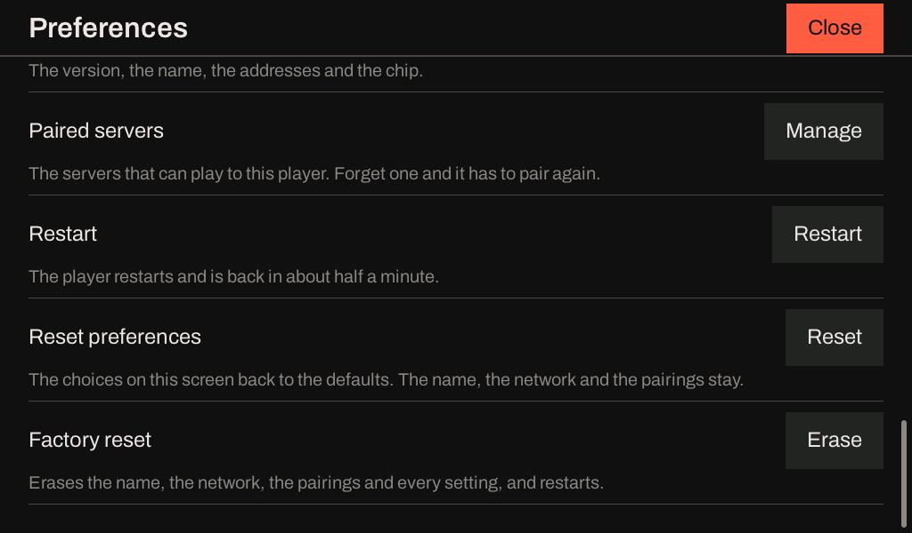

| Entry | A tap |
|---|---|
| **Wired or Wi-Fi** | Automatic, Wired or Wi-Fi, on a board that has both. It asks first, in the developer view's words, and a switch the board is certain to refuse says so and cannot be made. |
| **Name of this player** | Opens the keyboard. |
| **About** | Opens the version, the slot it runs from, the name, the address and MAC of each interface, the page's address, the chip, the layout and the number of paired servers. |
| **Paired servers** | Opens the list, each server with a Forget. |
| **Restart** | Asks, and restarts as `POST /restart` does. |
| **Reset preferences** | Asks, naming what changes on this board, and puts those choices back. |
| **Factory reset** | Asks twice: what is lost, and then a button held for three seconds. |

**The switch between wired and Wi-Fi** is the developer view's control (the same words, the same call), here
with a card over the sheet. The board keeps the preference only once the interface it names holds an address, as
[the wired section](#wired-and-wi-fi) says.

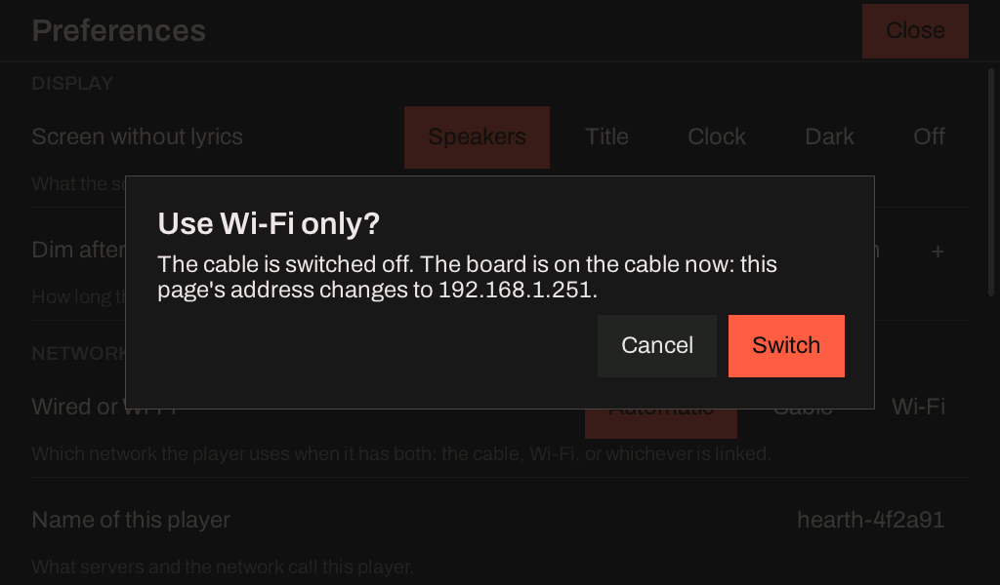

**The name** is typed on a keyboard of its own: lower case, a shift for one capital, digits and the punctuation a
room's name uses (`- _ . , ' & ( ) # + !`), and two pages of accented letters (Latin-1, and the Latin Extended-A
letters that Polish, Czech, Hungarian, Turkish and Romanian add). It offers only what the name's rule accepts and
the screen's fonts can draw, counts bytes and not letters (an accented letter is two, and the counter says how many
of the 32 are used), takes the last letter back whole, and enables Save only for a name that passes, saying why
when it does not. A saved name takes effect at once, with no restart.

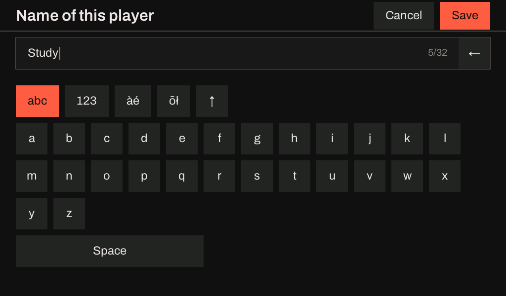

The same keyboard on a 480 by 320 panel, where the keys scroll under the name:

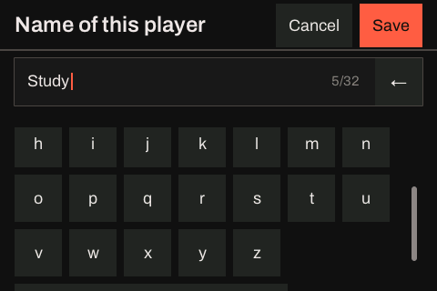

**About** is the friendly subset of the developer view, read the same way (it shares the developer view's reading
of the board), and never shows the Wi-Fi passphrase or the pairing token. The developer view stays behind the three
taps on the name.

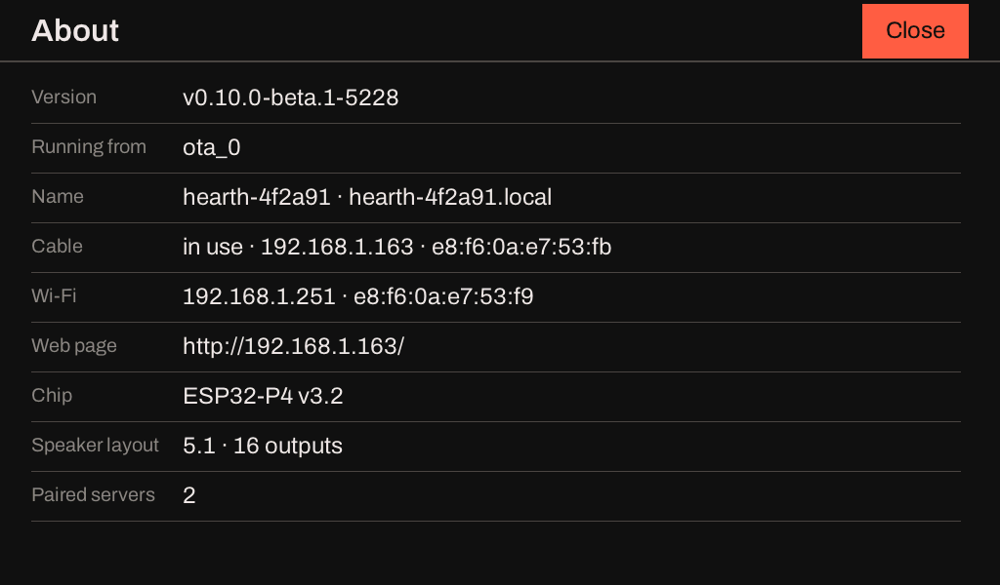

**The paired servers** are listed by name, with what each is doing ("playing now", "connected", "played here
last", "not seen since the player started"), and a Forget on each. Forgetting one asks first and says what
follows: that server has to pair with the player again, and to remove the player from its list first. **The server
that is playing is allowed**, with a warning that the music stops: it is the one a person gives a board away from.
The list never offers the board's bare `forget` (every pairing and a new identity): that is `pair forget` on the
console and *Forget every server* on the page.

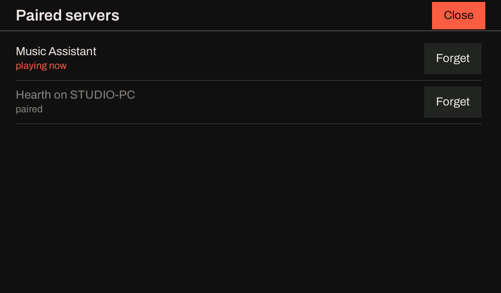

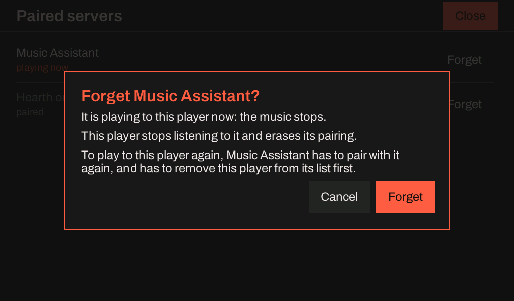

**Reset preferences** puts back the choices that every registry entry says are reset (the screen without
lyrics, its dim time, the brightness, the clock's hours and seconds and the night schedule; an entry that another page
adds says for itself) and keeps the name, the Wi-Fi network, the choice between wired and Wi-Fi, the wiring, the
speaker layout, the time zone and the pairings. It goes through each entry's own
setter, so the screen and the clock follow as they follow a change.

**Factory reset** is the one action that can strand a board, so it asks twice. The first card says what is lost
(the name, the network and its password, the paired servers, the layout, the DAC wiring and every preference), how
many servers will have to pair again, and, from what the board sees, whether it stays reachable: with the wired
network linked, "The wired network stays in use"; with no wired link, or on a board that has Wi-Fi alone, "After the reset it has NO
network", and what brings it back (Improv over the USB cable, at improv-wifi.com in Chrome or Edge).

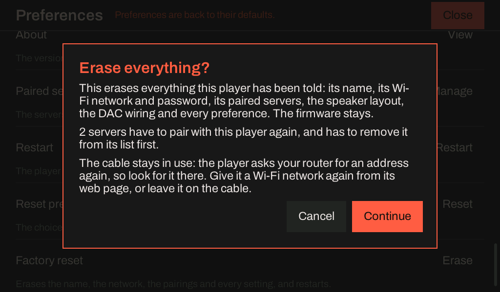

The second step is a button that has to be held for three seconds, its progress filling it; letting go cancels, and
a tap does nothing.

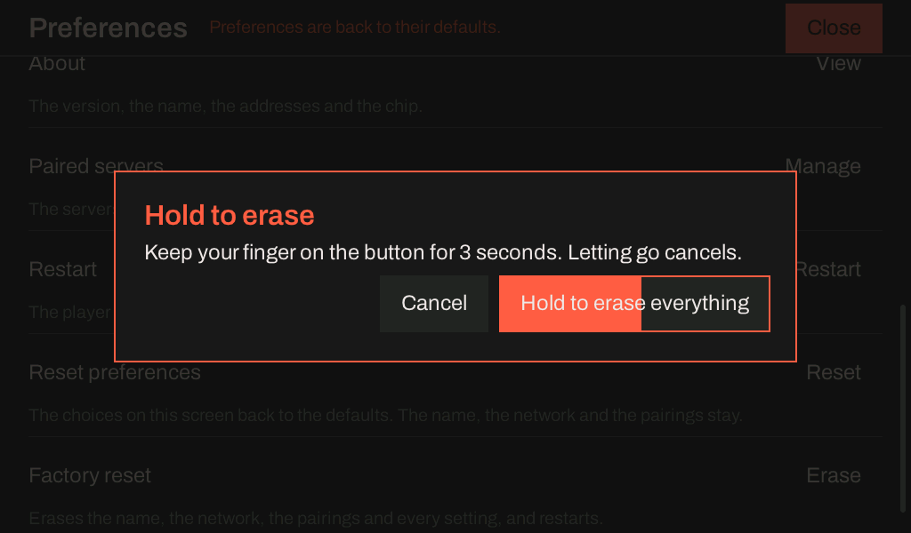

On a 320 by 240 panel the card is taller than the glass, so its paragraphs scroll and its buttons stay where a
finger finds them:

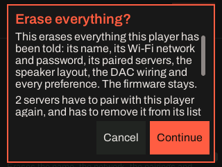

### Memory and time

The screen's own memory is in PSRAM, none in the internal RAM the AC-4 decoder leaves 1 to 11 KB
of: the frame buffer (1.2 MB at 16 bits), two render buffers (80 KB each), LVGL's heap and glyph
caches, the copies of the lines it shows (the rows, a file's plain text and the title are held in
LVGL's heap, not ESP-IDF's, which would try internal RAM first for anything up to 16 KB), and the
task's stack. The task runs at priority 2, below the decoder and the I2S writer.

**Measured on the v1.3 board with no panel** (a FireBeetle 2 at 360 MHz, a synthetic karaoke AC-3
programme decoded to 2.0 over Wi-Fi for 60 s, the screen filling a looping song at 30 fps):

| | Screen idle | Screen filling |
|---|---|---|
| Underruns, late, dropped chunks | 0, 0, 0 | 0, 0, 0 |
| A burst's decode and render, mean | 4.50 ms | 4.58 ms (+1.6 %) |
| A burst, worst | 5.7 to 6.0 ms | 5.8 to 6.2 ms |
| Refreshes a minute | 60 | about 960, 1.7 ms each (2.7 % of one core) |
| A line's rows rebuilt | | 28 to 48 ms, once a line |

One of five runs with the screen filling broke some 15 to 20 seconds in (underruns and resyncs, then
every chunk late until the stream ended); the three that followed it on the same image did not, and
a run with the screen idle had a smaller disturbance of the same kind. The cause was not found, and
the screen is neither shown to be it nor shown not to be
([the plan's Measured section](https://github.com/iainchesworthlabs/iclforge/blob/main/planning/karaoke-p4x-panel.md#measured)).
**Not in these numbers:** the DSI engine's own reads of PSRAM (74 MB/s at 60 Hz, on the bus the
decoder fetches its code from), and the AC-4 5.1 streams that fill a frame. Both were measured on the
kit on 2026-10-20:

**Measured on the v3.2 kit** (400 MHz, the glass; images of one tree, the decoder's time a frame
over `POST /play`, the median of six plays alternating the screen idle and the demo song filling;
[the plan has the method and every figure](https://github.com/iainchesworthlabs/iclforge/blob/main/planning/karaoke-p4x-panel.md#the-second-session-on-the-kit)):

| | AC-3 2.0 | E-AC-3 2.0 | AC-4 5.1 (Sendspin burst, layout 9.1.6) |
|---|---|---|---|
| No scan-out: `panel-null`, idle | 1,746 µs | 1,132 µs | 28.72 ms |
| The glass, idle | 1,768 µs (+1.3%) | 1,199 µs (+5.9%) | 31.7 to 32.0 ms (+10 to +11%) |
| The glass, the song filling | 1,862 µs (+6.6%) | 1,339 µs (+18.3%) | 32.03 ms (+11.5%) |

- **No underrun or resynchronised byte** in any of the 52 AC-3 and E-AC-3 plays, and no late chunk in a
  99 s karaoke play with the screen filling and the owner touching the Adjust sheet. The screen
  task's refresh took 2.3 ms on average over that play (1.6 ms for the demo song alone), a line
  rebuild up to 48.9 ms (the plan's 30 ms is not met), and the audio had no late chunk beside it.
- **The scan-out and the drawing split differently by stream.** On the light streams most of the
  move while the song fills is the drawing (4.6% and 11.7% on `panel-null`, which draws and does
  not scan out), and on AC-4 5.1 the song filling adds almost nothing (0.1%) to a 10% that is
  already there with the screen idle. 5% was the plan's pass; the light streams exceed it while the
  song fills, by 0.3 to 0.65% of a frame, and AC-4 5.1 exceeds it all the time.
- **AC-4 5.1 on the kit.** The decoder's PCM is the v1.3 board's, bit for bit. A Sendspin burst takes
  74% of the 42.7 ms frame on the glass at layout 9.1.6 (66% with no panel); at 5.1 it takes 65% on
  the glass (27.65 ms, 25.27 ms with no scan-out, 26.91 ms with the glass at 40 Hz). The scan-out costs
  2.4 ms a burst at 60 Hz, a linear 0.04 ms a hertz, and no AXI priority setting changes it. The
  least free internal heap is 11 to 15 KB (the v1.3 board: 27.7 KB; the decoder takes whatever is
  left, and the TDM DMA queue left 124 KB less at 5.1 before PR #1607). A bench-only `p4-rev3-ac4`
  profile is worth adding to hold these rows; whether the kit should ship AC-4 is the owner's call.
- **The TDM DMA queue holds the layout's channels.** The sink clocks sixteen slots whatever the
  layout and, until PR #1607, enabled all of them, so its 64 ms queue was 196,608 bytes of internal RAM
  at every layout from three channels up (24,576 at 2.0); it is now 4 bytes a frame for each channel,
  73,728 at 5.1. A 5.1 karaoke play left 46,139 bytes of internal heap at its least and leaves
  171,151.

## Developing the screen without a panel

Two tools, neither needing the kit.

**On a computer.** `firmware/hearth-sink/preview` builds the firmware's lyric screen against LVGL's
software renderer and writes one picture per screen above, and the [developer view](#the-developer-view)'s
(opened with three taps on the name, on fixture data), in seconds:

```bash
cmake -S firmware/hearth-sink/preview -B build-preview -DLVGL_DIR=<firmware/hearth-sink/managed_components/lvgl__lvgl>
cmake --build build-preview
build-preview/panel_preview <output directory>
```

`managed_components/lvgl__lvgl` appears after any P4 build of `firmware/hearth-sink`. It reads the
example songs in `examples/karaoke` and writes 24-bit BMP files. After the screens above it draws
[Adjust and Preferences](#adjust-and-preferences) at 1024 by 600, 800 by 480, 480 by 320 and 320 by 240, for the kit
and for a board whose screen has no touch (`iclforge/board_variants.hpp`), and checks them: it exits 3 when text is
clipped, a control is smaller than a fingertip or sticks out of its sheet, a tap does nothing, or a greyed choice
answers one.

**On a P4 with no panel** (`sdkconfig.panel-null`): LVGL draws into a frame buffer in PSRAM, and a
second small HTTP server (port 8081, `ICLFORGE_EXAMPLE_PANEL_CAPTURE_PORT`, 0 for none) serves it.
**That server has no authentication** (anyone on the network can read the screen and press its buttons), so
**a released image does not start it**: the port is 0 in the release profiles (`p4-rev3` locks it) and in the
Kconfig default, and `package_firmware.py` refuses a build with any other. An image that is run on a bench
turns it on with the `panel-capture` overlay (`sink_profile.py defaults p4-rev3 --overlay panel-capture`), and
`panel-null` has it on because that build exists to be read back:

| Request | Answer |
|---|---|
| `GET /panel.bmp` | the picture, as a 24-bit BMP |
| `GET /panel` | what drawing has cost: refreshes, pixels, microseconds a refresh, the longest rebuild, late cycles, the task's stack left; which no-lyrics `view` is chosen and whether the screen is `dimmed`; the [time of day](#the-time-of-day)'s state (`clock_enabled`, `clock_asking`, `clock_synced` and `clock_syncs`); and whether the [developer view](#the-developer-view) is open (`dev_view`) and what its refreshes cost |
| `POST /panel/tap?x=..&y=..` | a tap, for a board with no touch controller (or to try one: three of them within 600 ms at `x=100&y=568` open the developer view, and a tap on it half a second later closes it) |

The same screen code runs on both and on the glass; what the computer and the board with no panel
leave out is the glass itself.

## Licences

The image with a screen carries **LVGL** (MIT licence, from the component registry, version
9.5), and three typefaces under the SIL Open Font License 1.1: **Archivo** and **Noto Sans Hebrew**,
which the apps bundle, and **Noto Sans Greek and Cyrillic**, which only this image has (the texts
are in `firmware/hearth-sink/main/panel/fonts/`: `OFL.txt`, `NotoSansHebrew-OFL.txt` and
`NotoSansGreekCyrillic-OFL.txt`). The Hebrew and the Greek and Cyrillic files are static instances
cut from a variable font, which the licence allows for a font with no reserved name.

**Where a person reads them:** Hearth's **About, Licences** window, which shows the generated
`NOTICES.txt` that also ships in each package, names LVGL (`notices/fragments/hearth-lvgl.txt`) and
all three typefaces (`notices/fragments/hearth-fonts.txt`) with their copyright lines and the text
of each licence, and, in a section of its own (`notices/fragments/hearth-firmware.txt`), ESP-IDF and
the third-party components the ESP32 images link (FreeRTOS, lwIP, Mbed TLS, picolibc, HTTP Parser,
argtable3, TLSF, wpa_supplicant, the Xtensa headers, and what LVGL carries: stb_truetype and the
Montserrat font with Font Awesome's symbols), each with its text as its own files state it.
Those texts are `notices/licences/ESP-IDF-components.txt`, made from an ESP-IDF checkout by
`tools/generators/gen_esp_idf_notices.py` (a new ESP-IDF means running it again; a test fails
until it is). `tools/ci/check_hearth_package.py` fails a package whose notices lack any of them.
Forge and Crucible do not ship this firmware or these faces and their licence windows are
unchanged. The firmware images themselves carry no notices file: the notices travel with Hearth.

## Related pages

- [ESP32-P4 platform](../platforms/bare-metal/esp32-p4.md) — the chip revision, decode timing and
  memory, AC-4
- [Karaoke](../karaoke/index.md) — the stream and the lyrics files the screen shows
- [Sink firmware](sink-firmware.md) — which image, and updating over the network
- [planning/karaoke-p4x-panel.md](https://github.com/iainchesworthlabs/iclforge/blob/main/planning/karaoke-p4x-panel.md)
  — the plan, the decisions and the bring-up list
