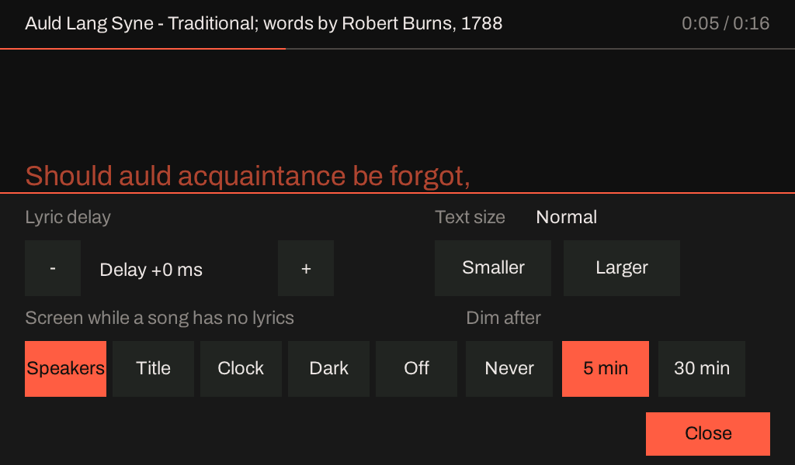

# An ESP32-P4 sink

`hearth_sink` runs on the ESP32-P4 as the **best** of the sink family: the part with the room to
decode E-AC-3 7.1.4 with its tools on, and AC-4 to 5.1, in real time. It has one I2S controller
whose TDM frame holds 512 bits, which reaches sixteen 32-bit channels into both DACs of the
planned pair from one line, and, on a board with a panel, it draws the words of a karaoke song as
they are sung.

!!! note "Status as of 2026-10-20: the v1.x board plays; the v3.x kit shows the screen, takes a tap, plays through 16 TDM slots, plays a karaoke song with its words and decodes AC-4 5.1; the clocks on the pins are not measured, and the glass costs the heaviest stream a tenth"
    The sink runs on a DFRobot FireBeetle 2 (chip revision v1.3), stereo, over Wi-Fi hosted on its
    onboard ESP32-C6. The v3.x kit arrived on 2026-10-20 and the v3.x image ran on it the same day:
    it boots on a v3.2 chip at 400 MHz, joins Wi-Fi, is found by Music Assistant, draws the idle and
    the lyric screens on the panel, answers a tap on every button of the controls sheet, and plays a
    5.1 stream through the full sixteen 32-bit TDM slots in real time with no underrun. A karaoke
    song with word-timed lyrics then played for 99 s with no underrun or late chunk, the words
    following it on the glass, and the owner, who watched and used the Adjust sheet, said it appeared
    and looked fine. **The glass takes decode time:** its scan-out costs the decoder 1.3% (AC-3), 6%
    (E-AC-3) and about 10% (AC-4 5.1), and with the song filling the screen the light streams' decode
    time moves by 5 to 12% (under 1% of a frame). **The glitches the first measurement put on the glass
    are not its:** about one play in five reaches the kit with its first chunk 300 to 600 ms late, with
    the glass, without it and at 40 Hz, over Wi-Fi and (more often) over the cable, and those plays
    lose the start of their first second: lwIP's six-entry TCP receive mailbox refused the first
    segments; PR #1610 makes it 32, and none of 40 plays had a late first chunk
    ([the trace](https://github.com/iainchesworthlabs/iclforge/blob/main/planning/karaoke-p4x-panel.md#what-the-glitches-were-the-first-chunk-comes-late)).
    **Not checked on the kit: the TDM clocks on the pins (it needs a scope) and tearing beyond the
    owner's look.** The board suite is played on it, with a baseline. Its RJ45 port works beside the
    Wi-Fi ([the cable](#the-cable-and-wi-fi)): the sink answers on it, plays Sendspin through it,
    takes an update over it, falls back to Wi-Fi when the cable is pulled and returns to the cable
    when it is put back, so the kit can run on a PoE splitter; **the splitter itself is not yet tried.**
    [planning/karaoke-p4x-panel.md](https://github.com/iainchesworthlabs/iclforge/blob/main/planning/karaoke-p4x-panel.md)
    has the plan, the first run and the list of what it runs next.

Pairing, groups and firmware updates work the same as on the S3; see
[An ESP32-S3 sink](sink-esp32-s3.md) and [Sink firmware](sink-firmware.md). This page covers what
differs on the P4.

## Two chips, two images

The P4 has had two silicon generations, and **their firmware images are not interchangeable**
(Espressif's v3.x user guide, section 1.1): an image for one refuses to start on the other. A
release carries one for each.

| | Chip revision v1.x | Chip revision v3.x ("P4X", v3.1 and newer) |
|---|---|---|
| Image | `hearth-sink-esp32p4-rev1` | `hearth-sink-esp32p4-rev3` |
| Example board | DFRobot FireBeetle 2 (v1.3) | ESP32-P4X-Function-EV-Board, 7-inch panel |
| CPU | 360 MHz (400 MHz asserts in its boot) | 400 MHz |
| I2S clock source | APLL, 125 MHz at most: **no TDM above two channels** | the 160 MHz PLL: TDM at the full 16 × 32 bits |
| Screen | none | the 7-inch 1024 by 600 panel, with touch |
| Verified | on a board | on a board (a v3.2 kit, 2026-10-20): screen, touch, 16-slot TDM in real time, a karaoke play with lyrics, AC-4 5.1 (scratch build); **the clocks on the TDM pins not yet measured** |

`GET /hardware` tells which a board is, and `ota.py` chooses the image from it, so a board updated
over its network gets the right one ([Sink firmware](sink-firmware.md#which-image)).

## Build and flash

From `firmware/hearth-sink`, in an ESP-IDF v6.1 terminal. A P4 is not built with `set-target`
and plain defaults: say the target and the overlays.

**Chip revision v1.x** (the FireBeetle 2, stereo, no screen):

```bash
idf.py -DIDF_TARGET=esp32p4 "-DSDKCONFIG_DEFAULTS=sdkconfig.defaults;sdkconfig.hw;sdkconfig.p4;sdkconfig.sendspin" build
idf.py -p PORT flash monitor
```

**Chip revision v3.x with the 7-inch panel** (the image CI publishes as `hearth-sink-esp32p4-rev3`):

```bash
idf.py -DIDF_TARGET=esp32p4 "-DSDKCONFIG_DEFAULTS=sdkconfig.defaults;sdkconfig.hw;sdkconfig.p4;sdkconfig.p4-rev3;sdkconfig.sendspin;sdkconfig.panel;sdkconfig.panel-dsi" build
```

**A board with no panel, to see the screen** (any P4; the picture is read back over HTTP,
[below](#developing-the-screen-without-a-panel)):

```bash
idf.py -DIDF_TARGET=esp32p4 "-DSDKCONFIG_DEFAULTS=sdkconfig.defaults;sdkconfig.hw;sdkconfig.p4;sdkconfig.sendspin;sdkconfig.panel;sdkconfig.panel-null" build
```

| File | What it sets |
|---|---|
| `sdkconfig.p4` | The P4 itself: the wide I2S sink, PSRAM, the code run from PSRAM, the Wi-Fi buffers and the DMA queue, with the reasons for each. Written for v1.x silicon |
| `sdkconfig.p4-rev3` | After `sdkconfig.p4`: chip revisions v3.1 to v3.99, 400 MHz, and the bootloader at the Warn log level (a v3.x bootloader is 25,152 bytes at Info against the 24,576-byte window; 22,448 at Warn) |
| `sdkconfig.panel` | LVGL's heap in PSRAM, TrueType fonts, right-to-left text |
| `sdkconfig.panel-null` / `sdkconfig.panel-dsi` | The frame buffer with no panel, or the 7-inch MIPI DSI panel |

AC-4 is `sdkconfig.ac4` after those ([ESP32-P4 platform page](../platforms/bare-metal/esp32-p4.md#ac-4)).

## On the v1.x board

It plays AC-3 and E-AC-3 onto 2.0 in a paired Sendspin session, and decodes AC-4 to 5.1 in real
time ([ESP32-P4](../platforms/bare-metal/esp32-p4.md)). **TDM does not open above two channels on
this silicon**: the controller has no PLL clock source before v3, and the audio PLL it falls back to
tops out at 125 MHz, short of the ~147 MHz a 512-bit frame needs at 48 kHz. That is a limit of the
chip, and `GET /hardware` says so on such a board.

### Karaoke on the v1.x board

The board reproduces AC-3 and E-AC-3 karaoke itself at its 2.0 layout, which is the only one it
can open. Hearth's live karaoke cases at `ICLFORGE_HEARTH_LIVE_KARAOKE_LAYOUT=2.0`, on a v1.3 board
booted from its first slot on 2026-10-13, found the board's output levels within 0.2 dB of the
host's decode for AC-3 and within 0.7 dB for E-AC-3, for as coded, aware, and capable with a
vocal, with none, and with the melody and a vocal moved, with the layout, routing, trim, delay
and crossover settings pushed as well. At 2.0 the aware reproduction is the Lo/Ro fold as coded
already is, so the two read alike. The 3.0 layout the case uses by default needs three slots
and cannot open here; it is not measured on a v3.x chip.

One earlier run on the same image, started from the board's second slot straight after an update
restart, played nothing and logged `burst player: a stream control message did not fit the ring`
(the player's ring was not draining). It did not repeat in eight runs after a clean start from
the first slot, and its cause is not known.

## On the v3.x kit

!!! warning "Run on a v3.2 chip and a panel; the pins' clocks are not measured"
    What follows was built from ESP-IDF's headers, the v3.x user guide and the vendor drivers' own
    values, and the first run on the kit (2026-10-20) corrected it in four places: a crash in the DSI
    code, the touch controller's address (0x14), its axes (turned half a turn from the display's)
    and how often it must be read, all fixed. A line below that says what the kit did was seen on it;
    one that says what the chip should do was not.

### What changes for the audio

- **400 MHz**, and PSRAM at 200 MHz by ESP-IDF's default for this chip. The decoders do not scale
  with the clock: on the kit, with no panel, the decoder alone takes 10% less time than on the v1.3
  board for AC-3 and 17% less for AC-4 (11% more clock), and a Sendspin burst at the same layout (2.0)
  takes 3 to 6% less. A burst costs about 176 µs for each output of the layout (the renderer, the
  patch, the trims, the meters and the playout's copy), and the kit's player starts at 9.1.6,
  sixteen outputs, where the v1.3 board's sink has two: the kit's first Sendspin figures were 13% to
  100% above the v1.3 board's for that reason. The kit's figures are in [Memory and
  time](#memory-and-time).
- **TDM opens**: the `i2s_wide` sink takes the 160 MHz PLL (`I2S_CLK_SRC_PLL_160M`) as the clock
  source on this silicon, which the 16 × 32-bit frame needs (a 147 MHz source at least). The source
  is chosen when the image is built, because the two revisions are two images. On the kit, a 5.1
  stream rendered onto the layout `9.1.6` opened sixteen 32-bit slots and played for 30 s in real
  time with no underrun, 30,336 ms of audio in 30,185 ms of wall clock, the six coded channels in
  their slots and the other ten at zero. **Whether the clocks leave the pins at 24.576 MHz (BCLK) and
  48 kHz (WS) is not measured:** it needs a scope or a logic analyser.
- **The DACs** are not wired and no firmware programs an ES9080 over I2C: the board plays to a
  frame whose unused slots are zero, which is what the ES9080 contract is
  ([sink tiers](https://github.com/iainchesworthlabs/iclforge/blob/main/planning/esp32-sink-tiers.md#shared-es9080-contract-all-tiers)).

### The screen


The board shows the lyrics of the item playing, against the sound **the board** is playing: the
server sends the document and where in it the sound is, and the board follows on its own clock, which
knows its own output delay. The same lyric file and the same karaoke stream Hearth plays on a desktop
([Karaoke](../karaoke/index.md)).


One colour for a word sung, one fill for the word being sung, and one for a word not yet sung, as on
the desktop, with one cue that is not colour (the underline), so that no one has to tell the colours
apart. The picture above and the others on this page are drawn by the firmware's own screen code
(`firmware/hearth-sink/main/panel/lvgl/lyric_screen.cpp`) and rendered by a tool on a computer
([below](#developing-the-screen-without-a-panel)).

| Screen | When |
|---|---|
|  | **Nothing is playing.** The board's name, its address and network, and what it waits for; the pairing code while an attempt shows one |
|  | **The song is held and has not started.** The first lines, so a singer sees what is coming |
|  | **A duet.** The first singer's lines at the left, the second's indented, each tagged with its name from the file |
|  | **An instrumental break** of four seconds or more: four dots that go out one a second, so the line's start is seen coming |
|  | **A file with line times only.** The whole line, emphasised; no word is invented |
|  | **Hebrew or Yiddish.** Right-aligned, the words flow right to left and the fill runs from a word's right edge |
|  | **Cyrillic or Greek.** Drawn as Latin is, in Noto Sans behind Archivo, with the same fill |
|  | **A script the fonts cannot draw** (Arabic here). One sentence in the line's place; the title in it is left out; a music note is dropped |
|  | **A file with no times.** The text, scrolled by touch, not followed |
|  | **Playing, and no lyrics are held** ([below](#a-song-with-no-lyrics)). The speakers of the layout in force, each glowing with its own level |
|  | **Playing, no lyrics, and the clock chosen** ([below](#the-clock)). The time, the date and the line over them; nothing until a time server has answered |
|  | **The same with that screen turned off.** The sentence this screen had before |
|  | **Adjust.** The lyric delay in 50 ms steps, the text size, the screen for a song with no lyrics and when it dims; put away after eight seconds untouched |

**Controls.** Touch changes only what the board owns: its lyric delay (±1,000 ms), its text size
(Smaller, Normal or Larger, which the sheet says beside its buttons), what its screen shows while a
song has no lyrics, when that dims, and (later) its brightness. Which vocals sound and the reproduction are the server's settings and are
shown, not changed, until the role has a way to carry a request back.

#### A song with no lyrics

Most of what is played has none. While a stream plays and the board holds no lyrics, the panel shows
the **speakers**: the room the layout in force describes, seen from above with the front at the top.
Ear-level speakers are circles, height speakers rounded squares, the LFE a wide box along the bottom,
and each speaker glows with its own level, from the board's own measure of the last 100 ms. A
speaker with nothing on it is a hollow outline, so a dead output can be seen. The line above says
what arrives and what it is played on (*Dolby Digital Plus 5.1 to 7.1.4*, *PCM to 2.0*).


It is meant to be left on for hours in a dim room: the glow moves in a few steps, slowly (it rises
at once and falls at 14 dB a second), and is never brighter than the accent at 55%. **After five
minutes with nothing touched** (the time is Adjust's, or `PUT /dim-after`: `never`, or whole minutes
from 1 to 240) the backlight goes to 4% and a black screen with one line is over everything; any tap
brings the speakers back, and the tap does not also press what is under it. Only this screen dims:
the lyric screens and the idle screen do not.


Which screen shows is the owner's: `speakers` (the default), `clock` ([below](#the-clock)) or `off`,
which is the old sentence; `title` (title, artist and a progress line, once the sink asks the server
for them) is planned and refused until then
([planning/p4x-now-playing.md](https://github.com/iainchesworthlabs/iclforge/blob/main/planning/p4x-now-playing.md)).

| Route | Takes | Default |
|---|---|---|
| `GET` and `PUT /now-playing` | `speakers`, `title`, `clock` or `off` | `speakers` |
| `GET` and `PUT /dim-after` | `never`, or minutes from 1 to 240 | `5` |

Both are stored on the board and take effect at once, with no restart; a board with no panel answers
404. `GET :8081/panel` says which `view` is chosen, whether the screen is `dimmed` and the time's
state.

#### The clock

The time of day, for a room where the sound is the thing and the panel is a glance: **the time in 24
hours at 200 px, the date under it, and nothing else**, in the muted tone (the time at about 80% of
it and the date at about 60%, so that neither is the brightest thing in a dim room). It shows no
seconds, so what the screen redraws is the time's rectangle once a minute (the preview counts 224,000
pixels, against none for a second that passes), and the line over it still says what the stream is
(*Dolby Digital Plus 5.1 to 5.1*).


The time is [the board's own](#the-time-of-day), kept with a time server, which every board does.
**Until the first answer the view draws the heading and nothing else, never a time it made up** (and an
answer from before 2026 is a server with a wrong clock, and is not taken for the time either).


**With no time zone set the clock says UTC, and says so:**


**A dim leaves the clock on the glass.** Dimming lowers the backlight to its floor, as for the speakers,
but the clock is what a dark room has the screen for, so no black cover goes over it: a clear one
catches the tap that wakes the screen, and the time goes on changing under it.

**On the kit** (2026-10-21): over Sendspin, a 5.1 E-AC-3 test programme with no lyrics drew exactly this picture; with the speakers showing, a burst took 4,573 µs against 4,555 µs with the view off (three 60 s plays each, no late burst, underrun or resynchronisation, and the same least free heap), and at 2.0 with a stereo music programme 2,099 against 2,114 µs. With `dim-after` at one minute the screen went dark 60.4 s after the speakers began to show, and a tap woke it. The glass's brightness at 4% and a finger's tap in place of an injected one were not looked at; the scan-out is the same whatever is drawn, and dimming leaves it alone.

**Fonts.** Archivo, the apps' own, for Latin (Basic, Latin-1 and Extended-A, most of Extended-B and
the Vietnamese block, and the punctuation and currency signs a lyric uses); Noto Sans behind it for
Greek (modern, with its tonos) and Cyrillic (with its supplement), and Noto Sans Hebrew behind that;
all three under the SIL Open Font License, in the image (473 KB of flash, two weights of each). **Not
in this build:** polytonic Greek and the Cyrillic Extended blocks, CJK (a usable face is 5 to 16 MB,
which the 4 MB application slots have no room for), Arabic (its shaping is not done by LVGL), and the
Indic and Thai scripts. **A line in a script the screen cannot draw is replaced by one sentence**,
"This line is in a script this screen cannot show.", not by the font's missing-glyph boxes; a title
in one is left out, and a music note (which none of the fonts has) is dropped from a line.

### The developer view

**Three taps on the board's name** (`hearth-e753f9`, at the left of the footer) put a screen of
developer information over the lyrics; **a tap anywhere else puts it away**. It is on the panel
image only (it needs the touch screen), the lyric and idle screens are as they were with it shut,
and it puts itself away after five minutes untouched, so that a panel left on a stand is a lyric
screen again.


Two columns of 18 px type and the console's last five lines under them, brought up to date once a
second (every two while a stream plays, so that its drawing and its questions of the radio
leave the audio alone). This is a page for someone at arm's length, not the two-metre type of the lyrics.

| Section | What it says |
|---|---|
| **Network** | The interface **in use**; for the cable and for the radio its link (the cable's speed and duplex, the radio's network and signal in dBm), its address and its MAC; the board's name and its mDNS name; the address of the web page |
| **Configuration** | The profile and its hash (`/hardware`), the firmware version and the slot it runs from, the chip and its revision, the ESP-IDF, the cores and the CPU and PSRAM clocks, the output layout, the slots and their width and the sink, how long the board has been up and why it last reset, and whether a core dump is stored |
| **Streaming** | The server and the connections; whether the clock has converged and its error; the stream; bursts played, underruns, late, dropped, resyncs and invalid chunks; the playout's offset and the burst time, each with its worst; a meter for each output; and the figures of a play from `POST /play` (`us_per_frame`, `worst_frame_us`, `sink_us_per_frame`, `render_us_per_frame`), which are dashes until one has run |
| **Performance** | The internal heap and the PSRAM, free and at their lowest; the panel's own render time and late cycles; the touch controller's reads, failures and touches |
| **Console** | The last five lines of the 16 KB ring `GET /log` serves, without their colour codes |

**The accent colour means look here**: a counter that is not zero, a radio signal below -75 dBm, a
clock that has not converged while something plays, a reset by a panic, a watchdog or a brownout
(`wdt` is not one: it is how this board restarts), a stored core dump, an internal heap that has
fallen below 16 KB.


**The network preference.** The row of three buttons, Auto, Ethernet and Wi-Fi, is the board's
[network preference](#the-cable-and-wi-fi), the chosen one in the accent colour. A tap on another one
**asks first**, so that a stray tap cannot cut the board off the network it is being used over:


Cancel, a tap anywhere else or eight seconds of nothing changes nothing. A change the board is sure
to refuse (the interface it names holds no address, or no Wi-Fi network is stored) is said so in the
accent colour and Switch is dimmed. **Switch** asks for the change as `PUT /network-preference` does
(the same call; it returns at once and the work is done on a task of its own, verified as the cable
section says), and the view says "Switching..." until the board keeps the preference, then "Done.",
or "The board refused the change." if it has not after 45 seconds.

**What it never shows** is the Wi-Fi passphrase or the Sendspin pairing token: the view reads one
struct of facts that has no field for either, and a console line that names a passphrase, a
password or a pairing token is replaced by a sentence. **What it does not show** is a ring fill: the
burst player keeps no such figure (the HTTP source's `ring_low` is in `GET /status` after a
`POST /play`).

The view's rows are `libs/device/include/iclforge/dev_view.hpp`, which the host tests hold to the
letter (the triple tap, the numbers, the colours, the confirming step's words, the log's lines),
and its pictures are drawn by the same code as the board's, by the
[preview](#developing-the-screen-without-a-panel).

### The time of day

**Every ESP board that has a network keeps its time with a time server**, by default, from the
moment it holds an address: all the hardware (the Wi-Fi boards and the P4X with its cable), where QEMU's
network has nothing to ask and a build with no network has nothing to ask over, so those keep no
time (the routes below answer 404). It is lwIP's SNTP client (`firmware/hearth-sink/main/clock/sntp/`).
The panel's [clock view](#the-clock) draws what it keeps; a board with no screen has it for its page,
`GET /status` and the console. Nothing listens: SNTP is a request the board sends and the answer comes
back to it.

**Which server is asked**, in this order:

1. **The one a person named** (`PUT /ntp-server`: a host name or an IPv4 address). Naming a server says
   where the time comes from, so with one named the board asks it and then the router's, and not the pool.
2. **The one the router gave over DHCP** (option 42), which is the default: lwIP keeps it when a lease is
   bound (`net/stack.cpp` turns that on at boot), so it is there from the first lease, and a lease
   renewed with another replaces it.
3. **`pool.ntp.org`**, when nobody named a server.

A lease rewrites lwIP's table of servers when it is bound (the router's takes the first slot and the rest
are emptied), so the board looks at the table once a second and puts it back as it should be; the
router's server is remembered from the first slot. The first request goes out after a random delay of up to
five seconds (RFC 4330 asks it of a device that has just started), and then once an hour. A new address
starts the question again at once if no server has answered yet.

| Route | Takes | Default |
|---|---|---|
| `GET` and `PUT /time-sync` | `on` or `off` | `on` |
| `GET` and `PUT /ntp-server` | a host name or an IPv4 address, or `none` | `none`: the router's, then the pool |
| `GET` and `PUT /timezone` | a POSIX time zone, or `none` | `none`: UTC |

All three are stored on the board (NVS `time_sync`, `ntp_server`, `time_zone`) and take effect at once,
with no restart. **They are on the board's own web page too**, in a Time section of Settings: the time
the board keeps and how it got it, a checkbox for whether to ask a time server, and a list of zones and cities
(*UTC+10 Melbourne, Sydney, Hobart, Canberra*; 42 of them, each a POSIX string the board's C library is
held to) with a field for any other, and a field for the server (which says, under it, the servers lwIP is set to ask). `GET /status` has a `time`
object (`sync`, `asking`, `synced`, `local`, `zone`, `server`, `servers`, `answers`), and the console
says when the board started asking (*wall clock: asking for the time: 192.168.1.5 (from DHCP),
pool.ntp.org*), each answer, and when it stopped. **`off` is for a board that must contact no time server:**
it stops asking and forgets the time (a clock left running with nothing correcting it is a time the board
made up), and a clock view then shows only its heading.

**The time zone is a POSIX string**, because the firmware has no zone database and a list of names
would be a table to keep: `PUT /timezone AEST-10AEDT,M10.1.0,M4.1.0/3` is Sydney, Melbourne and
Hobart. Its offset is the hours *west* of UTC, so an Australian zone has a minus sign; `none` takes
the zone away. A string that is not a zone, or one with daylight saving and no rules (which the
board's C library would give its own for, differently from the next one's), is refused with a 400
that says so; one the grammar accepts is then read by the board's own C library, on a day in January
and a day in July, and refused with a 409 if the library did not read it as written (a library that
cannot parse a string falls back to UTC without saying so). With none set the time is UTC.

The grammar and the words (`libs/device/include/iclforge/wall_clock.hpp`) are held to the letter by
the host tests (`test_wall_clock.cpp`: the zones and the servers taken and the ones refused, the offsets,
the dates and the words), and the device page's stand-in is held to the same lists
(`apps/demos/wasm/tests/device-ui/contract.spec.js`).

### Wiring

All of these are Kconfig (`ICLFORGE_EXAMPLE_PANEL_*`), and the defaults are the
[ESP32-P4X-Function-EV-Board's](https://docs.espressif.com/projects/esp-dev-kits/en/latest/esp32p4/esp32-p4x-function-ev-board/user_guide.html),
from its user guide and the older board's support header; **check them against the schematic of
the board the image is for.**

| Signal | Default | |
|---|---|---|
| Panel | EK79007, 1024 by 600, two DSI lanes at 900 Mbit/s | from Espressif's driver |
| DSI PHY supply | LDO channel 3 at 2.5 V | from Espressif's driver |
| Backlight (PWM), panel reset | GPIO26, GPIO27 | the user guide: J1 pins 31 and 38, to the LCD adapter |
| Touch (GT911) | I2C SDA GPIO7, SCL GPIO8; address 0x5D, then 0x14; polled | board header |
| TDM BCLK, WS, DOUT | GPIO20, 21, 22, the FireBeetle defaults | on J1 (pins 13, 11, 12), free in the user guide's table; **not yet checked on the bench** |
| Ethernet (`ICLFORGE_EXAMPLE_ETH_*`) | IP101GR on RMII: SMI MDC 31 and MDIO 52, PHY reset 51, PHY address 1, the 50 MHz reference clock in on 50, TX_EN 49, TXD0 34, TXD1 35, CRS_DV 28, RXD0 29, RXD1 30 | ESP-IDF v6.1's `examples/ethernet/basic` for the P4, and Zephyr's devicetree for this board; **read on the kit: the PHY answers at address 1 with ID 0243 0c54** |

Two things the user guide does not settle, and the first power-on checks: **which driver IC the
screen has** (it links both an EK73217BCGA and an EK79007AD datasheet; this image has the EK79007's
driver) and which touch controller (the older board's has a GT911). **Secure Download is not
supported on a v3.1 chip, and the image never enables it.**

### The cable, and Wi-Fi

The kit's RJ45 port (the chip's own Ethernet MAC and an IP101GR PHY on RMII, 10/100 Mbit/s) is a
network of the sink as the Wi-Fi is, so the kit can sit on a PoE splitter with no USB cable: the
splitter's Ethernet leg into the RJ45, its USB-C leg into the kit's **power** input (not the
connector marked JTAG, which is the console and the flashing port). The image is updated over the
same network, the way [Sink firmware](sink-firmware.md) describes, and everything that answers on
Wi-Fi answers on the cable: the control surface and the page on port 80, `GET /log`, `PUT /firmware`,
mDNS (`_sendspin._tcp` on 8928 and `hearth-<mac tail>.local`), the Sendspin player and its pairing,
and the idle screen, which shows the address and then `Ethernet` or `Wi-Fi <network>`.

**Which one it uses.** The board takes an address on whichever has a link, by DHCP, under the name
it is called (`hearth-<mac tail>`). With **auto**, the default, it uses the cable while the cable
holds an address and the Wi-Fi when only that does, and goes back to the cable when it returns, with
no restart. Both are up when the cable is in and a Wi-Fi network is stored, the cable's interface
with the higher route priority (200 against the Wi-Fi's 100; ESP-IDF's own number for Ethernet, 50,
would have put a board with both on Wi-Fi). A board with the cable in and **no Wi-Fi network
stored** comes up on the cable alone and needs nothing else. The setting, `network preference`,
chooses what the board does:

| Preference | The cable | The Wi-Fi station |
|---|---|---|
| `auto` | used while it holds an address | joined as the way out if the cable goes; used when only it holds an address |
| `ethernet` | the only network | switched off: no radio, nothing joined |
| `wifi` | switched off | the only network |

It is stored in the board's NVS like its name and its Wi-Fi network, so it survives a restart and an
update, and it is changed over REST, in the style of `PUT /name`:

```bash
curl http://192.168.1.251/network-preference                     # auto
curl -X PUT -d ethernet http://192.168.1.251/network-preference  # ok; takes effect in a moment, ...
```

A pinned preference leaves the board with one network and nothing to fall back to, so a change made
while the board runs is checked before it is kept. `ethernet` brings the cable up first (it waits
for a link and an address) and only then stores the preference and switches the Wi-Fi off; `wifi`
joins the stored network first and only then stores it and stops the cable. A change whose interface
does not come up is **not kept**: the preference stays what it was, the other interface stays on, and
the console says so (`network: no cable answered, so the WiFi station is not switched off`). The
reply (`200`) is sent before any of this, so it comes back over the interface the change may switch
off; read `GET /network-preference` a few seconds later to see what was kept.
`PUT /network-preference wifi` with no Wi-Fi network stored is refused (`409`). Improv over USB and
`PUT /network` still store a Wi-Fi network, and a board on the cable alone reports Improv's *ready*
state (it has no Wi-Fi), so a client still offers its Wi-Fi form; the Wi-Fi it is given joins while
the cable stays in use.

**What `GET /status` says.** The `network` object keeps its four fields (`kind`, `ssid`,
`rssi_dbm`, `address`), which now describe the interface **in use** (`kind` is `"ethernet"` or
`"wifi"`, and while none holds an address it is the one the board is waiting on), and adds
`preference` and `interfaces`: how each interface stands, and never the passphrase. On a board with
one network `preference` and `interfaces` are `null`.

```json
"network": {
  "kind": "ethernet", "ssid": "", "rssi_dbm": null, "address": "192.168.1.163",
  "preference": "auto",
  "interfaces": {
    "ethernet": {"enabled": true, "link": true, "address": "192.168.1.163",
                 "mac": "e8:f6:0a:e7:53:f9", "speed_mbps": 100, "full_duplex": true},
    "wifi":     {"enabled": true, "link": true, "address": "192.168.1.251",
                 "mac": "98:88:e0:72:59:b0", "configured": true, "ssid": "...", "rssi_dbm": -40}
  }
}
```

`enabled` is "not switched off by the preference", `link` is a cable with a partner on it
(Ethernet) or an association with the access point (Wi-Fi), `configured` says a Wi-Fi network is
stored, and `mac` is the interface's own address, for a DHCP reservation (the cable's is the chip's
base MAC, the one the board's name is made from; the Wi-Fi's is the C6's). A diagnostics view or a
control for the preference reads `GET /status` and `GET` and `PUT /network-preference` and nothing
else.

!!! warning "Moving a kit to PoE"
    On a PoE splitter the kit has no USB console and no USB flashing, so a bad image can only be
    rescued by the update's own rollback (an image that does not reach the network, the HTTP server
    and the Sendspin player inside five minutes goes back to the one before it, and so does one that
    panics on its first boot; both were tried on the kit) or by putting the USB cable back. Keep the
    Wi-Fi network stored, so the board has a way out if the cable goes. See
    [What was tested](#what-was-tested-on-the-cable) for what was and was not tried.

#### What was tested on the cable

On the v3.2 kit, 2026-10-20, with the owner's cable to their router (100 Mbit/s, full duplex), the
Wi-Fi and the USB cable on as well. Details and the numbers:
[the plan](https://github.com/iainchesworthlabs/iclforge/blob/main/planning/karaoke-p4x-panel.md#the-cable-on-the-kit-2026-10-20).

- **The update path, before the cable:** ten `ota.py push` runs (eight accepted, an image that never
  becomes healthy rolled back at its 300 s deadline, and one that panics rolled back by the
  bootloader in about 25 s), a `PUT` rollback, eight `POST /restart` and four rounds of a USB flash
  followed 20 s later by an update: the C6 link was back each time, 7 to 10 s after the restart.
- **The PHY** answers on the default pins at SMI address 1 with the IP101's ID, and negotiates 100
  Mbit/s full duplex.
- **Boot:** with the cable in, it answers on the cable 10 s after reset and the Wi-Fi joins behind it
  at 14 s; with no cable it waits 4 s for a link and is on Wi-Fi at about 16 s; with the cable in and
  **no Wi-Fi network stored** it comes up on the cable alone, with the page, mDNS and the Sendspin
  player, and Improv over USB then gives it a Wi-Fi network that joins while the cable stays in use.
- **A cable put in while the board runs** is in use within about 6 s, with no restart. **A cable
  pulled** (four times, by the owner, three with the board idle and one in the middle of a play)
  made the Wi-Fi the interface in use within half a second, with no restart, and the cable returned
  4 to 5 s after it was put back. A play cut by the pull ended there (926 bursts, no underrun until
  it) and the board was idle and answering; the next play ran in full.
- **Everything that answers on Wi-Fi answers on the cable:** the page, `/api`, `/hardware`, `GET /log`,
  `PUT /firmware` (an update over the cable restarted the board, which answered on the cable 10 s
  later and passed its trial), mDNS (`hearth-<mac tail>.local` has an A record for each address) and
  Sendspin, which played four 30 s AC-3 streams through the cable, 938 of 938 bursts each with no
  underrun (one with a late burst and a resync at its start).
- **The preference** set to each of the three words with the cable in did what the table says, and
  survived a restart; `ethernet` with no cable in was not kept and left the Wi-Fi on throughout.
  With `ethernet` set (the Wi-Fi radio off), an update sent to the cable's address restarted the
  board, which came back on the cable alone and passed its trial: the PoE case with the radio off.
- **Bad images on the cable:** an image that panics on its trial and one that never reports healthy,
  both built with the cable, pushed to the cable's address, were rolled back (about 25 s, and at the
  300 s deadline) and the board returned on the cable.
- **Cost:** the image grew by 51 KB (2,518,416 bytes) and the internal heap at boot is 15 to 25 KB
  smaller (about 281 KB free, largest block about 256 KB).

**Not tested:** a PoE splitter, 10 Mbit/s or half duplex, a static address, IPv6 and a long soak. A
board whose DHCP server is slow gives the cable 15 s at boot before the Wi-Fi is joined as well
(the cable goes on asking). **A kit on PoE should keep its Wi-Fi network stored, so that it has a way
out if the cable goes, and the first move to PoE should be done with the USB cable at hand.**

### Memory and time

The screen's own memory is in PSRAM, none in the internal RAM the AC-4 decoder leaves 1 to 11 KB
of: the frame buffer (1.2 MB at 16 bits), two render buffers (80 KB each), LVGL's heap and glyph
caches, the copies of the lines it shows (the rows, a file's plain text and the title are held in
LVGL's heap, not ESP-IDF's, which would try internal RAM first for anything up to 16 KB), and the
task's stack. The task runs at priority 2, below the decoder and the I2S writer.

**Measured on the v1.3 board with no panel** (a FireBeetle 2 at 360 MHz, a synthetic karaoke AC-3
programme decoded to 2.0 over Wi-Fi for 60 s, the screen filling a looping song at 30 fps):

| | Screen idle | Screen filling |
|---|---|---|
| Underruns, late, dropped chunks | 0, 0, 0 | 0, 0, 0 |
| A burst's decode and render, mean | 4.50 ms | 4.58 ms (+1.6 %) |
| A burst, worst | 5.7 to 6.0 ms | 5.8 to 6.2 ms |
| Refreshes a minute | 60 | about 960, 1.7 ms each (2.7 % of one core) |
| A line's rows rebuilt | | 28 to 48 ms, once a line |

One of five runs with the screen filling broke some 15 to 20 seconds in (underruns and resyncs, then
every chunk late until the stream ended); the three that followed it on the same image did not, and
a run with the screen idle had a smaller disturbance of the same kind. The cause was not found, and
the screen is neither shown to be it nor shown not to be
([the plan's Measured section](https://github.com/iainchesworthlabs/iclforge/blob/main/planning/karaoke-p4x-panel.md#measured)).
**Not in these numbers:** the DSI engine's own reads of PSRAM (74 MB/s at 60 Hz, on the bus the
decoder fetches its code from), and the AC-4 5.1 streams that fill a frame. Both were measured on the
kit on 2026-10-20:

**Measured on the v3.2 kit** (400 MHz, the glass; images of one tree, the decoder's time a frame
over `POST /play`, the median of six plays alternating the screen idle and the demo song filling;
[the plan has the method and every figure](https://github.com/iainchesworthlabs/iclforge/blob/main/planning/karaoke-p4x-panel.md#the-second-session-on-the-kit)):

| | AC-3 2.0 | E-AC-3 2.0 | AC-4 5.1 (Sendspin burst, layout 9.1.6) |
|---|---|---|---|
| No scan-out: `panel-null`, idle | 1,746 µs | 1,132 µs | 28.72 ms |
| The glass, idle | 1,768 µs (+1.3%) | 1,199 µs (+5.9%) | 31.7 to 32.0 ms (+10 to +11%) |
| The glass, the song filling | 1,862 µs (+6.6%) | 1,339 µs (+18.3%) | 32.03 ms (+11.5%) |

- **No underrun or resynchronised byte** in any of the 52 AC-3 and E-AC-3 plays, and no late chunk in a
  99 s karaoke play with the screen filling and the owner touching the Adjust sheet. The screen
  task's refresh took 2.3 ms on average over that play (1.6 ms for the demo song alone), a line
  rebuild up to 48.9 ms (the plan's 30 ms is not met), and the audio had no late chunk beside it.
- **The scan-out and the drawing split differently by stream.** On the light streams most of the
  move while the song fills is the drawing (4.6% and 11.7% on `panel-null`, which draws and does
  not scan out), and on AC-4 5.1 the song filling adds almost nothing (0.1%) to a 10% that is
  already there with the screen idle. 5% was the plan's pass; the light streams exceed it while the
  song fills, by 0.3 to 0.65% of a frame, and AC-4 5.1 exceeds it all the time.
- **AC-4 5.1 on the kit.** The decoder's PCM is the v1.3 board's, bit for bit. A Sendspin burst takes
  74% of the 42.7 ms frame on the glass at layout 9.1.6 (66% with no panel); at 5.1 it takes 65% on
  the glass (27.65 ms, 25.27 ms with no scan-out, 26.91 ms with the glass at 40 Hz). The scan-out costs
  2.4 ms a burst at 60 Hz, a linear 0.04 ms a hertz, and no AXI priority setting changes it. The
  least free internal heap is 11 to 15 KB (the v1.3 board: 27.7 KB; the decoder takes whatever is
  left, and the TDM DMA queue left 124 KB less at 5.1 before PR #1607). A bench-only `p4-rev3-ac4`
  profile is worth adding to hold these rows; whether the kit should ship AC-4 is the owner's call.
- **The TDM DMA queue holds the layout's channels.** The sink clocks sixteen slots whatever the
  layout and, until PR #1607, enabled all of them, so its 64 ms queue was 196,608 bytes of internal RAM
  at every layout from three channels up (24,576 at 2.0); it is now 4 bytes a frame for each channel,
  73,728 at 5.1. A 5.1 karaoke play left 46,139 bytes of internal heap at its least and leaves
  171,151.

## Developing the screen without a panel

Two tools, neither needing the kit.

**On a computer.** `firmware/hearth-sink/preview` builds the firmware's lyric screen against LVGL's
software renderer and writes one picture per screen above, and the [developer view](#the-developer-view)'s
(opened with three taps on the name, on fixture data), in seconds:

```bash
cmake -S firmware/hearth-sink/preview -B build-preview -DLVGL_DIR=<firmware/hearth-sink/managed_components/lvgl__lvgl>
cmake --build build-preview
build-preview/panel_preview <output directory>
```

`managed_components/lvgl__lvgl` appears after any P4 build of `firmware/hearth-sink`. It reads the
example songs in `examples/karaoke` and writes 24-bit BMP files.

**On a P4 with no panel** (`sdkconfig.panel-null`): LVGL draws into a frame buffer in PSRAM, and a
second small HTTP server (port 8081, `ICLFORGE_EXAMPLE_PANEL_CAPTURE_PORT`, 0 for none) serves it:

| Request | Answer |
|---|---|
| `GET /panel.bmp` | the picture, as a 24-bit BMP |
| `GET /panel` | what drawing has cost: refreshes, pixels, microseconds a refresh, the longest rebuild, late cycles, the task's stack left; which no-lyrics `view` is chosen and whether the screen is `dimmed`; the [time of day](#the-time-of-day)'s state (`clock_enabled`, `clock_asking`, `clock_synced` and `clock_syncs`); and whether the [developer view](#the-developer-view) is open (`dev_view`) and what its refreshes cost |
| `POST /panel/tap?x=..&y=..` | a tap, for a board with no touch controller (or to try one: three of them within 600 ms at `x=100&y=568` open the developer view, and a tap on it half a second later closes it) |

The same screen code runs on both and on the glass; what the computer and the board with no panel
leave out is the glass itself.

## Licences

The image with a screen carries **LVGL** (MIT licence, from the component registry, version
9.5), and three typefaces under the SIL Open Font License 1.1: **Archivo** and **Noto Sans Hebrew**,
which the apps bundle, and **Noto Sans Greek and Cyrillic**, which only this image has (the texts
are in `firmware/hearth-sink/main/panel/fonts/`: `OFL.txt`, `NotoSansHebrew-OFL.txt` and
`NotoSansGreekCyrillic-OFL.txt`). The Hebrew and the Greek and Cyrillic files are static instances
cut from a variable font, which the licence allows for a font with no reserved name.

**Where a person reads them:** Hearth's **About, Licences** window, which shows the generated
`NOTICES.txt` that also ships in each package, names LVGL (`notices/fragments/hearth-lvgl.txt`) and
all three typefaces (`notices/fragments/hearth-fonts.txt`) with their copyright lines and the text
of each licence, and, in a section of its own (`notices/fragments/hearth-firmware.txt`), ESP-IDF and
the third-party components the ESP32 images link (FreeRTOS, lwIP, Mbed TLS, picolibc, HTTP Parser,
argtable3, TLSF, wpa_supplicant, the Xtensa headers, and what LVGL carries: stb_truetype and the
Montserrat font with Font Awesome's symbols), each with its text as its own files state it.
Those texts are `notices/licences/ESP-IDF-components.txt`, made from an ESP-IDF checkout by
`tools/generators/gen_esp_idf_notices.py` (a new ESP-IDF means running it again; a test fails
until it is). `tools/ci/check_hearth_package.py` fails a package whose notices lack any of them.
Forge and Crucible do not ship this firmware or these faces and their licence windows are
unchanged. The firmware images themselves carry no notices file: the notices travel with Hearth.

## Related pages

- [ESP32-P4 platform](../platforms/bare-metal/esp32-p4.md) — the chip revision, decode timing and
  memory, AC-4
- [Karaoke](../karaoke/index.md) — the stream and the lyrics files the screen shows
- [Sink firmware](sink-firmware.md) — which image, and updating over the network
- [planning/karaoke-p4x-panel.md](https://github.com/iainchesworthlabs/iclforge/blob/main/planning/karaoke-p4x-panel.md)
  — the plan, the decisions and the bring-up list
