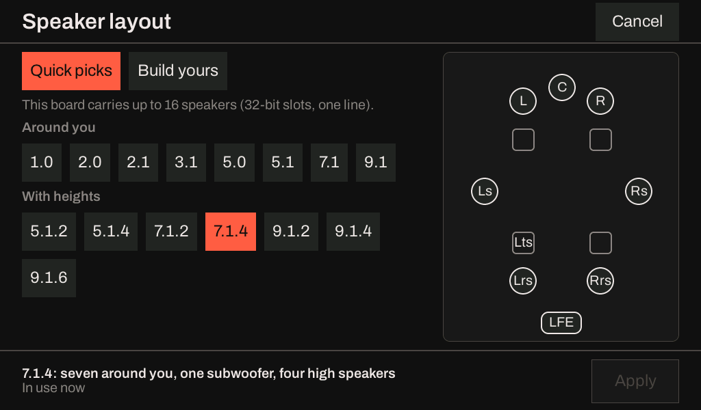
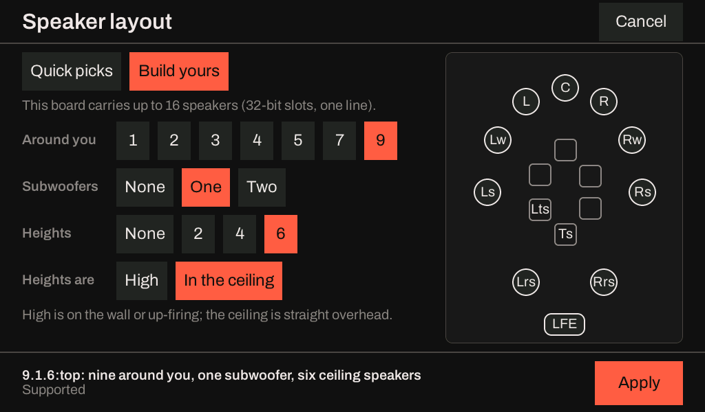
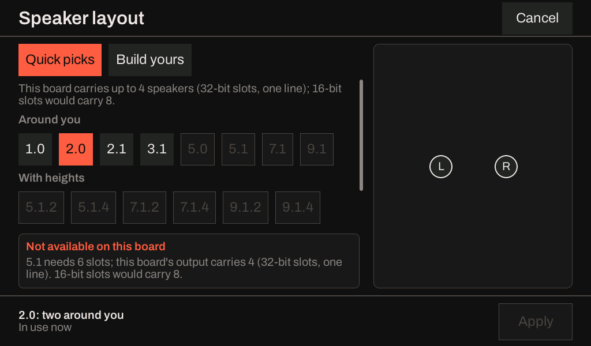
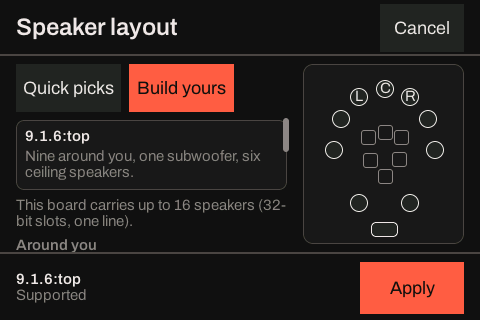
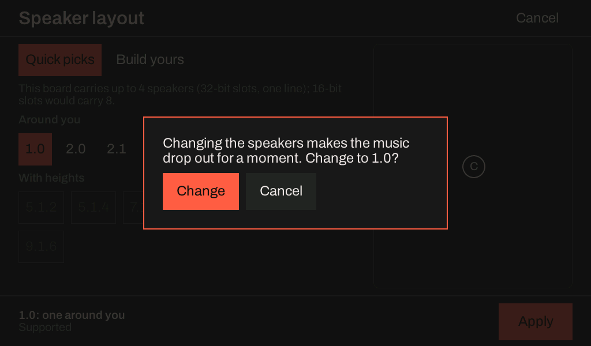

# Choosing the speaker layout of a sink

A Hearth sink plays onto the speakers its **layout** names, one per output slot of its DAC: `2.0` for a
pair, `5.1`, `7.1.4`, up to `9.1.6`, or a list such as `L,R,C,LFE,Ls,Rs` for a DAC wired in another
order. What a board can carry depends on how its I2S output is set up and on the chip, not on the layout,
so the board says which layouts it can take and why it cannot take the others. The same answer is on the
screen (Preferences), on the device's web page and in the REST routes.

## What a board can take

| What decides it | Where it is set | Effect |
|---|---|---|
| Slot width, 16 or 32 bits | The page's **Slot width**, or `PUT /slot-width` | One TDM line is one frame of 128 bits on an ESP32-S3 or ESP32-C6, so four 32-bit slots or eight 16-bit ones; 512 bits on an ESP32-P4, sixteen or thirty-two |
| A second I2S line | The page's **Wiring**, or `PUT /wiring`; only on an ESP32-S3 | Doubles the slots. A DAC has to be wired to the second data pin |
| The chip | Fixed | An ESP32-P4 older than revision v3.0 has no clock for TDM: it plays stereo and nothing wider |
| The build | Fixed | The ESP32-C6 build decodes streams of two channels at most |

The slot width and the second line are the DAC's wiring. Both can be changed while nothing plays, and the
list below follows them.

## The list

`GET /layout-options` lists thirteen layouts (`1.0`, `2.0`, `2.1`, `5.0`, `5.1`, `5.1.2`, `7.1`, `5.1.4`,
`7.1.2`, `7.1.4`, `9.1.2`, `9.1.4`, `9.1.6`), each with one of three verdicts and, unless it is plainly
supported, a sentence:

- **supported**: the board takes it, and a play this wide has been measured keeping up on this kind of
  board.
- **with limits**: the board takes it, and something sits on it: the build decodes fewer channels than
  the layout has, it needs the second line (never checked with a DAC on both lines), a stream this wide
  was measured falling behind, or nobody has measured a play this wide on this kind of board. The last is
  written "Not verified", and means exactly that, not that it fails.
- **unavailable**: the board cannot play it, and the sentence says why: "7.1.4 needs 12 slots; this
  board's output carries 4 (32-bit slots, one line). 16-bit slots and a second line would carry 16."
  The `fix` field says which setting would change that: `slot-width`, `second-line`,
  `slot-width-and-second-line`, or `hardware` when no setting does.

```bash
curl http://hearth-1a2b3c.local/layout-options
```

**One verdict decides all of it.** `PUT /layout` refuses an unavailable layout with `409` and the same
sentence as the body, and takes a layout with a limit with the limit after the `ok`; the screen's list greys
the same layouts with the same sentences; the device page greys the same presets. A layout the list
offers is one `PUT /layout` takes, and one it greys is one `PUT /layout` refuses.

## What each board offers

At the setting each board ships with. The verdicts are the project's host tests', which run every board
below against the layout parser and the board's own rule.

| Board | Setting | Carries | Offered |
|---|---|---|---|
| ESP32-S3 N16R8 | 32-bit slots, one line | 4 slots | `1.0` and `2.0`; `2.1` not verified. `5.0` to `7.1` need 16-bit slots, and `5.1.4` and wider need 16-bit slots and a second line |
| ESP32-S3, 16-bit slots, two lines | | 16 slots | Every layout. `2.0` is the one measured; the rest are not verified, and those past eight slots lean on the second line |
| ESP32-C6 | 16-bit slots, one line | 8 slots | `1.0` and `2.0`; up to `7.1` with the build's two-channel limit; wider layouts unavailable, and no setting helps |
| ESP32-P4 below v3.0 | 32-bit slots | 2 slots | `1.0` and `2.0`; every wider layout unavailable because of the chip, and `PUT /layout` refuses it with that sentence |
| ESP32-P4 v3.x (the P4X kit) | 32-bit slots | 16 slots | All thirteen supported: a 5.1 stream onto `9.1.6`, sixteen slots, ran in real time with no underruns |

"Measured" here is a play in the board suite with no underruns, not a listening test.

## On the screen

A board with a screen has **Speaker layout** in Preferences, under Sound: the layout in force, in words, and a
**Change** button. Change opens one sheet with two ways in to the same choice.

**Quick picks** are the layouts a home has, in two groups: *Around you* (`1.0` to `9.1`) and *With heights*
(`5.1.2` to `9.1.6`). A layout the board cannot carry is greyed, and touching it says why in the card above the
buttons. **Build yours** is how many speakers are around you, how many subwoofers, how many heights, and how the
heights are mounted: high, or in the ceiling. The room the layout makes is drawn beside the
buttons and changes as they are pressed; the footer names the layout in words and holds **Apply**, and Cancel
is in the bar, so neither is ever off the screen. Only the buttons scroll.





What the board plays differently is only the ceiling: heights **in the ceiling** are put straight overhead, and
**high** heights, on the wall or up-firing, are played the same way (the renderer has one upper tier), so the
sheet has one button for them. Bass-managed small speakers are not offered here, because the name has no
spelling for them; a speaker list still sets them, through the route and the web page.

The same sheet on an ESP32-S3 whose sink carries four slots: what the board carries is said at the head, the
layouts it cannot carry are greyed, and a touch on one gives the verdict's sentence.



The sheet is the same code at every size the product is drawn at; on a smaller display the room moves to the end
of what scrolls.



While music plays, Apply asks first, because the sink is opened again and the audio breaks up for a moment. With
nothing playing the change is made at the touch.



How it was designed, and what the board can honestly tell apart, is in
[planning/p4x-layout-builder.md](https://github.com/iainchesworthlabs/iclforge/blob/main/planning/p4x-layout-builder.md).

## Changing the layout

`PUT /layout` with a name or a list sets it, and the board keeps it over a restart. What it does to a
stream that is playing depends on how the stream arrives, and is described, with its open question,
in [planning/p4x-layout-options.md](https://github.com/iainchesworthlabs/iclforge/blob/main/planning/p4x-layout-options.md#what-a-layout-change-does-to-a-playing-stream).
