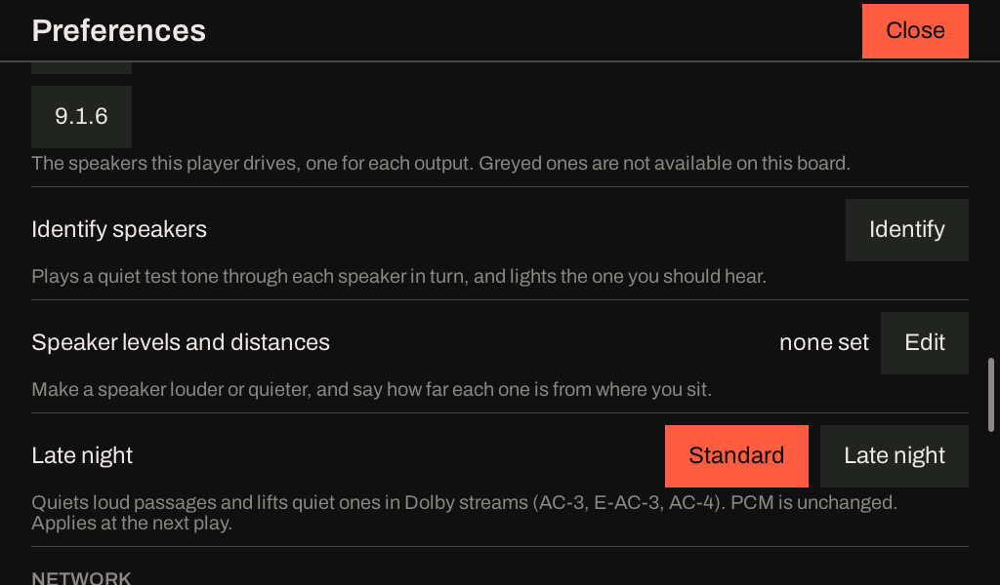
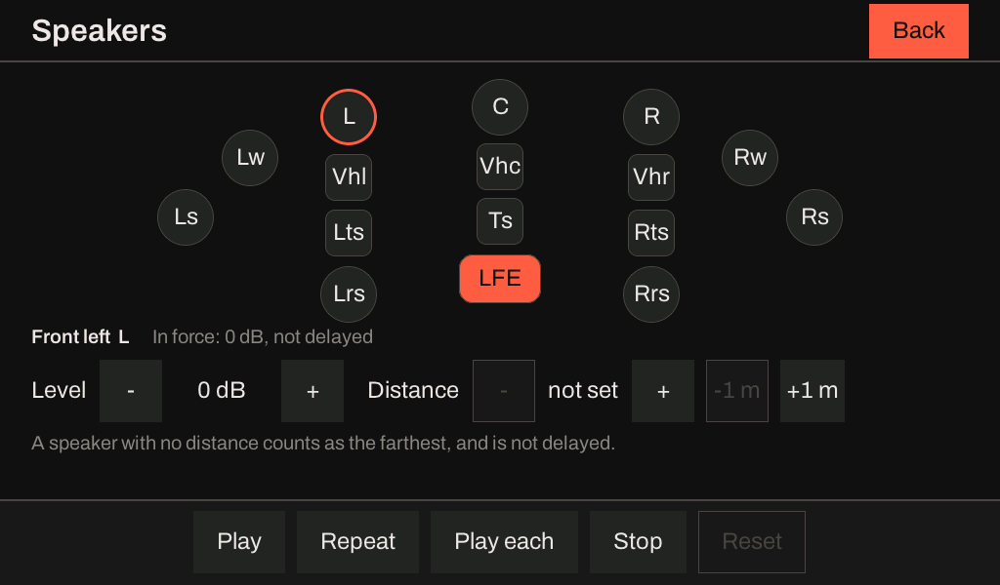
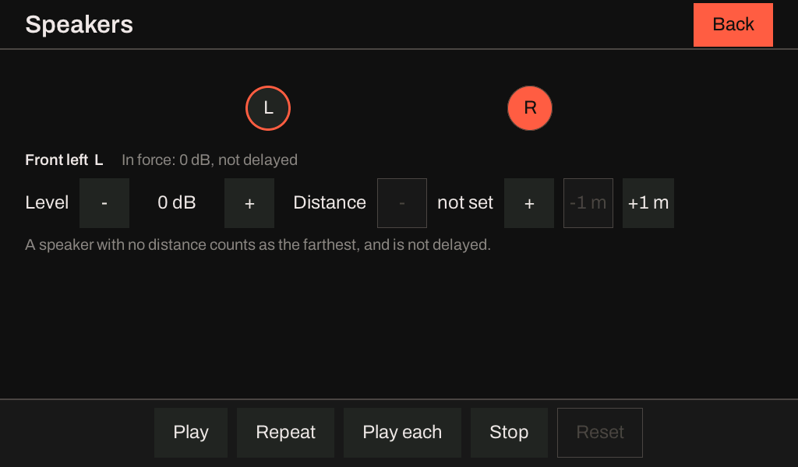
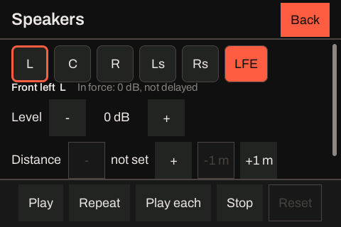

# Speaker levels, distances and the test tone

A sink sets two numbers for each speaker of the room, a **level** and a **distance**, and plays a
quiet **test tone** out of any one of them, so that a person setting up the room can hear which
speaker an output reaches and can match the speakers to each other. Both work the same on every
sink that has a Sendspin player (the S3, the C6 and the P4), and both apply to everything the sink
plays: PCM from Music Assistant, AC-3, E-AC-3, AC-4 and objects from Hearth.

## What the two numbers do

| | Range | Does |
|---|---|---|
| **Level** | -12 to +12 dB, in steps of 0.5 | Turns that speaker up or down against the others. 0 dB is the stream as it comes. |
| **Distance** | 0.1 to 10 metres, to the centimetre | How far that speaker is from where you sit. The nearer speakers are delayed so that the sound of all of them arrives at the same moment. |

Each is kept against the speaker's **role** in the layout, not against the output it is wired to.
The roles are the ones the layout names (`L`, `C`, `R`, `Ls`, `Rs`, `Lrs`, `Rrs`, `Vhl`, `Vhr`,
`Lts`, `Rts`, `LFE` and the rest of the list in [Layouts](sink-esp32-s3.md#layouts)), and `S1` to
`S16` for a slot that a list places by angle. So the left surround keeps its level and distance
when the layout changes from 5.1 to 7.1.4, and a speaker the layout does not have is remembered
until the layout has it again. Every speaker starts at 0 dB with no distance.

A speaker with **no distance** counts as being as far away as the farthest speaker that has one, so
it is never delayed. Setting one distance changes nothing; setting a second moves the nearer of the
two. The **farthest speaker is never delayed**: the delay a speaker gets is the extra distance the
farthest one has over it, at the speed of sound (343 m/s). That also means the time at which the
sink plays a frame, the time its server asked for, is the farthest speaker's, and a group of sinks
stays together however each room is measured.

A level above 0 dB can clip a loud passage: the sink clips at full scale and does not limit.

## Setting them

**On the sink's own screen**, a board with a touch panel (the P4X kit) has them under *Preferences*, in the group *Sound*:



*Identify speakers* and *Speaker levels and distances* open the same view, the *Speakers* sheet. *Identify* opens it and plays
the test tone through every speaker in turn, once; *Edit* opens it as it is.



The sheet draws the room as the layout in force has it, with **every speaker's ID on it** (`L`, `C`, `R`, `Ls`, `Rs`, `LFE`,
and the rest of a larger room's, the height speakers among them), and **the speaker the tone is on is lit** as each sounds:
which one you hear is the one you see. A tap on a speaker chooses it (it is ringed) and plays the tone through it. For the
chosen speaker, *Level* goes up and down half a decibel a tap and *Distance* a tenth of a metre, or a metre with *-1 m* and
*+1 m* (the first *+* on a speaker with no distance starts it at the farthest distance the others have, so that nothing moves
until you move it); the line above them says what is in force at it. A 2.0 room is the same sheet with two speakers:



**The five buttons are a bar at the foot of the sheet that is always on the screen**: *Play* (the chosen speaker once), *Repeat*
(it over and over, so that a level can be set by ear), *Play each* (every speaker in turn), *Stop* and *Reset* (the chosen
speaker back to 0 dB and no distance). *Stop* ends the tone and leaves the controls; it is not the only thing on the screen. The
room and the chosen speaker scroll between that bar and the title's where they are more than the screen holds (a 9.1.6 room, a
small display), and the bar does not move. **The tone stops when you leave the sheet**, and when Preferences put themselves away.
On a screen too narrow for a room the speakers are a row of buttons, and a display too narrow for five buttons on a line wraps
them onto two with shorter words (*Loop* and *All*):



When the board cannot do something the sheet says why under the controls: a song is playing, the board has no memory for delay
lines (the distance is greyed, the level is not), or a Sendspin server is setting the levels. A level or a distance the board
refuses (the nearest and the farthest speaker too far apart) is said above the controls.

**On the sink's web page**, the section *Levels and distances* lists the speakers of the layout in
force, with a level field, a distance field, the delay that comes to, and a *Play* button for the
tone. A field is sent when you leave it. *Reset levels and distances* asks first.

**Over the control surface:**

```bash
curl http://hearth-a1b2c3.local/trim
```

lists the speakers as JSON, with what is set, what is in force, and what the board can do.

```bash
curl -X PUT http://hearth-a1b2c3.local/trim -d 'L level=-1.5 distance=2.4; R level=-1.5 distance=2.4; Ls distance=1.9'
```

changes them. The body is statements separated by semicolons or line ends; a statement is a role
and `level=<dB>`, `distance=<metres>` (or `distance=none`), or `reset`; `reset` alone clears every
speaker. All of it is taken or none of it: one wrong statement changes nothing and the reply says
which kind of mistake it was. A change is in force at the next chunk of a stream that plays, and
is kept over a restart.

A change of level while a song plays moves over the next block of 256 frames (5 ms), so it does not click. A change
of a distance drops that one speaker for the length of its new delay (20 ms at most), once.

## The test tone

```bash
curl -X POST http://hearth-a1b2c3.local/identify -d all       # each speaker in turn
curl -X POST http://hearth-a1b2c3.local/identify -d Ls        # one speaker, once
curl -X POST http://hearth-a1b2c3.local/identify -d 'Ls loop' # that speaker again and again
curl -X POST http://hearth-a1b2c3.local/identify -d off
```

The tone is pink noise, which sounds equally present through a tweeter and a woofer; a subwoofer or
an LFE feed gets the same noise in the band 30 to 80 Hz. It goes through the same output stage as
the music, so a tone out of the left surround proves the whole way from the slot to the DAC channel
to the speaker, and it carries the speaker's level, so a level set by ear is heard on the next tone.
The sink's volume applies, as it does to music.

The tone is made to be safe in a room, and the limits are in the code, not in what a request says:

- **At most -24 dB of full scale** (RMS), and -30 dB unless a caller asks otherwise. A request for
  more plays at -24.
- **1.5 seconds a speaker**, with a 20 ms fade in and out so that no speaker is clicked, and half a
  second between two speakers.
- **60 seconds in all** for anything a request starts, a loop included; then it ends by itself.

It is refused (409, with the reason) while a stream is playing, while a play from the control
surface or an update has the speakers, and while a server's own tone is on. It stops at once when a
stream begins, when the player is held for a play or for an update, and when asked (`off`, which
fades over 20 ms). The sink is left as the tone found it: the player had the sink open already, and
a tone opens or closes nothing. The web page asks the sink to stop when it is closed.

## What a board can do

The delay of a distance needs a delay line for each output, which the sink keeps in PSRAM. A sink
that has none still sets levels.

| Sink | Level | Distance |
|---|---|---|
| ESP32-S3 with PSRAM | Yes | Yes, with the nearest and the farthest speaker up to 6.86 m apart |
| ESP32-P4 (v1.x board, v3.x kit) | Yes | Yes, up to 6.86 m apart |
| ESP32-C6, or any build without PSRAM | Yes | No: the board has no memory for delay lines |

`GET /trim` says which, in its `delay` object (`available`, `reason`, `max_span_m`), and a request to
set a distance on a board that cannot is refused with that reason. Each speaker's distance can be
anything from 0.1 to 10 m, but **the nearest and the farthest speaker can be no further apart than
sound travels in the delay line**: 20 ms, which is 6.86 m (`CONFIG_ICLFORGE_EXAMPLE_SENDSPIN_MAX_DELAY_MS`,
20 in the published images). A request that would put them further apart is refused (409) and says
how far apart they can be; a span that is already too wide, left by a build with longer lines, can
still be made smaller, and a level can be set beside it.

## When a server sets them

A Sendspin server can send a trim and a delay for each output (`trim_db` and `delay_ms` in its
settings), and what it sends **replaces** the sink's own for as long as its settings stand, each key
on its own: a server that sends trims and no delays leaves the delays to the sink. `GET /trim` then
says `server_level` or `server_delay`, the table still shows what the listener set, and the numbers
in force are `applied_level_db` and `delay_samples`. A server's tone replaces the sink's own, and
the sink's is refused while a server's is on.

## Related pages

- [An ESP32-P4 sink](sink-esp32-p4.md) (its screen and Preferences, [Adjust and Preferences](sink-esp32-p4.md#adjust-and-preferences)),
  [An ESP32-S3 sink](sink-esp32-s3.md) and [An ESP32-C6 sink](sink-esp32-c6.md).
- [planning/hearth-speaker-trim-identify.md](https://github.com/iainchesworthlabs/iclforge/blob/main/planning/hearth-speaker-trim-identify.md)
  has the design, the memory, the cost and what is left to check on a board.
