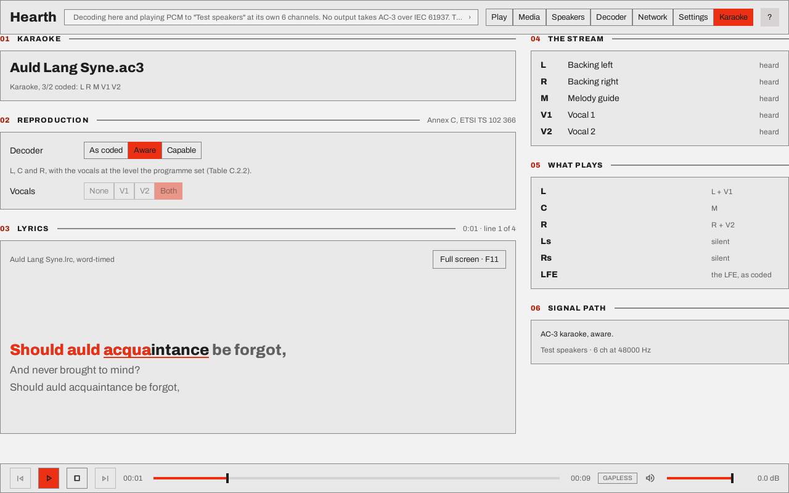
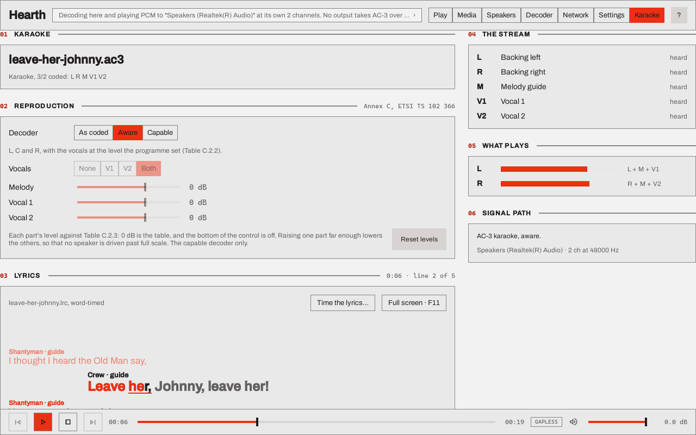
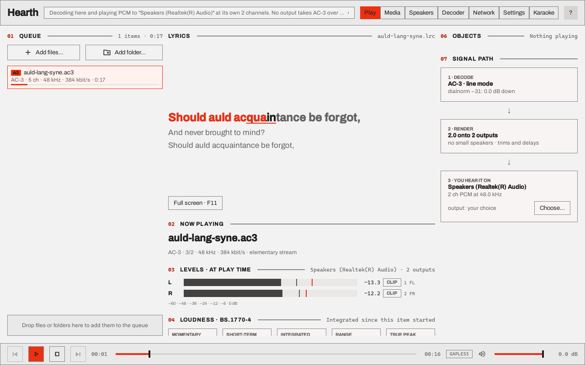
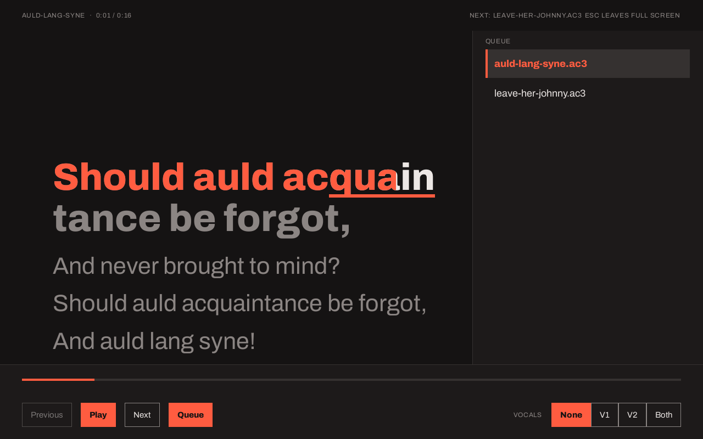
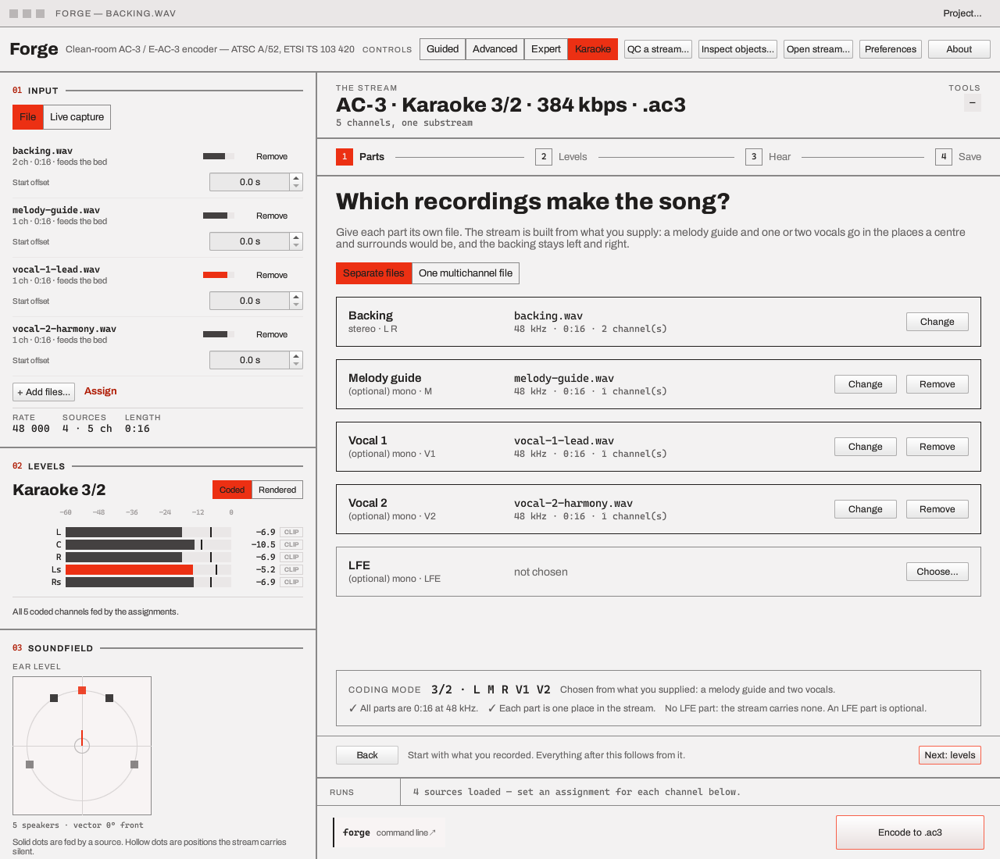
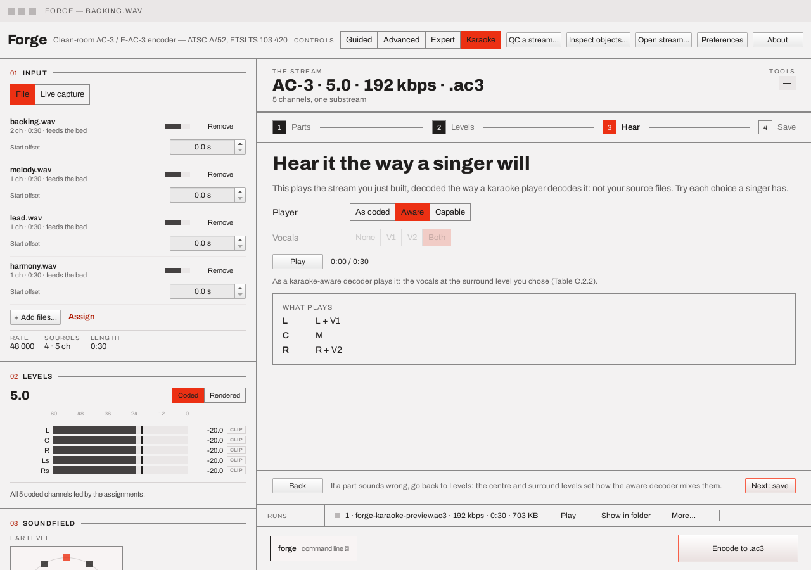

# Karaoke

A karaoke stream is an ordinary AC-3 programme whose channels are **parts**, not speakers: the
backing music, a guide melody, and one or two vocals. ETSI TS 102 366 Annex C defines it. iclforge
handles it end to end, in three places:

| You want to | Use |
|---|---|
| **Play** one, choose which vocals you hear, and sing along to its words | [Hearth](#play-it-in-hearth) |
| **Make** one from a backing track, a guide melody and one or two vocals | [The Forge GUI](#make-one-in-the-forge-gui) |
| Encode, probe and decode one in a script | [`forge`](#from-the-command-line) |

There is no separate karaoke program: Hearth has a Karaoke page, and the Forge GUI has a Karaoke
entry in its Controls switch.

## Try it

[`examples/karaoke/auld-lang-syne/`](https://github.com/iainchesworthlabs/iclforge/tree/main/examples/karaoke/auld-lang-syne)
is a karaoke stream with everything it is made of, so that nothing has to be built first. It is
"Auld Lang Syne", one verse, 16.5 s, generated by a script and not recorded:

- **The parts**: a stereo backing, a melody guide and two vocals as WAV files, and a Forge GUI
  project that opens them in the Karaoke flow. Open the project, press through **Hear** to listen
  to the stream as coded, aware and capable, change a part or a level, and **Save** to encode it
  again.
- **The stream and its words**: `auld-lang-syne.ac3` and `auld-lang-syne.lrc`. Open the stream in
  Hearth and the words follow the singing, syllable by syllable.

The example's own README gives each step, and the `forge encode` line that writes the same stream.

A second example is built for **duets**:
[`examples/karaoke/leave-her-johnny/`](https://github.com/iainchesworthlabs/iclforge/tree/main/examples/karaoke/leave-her-johnny)
is a traditional capstan shanty, one verse, 19.2 s, in which the shantyman and the crew sing
*different* lines and each is silent while the other sings, so that "V1 only", "V2 only" and
"both" each sound different and leave a different part for you to sing. Its project names the four
parts and nothing of how they are laid out; the Karaoke flow and `forge project` work that out.

## What a karaoke stream is

It is a main service with `bsmod` 7 and a coding mode above 1/0. L and R carry the backing; the
slot a programme would use for its centre carries a **guide melody** (M), and the slots it would
use for its surrounds carry **one or two vocals** (V1 and V2):

| Mode | Parts, in coded order |
|---|---|
| 3/0 | L M R |
| 2/1 | L R V1 |
| 3/1 | L M R V1 |
| 2/2 | L R V1 V2 |
| 3/2 | L M R V1 V2 |

A player that knows nothing about karaoke plays the channels where they are coded, so the vocals
come out of the rear speakers. Annex C defines two kinds of decoder that do better:

- A **karaoke-aware** decoder (Table C.2.2) plays L, C and R: the backing, the melody guide in the
  centre, and the vocals mixed in at the surround level the stream carries.
- A **karaoke-capable** decoder (Table C.2.3) does the same and lets the listener choose which
  vocals play: none, V1, V2 or both. With none, what is left is the backing and the guide melody,
  for singing along to. Annex C also leaves it room to move the level of each part, which
  iclforge's capable decoder offers.

E-AC-3 and AC-4 have no karaoke mode in their specifications; this is AC-3 only.

## Play it in Hearth

Open a karaoke stream in Hearth (a raw `.ac3`, or an MP4, Matroska or MPEG-TS file with an AC-3
track) and choose the **Karaoke** page (`Ctrl+7`).



*The "Auld Lang Syne" example, 1.8 s in and held there: the word being sung is part way through its fill. Taken from the running window with `hearth --smoke-shot ... --open ... --seek 1800` ([Hearth's command line](../hearth/index.md#command-line)).*

**Reproduction** is the decoder's choice, kept across starts:

| Choice | What you hear |
|---|---|
| **As coded** | The channels as the stream codes them: the vocals come from the surround speakers. |
| **Aware** (the default) | L, C and R, with the vocals at the stream's own level. On two speakers this is the ordinary Lo/Ro fold, which Annex C says is the same thing. |
| **Capable** | As aware, with **Vocals** set to None, V1, V2 or Both. A single vocal plays in the centre with the melody; Both is V1 on the left and V2 on the right, so a stream with only V1 plays it on the left. A **level** for the melody and for each vocal moves it against the table, from 24 dB down (which is off) to 12 dB up. |

The levels are the capable decoder's alone, 0 dB each is the table as it stands, and they are
kept across starts with the choice. Raising a part far enough lowers the others a little, so that
no speaker is driven past full scale. **Reset levels** puts all three back. A part at the bottom of
its control is off, and the page lists it as muted. A level has nothing to act on for a vocal the
stream lacks or the **Vocals** choice leaves out, and its control is closed.

The page says which part each speaker plays under the choice made, and says in words when the
choice does not apply:

- The stream is **not karaoke** (it may be an ordinary 5.1 AC-3 stream, or E-AC-3 or AC-4).
- The output is a **bitstream** to a receiver. The receiver decodes it, so the choice is not
  applied; unless it is karaoke-capable, V1 and V2 play from its surround speakers. The page has a
  button to choose another output.
- The output is a **network group**: a sink that lists the karaoke settings is sent the stream as
  it is and told your choice, and decodes it itself; one that does not is sent PCM that Hearth has
  decoded with the choice applied. Every member plays one reproduction, at the same levels (see
  [the Hearth page](../hearth/index.md#karaoke)).
- The stereo fold is **Lt/Rt**, for which Annex C defines no reproduction. The page has a button to
  use Lo/Ro, which does.

## Lyrics

Hearth shows the words of the stream playing from a **`.lrc` file with the same name** in the same
folder: `Auld Lang Syne.ac3` is read with `Auld Lang Syne.lrc` (the extension in any case). Where
there is no `.lrc`, a **SubRip `.srt`** of that name is read the same way (see [below](#subrip)),
and failing that an **Advanced SubStation Alpha `.ass`** (see [below](#advanced-substation-alpha)),
and then a **MIDI karaoke `.kar`** (see [below](#midi-karaoke)).

### The file

LRC is an informal format; what Hearth reads is:

```text
[ti:Auld Lang Syne]
[ar:Traditional]
[offset:0]
[00:12.00]<00:12.00>Should <00:12.60>auld <00:13.10>acquaintance <00:14.20>be <00:14.60>forgot,
[00:16.00]And never brought to mind?
```

| Part | Meaning |
|---|---|
| `[mm:ss.xx]` | A line, shown from that time. `.xx` is hundredths, `.x` tenths and `.xxx` milliseconds. Several tags give one text at several times (a repeated chorus). |
| `<mm:ss.xx>` before a word | The **word-timed** form: the word starts at that time and runs to the next word's tag, and a line's last word runs to the next line. |
| `[offset:+/-ms]` | Shifts every time. A positive value makes the lyrics appear sooner. |
| `[ti:]` `[ar:]` `[al:]` `[by:]` `[length:mm:ss]` | Kept for display. |
| `V1:` `V2:` `V1+V2:` at the start of a line | A **duet**: which vocal sings the line (see below). Not shown as text. |
| `[v1:name]` `[v2:name]` | What the file calls the two singers. |

The text is **UTF-8**, with or without a byte-order mark. A file in another encoding is not shown,
and the page says so; playback is not affected.

### A duet

A karaoke stream has two vocals, and a duet's lines can say which sings each:

```text
[v1:Shantyman]
[v2:Crew]
[00:12.00]V1: Oh, the times are hard and the wages low
[00:16.00]V2: Leave her, Johnny, leave her
[00:20.00]V1+V2: It's time for us to leave her
```

The marker is the first thing after the time (before any `<mm:ss.xx>` word tag), in either case,
with spaces allowed round the `+` and after the colon. A line with no marker is for nobody in
particular. A plain file with no times may carry the markers too, so that a duet's text can be
marked before it is timed. Hearth's timing window sets each line's singer and the two names as the
file is timed, and saves them in the file (see [Timing the lyrics](../hearth/index.md#timing-the-lyrics)).

Where a file marks its lines, the Karaoke page has two name fields. A name typed there is for this
run of Hearth only, never kept for a song, and comes before the file's `[v1:]` and `[v2:]`, which
come before "V1" and "V2". Every line then says who sings it, three ways: the **name** above it, the
**side** (the second singer's lines are indented, the first's are not) and the **colour**. On a
karaoke stream the name also says whose line it is for you: **guide** when the vocal that is playing
sings it, **you** when it does not, and **shared** when it is a line for both and only one of the
two plays. A sentence under the names says the same for the whole file ("The vocal of Shantyman
plays: you sing the lines of Crew."), which is what choosing **V1**, **V2**, **None** or **Both**
under Capable changes.



*"Leave Her, Johnny", 6.3 s in: the crew's line, indented and tagged **guide** because both vocals play.*
### SubRip

A `.srt` file is read as lyrics too, which is what subtitle tools and ripped karaoke subtitles write:

```text
1
00:00:12,000 --> 00:00:15,500
Should auld acquaintance
be forgot

2
00:00:20,250 --> 00:00:22,000
And never brought to mind?
```

Each cue is a line, and it ends where its cue ends, so the gap between two cues is a stretch where
nothing is being sung (which an LRC file, whose lines end where the next begins, cannot say). The
text lines of a cue are joined with a space; styling (`<i>`, `<b>`, `<font ...>`) and `{...}`
override blocks are dropped, and a position after the end time is ignored. The number above a cue
is not needed, a `.` is read for a `,` in a time, and cues out of order are put in order. There are
no words in a SubRip file, so there is no word fill: the whole line is emphasised as it is sung.
The encodings are the LRC reader's: UTF-8 with or without a byte-order mark, or UTF-16 with one.

### Advanced SubStation Alpha

A `.ass` script is read as lyrics too, which is what subtitle-karaoke tools write, and its
karaoke tags are **word times**:

```text
[Events]
Format: Layer, Start, End, Style, Name, MarginL, MarginR, MarginV, Effect, Text
Dialogue: 0,0:00:12.00,0:00:15.50,Default,,0,0,0,,{\k50}Should {\k30}auld {\k80}acquaint{\k20}ance
```

Each `Dialogue:` event is a line from its start to its end. Each `{\k50}` (and `\kf`, `\K`, `\ko`:
the same duration, drawn differently) begins a **syllable** that lasts that many hundredths of a
second after the one before; a syllable is a word of the line, so the fill moves by syllable, as
the script's own sweep does. Everything else is dropped: the other override tags (`{\an8}`,
`{\pos(...)}`), the styles, and any event that draws (`{\p1}`) or is a `Comment:`. `\N` is a
space. The columns are the script's own `Format:` line, with the v4+ order where it has none, and
an event with no karaoke tags is a line with no words.

### MIDI karaoke

A `.kar` file (a Standard MIDI File whose syllables are meta events) is read for its words, and only
its words: the music in it is not played or read. What is taken:

- the **words** from the track called `Words`, where there is one, else from the file's Lyric
  events, else from its Text events;
- the **title** and the **artist** from the first and second `@T` lines; the other `@` lines
  (`@K`, `@L`, `@I`, `@V`) are not words;
- a `/` begins a new line, and a backslash a new verse (a line too, here), and so does a line end in the
  text;
- every **syllable** is a word of the line with its own start, from its tick through the file's
  **tempo map** (a tempo change on any track moves every later tick), so the fill moves by syllable. A
  syllable that begins with a space is the start of the next word: the space is joined to the one
  before it. A line ends where the next begins;
- a file whose time is counted in **SMPTE frames** (a frame rate and the ticks in a frame, where the
  other files count ticks in a quarter note) has a tick of a fixed length, and its tempo events mean
  nothing: 24, 25, 29.97 and 30 frames a second are the four rates the format defines, and all
  four are read.

A file with no words, that is cut short, or that counts SMPTE frames at some other rate says so. A
MIDI file carries **no word of its encoding**, and what is read is UTF-8 only: Latin-1 and the other code pages
are not guessed at, so a Western karaoke file with accented letters saved in Latin-1 (and Hebrew in
Windows-1255) is refused with the reason, as an LRC file in a code page is. Plain ASCII is UTF-8, and
most are. Only the title, the artist and the words are checked: the other `@` lines are not shown,
so a copyright or key line in a code page does not refuse a file whose words are fine.

### What is shown

- In a **word-timed** file, a word that has been **sung** is in the accent colour, a word **not yet
  sung** is muted, and the word **being sung** is underlined and fills in the accent from left to
  right as it is sung.
- In a file that times **lines but not words**, the whole line is emphasised as it is sung. No word
  times are invented for it.
- A file with **no times at all** is shown whole and is not followed.
- With **no file**, the page says which name it looks for.

The words follow the position of what is *heard*: the output device's own clock less its path's
delay, so they stay with the sound on a Bluetooth speaker or a receiver with a long path.

They are on the Karaoke page, full screen ([the singer view](#the-singer-view)), and on the Play
page: an item with lyrics, or a CD+G picture, gets a **Lyrics** card there beside the queue (in
a window 1,580 pixels wide or more) or at the top of the monitor column (in a narrower one). An
item with none gets no card, so the Play page is as it was for every other stream.



*The Play page at its default size, 1.8 s into the example.*

### A CD+G disc

A **`.cdg` file with the same name** is the picture of a karaoke disc that was ripped on its own,
the other half of an "MP3+G" pair: `Song.mp3` and `Song.cdg`. When there is **no lyrics file**,
Hearth shows that picture where the words would be, with the proportions of the disc's 300 by 216
and as large as fits (in whole steps, so the small type stays crisp), drawn against the position of
what is *heard* and moved by the lyric delay as the words are.

The words of a disc are **part of the picture**. Nothing is read from it as text, so there is no
fill, no line to follow and nothing to translate or copy, and the page says so.

**When a lyrics file is beside the stream too**, the words are shown, since they are what a
word-by-word fill and the delay can follow, and a **Show** choice (Words or Picture) appears in the
Lyrics card, and on the bar of the full-screen singer view, to show the disc instead. The choice is
for **this run of Hearth**: it is not kept for the song, it holds from one song to the next while
Hearth is open, and a song with only a lyrics file or only a disc is not changed by it. Choosing
the picture takes nothing from the lyrics: the file is still loaded, so the timing window, the
duet cues and the lyrics a board is sent are as they were. A `.cdg` that cannot be read beside a
lyrics file is not shown and not reported: the words are.

What is drawn is what the disc's own player draws: the screen preset and the border preset, the
tile blocks and their XOR form, the scrolls by a tile (the preset form fills the gap, the copy form
brings back what left), the smooth scrolling offsets within a tile (the picture is shown up to 5
pixels left and 11 up of where its memory has it, which is how a disc scrolls a line a pixel at a
time), the 12-bit colour table of 16 colours, and the transparent colour (drawn as the backdrop, which
is black: there is no video here for it to show). A packet that is not CD+G is skipped
and keeps its place in time, and a file that is not a whole number of 24-byte packets, or has no
CD+G packet in it, is refused with the reason (playback is not affected). The packets are not checked
for parity: a rip has already been through the drive's error correction.

### Keeping the words in sync

**Settings, Playback, Lyric delay** moves the words later (positive) or sooner (negative) by up to a
second in steps of 10 ms, on top of the file's own `[offset:]`. It is kept across starts. A file's
times are rarely right to the frame against a particular output.

### The singer view

`F11`, or **Full screen** on the Karaoke page's lyrics or the Play page's, opens the words alone,
large, on a dark screen. `Esc` leaves it, and `Space` pauses.



A position bar, Previous, Play/Pause, Next, **Queue** and the **Vocals** chooser stay at the
bottom, so a singer can move about in the song, pause, skip, pick the next song or change which
vocals play without leaving. Choosing a vocal there chooses the capable reproduction with it.

**Moving about.** Press the position bar, or drag along it: the words and the clock show the place
the bar is held at, and the song moves there when you let go, whether it was playing or paused.
`Left` and `Right` move it five seconds either way, and stop at the ends.

**The queue.** The strip at the top names the song that comes next. **Queue**, or `Q`, opens the
queue beside the words: the song that is playing is marked, and pressing another plays it from
its start. `Q` or the button closes it again.

## Make one in the Forge GUI

Choose **Karaoke** in the Controls switch. Four steps build the stream from the recordings it is
made of:



1. **Parts.** Give each part its own file: a **stereo backing**, and optionally a **mono melody
   guide**, **Vocal 1** and **Vocal 2**. Or give **one multichannel file** whose WAV speakers are
   already named. The page shows the coding mode the parts make, why, and what is wrong with
   anything that cannot be used.
2. **Levels.** The centre level (the melody guide in a stereo fold) and the surround level (the
   vocals), which an aware decoder applies.
3. **Hear.** The stream is encoded and played back the way a karaoke player decodes it: as coded,
   aware, or capable with the vocals you choose. It plays the encoded stream, not your source
   files.
4. **Save.** The file type (the raw stream, or Matroska, MP4 or MPEG-TS), the bit rate, the
   equivalent `forge encode` command, and the encode.



Each coded channel is written into the same draft the other tiers edit, so switching to Expert
afterwards shows the same bed, `bsmod` and assignments. The Forge GUI guide has the details of each
step and of what a part may be: [Forge GUI, Karaoke](../forge/gui/karaoke.md).

## From the command line

Encode: a stereo backing and a melody guide and two vocals as five coded channels, with `bsmod`
set to 7 (the token is `voiceover`, which at a layout above 1/0 is the karaoke main service). The
sources are mapped to bed positions with `src=` and `map=`:

```text
forge encode backing.wav out.ac3 384 L,C,R,Ls,Rs src=melody.wav src=lead.wav src=harmony.wav \
      map=0.0:L,0.1:R,1.0:C,2.0:Ls,3.0:Rs bsmod=voiceover
```

A single multichannel WAV whose speakers are named needs no `map=`.

Probe:

```text
$ forge probe out.ac3
...
bsmod           7 (karaoke)
layout          3/2 (acmod 7, lfeon 0)
renders         5 channel(s): L C R Ls Rs
```

Decode, as an aware decoder (`karaoke`) or a capable one with a choice of vocals
(`karaoke=none`, `karaoke=v1`, `karaoke=v2` or `karaoke=v1+v2`), to L, C and R:

```text
forge decode out.ac3 aware.wav karaoke
forge decode out.ac3 melody-and-v1.wav karaoke=v1
```

`channels=2` or `channels=1` gives the 2/0 or 1/0 reproduction. `downmix=ltrt` is refused with
`karaoke`, as Annex C defines no Lt/Rt reproduction. A stream that is not karaoke is decoded as
coded, and the report says so. The library form is `OutputConfig::karaoke` and
`OutputConfig::karaoke_vocals`; see [Decoding](../library/decoding.md).

`forge monitor` takes the same choice and plays the reproduction on the output:

```text
forge monitor out.ac3 karaoke=none      # L, C, R: the backing and the melody, for singing along
forge monitor out.ac3 karaoke=v1+v2     # V1 left, V2 right
```

The capable decoder's levels are `karaoke-melody=<dB>`, `karaoke-v1=<dB>` and `karaoke-v2=<dB>` on
both commands: each part against Table C.2.3, 0 dB the table, up to 12 dB louder and `-24` or `off`
at the bottom, the span and the defaults of Hearth's sliders.

```text
forge decode out.ac3 sing.wav karaoke=none karaoke-melody=-6
forge monitor out.ac3 karaoke=v1 karaoke-v1=-12 karaoke-melody=3
```

They move nothing under the aware reproduction, so a level without a choice of vocals
(`karaoke=none`, `v1`, `v2` or `v1+v2`) is refused.

On an output narrower than the stream, which `monitor` folds to unasked, the 2/0 reproduction
plays. `forge play` applies the choice where it decodes (its PCM fallback), and `forge spdif`
and `forge play`'s bitstream legs hand the coded stream on: they accept `karaoke` and say it is
not applied, since a receiver reproduces the stream. E-AC-3 and AC-4 are ignored with a warning
by all of them.

## From a program

The reproduction and the lyric reader are in the libraries, so a program of your own can use them:

| You are in | The reproduction | The lyrics |
|---|---|---|
| C or C++ through the C API | `iclforge_decoder_create_with_karaoke()`, [C API](../library/c-api.md#karaoke-streams-annex-c) | `iclforge_lyrics_parse()` and its cursor, [C API](../library/c-api.md#lyrics) |
| Python | `DecoderConfig(karaoke=...)`, [Python](../library/python-api.md#karaoke-streams-and-lyrics) | `iclforge.lyrics` |
| Rust | `Decoder::with_karaoke`, [Rust](../library/rust-api.md#karaoke-and-lyrics) | `iclforge::lyrics::Lyrics` |
| A browser or Node (WebAssembly) | `FoldOptions.karaoke`, [the npm package](../platforms/wasm.md) | `parseLyrics` in the demo's module, which the [decode demo](../wasm-demo.md)'s Words panel uses |
| C++ | `OutputConfig::karaoke` and its levels, [Decoding](../library/decoding.md) | `iclforge::lyrics`, `libs/lyrics` |

All of them take the same choices (as coded, aware or capable; the vocals; the three part levels in
dB over -24 to +12, where the bottom is off) and the same bytes of a lyrics file, and give the same
samples and the same lines as `forge decode` and Hearth do.

## What it does not do

- **Aligning words to the sound.** Hearth's timing window ([Timing the
  lyrics](../hearth/index.md#timing-the-lyrics)) takes word times from your presses, and an estimate
  by the letters of a word is only where a press starts from. A forced aligner is outside software,
  and [Timing a song with a forced aligner](forced-alignment.md) runs one and reads its result in.
- **Reading a lyrics file in a code page.** UTF-8 and UTF-16 are read; Latin-1, Windows-1255 and the
  other 8-bit encodings are named and not guessed at. A MIDI karaoke file has no way to say its
  encoding, so its words must be UTF-8.
- **Text from a CD+G disc.** Its words are pixels, so Hearth shows the picture and cannot follow the
  words.
- **A screen on a sink.** A board that decodes for itself is sent the lyrics and where the sound is
  in them, follows them on its own clock and reports the line; the panel that would draw them waits
  for a board with a display.
- **Karaoke in E-AC-3 or AC-4.**
- **A microphone, scoring or recording.** A [draft plan](https://github.com/iainchesworthlabs/iclforge/blob/main/planning/karaoke-microphone.md)
  sets out the requirements and the design questions and is awaiting approval; nothing of it is
  built.

## How it is checked

No other decoder implements Annex C's karaoke reproduction and there is no karaoke stream from
anyone else, so there is nothing outside to compare with. It is held to the annex's own tables,
transcribed independently of the code: every mode is encoded with a tone in each part and decoded
under each reproduction and each choice of vocals, and the tones on each output are what the table
says. See [Verification](../verification.md).
