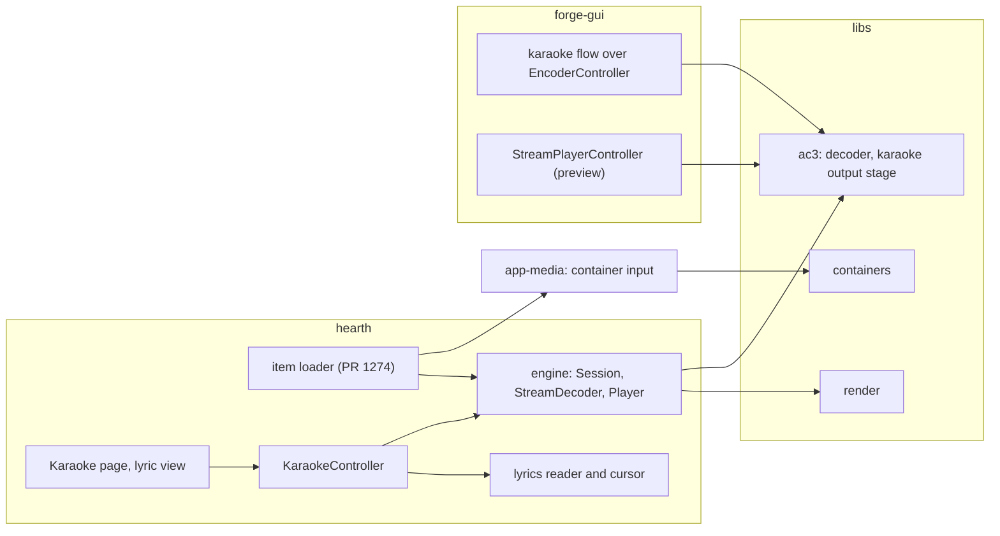

# Karaoke: design

!!! note "Status as of 2026-10-11: architecture, work breakdown and the UI sheet drafted; the owner's sign-off is next"
    Phase 2 of [the karaoke plan](karaoke.md). It answers the specification there (requirement IDs
    P1 to P11, L1 to L6, A1 to A8, D1 and D2) and changes none of it. Nothing below is built, except
    the first PR of the breakdown, which is open: PR #1274. Section
    [Decisions for the owner](#decisions-for-the-owner) lists what the design needs answered
    before Phase 3.

## What the design rests on

- **No new program.** Hearth plays and the Forge GUI creates. A program may not use another
  program (`tools/checks/projects.json`, held by `check_layering.py`), so the two share only
  libraries and `app-media`, `app-preferences` and `app-theme`.
- **The karaoke decoders are on `main`.** PR #1267 merged on 2026-10-11 at 04:14Z, so the library
  fields (`OutputConfig::karaoke`, `karaoke_vocals`, `meta::is_karaoke`, the four-argument
  `output_channel_count`) need no stacking.
- **Hearth decodes, then renders onto a speaker layout.** `StreamDecoder` takes the decoder's
  channels and a bed layout and hands both to `render::LayoutRenderer`. Karaoke changes what the
  decoder returns, which is the one place the design has to look closely (below).

## Architecture

An arrow is *uses*. Nothing in `hearth` uses `forge-gui` or the other way round.

### Hearth

- **Engine (no Qt).** `DecoderSettings` gains a karaoke group, the one place Hearth's decoder
  options become a library configuration, and `decoder_setup()` writes it into
  `OutputConfig::karaoke` and `karaoke_vocals` (P2, P3). The default is *aware* for every item: the
  library ignores it for a stream that is not karaoke, so it changes nothing else (P6).
  `StreamDecoder` lays a reproduced karaoke stream out correctly (next section). The report that
  already travels with each unit says whether karaoke was reproduced and which vocals (P1, P10).
- **Lyrics (no Qt, in the engine's test binary).** A reader turns an LRC file into lines of timed
  words, and a cursor answers "which line, which word, how far through it" for a position by binary
  search (L1 to L5). Nothing about it is Hearth-specific, so it can move to `apps/shared` if the
  Forge GUI ever shows lyrics.
- **UI (Qt).** A third QML singleton, `KaraokeController`, beside `HearthController` and
  `NetworkController`, so `hearth_controller.cpp` (about 2,200 lines, edited by many sessions)
  does not grow. It holds the stream facts, the reproduction and vocals properties (which write
  through `HearthController`'s decoder settings), the lyrics of the current item, and the notices
  of P6 to P8. The page and the lyric view are new QML files; the lyric colours are three new
  roles in `apps/shared/theme/assets/qml/Theme.qml`.

### The reproduced layout (the finding)

For an AC-3 unit, `StreamDecoder` sets the renderer's bed from the **coded** layout
(`peek_layout`: the unit's `acmod`). With *aware* or *capable* reproduction at a layout that does
not fold, the decoder returns **L, C, R and then the LFE** for a 2/1, 3/1, 2/2 or 3/2 karaoke
stream, so three or four channels arrive against a bed of four to six. Rendered as it stands, the
vocals would be placed as surrounds that are no longer there, and the channel count would not
match the bed.

The fix is small and has one rule: when the stream is karaoke and a reproduction applies and the
layout is not folded, the unit's bed is the 3/0 layout (with the LFE if the stream has one). The
decision is the same one the CLI's `decode ... karaoke` already makes when it writes the WAV's
speaker mask, and the Forge GUI preview (A6) needs it too, so it belongs in the library once
(decision 1 below).

### Lyrics and the clock

The engine already publishes where the item has got to (`PlayPosition::heard`: the device's clock
less its output path's delay, in milliseconds) and the controller reads it every 60 ms. A word
fill moves too often for that, so:

1. The controller publishes `positionMs` as it does now, and records when it did.
2. The lyric view keeps a clock that, while the transport is *playing*, is that position plus the
   time since the poll, advanced each frame and never more than two polls ahead of the last
   reading, so a stalled poll cannot run the words away.
3. A pause, a seek, an item change and a stop snap the clock to the position read.
4. Each frame the cursor gives the line, the word and the fraction through the word; the view draws
   the word's text twice, the *sung* colour clipped to that fraction of its width over the
   *current* colour, and the words before it *sung* and after it *not yet sung* (L4).

The fill is proportional to time across the word's width, not to its letters. The view is polled,
not pushed, as the rest of Hearth's live state is: no engine callback carries a word.

### Forge GUI

- **Authoring (A1 to A8).** The Forge GUI already has multi-source parts with per-channel
  assignment (`addSourceFile`, `setAssignment`, `autoAssignByName`), a `bsmod` choice, centre and
  surround levels, and `encodeTo()`. The karaoke page is a fourth guided flow over the same draft
  as `GuidedWizard.qml`, whose own header says it is "a wrapper over the SAME rules" so that what
  it sets is what Expert would show. A small Qt-free helper turns the parts the author supplied
  into the coding mode and the assignment (A2, A3, A8), so those rules are tested without QML.
- **Preview (A6).** `StreamPlayerController` already decodes a stream to memory and plays it. It
  gains the reproduction and vocals choice, and the page uses it on the file just encoded, so the
  author hears the encoded stream through the same decoder a singer's player runs.

## The UI design sheet

Five artboards, drawn in Hearth's own language (the signal palette, zero radius, numbered mono
section labels, the three-column page and the transport bar at the bottom) from its design
screenshots and `Theme.qml`, and read back from the rendered pages and an enlarged crop, not from
memory. The sheet is a design canvas, <https://claude.ai/artifact/4gF1gBgmBpPFLt7nLDYH7e>, private
to the owner.

| Board | Shows | Answers |
|---|---|---|
| Hearth: Karaoke page, reference view | Queue with karaoke items, the stream's parts and which are heard or muted, the Reproduction card (decoder: as coded, aware, capable; vocals: none, V1, V2, both), the lyric panel with a word part-way through, what each output carries, and the signal path | P1, P2, P4, P10; L4 |
| Hearth: singer view | Full screen, dark: the line being sung large, previous lines dim in the sung colour, upcoming lines muted, the vocals chooser and transport kept at the bottom | L4, L6 |
| Hearth: the states | Not a karaoke stream (controls disabled, with the reason), a bitstream output, the Lt/Rt fold, and the three lyric cases (line times only, no file, unreadable) | P6, P7, P8; L5 |
| Forge GUI: Karaoke flow, Parts | A fourth entry beside Guided, Advanced and Expert; the parts as named slots, the coding mode chosen from what was supplied, the checks, the coded channels on the left | A1 to A3, A8 |
| Forge GUI: Karaoke flow, Hear | The encoded stream played under each reproduction, with what reaches each output | A6 |

What the sheet fixes, so the build does not have to decide it again:

- **Three word states, and a cue that is not colour.** *Sung* is the accent, *not yet sung* is the
  muted neutral, and the word *being sung* is bold and underlined, with the sung part of it in the
  accent. The first render of the sheet lost that underline on the Hearth page (the underline fell
  outside the clipped background and went transparent); the QML draws it as its own item, not as
  text decoration.
- **The page keeps Hearth's order.** Karaoke is the seventh button, after Settings, so `Ctrl+1` to
  `Ctrl+6` keep their meaning.
- **Notices sit inside the Reproduction card**, in words, with the one action that fixes the
  cause (`Play decoded here`, `Use Lo/Ro`), so a disabled control is never unexplained.
- **The Forge flow is a mode of the controls row**, with the same stepper and footer as Guided, and
  the coded channels shown on the left as they will be written.

## Work breakdown

Small PRs, each with code, tests, docs and a CHANGELOG line, in this order. "Needs" is what must
have merged first.

| PR | What | Needs | Size | Checks |
|---|---|---|---|---|
| **K0** (#1274) | Hearth opens MP4, Matroska and MPEG-TS (P11) | nothing | S | Open, CI running |
| **K1** | Library: the layout a reproduced karaoke frame comes out in, with tests (decision 1) | nothing | S | `libs/ac3` tests; owner of the decoder reviews |
| **K2** | Hearth engine: karaoke settings, `decoder_setup`, bed layout, report fields (P1 to P5, P10) | K1 | M | Player on a fake device against the library decode, per reproduction |
| **K3** | Hearth engine: LRC reader and cursor (L1 to L5) | nothing | M | Unit tests over a file of cases; cursor against known positions, seek included |
| **K4** | Hearth UI: `KaraokeController`, Karaoke page (reference view), notices P6 to P8, persistence (P9), translations | K2 | M | QML tests, `qml.exe` screenshots, lupdate gate |
| **K5** | Hearth UI: lyric view, the clock, full-screen view, lyric delay (L4, L6) | K3, K4 | M | QML tests with a driven clock; screenshots |
| **K6** | Forge GUI: parts helper, karaoke flow, preview choice in the stream player (A1 to A8) | nothing (the library is on `main`) | L | End to end: build from generated parts, probe, decode under each reproduction, compare with Annex C |
| **K7** | `docs/karaoke` user guide, the development-status rows, roadmap row, screenshots; remove the `docs/karaoke` entry from `PLANNED_PATHS` | K5, K6 | S | `check_doc_paths.py`, `--smoke-shot` |

K2 and K3, and K6 against the Hearth PRs, can run at the same time. K0 and K1 first.

**Owners.** Every PR is this session's unless the owner chooses to hand pieces to subagents; that
is billed, so it is asked about before a wave. Before a PR touches a file, the open PRs on it are
listed and the session that owns them is messaged: K1 the session that owns the AC-3 decoder; K2,
K4 and K5 any open Hearth PR on `hearth_controller.cpp`, `Main.qml` or `PlayPage.qml`; K6 the
sessions that work on the Forge GUI's stream player and on `encoder_controller.cpp`.

## Test strategy

- **Engine and library.** Catch2 in `iclforge-hearth-tests` and the AC-3 tests, with generated
  streams whose parts are tones at distinct frequencies, so an output's spectrum names the parts
  in it and their gains. The expectation is Annex C's tables, transcribed independently as the
  library's own tests do.
- **Hearth UI.** The window's QML tests drive the real controllers, as the existing `tst_` files
  do (`HearthTestHelpers.js`), with a fake clock for the lyric view. A page's states each have a
  test: karaoke, not karaoke, passthrough, Lt/Rt, no lyrics, lyrics without word tags.
- **Screens.** Each design-sheet screen is rendered from the running QML through `qml.exe` with
  mocked singletons (the harness Hearth's own design used) and compared by re-cropping the
  screenshot, not from recall.
- **Forge GUI.** `forge_gui_qmltests` for the flow, and the helper's own Catch2 cases.
- **Manual.** A listening pass by the owner, recorded in the PR, for singer view and the
  reproductions.
- **CI.** No new lane. New `qsTr()` strings regenerate the catalogues in the same PR and satisfy
  the lupdate location gate; each Hearth PR is built in its own tree.

## Documentation plan

The user guide is written as each feature lands, under `docs/karaoke`, not before: what a karaoke
stream is, the three reproductions and the listener's choice, lyrics (the format Hearth reads,
with an example), and making a stream in the Forge GUI. `docs/hearth/index.md` and
`docs/forge/gui` link to it. The development-status rows record what is checked against what, and
use the blue dot only for a stated, accepted gap (no outside decoder; word-timed files rarer than
line-timed ones). Screenshots come from the running app with `--smoke-shot`, never `--shot`.

## Risks

- **The reproduced layout (K1, K2).** A reproduction that reaches the renderer with the wrong
  bed puts vocals in the wrong speakers without any error. The K2 test compares Hearth's PCM
  with the library's for the same stream under each reproduction.
- **Hot files.** `hearth_controller.cpp`, Hearth's `Main.qml` and `PlayPage.qml`, and the Forge
  GUI's `Main.qml` (about 7,700 lines) and `encoder_controller.cpp` are edited by many sessions.
  The design adds new files and small hooks to them, and each PR is rebased on a fresh `main`.
- **The clock under load.** If the GUI thread stalls, the fill can lag; the clamp (two polls)
  bounds how far it can run ahead and a poll snaps it back. Measured in K5 on a loaded machine.
- **Word-timed files are rare.** The feature is only as good as the files; v1 test content is
  generated and the plan's open question 5 is the tool that would time words.
- **Translations.** Each UI PR adds strings; the lupdate location gate restamps on unrelated edits
  in the Forge GUI, so K6 builds `forge-gui_lupdate` before pushing.

## Decisions for the owner

Each has the answer the design assumes.

1. **Where the reproduced layout comes from (K1).** *Assumed:* a small library function beside
   `output_channel_count` (the layout a frame comes out in under an `OutputConfig`), used by
   Hearth, the Forge GUI preview and later the sinks. *Alternative:* a private rule in Hearth's
   `StreamDecoder` and another in the Forge GUI: no library PR, two copies of one rule.
2. **Shape of the Forge page (K6).** *Assumed:* a guided flow over the existing encoder draft, in
   the manner of `GuidedWizard.qml`: parts, levels, hear, save, with Expert showing the same
   settings. *Alternative:* a separate dialog with its own controller, as QC and the stream player
   have: it cannot clobber an encode in progress, and it duplicates the pipeline's source and
   assignment handling.
3. **One place for the choice (K4).** *Assumed:* the reproduction and vocals are chosen on the
   Karaoke page only, and the Decoder page shows the current choice as one line that opens it.
   *Alternative:* the same controls on the Decoder page too, which makes the stream's
   reproduction reachable where the other decoder options are and gives it two homes.
4. **A lyric delay (K5).** *Assumed:* a Settings control, ±1,000 ms, added to the file's own
   `[offset:]`, because sync between a file's tags and a particular output path is the thing a
   singer most often has to nudge. *Alternative:* the file's tags only.
5. **Full screen (K5).** *Assumed:* the singer view is the page's lyric view made full screen
   (F11, Escape to leave), with the transport and the vocals chooser reachable by one key.
   *Alternative:* a separate window, which would also allow a second monitor.
