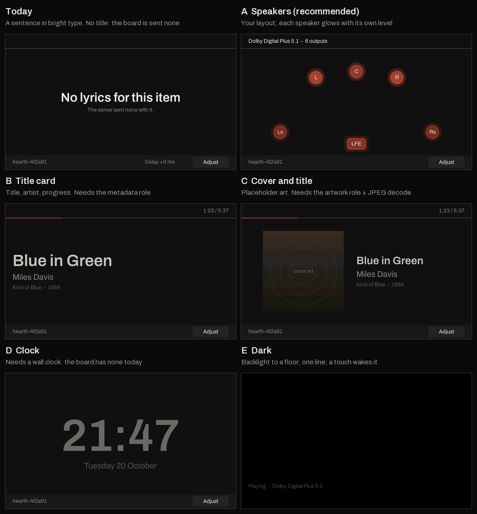
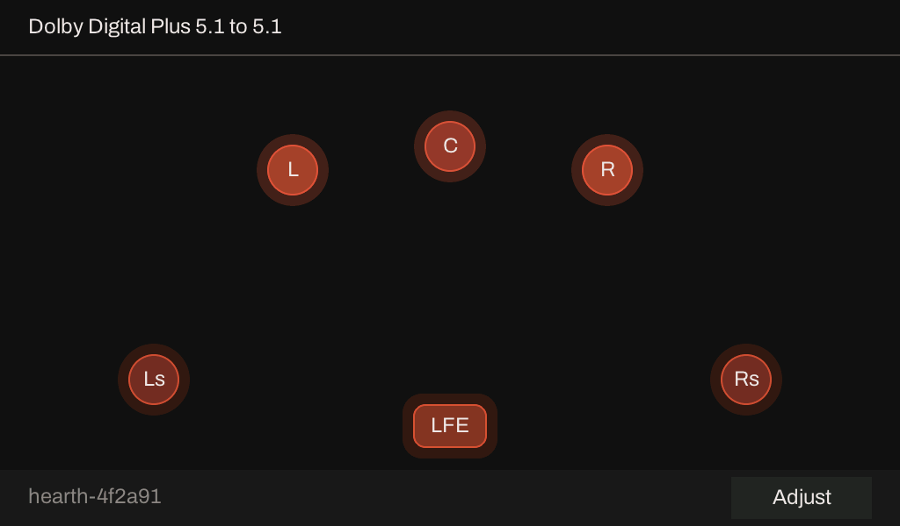
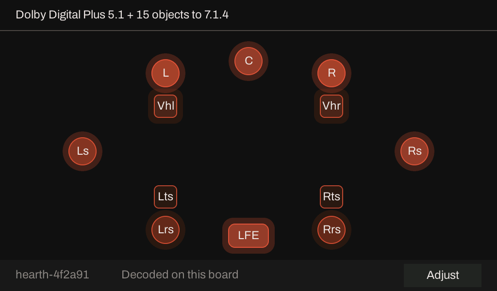
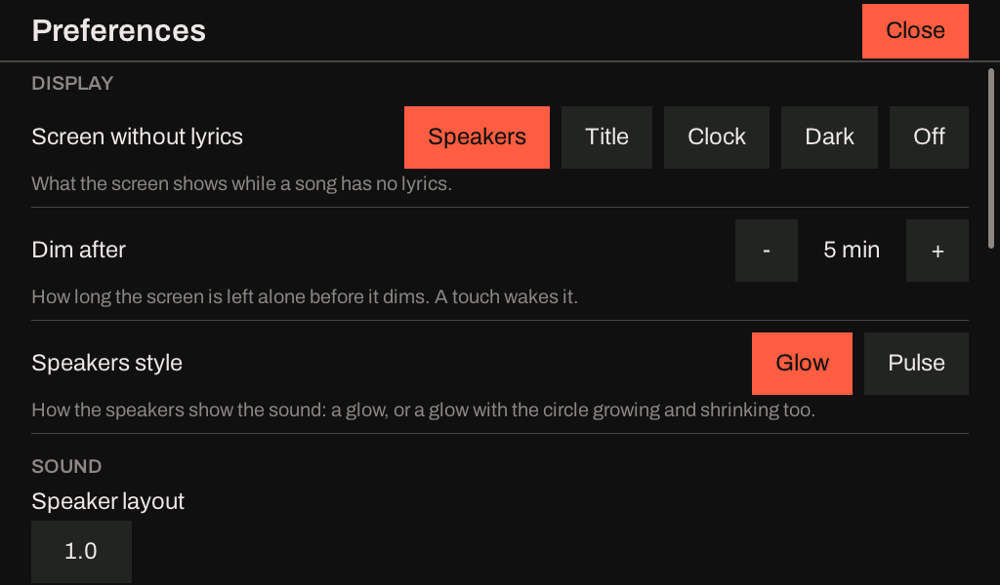
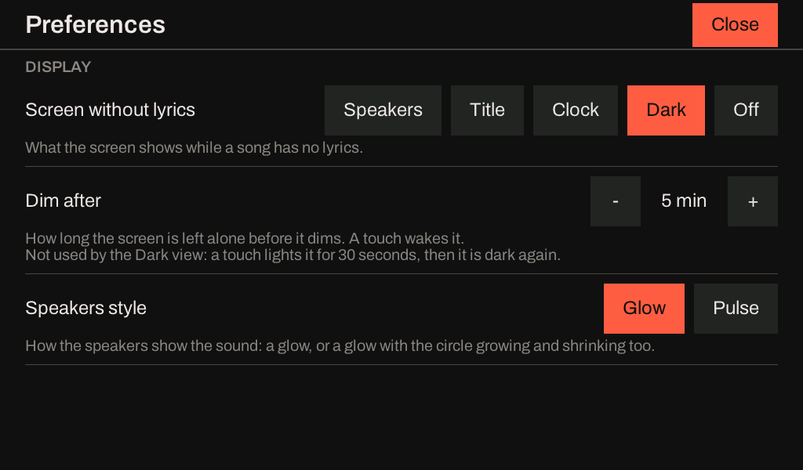
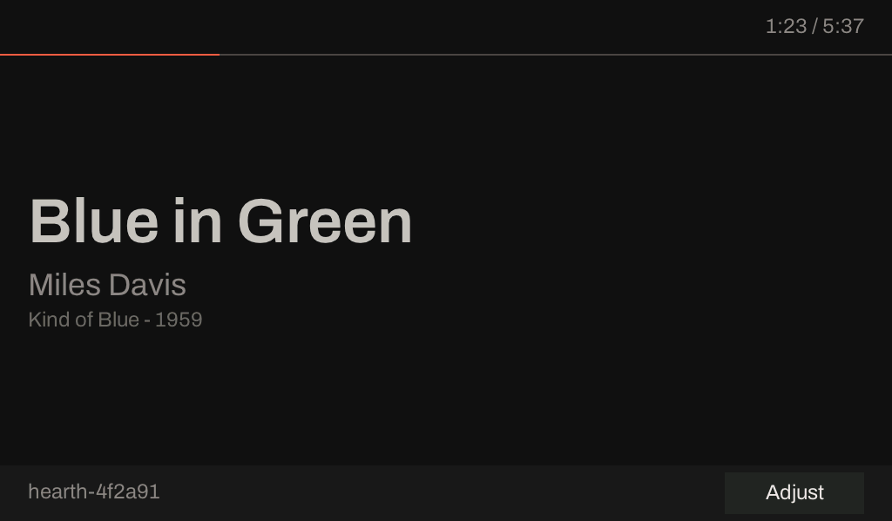
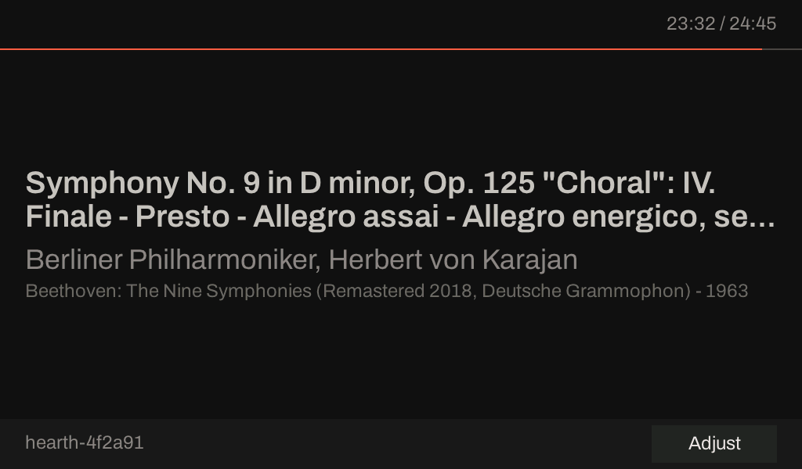
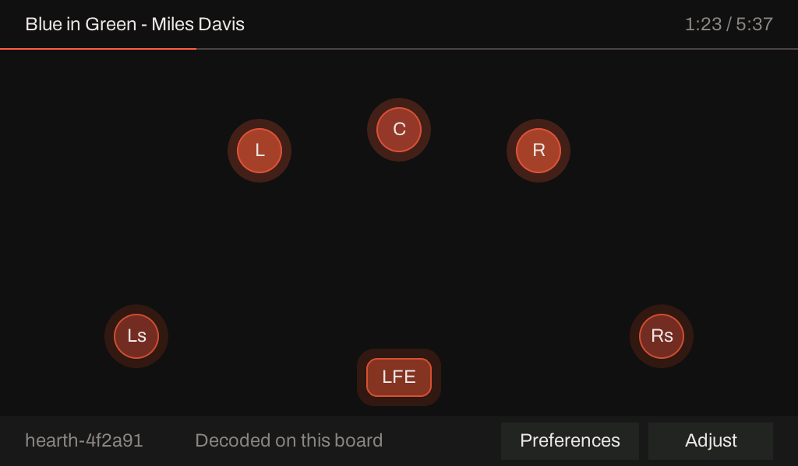

# What the P4X's panel shows while a song with no lyrics plays

!!! note "Status as of 2026-10-21: chosen by the owner; stages 1, 1b (dark), 2 and 3 built"
    The panel of [the P4X sink](karaoke-p4x-panel.md) draws the lyrics of the item playing, and the
    idle screen when nothing plays. A song with no lyrics (most of what a music server plays, and
    every surround programme that is not karaoke) had one sentence: "No lyrics for this item". The
    owner, on 2026-10-20: *"on the P4X, when we are not serving lyrics, what should we put on the
    screen? ... What can we put on the screen that isn't super distracting, and maybe in Adjust we can
    turn it on, turn it off."* This page is what the board knows while a song plays, the options that
    were drawn and shown, what the owner chose on 2026-10-21, and how it is built.

    | Stage | What | State |
    |---|---|---|
    | 1 | The setting (`GET` and `PUT /now-playing`, `/dim-after`, the Adjust sheet), the **speakers** view, dimming | Built; run on the kit: see [On the kit](#on-the-kit) |
    | 1b | The **dark** view: the backlight off until a touch lights the speakers for 30 s | Built; the rule tested on the host and in the preview tool, and run on the kit with a stream and injected taps; a finger and the glass not yet looked at: [The dark view](#the-dark-view) |
    | 2 | The **title card**: the sink asks the server for `metadata@v1` and draws what it sends | Built; run on the kit: see [Stage 2](#stage-2-the-title-card-as-built) |
    | 3 | The **clock**: the board gets the time and a time zone | Built, and widened by the owner to every ESP board; run on the kit: see [Stage 3, as built](#stage-3-the-clock) |
    | 4 | **Preferences** the owner picked on 2026-10-25: brightness, the clock's 12 or 24 hours, a night schedule, a time-zone picker | Built: brightness, the clock's format, the zone table, and the night schedule (settings, routes, the screen's use of it, the Preferences rows and the editors for its times and for the zone), on every board that can; nothing run on a kit yet: [Stage 4](#stage-4-display-and-time-preferences) |
    | 5 | The speakers **follow every window and can pulse**: the screen reads each 100 ms level, judges it against the room's loudest, and a `speakers style` (`glow` / `pulse`) | Built and host-tested, the preview run; the kit A/B is to do: see [Stage 5](#stage-5-the-speakers-follow-the-sound) |

    **2026-10-25: the view and the dim time moved out of Adjust.** The owner asked for Adjust to be only
    adjustments and for a **Preferences** sheet beside it for what is chosen once. Where this page says "the
    Adjust sheet" for the view, the dim time, the third row or the 352 px, it describes what was built
    on 2026-10-21; [Preferences](#preferences-2026-10-25) says what replaced it.

## What the board knows while a song plays

Read from the code, 2026-10-20; the levels and the layout are the Sendspin player's own status
(`BurstPlayer::status()`, `firmware/esp-idf/iclforge/include/iclforge/burst_player.hpp`), which the
kit's `GET /status` already reports.

| Fact | Where it comes from | Known |
|---|---|---|
| Each output's peak and RMS over the last 100 ms, in dB of full scale | The burst player's output stage, one pair per output slot, closed every 100 ms | **Yes**, for a coded stream and for PCM |
| The layout in force, and where each of its speakers is (azimuth, elevation, which is the LFE) | `OutputLayout` (`libs/render/include/iclforge/render/layout.hpp`): a name ("5.1", "7.1.4") or a list | **Yes** |
| The codec, the coded channel layout (`acmod`, LFE) and the objects a stream carries | The decoder's report, once a unit has decoded | **Yes** for Dolby Digital, Digital Plus and AC-4; PCM has none |
| The volume | The player's own state | Yes (not used by the screen) |
| Title, artist, album, the year, **the position in the song and its length** | `metadata@v1` | **No.** The sink's hello lists `_iclforge_player@v1` and `player@v1` and nothing else, so no server sends it. Without lyrics there is no document to carry a title either: the screen's old title line was cleared whenever no lyrics were held, so the sentence **never** showed one |
| Cover art | `artwork@v1` | **No**, for the same reason, and the board has no image decoder in the image |
| The time of day | A clock | **No.** Nothing in the firmware sets one (no SNTP, no time zone); a server's clock in Sendspin is a monotonic one, not wall time |

So the one view that needs nothing new is the one that shows the speakers, and it is the one that
only this board can show: a server does not know what the board is playing to.

## What it may cost

The panel's scan-out reads the frame out of PSRAM sixty times a second whatever is drawn, and that
is nearly all of what the glass costs a heavy stream: **a tenth of the decoder's time for AC-4 5.1,
and at layout 5.1 five of eighteen plays glitched with the glass on against one of thirty without a
scan-out** ([the second session on the kit](karaoke-p4x-panel.md#the-second-session-on-the-kit)).
Two things follow.

- **Drawing less is not the saving.** A screen that is almost black still costs its scan-out. A
  view's own cost is its drawing, and it has to stay small: the lyric screen's song filling cost the
  light streams 5 to 12% of their decode time and the heavy one 0.1 to 1%.
- **Nothing about a dark screen is known to save the scan-out.** Dimming turns the backlight down;
  whether the DSI engine can be stopped while the screen is dark (which would make a dark screen
  the cheapest of all, and might be worth something to the AC-4 5.1 glitches) has not been tried.

How much a view redraws was counted on a computer, which is exact for pixels and says nothing about
time: the pixels LVGL flushes a second over a minute of sample levels moving as music moves them
(`panel_preview`, "measure", from the prototype). A **continuous fade** of each speaker's glow in a
7.1.4 room flushed 1.7 million pixels a second, nine times the lyric screen's song filling (192,000);
the glow in **five steps, five times a second, with a quarter-step margin before it changes**
flushed 45,000 (5.1) and 81,000 (7.1.4). That is what stage 1 draws. The kit's own cost is in [On the
kit](#on-the-kit).

## The options

Drawn on 2026-10-20 from a prototype of each, by the firmware's own screen code
(`firmware/hearth-sink/preview`); the cover is a placeholder, and the title, the levels and the clock
are sample data. The prototype is not in the repository: stage 1's view is its speakers view, written
again, and the others are rebuilt for the stages that need them.

| | Option | Honest today? | Quiet in a dim room? | Cost |
|---|---|---|---|---|
| | **Today** | Yes, and says nothing | No: 56 px bright type, and a delay chip that does nothing | Nil |
| A | **Speakers**: the layout seen from above, each speaker glowing with its own level; a speaker with nothing on it goes hollow | **Yes**, all of it from the board's own status | Yes, if the glow is slow and capped (accent at 55% at its loudest) | A few small redraws; see above |
| B | **Title card**: title, artist, album, a thin progress line | Only when the server sends them | Yes: text, no motion but the line | The role, its parse, a small copy |
| C | **Cover and title** | Only with the artwork role, and a decode | The brightest thing a screen can show | A decoder, 260 KB of PSRAM a cover, unmeasured |
| D | **Clock** | Only with a clock the board does not have | Yes | SNTP, a time zone setting, and the board asking the network for the time |
| E | **Dark**: backlight to a floor, one line, a touch wakes it | Yes | The quietest | Nothing drawn, but the scan-out stays |

## The decision

The owner, 2026-10-21, after seeing the pictures:

- **Which view:** the owner chooses between **speakers, title card and clock** in Adjust (the cover
  is not wanted).
- **On or off out of the box:** **on**, showing the speakers. Off is the old sentence.
- **Where it lives:** the Adjust sheet gets a **third row and is taller** (352 px, not 240), not a
  second page.
- **Dimming:** after **5 minutes** with nothing touched the screen goes to **E**, the dark screen,
  and **any tap wakes it**. No swipe: there is one view at a time, chosen in Adjust.

What the decision leaves for the stages: the title card and the clock are in the sheet's list only
once the board can draw them, and `PUT /now-playing title` and `clock` answer 409 until then.

The owner, later on 2026-10-21, added one more choice to the same list: **a dark or off screen**, for
people who do not want a bright screen while they listen to music. *"A tap would turn the screen on
(just like when it's dimmed) and it would time out and go back to dark if not interacted with."* It is
one more view beside the speakers, the title card and the clock, not a change to dimming: see [The dark
view](#the-dark-view).

## Stage 1, as built

**The setting.** Two stored values, in NVS beside the others (`np_view`, `np_dim`), read at boot and
followed at once when they change, with no restart:

| Route | Takes | Default |
|---|---|---|
| `GET` and `PUT /now-playing` | `speakers`, `title`, `clock`, `off` or `dark` | `speakers` |
| `GET` and `PUT /dim-after` | `never`, or whole minutes from 1 to 240 | `5` |

Both are in the control surface's route list (`GET /api`) on a board that has a panel and answer 404
on one that has none. A stored number this build does not know (a partition written by a later
image) is said on the console and the default stands. The Preferences sheet's controls make the same change and
store it (through the same code: `iclforge::prefs::Backend`), and show what the routes set.

**The speakers view.** The layout in force, from above, front at the top, left on the left
(`libs/render/include/iclforge/render/room_plan.hpp`, 14 host test cases): ear-level speakers are
circles, height speakers rounded squares pulled in towards the listener by the cosine of their
elevation, the LFE a wide box along the bottom, each named inside its shape. Where two would touch
(a 9.1.6 room has a ceiling speaker over the listener) they are pushed apart; every layout the
grammar can name is tested to draw no two on each other. A speaker's **core** follows its RMS and its
**halo** its peak, each in a few steps; an output with nothing on it is a hollow outline, so a dead
centre is seen. The level rises at once and falls at 14 dB a second (the peak at 30), so the glow
does not follow every 100 ms window.

The header says what arrives and what it plays on: *Dolby Digital Plus 5.1 to 7.1.4*, *PCM to 2.0*
(`libs/device/include/iclforge/now_view.hpp`, 11 host test cases). A layout given as a list of
speakers, too long to say, is "6 outputs". The lyric delay chip in the footer is not shown: it does
nothing without lyrics.

**Dimming.** With the speakers showing, and nothing touched for the time set (counted from the last
touch or from when the speakers began to show, whichever is later, so a song started on a panel
nobody has touched for hours does not start dark), the backlight goes to 4% and a black cover with
one line over everything (*Playing - Dolby Digital Plus 5.1 to 5.1*). The cover is the object a
touch lands on, so the tap that wakes the screen does not press a button under it; the touch is
activity, and the next frame takes the cover away and puts the backlight back to 80%. Dimming is for
this screen only: the lyric screens and the idle screen are not dimmed (see [Open](#open)).

**What the screen reads.** `sendspin_now_playing()` (`sendspin.hpp`): one read of the player's status
under its own lock, five times a second, copied into a buffer that keeps its capacity so that a read
allocates nothing from the heap a decoder leaves little of. The room is parsed again only when the
layout text changes.

## The dark view

**What it is for.** Dimming leaves the screen on at 4% with a line of text after five minutes, which is
still a light in a dark room. The dark view is for a listener who wants none: the backlight is **off**
and the screen says nothing, from the moment a song with no lyrics begins.

**The rule**, one pure function in `libs/device/include/iclforge/now_view.hpp` (`dim_state`, 2 host test
cases) that the screen and the preview tool share:

- *Dark* from the moment the view begins to show, however long ago anything touched the panel: a touch
  from before the song is not a touch of this song, so a song that begins on a panel nobody has touched
  for an hour is dark at once.
- *Lit* after a touch, for `kDarkAwakeMs` (**30 s**) from the **last** touch: a second touch moves it on
  by as much. Then dark again. A touch lights the speakers view, which the dark view builds as well
  (the sentence screen when the board does not yet know its layout).
- The tap that wakes it lands on the black cover, which is the object a touch hits, so it does not also
  press what is under it: the same mechanism as the dimmed screen.
- The **dim time** (`/dim-after`, the sheet's *Dim after*) means nothing here and is not used, even
  *never*; the sheet says so by showing "30 seconds, then dark again" where it would show the dim
  times while Dark is chosen. The 30 s is a constant, not a setting; it is the one number the owner did
  not give, and is the thing to change if a tap should light the screen for longer or shorter.
- The **developer view keeps the screen lit while it is open** (it is read, not touched, and has no
  idle time of its own). The sheet needs no such rule: it puts itself away after eight seconds, well
  inside the 30.

**What it does not do.** It is for the no-lyrics screen only. The lyric screens are lit, as they must be
to be sung from, and the **idle screen is lit** (between two songs, or when a server has stopped, the
panel can light up in a dark view: whether the idle screen should follow is the question
[Open](#open) already asks about dimming, and the answer for one is the answer for the other).

**What was run.** The rule on the host (13 test cases in `test_now_view.cpp`, the speakers view's own
rule checked against `dimmed()` on every input it takes); the real screen code in the preview tool,
which fails its run if the screen is not dark at the start, is not lit by a touch, is not lit at 28 s,
is not dark at 32 s, or a second touch does not move it on (all pass); and a picture of the sheet:

**On the kit (2026-10-21, over the cable, the bench lock held).** The image of this change (`p4-rev3`,
profile hash `ff9b27a6c4fd`, 2,562,880 bytes) was sent with `ota.py push` and accepted on its 30 s
trial. `PUT /now-playing dark` answered 200 and the panel's read-back said `view: dark`; a 400 for
`Dark` (the words are lower case) and for anything else. Then `hearth-testserver` played the E-AC-3 5.1
test programme (`testdata/external-baseline/eac3-51-256`, no lyrics) over Sendspin to layout 5.1 for
190 s, on a panel nobody had touched for hours, while the panel's read-back (`GET :8081/panel`: `dimmed`,
`backlight`) was sampled twice a second and taps were injected (`POST :8081/panel/tap`); `T1`, `T2` and
`T3` are the taps:

| Tried | Result |
|---|---|
| The song begins on an untouched panel | dark at once (backlight 0, 5 s after the request, as soon as the screen showed) |
| `T1`: a tap on *Adjust* while dark | lit (backlight 80) within 0.8 s, and **the sheet did not open** (the frame's Close button was not there) |
| Left alone after `T1` | dark again **30.1 s** after the tap |
| `T2`, then `T3` 20 s later | still lit at 20 s; lit 27 s after `T3` (47 s after `T2`); dark **30.2 s** after `T3` |
| `PUT /now-playing speakers` while dark | lit at once and kept |
| `PUT /now-playing dark` again, nothing touched for over 30 s | dark at once |

Nine checks, nine passes (`scratchpad` script, not in the repository). The timings are the read-back's, at
half a second, and the injected tap is not a finger. **Not looked at on the kit:** a real finger's tap, the
glass with its backlight off (the read-back is the frame buffer and the PWM duty, not the light), and
whether the idle screen lights up between two songs of a real playlist. The kit was put back as found
(view `speakers`, dim after 5 minutes, the test server's pairing record forgotten).

## Stage 2: the title card, as built

**The role.** The sink lists `metadata@v1` in its hello, on a board with a screen only (a board with
none would be sent a message at every track and pause for nothing). The player's session already ran
the role for a client that lists it (`libs/sendspin/src/player_session.cpp`: the `server/state` object
reaches `PlayerListener::on_server_state()`); the host now forwards it (`SendspinEvents::on_metadata()`
and `on_metadata_gone()`, `firmware/esp-idf/iclforge`), and `kSinkMaxJsonTokens` (512) covers the largest
message a server sends.

**The store** (`libs/device/include/iclforge/title_card.hpp`, 8 host cases): title (256 bytes), artist
and album (160 each) and year, cut at a character and not in the middle of one, in strings reserved when
the store is made (in PSRAM where the part has it, `PsramScope`), so that an update and the panel's reads
allocate nothing from the internal heap; and the progress with the time it was told at. The song's
position is that progress advanced at its speed on the board's own clock (the role's calculation,
`metadata::position_ms`, kept with the progress's own timestamp so that an object that names only a title
does not move the song). It is read five times a second and copied into the screen's buffers only when the
store's revision moved. A connection that ends, or is displaced, clears it.

**Two servers say the same object two ways** ([planning/hearth-sendspin-extension.md](hearth-sendspin-extension.md),
C36), and a null and a field left out read alike in `metadata::State`, so the reader now keeps which fields
were null (`metadata::null_fields`, `ServerState::metadata_nulls`; 3 new checks in `test_messages.cpp`):

| Server | What it sends | The store |
|---|---|---|
| The specification, and **aiosendspin 10.x (Music Assistant now)** | The whole state each time, a field it has not got left out, an omitted `progress` clearing the position, a cleared state as an object with only a `timestamp` | Replaces: what the object leaves out is gone |
| aiosendspin 9.1.1 (C36) | The first object whole, then only what changed, a cleared field as `null` | Merges: left out stays, null clears |

The first row was read from aiosendspin's source on 2026-10-21 (`server/roles/metadata/group.py`:
`_state_message` sends `Metadata.snapshot_update()`, "the full current state", with `omit_none`; Music Assistant's
Sendspin provider calls `set_metadata(metadata)` with no timestamp, so a change applies at once) and agrees
with what the owner's Music Assistant reported on the kit that day: the **specification** dialect. The dialect
chooses the rule (`TitleUpdate::whole`), and the console says which it used (*metadata (whole state): ...*).
**Not handled:** a state stamped in the future (aiosendspin can schedule one up to 20 s ahead; Music Assistant
does not) takes effect when it arrives, not at its time; the console line says how far ahead it was stamped.

**The view.** The title in 72 down to 34 px by its length (the lyric line's `current_size()`, and the same
Smaller and Larger steps), in two rows at most, cut with three dots; the artist in 36 px muted; the album and
year in 24 px, a step further back; the block in the middle of the stage; the song's time at the top right
and the progress line under the header, as the lyric screens have them (tile B of the options picture). The
title card is the third choice in Adjust, `now_view_drawn(kTitle)` is true and `PUT /now-playing title`
answers 200. **No title, no card:** with the card chosen and no title said, or one the fonts cannot draw
(`drawable_title()`), the speakers show in its place, and failing those the sentence; the artist and album go
with an undrawable title, and one that is undrawable alone is left out. When the title is known the speakers'
header says *Title - Artist* with the time at the right and the progress line under it. The card dims as the
speakers do; its dark screen names the song. A title is a rebuild of the card (about 44 ms, once, when it
changes), the time and the line are two labels.

Found on the way: the header's clock label was 120 px wide and cut a long piece's time (*23:32 / 24:45* showed
as *:32 / 24:45*); it is 176 px now, and no other picture changed.

## Stage 3: the clock

The board had no time. The plan proposed SNTP started only while the clock view was chosen, a time zone
as a POSIX string, and a view that shows nothing until a server has answered. The owner, building it,
widened the first of those on 2026-10-21 (in chat, while it was being built): *"If we are supporting a
clock, let's make sure that there's ntp support (via dhcp or manually configured)"*; *"Ntp support should
be on all esp hardware"*; and, asked whether a board with no screen should ask a time server always, only
with a clock on show or only on request, **"Always, on every board"**; then *"You can configure it via the
web server on each board, have sensible defaults, ideally on by default, dhcp can set the default ntp
server"*. So the time is **not the panel's**: it is a facility of every board that has a network, and the
clock view reads it.

**As built** (all in [The time of day](../docs/hearth/sink-esp32-p4.md#the-time-of-day) in the sink's page):

- **The facility** (`firmware/hearth-sink/main/wall_clock.hpp`, a seam like the network beside it):
  `clock/sntp/` for every build with a Wi-Fi station or a wired network (all the hardware: S3, C6, the P4 boards,
  the P4X) and `clock/none/` for a build with no network and for QEMU's, which has no time server to ask and
  must not make CI depend on one. lwIP's SNTP client, started when the board holds an address (the address
  event, and a one-second upkeep as well), an hour apart after the first answer.
- **Which server:** the one a person named (`PUT /ntp-server`, a host name or an IPv4 address), else the
  router's over DHCP (option 42: `CONFIG_LWIP_DHCP_GET_NTP_SRV`, and `net/stack.cpp` turns on lwIP's flag so
  the lease's server is kept from the first lease on), with `pool.ntp.org` behind it **only when nobody named
  a server** (naming one says where the time comes from, and a LAN with no way out is a reason to). A lease
  rewrites lwIP's table (the router's server takes slot 0 and the others are emptied), so the board
  looks at it once a second and puts it back.
- **Defaults:** on (`PUT /time-sync off` for a board that must contact none), no server named, UTC. The
  settings are in NVS (`time_sync`, `ntp_server`, `time_zone`), on `GET` and `PUT` routes of the control
  surface on every board that keeps time (404 on the others), and in a **Time section of each board's own
  web page** with the time it keeps and how it got it; `GET /status` has a `time` object.
- **The zone** is a POSIX string (`AEST-10AEDT,M10.1.0,M4.1.0/3`), because IDF has no zone database and a
  list of names would be a table to keep. `libs/device/include/iclforge/wall_clock.hpp` reads it (a zone with
  daylight saving must give its rules); the board's own C library must then read it the same way on a day in
  January and a day in July, or it is refused.
- **The view:** the time in 24 hours in the 200 px semibold face at about 80% of the muted token, the date
  at 36 px at about 60%, a sentence saying UTC while no zone is set, and **until the first answer only the
  stream's heading, never a time it made up** (the facility says no time until a server has answered, forgets
  it when `time-sync` goes off, and takes none from before 2026). The minute redraws one rectangle (the preview
  counts 224,000 pixels for a minute and none for a second). A dim leaves it on the glass: the backlight goes to
  its floor and the cover over it is clear, which still takes the tap that wakes the screen.
- **Tests:** 17 host cases in `libs/device/tests/test_wall_clock.cpp` (the grammar, the offsets, the servers,
  the calendar, the words), the device page's stand-in held to the same lists
  (`apps/demos/wasm/tests/device-ui/contract.spec.js`), the preview's scenarios (the clock with and without a
  zone, before an answer, a minute and a second, a dim and a tap).

**What the owner did not say, and was decided:** with a server named the pool is not asked (a person who
names a server is saying where the time comes from; the router's, a local server too, is still second); a
board that is turned `off` shows no time at all rather than an old one; the page budget went from 57,344 to
65,536 bytes for the Time section and its list of zones (the image has room); a zone is a string and not a name, so the page offers a list of 42 zones and cities (*UTC+10 Melbourne,
Sydney, Hobart, Canberra*) that sets the string, and a field for any other, and the 400 says why.

## Stage 4: display and time preferences

The owner, 2026-10-25, picked four things for the new Preferences screen (the programme's brief is
`planning/p4x-preferences.md`, which is not in the tree yet): **brightness**, the **clock in 12 or 24 hours**, a
**night schedule** ("go dark between two times") and a **time-zone picker**. They are built as settings and
routes first, for any board with the capability (a screen with a backlight, a clock), and drawn on the
Preferences screen when that exists; nothing here is the P4X's alone.

**Brightness** (plan D6 said "not a setting"; it is now). The lit level of the backlight is stored (`bright`,
10 to 100 percent, 80 unless set; Kconfig `ICLFORGE_EXAMPLE_BRIGHTNESS_PERCENT`) and followed at once:
`GET` and `PUT /brightness` take any whole number in that range, and the Preferences stepper moves it by 10. The
screen asks for one of three named levels (lit, dimmed, off) and the panel seam gives the glass the person's
level for the first, **the dim floor (4%) under it, never above it** for the second, and 0 for the third
(`iclforge::nowview::backlight_percent`, host-tested for every level from 10 to 100): a screen set as low as
the floor does not light up when it dims. The developer view still forces the screen lit, at the person's level.
A glass with no backlight to dim (the frame buffer a board with no panel runs) has no brightness: `PUT` is a
409 and `DisplayCaps::backlight` is false, which is what the Preferences entry reads to grey itself with the
reason.

**The clock's format.** `GET` and `PUT /clock-format` take `24`, `12`, `24 seconds` or `12 seconds` (stored as one
number, `clock_fmt`: bit 0 the 12-hour clock, bit 1 the seconds, 0 the default). 12 hours has no leading zero
and no hour 0 (midnight is 12:05 AM). The digits stay in the 200 px face; **what goes small beside them (the
seconds, AM or PM) is a label of its own**, so a second that passes redraws about 9,600 pixels and not the
digits' 300,000 (the preview counts both, and fails its run if a second with the seconds off flushes anything).
The text is made in `libs/device/include/iclforge/wall_clock.hpp` (`face()`, host-tested at every hour of the
day) and handed to the view in the clock's reading, so the drawing code changed only where the time's text is set.

**The night schedule.** Dark between two times of day, by the board's own local time (the stored zone and the
converged SNTP time): `dim_state()` in `now_view.hpp` takes the schedule and the board's local minute of the day
and, while the schedule is in force, **any no-lyrics view is the dark view**: dark from the moment it begins to
show, lit for 30 s by a touch, the cover swallowing the wake tap. The rule, and what it was held to on the host:

| Case | Rule |
|---|---|
| A window across midnight (22:00 to 07:00) | in from 22:00 to 06:59, out at 07:00; a window inside one day is the same rule |
| From equal to to | an empty window, **never dark** (a whole day is the dark view) |
| A clock that has not converged | the schedule is not in force and a lit screen stays lit: the panel passes no minute at all, not the zeroed reading, which is 00:00 and inside a window that wraps midnight |
| Daylight saving | kept by the wall clock. Melbourne's changeovers are tested at the real instants (2026-10-04 and 2026-04-05, and 2027 and 2028): the night the clocks go forward is eight real hours of dark and the night they go back ten, with no gap at the jump; a window that starts in the hour that does not exist begins at the jump, and one that starts in the hour lived twice is dark in both passes |
| Night begins while a song plays | lit until nothing has touched the glass for 30 s, then dark |

**The setting is one number.** `night` in NVS holds the two times and both switches (from in bits 0 to 10, to in
bits 11 to 21, bit 22 on, bit 23 the idle screen: `nowview::night_stored`, host-tested for every state and for numbers no
build wrote), so that a power cut cannot leave half a schedule; Kconfig `ICLFORGE_EXAMPLE_NIGHT_SCHEDULE`
(`22:00-07:00 off`) and `ICLFORGE_EXAMPLE_NIGHT_IDLE` (0) are what a board has before anyone chooses. `parse_night_schedule`
reads `22:00-07:00` (the times, and on), `on`, `off` (the times kept) or both (`22:00-07:00 off`) and `night_schedule_text`
writes `22:00-07:00 on`: those are what `GET` and `PUT /night-schedule` say and take (a PUT with no screen is a 409, a body
that is none of them a 400). Reset preferences returns it to the defaults; the time zone it is read in stays. The panel is
handed the schedule and the board's local minute of the day in `NowSettings` (the minute is read only while the schedule
is on, and is nothing until the clock has converged), and `lyric_screen.cpp` passes both to `dim_state()`: that is all
the screen does for it, a line and a half. Days of the week are not in it.

**The idle screen is a separate setting, and off.** Whether the night schedule also darkens the idle screen between
two songs is the question [Open](#open) already asks about dimming, and the owner has not answered it. It will be
its own setting (`night-idle`, `on` or `off`, default `off`; `NightSchedule::idle`; `GET` and `PUT /night-idle`, and a
switch of its own in Preferences, *Night covers idle screen*, which says *Used while the night schedule is on* while the
schedule is off). With it on, the idle screen (nothing playing, nothing held) counts as showing while the night is in
force, so `dark_state()` is its rule: dark from the moment the night begins, a tap lights it for 30 s
(`night_covers_idle`, host-tested, and driven on the screen by the preview tool). Both are there to try; nothing is
decided here.

**The time-zone picker.** The board has no zone database, so a zone is still a POSIX string; what is new is a table
of the zones people choose by region and city, each with the string its rules end in. It is generated, not written:
`tools/hearth/gen_time_zones.py` reads IANA's tzdata (public domain; release 2026e, from the `tzdata` package) and
writes `libs/device/include/iclforge/time_zone_data.hpp`, which is checked in with it.

| | |
|---|---|
| Entries | **420**: tzdata's own `zone.tab` (418, one per country and zone, so Amsterdam and Oslo are there), `UTC`, and `Australia/Canberra` (a link to Sydney that `zone.tab` leaves out) |
| Australia | all of it: Adelaide, Brisbane, Broken Hill, Canberra, Darwin, Eucla, Hobart, Lindeman, Lord Howe, Melbourne, Perth, Sydney |
| Regions | Africa 52, America 144, Antarctica 11, Arctic 1, Asia 82, Atlantic 10, Australia 12, Europe 58, Indian 11, Pacific 38, Other 1 (UTC) |
| Flash | **11,578 bytes**: 3,360 for the 420 rows (two 4-byte pointers each), 6,910 for the names, 1,308 for the 89 distinct strings (420 names share them: Melbourne, Sydney, Hobart and Canberra are one) |
| Held to tzdata | `gen_time_zones.py --verify` reads every string a second time and compares it with the offsets Python's `zoneinfo` gives at every change from 2026-11-02 to 2036, found to the second: 4,500 changes, **0 disagreements**. glibc, asked through `TZ` in WSL, reads every string the same way at 2,680 instants around the 2027 and 2028 changes (0 disagreements). The C++ evaluator is held to the same real instants for 16 zones (Melbourne, Sydney, Adelaide, Lord Howe, Hobart, New York, Los Angeles, London, Dublin, Berlin, Santiago, Nuuk, Cairo, Auckland, Troll and Gaza), 2027 and 2028 |

Two things in the data that a person may not expect. **A string rules only from its zone's last explicit
transition**: in 2026e Vancouver, Edmonton, Winnipeg and Inuvik settle on a permanent time on 2026-11-01 and Casablanca
on 2026-09-20, so their strings are right from those days (and before them by the luck of the offsets); Gaza and
Hebron have explicit transitions to 2086 and agree with their string to 2036, which is as far as `--verify` looks.
And **`UTC+10` is ten hours west**: it is a valid POSIX string, and the table's `UTC` is the zone people mean.

*Which choice is kept.* `PUT /timezone` still takes a POSIX string and `none`, and now also **a name from the
table** (`PUT /timezone Australia/Melbourne`), which stores both. The name goes in a second NVS key (`tz_name`),
because a string cannot say which city was meant (89 strings stand for 420 names) and the screen must show
*Melbourne*; a reverse lookup was rejected for that reason, since Melbourne, Sydney, Hobart and Canberra are the
same string. The string stays the key the clock reads (`time_zone`, unchanged, so a board that goes back to an
older image still tells the right time). The two never disagree: a name the table does not know is dropped at boot,
a typed string stores no name, and **a name the table knows says the zone**, so a release that changes a city's
rules moves the boards that chose that city and no others. `GET /time-zones` lists the names, one a line (sent in
pieces: 8 KB is never one allocation), and `GET /status`'s `time` object has `zone_name`. The device web page
offers the same list as a region and a city: it asks the board for the names, and no longer carries a list of 42
zones of its own, so the page is 50 bytes smaller.

**The string is never shown** (owner, 2026-10-26: a board set through the page before the picker showed
`AEST-10AEDT,M10.1.0,M4.1.0/3` on the Preferences screen, and once picked read *Melbourne (Australia)*). A zone is read as
its place (`wallclock::zone_readable`): the name chosen, else the table's place for the exact string (for a string several
places share, the most populous, written down by the generator as `PREFERRED`: Melbourne for the Australian east coast,
Berlin for central Europe, New York for the American east), else its offset (*UTC+09:45 (custom)*, with *with daylight
saving* when the rule has one). The lookup is display only and nothing is stored from it, so Reset preferences still
keeps what it kept. The Preferences row, the picker's *Now* line and the place it is marked at, `GET /status`'s `time`
(`zone_place`, `zone_label`) and the device page all read it; `GET /timezone` and `zone` keep the string for tools. The
page's field for a zone not in the list is never filled in.

**The editors** (`panel/lvgl/prefs_editors.cpp`). A `kText` entry that wants one names it (`Pref::editor`), the sheet
draws its value as a button, and a tap on it opens the editor over the sheet, with a *Done* of its own. **The times**: a
row each for *From* and *To*, each a minus, the time and a plus; a tap steps a quarter of an hour round the clock
(`night_time_stepped`, host-tested for every minute of the day), a held button steps ten times a second and after eight
steps an hour at a time, and the pair is written half a second after the last step (a held button is one write). **The
zone**: the regions of the table and *No zone (UTC)*, then the places in a region, opening at the region of the zone
already chosen with that place in view; the title is the region, the way back a *Regions* button (a chevron on a bar
narrower than 400 px), and a tap on a place chooses it. Both are drawn from the sheet's own metrics and held to its rules
by the preview tool at 1024 by 600, 800 by 480, 480 by 320, 320 by 240 and 240 by 240 (every target 48 px or more,
nothing cut off, the longest list, America's 144 places, scrolled); a typed zone stays the web page's and the route's.

**What the night schedule and the editors cost** (images built here, each held to its profile by `sink_profile.py verify`):
the P4X's grew 16,032 bytes (2,646,640 to 2,662,672: the editors, the six rows, the routes and the setting), the S3's 7,168
and the C6's 7,280, which are boards with no panel and so none of the screen's code: the setting, the two routes, the
registry's new rows and the backend. The 4 MB C6's slot (1,966,080 bytes, the same image as the 16 MB profile's) is left
with 53,648 bytes free, where the zone table alone left 73,024.

**Not built, not decided.** Days of the week. A zone typed on the screen. The idle screen under the night schedule is the
owner's to decide. Nothing has been run on the kit.

## Stage 5: the speakers follow the sound

The owner, 2026-10-25, asked for the speakers to be "a little more dynamic ... reacting", was shown seven options
(rings, three bands, Atmos objects, a phantom image of where the sound is, waveform tiles, edge light, and the image
with the objects: [planning/p4x-speakers-options.md](p4x-speakers-options.md)) and chose none: *"rather than a full
redesign, the today visualisation would be more responsive to the audio, and perhaps a variant of the rings where
the audio levels cause a growing/shrinking of the speaker circle (when it was filled in) but not excessively so."*
So stage 5 is that, and nothing from the seven:

- **The glow is more responsive.** The screen reads the levels itself every frame (`BurstPlayer::levels()`,
  `sendspin_now_levels()`, `read_now_levels()`: a lock and two short arrays) and follows every window the player
  closes; it read the status at 5 Hz and so saw every other one. A level is judged against the loudest the room has
  lately been (`LevelCeiling`), so the same music shows the same at any volume. Six core steps over 30 dB, the
  level falling 60 dB a second, 0.4 of a step of margin, two halo steps. Chosen over a synthetic groove
  (`preview/speakers_options/tune.cpp`): 72% of 5 dB onsets show in the same window (3 to 26% before), 3 to 5% of
  steady windows move a step; 18 / 56 / 82 / 101 thousand pixels a second at 2.0 / 5.1 / 7.1.4 / 9.1.6, where the
  first design's host estimate was 45 and 81 thousand at 5.1 and 7.1.4 (and cost a burst 0.4% on the kit).
- **A style, `glow` (the default) or `pulse`** (`GET` and `PUT /speakers-style`, NVS `np_style`, `SpeakersStyle` in
  `now_view.hpp`): in `pulse` the filled circle is one of eight sizes between 88% and 112% of the plan's (`Pulse`,
  `kPulseReach`), following the level over 18 dB with its own smoothing, three sizes a window at most, held until a
  quarter size past an edge, and a speaker 18 dB or more under the room's loudest does not move. The halo is not
  resized, which halves what a size change redraws. 33 / 96 / 129 / 166 thousand pixels a second in the same rooms.
- **Not changed:** `LV_INV_BUF_SIZE` (LVGL redraws the whole screen when more than 32 separate rectangles are
  invalid in a refresh). Measured with 32 and 128 the glow is identical in every room and the pulse differs only at
  9.1.6 (166 against 144 thousand), so the compile definition is not worth carrying. It matters for any busier view:
  the bands option flushed 5.5 million pixels a second in a 7.1.4 room with 32 and 0.27 million with 128.
- **The owner's decision** (2026-10-25, after a picture and an animation of the old glow, the new glow and the pulse in 2.0
  and 5.1): the pulse stays at plus and minus 12% as drawn, and both styles stay as a choice, glow (the new
  responsive one) the default. The setting becomes a Preferences registry entry (choice, group Display) once that
  branch has merged; until then it is `PUT /speakers-style`.
- **To do on the kit:** the A/B of `burst_us` (E-AC-3 5.1, stereo PCM, AC-4 5.1) with the old glow, the new glow and
  the pulse, in alternating order, against the +0.4% the first design cost a 5.1 burst; and the owner's eye on the
  glass.

## Open

- **The idle screen is not dimmed.** It is on for hours too (Q7 of the panel's plan). The owner's
  answer was about this screen; whether idle follows is a question for the owner. It matters more now
  that there is a dark view: a listener who chose it may see the idle screen light up between two
  songs, if the server ends one stream before it starts the next. Whether it does has not been looked
  at on the kit. The night schedule asks the same question ([Stage 4](#stage-4-display-and-time-preferences)): it
  is its own setting, `night-idle`, off, until the owner says.
- **Does a dark screen save the scan-out?** Stopping the DSI engine while the cover is up is the
  experiment; the kit's AC-4 5.1 glitches are the reason to try it.
- **Brightness** was not a setting (plan D6) and is one now, on the Preferences screen and `PUT /brightness`
  ([Stage 4](#stage-4-display-and-time-preferences)); the Adjust sheet stays as it is.
- **Music Assistant, live.** It had not reconnected to the kit by 22:00Z on 2026-10-21, an hour after the
  title-card image went on (the same happened after each earlier reflash), so what the owner's Music Assistant
  sends this role has been read from aiosendspin's source and not seen on the board. When it connects and plays,
  `python tools/hearth/bench.py log P4X` shows each object as *sendspin: metadata (whole state): ...* with how
  far ahead it was stamped.

## Preferences (2026-10-25)

The owner, 2026-10-25: *"There is a screen with an Adjust button, and the Adjust sheet holds: what the screen does for a
song with no lyrics, dim after, text size, lyric delay. ... the adjustment screen should just be for adjustments, and
there should be a **Preferences** button as well."* And: *"It is not just for the P4X ... If it were a C3 or an S3 with a
screen, Preferences should still work ... a generic product base that different hardware versions then run with
different supported configurations."*

**What was built** (the foundation; [docs/hearth/sink-esp32-p4.md](../docs/hearth/sink-esp32-p4.md#adjust-and-preferences)
has the pictures and the sizes):

- **Adjust** keeps the lyric delay and the text size: 250 px tall (it was 352), put away after eight seconds untouched.
- **Preferences**, a button beside Adjust in the footer: a full-screen scrollable list, grouped Display, Sound,
  Network, Time, Updates and System, drawn from a registry. *What the screen shows for a song with no lyrics* (the
  five views of this page) and *Dim after* (a stepper: 1, 5, 15, 30 minutes, 1, 2, 4 hours, never) are in it; the dim
  time is greyed, with a sentence, while Dark is chosen.
- **A capability description** (`iclforge::BoardCaps`, `libs/device`), filled once at boot from the build and the
  hardware, and **availability** per preference and per choice against it. A choice the board cannot make is shown
  greyed with its reason (a screen with no touch cannot offer Dark or a dim time; a board that keeps no time cannot
  offer the clock); `board_variants.hpp` has every board the product knows, plus an S3 and a C3 with a 320 by 240 panel
  and no touch, and the host tests walk each entry against each.
- **`GET /preferences`**, read-only, on every board: the same registry as JSON, which the web page will draw from.
- **Sizes from the display**, not 1024 by 600: `screen_metrics.hpp`, a 48 px fingertip floor, and a preview that draws
  and checks both sheets at four sizes.

**Decided without asking** (the owner can say otherwise): Preferences is a full sheet and not a half one (a list of
many entries needs the room, and Adjust stays the small one); it puts itself away after a minute, not eight seconds (a
list is read, and Adjust is a tweak); Adjust stays at the right of the footer, where tools tap it, with Preferences to
its left; the dim time is a stepper over a few stops, and a number a `PUT` stored that is not a stop is shown as it is
("7 min"); the dim time is greyed and not hidden while Dark is chosen.

**Not built:** the other preferences (the speaker layout, the speakers' style, brightness, the clock's format, the
network choice, updates: other sessions of the same programme, plugging into this registry), a display backend for a
chip other than the P4, and a measurement of what Preferences costs on the kit (see the docs page).

## On the kit

**2026-10-21, the kit with its bench lock, over the cable.** The image is `p4-rev3` from this branch
(profile hash `ff9b27a6c4fd`, 2,532,784 bytes, 40% of the 4 MB slot free), sent with `ota.py push` to
the cable's address, accepted on its 30 s trial. It was built from the commit before the last one of
the stage (the difference is the preview's CMake file), and an S3 image of the tree (no panel) builds
as well.

| Tried | Result |
|---|---|
| The two routes: both words, each refusal (`400` for a bad word or time, `409` for `title` and `clock`), and a time of `never`, `1` and `5` | 20 of 20 as the stand-in says; the panel's read-back followed at once (`view`) |
| `POST /restart` with `off` and `30` set | both back after the restart, then set again |
| The Adjust sheet, by injected taps (`POST :8081/panel/tap`) | Adjust, Off, Speakers, 30 min, Never, 5 min and Close each did what they say, the routes read the same back, and the chosen buttons were the accent in the read-back |
| A stream: `hearth-testserver` playing the E-AC-3 5.1 test programme `testdata/external-baseline/eac3-51-256` over Sendspin to layout 5.1, no lyrics | The read-back is the designed picture: *Dolby Digital Plus 5.1 to 5.1*, six speakers lit, the delay chip gone |
| Dimming: `dim-after 1`, the same play | Dark **60.4 s** after the speakers began to show; a tap woke it and did not open the sheet |

**What the view costs a stream.** The same E-AC-3 5.1 programme over Sendspin, 60 s, layout 5.1, the
view `speakers` against `off`, in alternating order, three plays each; then a stereo music programme
(`eac3-music-stereo-96`, layout 2.0), two each, and the 5.1 programme to 7.1.4, one each. The burst is
the board's mean time to decode and render one, `/status`'s `burst_us`:

| Programme and layout | `off` | `speakers` | Late, underruns, resyncs | Panel refreshes a play (off, speakers) |
|---|---|---|---|---|
| E-AC-3 5.1 to 5.1 | 4,555 µs (4,545-4,563) | 4,573 µs (4,571-4,575) | 0, 0, 0 in all six | 4 to 6, 70 to 84 |
| E-AC-3 stereo music to 2.0 | 2,114 µs (both) | 2,099 µs (2,096-2,102) | 0, 0, 0 in all four | 4 to 5, 18 to 20 |
| E-AC-3 5.1 to 7.1.4 | 5,696 µs | 5,712 µs | speakers 0, 0, 0; off 5 late (see below) | 4, 81 |

- **The view costs a burst nothing that can be told from the spread**: +18 µs (0.4%) at 5.1, -15 µs
  at 2.0 and +16 µs at 7.1.4, where the spread of the plays of one view is as large. The least free
  internal heap at the end of a play was 101.5 to 104.0 KB at 5.1 with either view (the 7.1.4 layout
  leaves 29 KB, 29,103 with the view off and 28,847 with it on, which is the layout's and not the
  panel's), and the panel task's late cycles were 2 or 3 a play with either view (a rebuild at the
  start and the end).
- **What it draws is small.** A play at 5.1 with the test programme, whose levels hardly move, redrew
  70 to 84 times, about one a second, and 18 to 20 times with the stereo music in a minute; the
  pixels LVGL flushed over a play were 3.9 million at most with the speakers and 1.9 to 2.9 million
  with the view off (which is a few full frames, the stream's start and end), so the speakers' own
  redraw is on the order of 15,000 pixels a second. The host's count for sample levels moving as music
  moves them was 45,000 to 81,000, against 192,000 for the lyric screen's song filling.
- **A play with the view off, at 7.1.4, lost its first second** (5 late bursts, 7,680 frames lost, no
  underrun): the delay at the start of a stream that the P4X's Sendspin plays have shown, which the
  lwIP receive mailbox change in PR #1610 is for, with the screen not drawing anything. The first play
  of the series, at 5.1 with the speakers, had it too (2 late, 3,072 frames lost at the start).

**Not checked.** The brightness of the glass at 4%: the read-back is the frame buffer, and the
backlight is a PWM that no picture shows. A finger's tap on the glass in place of an injected one (the
same pointer path, and the sheet's buttons were found under a finger on the first day). A glow
moving with real 5.1 music: the 5.1 programme is a test stream. The scan-out's cost, which is the
same whatever is drawn and is what dimming leaves alone.

### Stage 2, the title card

**2026-10-21, the kit with its bench lock, over the cable.** The image is `p4-rev3` from this branch
(commit `a7bfa153a`, profile hash `ff9b27a6c4fd`, 2,567,920 bytes against stage 1's 2,532,784, before main took
its later changes), sent with
`ota.py push`, accepted on its 30 s trial. Its slot is the one the clock session's image shared the version
string with, so the two were told apart by `PUT /now-playing title` (200 here, 409 there).

| Tried | Result |
|---|---|
| `PUT /now-playing`: `title`, `clock`, `Title`, `speakers` | 200, **409** (the clock is still not drawn), 400, 200; `GET` followed each; 10 of 10 checks |
| The Adjust sheet, by injected taps | Adjust, Title, Speakers and Title each set the view and the route read it back; the Title button is the accent in the read-back |
| `POST /restart` with `title` set | `title` came back |
| `hearth-testserver` (new `--title`, `--artist`, `--album`, `--year`, `--track-seconds`, and `--then-after` with `--then-title`: a second song with no artist, album or year) over Sendspin to layout 5.1 | **What the server sent**: `metadata (whole state): none` at activation, then `title "Blue in Green" artist "Miles Davis" album "Kind of Blue" year 1959 progress 0/337000 x1000, stamped -2 ms`, then `title "Evening News" progress 0/337000 x1000, stamped -1 ms`, then `none` when the play ended. **What the screen drew** (`GET :8081/panel.bmp`): the card as designed, then the second song alone, no artist and no album kept from the first, the time `0:12 / 5:37` and the line moving, the card rebuilt once at the change (44 ms), and the speakers' screen again when it ended |
| The card chosen and a play that says nothing | the speakers, with *Dolby Digital Plus 5.1 to 5.1* in the header: no empty card |
| A 119-character title, a long artist and album, a 24-minute song | two rows ending in three dots, the artist and the album and year one row each, and `0:08 / 24:45` whole |
| `dim-after 1`, the card, the same play | Dark **60.3 s** after the card began to show; the dark screen said *Playing - Blue in Green - Miles Davis*; a tap woke it (not opening the sheet) and the card was back at `1:05 / 5:37` |

**What the view costs a stream.** The programmes and layouts of stage 1, 60 s each, the view `off`, `speakers`
(its header now the song) and `title`, in alternating order, `metadata@v1` said in every play so that what the
role itself costs is in all three; `/status`'s `burst_us`, the board's mean time to decode and render a burst:

| Programme and layout | `off` | `speakers` | `title` | Late, underruns, resyncs |
|---|---|---|---|---|
| E-AC-3 5.1 to 5.1 (three plays each) | 5,325 µs (5,318-5,329) | 5,341 µs (5,322-5,354) | 5,333 µs (5,320-5,345) | 0, 0, 0 in all nine |
| E-AC-3 stereo music to 2.0 (two each) | 2,614 µs (2,606-2,621) | 2,628 µs (2,625-2,630) | 2,633 µs (2,624-2,642) | 0, 0, 0 in all six |
| E-AC-3 5.1 to 7.1.4 (three off, two speakers, three title) | 6,475 µs (6,469-6,486) | 6,478 µs (6,446-6,509) | 6,491 µs (6,479-6,499) | 0, 0, 0 in all eight |

- **The view costs a burst +3 to +19 µs (0.05 to 0.7%)**, inside the spread of the plays of one view at 7.1.4
  and at the edge of it elsewhere. The least free internal heap at the end of a play was 98.7 to 101.9 KB at 5.1
  with any view (24 to 26 KB at 7.1.4; one title play left 20.2 KB, the other two 24.3 and 24.7).
- **The role costs nothing that shows.** The clock session's image (this tree's base with no `metadata@v1`, run
  from the other slot by `ota.py rollback`) played the 5.1 programme with the view off at 5,364 µs (5,340-5,376,
  three plays, 99.2 to 102.2 KB of heap) against 5,325 µs here. Stage 1's 4,555 µs and the clock session's 4,564 µs are other plays, and may be another encoder's file (the
  board suite plays `ffmpeg.ec3`, this run `dee.ec3`); the comparison is this tree's own base.
- **What it draws is small.** About 5.7 redraws a second (the song's time once a second and the progress line
  three pixels a second at this length, 384 to 396 a play against 4 with the view off), and 0.5 to 1.1 million
  more pixels over a 68 s play than with the view off, which is 7,000 to 16,000 a second. The cost is the same
  for the card and for the speakers' header.

**Not checked.** The owner's Music Assistant (see [Open](#open)); a finger's tap in place of an injected one; a
title in a script the fonts lack on the board (the preview draws it, `hearth-testserver` takes its arguments in
the console's code page, which cannot carry one); a scheduled state, which no server here sends.

### Stage 3, the time of day and the clock

**The time of day and the clock view, 2026-10-21, the kit over the cable.** `p4-rev3` with the time on every
board (v0.10.0-beta.1-5170-g3b92a7511), sent with `ota.py push`, accepted on its 30 s trial; the kit's name is
`hearth-e753f9`, its router `192.168.1.5` gives a time server over DHCP (option 42).

| Tried | Result |
|---|---|
| Nothing touched: the board has just booted, sync is on by default | asking from boot, `servers` = `192.168.1.5 (from DHCP), pool.ntp.org`, first answer within seconds; the board's `22:04:35` against the PC's `22:04:34` UTC |
| `PUT /ntp-server 0.au.pool.ntp.org`, then `none` | answered 2.1 s after naming it (the server list became `0.au.pool.ntp.org [162.159.200.123], 192.168.1.5 (from DHCP)`), and 5.3 s after `none`; `pool.ntp.org:123` is a 400 |
| `PUT /time-sync off`, 30 s, then `on` | `asking` and `synced` false and the time gone at once; **answers 3 and 3 thirty seconds later (no request went out)**; back on, synced in 3.2 s |
| `PUT /timezone AEST-10AEDT,M10.1.0,M4.1.0/3` | `2026-10-21 09:05:20` against the PC's local `09:05:18`; JST-9, `<+0530>-5:30` and `EST5EDT,...` moved it by the right hours |
| Every zone the page lists (42), and 15 others (negative daylight saving, quoted names, rule times past a day) | 57 of 57 read by picolibc as written (the January/July check passed); a string that is not a zone, `AEST-10AEDT` without rules and `AEST-25` are 400s |
| `POST /restart` with the zone set | zone, server and sync came back as stored, and the time again 2.1 s after the board answered |
| The clock view on the glass, a Sendspin play (`GET :8081/panel.bmp`) | the designed picture with the real time: `09:06 Wednesday 21 October` in AEDT, `21:09 Tuesday 20 October` and the UTC sentence before a zone was set |

**What the clock costs a stream.** The 5.1 E-AC-3 programme over Sendspin, 60 s, layout 5.1, the view
`clock` against `off` in alternating order, three plays each (time sync on in both, since it is on in all):

| | `clock` | `off` |
|---|---|---|
| Burst, `/status`'s `burst_us` | 4,561, 4,573, 4,565 (mean 4,566) | 4,551, 4,577, 4,565 (mean 4,564) |
| Late, underruns, resyncs, invalid | 0 in all three | 0 in all three |
| Free internal heap at the end | 99,067, 98,687, 96,419 | 97,231, 96,851, 97,867 |

**The clock view costs a burst 2 µs (0.04%)**, which the spread of the plays of one view (26 µs) hides, with the
same heap. The test server's sockets while it played: one outbound TCP connection to the board's Sendspin
port and one unbound-peer UDP socket on an ephemeral port; no listening TCP socket.

**Not checked on the kit.** A finger's tap on the glass in place of an injected one; the dim with the clock
chosen (the preview checks it: backlight at its floor, the clock still lit, a touch wakes it); the S3, C6 and
P4 boards of the bench were built (S3 and QEMU's shape fit and hold to their profiles) and not flashed.
