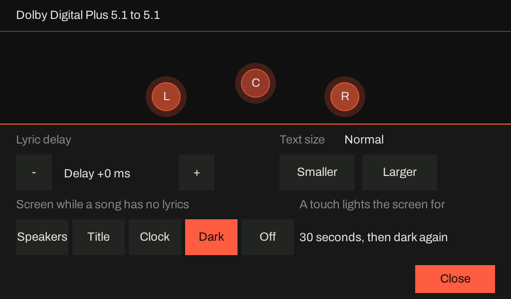

# What the P4X's panel shows while a song with no lyrics plays

!!! note "Status as of 2026-10-21: chosen by the owner; stage 1 built; stages 2 and 3 not started"
    The panel of [the P4X sink](karaoke-p4x-panel.md) draws the lyrics of the item playing, and the
    idle screen when nothing plays. A song with no lyrics (most of what a music server plays, and
    every surround programme that is not karaoke) had one sentence: "No lyrics for this item". The
    owner, on 2026-10-20: *"on the P4X, when we are not serving lyrics, what should we put on the
    screen? ... What can we put on the screen that isn't super distracting, and maybe in Adjust we can
    turn it on, turn it off."* This page is what the board knows while a song plays, the options that
    were drawn and shown, what the owner chose on 2026-10-21, and how it is built.

    | Stage | What | State |
    |---|---|---|
    | 1 | The setting (`GET` and `PUT /now-playing`, `/dim-after`, the Adjust sheet), the **speakers** view, dimming | Built; run on the kit: see [On the kit](#on-the-kit) |
    | 1b | The **dark** view: the backlight off until a touch lights the speakers for 30 s | Built; the rule tested on the host and in the preview tool, and run on the kit with a stream and injected taps; a finger and the glass not yet looked at: [The dark view](#the-dark-view) |
    | 2 | The **title card**: the sink asks the server for `metadata@v1` and draws what it sends | Not started; [what it needs](#stage-2-the-title-card) |
    | 3 | The **clock**: the board gets the time and a time zone | Not started; [what it needs](#stage-3-the-clock) |

## What the board knows while a song plays

Read from the code, 2026-10-20; the levels and the layout are the Sendspin player's own status
(`BurstPlayer::status()`, `firmware/esp-idf/iclforge/include/iclforge/burst_player.hpp`), which the
kit's `GET /status` already reports.

| Fact | Where it comes from | Known |
|---|---|---|
| Each output's peak and RMS over the last 100 ms, in dB of full scale | The burst player's output stage, one pair per output slot, closed every 100 ms | **Yes**, for a coded stream and for PCM |
| The layout in force, and where each of its speakers is (azimuth, elevation, which is the LFE) | `OutputLayout` (`libs/render/include/iclforge/render/layout.hpp`): a name ("5.1", "7.1.4") or a list | **Yes** |
| The codec, the coded channel layout (`acmod`, LFE) and the objects a stream carries | The decoder's report, once a unit has decoded | **Yes** for Dolby Digital, Digital Plus and AC-4; PCM has none |
| The volume | The player's own state | Yes (not used by the screen) |
| Title, artist, album, the year, **the position in the song and its length** | `metadata@v1` | **No.** The sink's hello lists `_iclforge_player@v1` and `player@v1` and nothing else, so no server sends it. Without lyrics there is no document to carry a title either: the screen's old title line was cleared whenever no lyrics were held, so the sentence **never** showed one |
| Cover art | `artwork@v1` | **No**, for the same reason, and the board has no image decoder in the image |
| The time of day | A clock | **No.** Nothing in the firmware sets one (no SNTP, no time zone); a server's clock in Sendspin is a monotonic one, not wall time |

So the one view that needs nothing new is the one that shows the speakers, and it is the one that
only this board can show: a server does not know what the board is playing to.

## What it may cost

The panel's scan-out reads the frame out of PSRAM sixty times a second whatever is drawn, and that
is nearly all of what the glass costs a heavy stream: **a tenth of the decoder's time for AC-4 5.1,
and at layout 5.1 five of eighteen plays glitched with the glass on against one of thirty without a
scan-out** ([the second session on the kit](karaoke-p4x-panel.md#the-second-session-on-the-kit)).
Two things follow.

- **Drawing less is not the saving.** A screen that is almost black still costs its scan-out. A
  view's own cost is its drawing, and it has to stay small: the lyric screen's song filling cost the
  light streams 5 to 12% of their decode time and the heavy one 0.1 to 1%.
- **Nothing about a dark screen is known to save the scan-out.** Dimming turns the backlight down;
  whether the DSI engine can be stopped while the screen is dark (which would make a dark screen
  the cheapest of all, and might be worth something to the AC-4 5.1 glitches) has not been tried.

How much a view redraws was counted on a computer, which is exact for pixels and says nothing about
time: the pixels LVGL flushes a second over a minute of sample levels moving as music moves them
(`panel_preview`, "measure", from the prototype). A **continuous fade** of each speaker's glow in a
7.1.4 room flushed 1.7 million pixels a second, nine times the lyric screen's song filling (192,000);
the glow in **five steps, five times a second, with a quarter-step margin before it changes**
flushed 45,000 (5.1) and 81,000 (7.1.4). That is what stage 1 draws. The kit's own cost is in [On the
kit](#on-the-kit).

## The options

Drawn on 2026-10-20 from a prototype of each, by the firmware's own screen code
(`firmware/hearth-sink/preview`); the cover is a placeholder, and the title, the levels and the clock
are sample data. The prototype is not in the repository: stage 1's view is its speakers view, written
again, and the others are rebuilt for the stages that need them.

| | Option | Honest today? | Quiet in a dim room? | Cost |
|---|---|---|---|---|
| | **Today** | Yes, and says nothing | No: 56 px bright type, and a delay chip that does nothing | Nil |
| A | **Speakers**: the layout seen from above, each speaker glowing with its own level; a speaker with nothing on it goes hollow | **Yes**, all of it from the board's own status | Yes, if the glow is slow and capped (accent at 55% at its loudest) | A few small redraws; see above |
| B | **Title card**: title, artist, album, a thin progress line | Only when the server sends them | Yes: text, no motion but the line | The role, its parse, a small copy |
| C | **Cover and title** | Only with the artwork role, and a decode | The brightest thing a screen can show | A decoder, 260 KB of PSRAM a cover, unmeasured |
| D | **Clock** | Only with a clock the board does not have | Yes | SNTP, a time zone setting, and the board asking the network for the time |
| E | **Dark**: backlight to a floor, one line, a touch wakes it | Yes | The quietest | Nothing drawn, but the scan-out stays |

## The decision

The owner, 2026-10-21, after seeing the pictures:

- **Which view:** the owner chooses between **speakers, title card and clock** in Adjust (the cover
  is not wanted).
- **On or off out of the box:** **on**, showing the speakers. Off is the old sentence.
- **Where it lives:** the Adjust sheet gets a **third row and is taller** (352 px, not 240), not a
  second page.
- **Dimming:** after **5 minutes** with nothing touched the screen goes to **E**, the dark screen,
  and **any tap wakes it**. No swipe: there is one view at a time, chosen in Adjust.

What the decision leaves for the stages: the title card and the clock are in the sheet's list only
once the board can draw them, and `PUT /now-playing title` and `clock` answer 409 until then.

The owner, later on 2026-10-21, added one more choice to the same list: **a dark or off screen**, for
people who do not want a bright screen while they listen to music. *"A tap would turn the screen on
(just like when it's dimmed) and it would time out and go back to dark if not interacted with."* It is
one more view beside the speakers, the title card and the clock, not a change to dimming: see [The dark
view](#the-dark-view).

## Stage 1, as built

**The setting.** Two stored values, in NVS beside the others (`np_view`, `np_dim`), read at boot and
followed at once when they change, with no restart:

| Route | Takes | Default |
|---|---|---|
| `GET` and `PUT /now-playing` | `speakers`, `title`, `clock`, `off` or `dark` | `speakers` |
| `GET` and `PUT /dim-after` | `never`, or whole minutes from 1 to 240 | `5` |

Both are in the control surface's route list (`GET /api`) on a board that has a panel and answer 404
on one that has none. A stored number this build does not know (a partition written by a later
image) is said on the console and the default stands. The sheet's buttons make the same change and
store it, and the sheet shows what the routes set.

**The speakers view.** The layout in force, from above, front at the top, left on the left
(`libs/render/include/iclforge/render/room_plan.hpp`, 14 host test cases): ear-level speakers are
circles, height speakers rounded squares pulled in towards the listener by the cosine of their
elevation, the LFE a wide box along the bottom, each named inside its shape. Where two would touch
(a 9.1.6 room has a ceiling speaker over the listener) they are pushed apart; every layout the
grammar can name is tested to draw no two on each other. A speaker's **core** follows its RMS and its
**halo** its peak, each in a few steps; an output with nothing on it is a hollow outline, so a dead
centre is seen. The level rises at once and falls at 14 dB a second (the peak at 30), so the glow
does not follow every 100 ms window.

The header says what arrives and what it plays on: *Dolby Digital Plus 5.1 to 7.1.4*, *PCM to 2.0*
(`libs/device/include/iclforge/now_view.hpp`, 11 host test cases). A layout given as a list of
speakers, too long to say, is "6 outputs". The lyric delay chip in the footer is not shown: it does
nothing without lyrics.

**Dimming.** With the speakers showing, and nothing touched for the time set (counted from the last
touch or from when the speakers began to show, whichever is later, so a song started on a panel
nobody has touched for hours does not start dark), the backlight goes to 4% and a black cover with
one line over everything (*Playing - Dolby Digital Plus 5.1 to 5.1*). The cover is the object a
touch lands on, so the tap that wakes the screen does not press a button under it; the touch is
activity, and the next frame takes the cover away and puts the backlight back to 80%. Dimming is for
this screen only: the lyric screens and the idle screen are not dimmed (see [Open](#open)).

**What the screen reads.** `sendspin_now_playing()` (`sendspin.hpp`): one read of the player's status
under its own lock, five times a second, copied into a buffer that keeps its capacity so that a read
allocates nothing from the heap a decoder leaves little of. The room is parsed again only when the
layout text changes.

## The dark view

**What it is for.** Dimming leaves the screen on at 4% with a line of text after five minutes, which is
still a light in a dark room. The dark view is for a listener who wants none: the backlight is **off**
and the screen says nothing, from the moment a song with no lyrics begins.

**The rule**, one pure function in `libs/device/include/iclforge/now_view.hpp` (`dim_state`, 2 host test
cases) that the screen and the preview tool share:

- *Dark* from the moment the view begins to show, however long ago anything touched the panel: a touch
  from before the song is not a touch of this song, so a song that begins on a panel nobody has touched
  for an hour is dark at once.
- *Lit* after a touch, for `kDarkAwakeMs` (**30 s**) from the **last** touch: a second touch moves it on
  by as much. Then dark again. A touch lights the speakers view, which the dark view builds as well
  (the sentence screen when the board does not yet know its layout).
- The tap that wakes it lands on the black cover, which is the object a touch hits, so it does not also
  press what is under it: the same mechanism as the dimmed screen.
- The **dim time** (`/dim-after`, the sheet's *Dim after*) means nothing here and is not used, even
  *never*; the sheet says so by showing "30 seconds, then dark again" where it would show the dim
  times while Dark is chosen. The 30 s is a constant, not a setting; it is the one number the owner did
  not give, and is the thing to change if a tap should light the screen for longer or shorter.
- The **developer view keeps the screen lit while it is open** (it is read, not touched, and has no
  idle time of its own). The sheet needs no such rule: it puts itself away after eight seconds, well
  inside the 30.

**What it does not do.** It is for the no-lyrics screen only. The lyric screens are lit, as they must be
to be sung from, and the **idle screen is lit** (between two songs, or when a server has stopped, the
panel can light up in a dark view: whether the idle screen should follow is the question
[Open](#open) already asks about dimming, and the answer for one is the answer for the other).

**What was run.** The rule on the host (13 test cases in `test_now_view.cpp`, the speakers view's own
rule checked against `dimmed()` on every input it takes); the real screen code in the preview tool,
which fails its run if the screen is not dark at the start, is not lit by a touch, is not lit at 28 s,
is not dark at 32 s, or a second touch does not move it on (all pass); and a picture of the sheet:

**On the kit (2026-10-21, over the cable, the bench lock held).** The image of this change (`p4-rev3`,
profile hash `ff9b27a6c4fd`, 2,562,880 bytes) was sent with `ota.py push` and accepted on its 30 s
trial. `PUT /now-playing dark` answered 200 and the panel's read-back said `view: dark`; a 400 for
`Dark` (the words are lower case) and for anything else. Then `hearth-testserver` played the E-AC-3 5.1
test programme (`testdata/external-baseline/eac3-51-256`, no lyrics) over Sendspin to layout 5.1 for
190 s, on a panel nobody had touched for hours, while the panel's read-back (`GET :8081/panel`: `dimmed`,
`backlight`) was sampled twice a second and taps were injected (`POST :8081/panel/tap`); `T1`, `T2` and
`T3` are the taps:

| Tried | Result |
|---|---|
| The song begins on an untouched panel | dark at once (backlight 0, 5 s after the request, as soon as the screen showed) |
| `T1`: a tap on *Adjust* while dark | lit (backlight 80) within 0.8 s, and **the sheet did not open** (the frame's Close button was not there) |
| Left alone after `T1` | dark again **30.1 s** after the tap |
| `T2`, then `T3` 20 s later | still lit at 20 s; lit 27 s after `T3` (47 s after `T2`); dark **30.2 s** after `T3` |
| `PUT /now-playing speakers` while dark | lit at once and kept |
| `PUT /now-playing dark` again, nothing touched for over 30 s | dark at once |

Nine checks, nine passes (`scratchpad` script, not in the repository). The timings are the read-back's, at
half a second, and the injected tap is not a finger. **Not looked at on the kit:** a real finger's tap, the
glass with its backlight off (the read-back is the frame buffer and the PWM duty, not the light), and
whether the idle screen lights up between two songs of a real playlist. The kit was put back as found
(view `speakers`, dim after 5 minutes, the test server's pairing record forgotten).

## Stage 2: the title card

The sink lists `metadata@v1` in its hello. The player's session already runs the role for a client
that lists it (`libs/sendspin/src/player_session.cpp`: the `server/state` object reaches
`PlayerListener::on_server_state()`), and `kSinkMaxJsonTokens` (512) covers the largest message a
server sends. What is new on the board is a small store of what it says (title, artist, album,
progress with the duration) under the player's lock, and the view. The song's position is the
state's `progress` advanced on the board's own clock (`metadata::position_ms`). Music Assistant sends
the role to a client that lists it; **the first run with the owner's server decides what it sends**,
and the view says nothing it was not told. Until the role is listed no server sends anything, so
the title card would be empty: that is why it waits.

When the title is known the speakers view uses it too: the header becomes *Title - Artist* with the
time at the right and the progress line under it, as the lyric screens' header is.

## Stage 3: the clock

The board has no time. What stage 3 adds, with the defaults I would take and the owner can change:

- **SNTP, started only when the clock view is the one chosen** (the board contacts no time server
  otherwise), with the servers the router hands out over DHCP and `pool.ntp.org` behind them.
- **A time zone** as a POSIX string (`AEST-10AEDT,M10.1.0,M4.1.0/3`), stored in NVS and set by
  `PUT /timezone`; with none set the clock says UTC and says so. IDF has no zone database, and a
  list of names would be a table to keep.
- A 24-hour clock and the date, in the muted tone; until the first answer from a time server the
  view shows nothing but the stream's heading, and never a time it made up.

## Open

- **The idle screen is not dimmed.** It is on for hours too (Q7 of the panel's plan). The owner's
  answer was about this screen; whether idle follows is a question for the owner. It matters more now
  that there is a dark view: a listener who chose it may see the idle screen light up between two
  songs, if the server ends one stream before it starts the next. Whether it does has not been looked
  at on the kit.
- **Does a dark screen save the scan-out?** Stopping the DSI engine while the cover is up is the
  experiment; the kit's AC-4 5.1 glitches are the reason to try it.
- **Brightness** is still not a setting (plan D6): the sheet has room for a fourth row only by being
  taller again or by a second page.

## On the kit

**2026-10-21, the kit with its bench lock, over the cable.** The image is `p4-rev3` from this branch
(profile hash `ff9b27a6c4fd`, 2,532,784 bytes, 40% of the 4 MB slot free), sent with `ota.py push` to
the cable's address, accepted on its 30 s trial. It was built from the commit before the last one of
the stage (the difference is the preview's CMake file), and an S3 image of the tree (no panel) builds
as well.

| Tried | Result |
|---|---|
| The two routes: both words, each refusal (`400` for a bad word or time, `409` for `title` and `clock`), and a time of `never`, `1` and `5` | 20 of 20 as the stand-in says; the panel's read-back followed at once (`view`) |
| `POST /restart` with `off` and `30` set | both back after the restart, then set again |
| The Adjust sheet, by injected taps (`POST :8081/panel/tap`) | Adjust, Off, Speakers, 30 min, Never, 5 min and Close each did what they say, the routes read the same back, and the chosen buttons were the accent in the read-back |
| A stream: `hearth-testserver` playing the E-AC-3 5.1 test programme `testdata/external-baseline/eac3-51-256` over Sendspin to layout 5.1, no lyrics | The read-back is the designed picture: *Dolby Digital Plus 5.1 to 5.1*, six speakers lit, the delay chip gone |
| Dimming: `dim-after 1`, the same play | Dark **60.4 s** after the speakers began to show; a tap woke it and did not open the sheet |

**What the view costs a stream.** The same E-AC-3 5.1 programme over Sendspin, 60 s, layout 5.1, the
view `speakers` against `off`, in alternating order, three plays each; then a stereo music programme
(`eac3-music-stereo-96`, layout 2.0), two each, and the 5.1 programme to 7.1.4, one each. The burst is
the board's mean time to decode and render one, `/status`'s `burst_us`:

| Programme and layout | `off` | `speakers` | Late, underruns, resyncs | Panel refreshes a play (off, speakers) |
|---|---|---|---|---|
| E-AC-3 5.1 to 5.1 | 4,555 µs (4,545-4,563) | 4,573 µs (4,571-4,575) | 0, 0, 0 in all six | 4 to 6, 70 to 84 |
| E-AC-3 stereo music to 2.0 | 2,114 µs (both) | 2,099 µs (2,096-2,102) | 0, 0, 0 in all four | 4 to 5, 18 to 20 |
| E-AC-3 5.1 to 7.1.4 | 5,696 µs | 5,712 µs | speakers 0, 0, 0; off 5 late (see below) | 4, 81 |

- **The view costs a burst nothing that can be told from the spread**: +18 µs (0.4%) at 5.1, -15 µs
  at 2.0 and +16 µs at 7.1.4, where the spread of the plays of one view is as large. The least free
  internal heap at the end of a play was 101.5 to 104.0 KB at 5.1 with either view (the 7.1.4 layout
  leaves 29 KB, 29,103 with the view off and 28,847 with it on, which is the layout's and not the
  panel's), and the panel task's late cycles were 2 or 3 a play with either view (a rebuild at the
  start and the end).
- **What it draws is small.** A play at 5.1 with the test programme, whose levels hardly move, redrew
  70 to 84 times, about one a second, and 18 to 20 times with the stereo music in a minute; the
  pixels LVGL flushed over a play were 3.9 million at most with the speakers and 1.9 to 2.9 million
  with the view off (which is a few full frames, the stream's start and end), so the speakers' own
  redraw is on the order of 15,000 pixels a second. The host's count for sample levels moving as music
  moves them was 45,000 to 81,000, against 192,000 for the lyric screen's song filling.
- **A play with the view off, at 7.1.4, lost its first second** (5 late bursts, 7,680 frames lost, no
  underrun): the delay at the start of a stream that the P4X's Sendspin plays have shown, which the
  lwIP receive mailbox change in PR #1610 is for, with the screen not drawing anything. The first play
  of the series, at 5.1 with the speakers, had it too (2 late, 3,072 frames lost at the start).

**Not checked.** The brightness of the glass at 4%: the read-back is the frame buffer, and the
backlight is a PWM that no picture shows. A finger's tap on the glass in place of an injected one (the
same pointer path, and the sheet's buttons were found under a finger on the first day). A glow
moving with real 5.1 music: the 5.1 programme is a test stream. The scan-out's cost, which is the
same whatever is drawn and is what dimming leaves alone.
